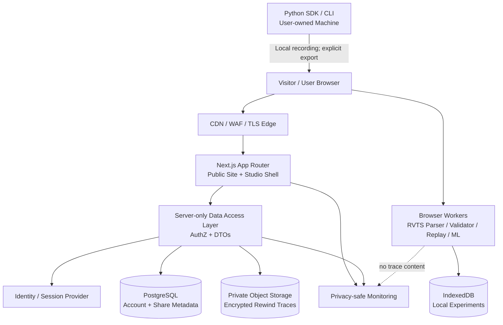
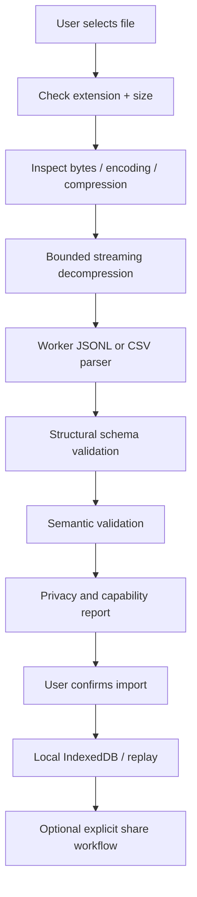

# REWINDVERSE

## Security Architecture & Implementation Standard

**Product promise:** Train a model, then replay how it learned.  
**Tagline:** Every Model Has a Story.  
**Main application:** Rewind Studio  
**Security posture:** Local-first by default, least privilege, zero trust at service boundaries, secure-by-design, privacy by default, and evidence-based release gates.

> **Important security statement**  
> No website can honestly guarantee protection from *every* malicious attack. This document defines a layered security programme intended to reduce attack likelihood and impact, detect abuse, protect visitors and users, and recover safely. RewindVerse must not advertise itself as “unhackable” or “100% secure”. Security claims must be supported by current test evidence, reviewed scope and disclosed limitations.

---

# Document control

| Field | Value |
|---|---|
| Product | RewindVerse |
| Primary experience | Rewind Studio |
| Domain packages | RewindML, Rewind Replay, Rewind Insights, Rewind Compare, Rewind Academy |
| Trace interchange | Rewind Trace / RewindVerse Training Trace Specification (RVTS) |
| Parent product specification | RewindVerse Final PRD, Edition 4.1 |
| Parent technical specification | RewindVerse Technical Stack Final, Version 2.0 |
| Parent design specification | RewindVerse Website Design & Engineering Standards |
| Security owner | To be assigned before public beta |
| Document owner | Product & Engineering |
| Review cadence | Every release; quarterly security review; immediately after a material incident or architecture change |
| Applicable baseline | OWASP ASVS 5.0.0; OWASP Top 10:2025; OWASP API Security Top 10:2023; NIST SSDF 1.1; NIST CSF 2.0 |
| Status | Design baseline. Controls are not considered implemented until verified in code and evidence is retained. |

## How to use this document

1. Treat this document as the security source of truth for RewindVerse implementation.
2. Every `SEC-*` requirement must map to one or more code changes, tests, configuration checks, operational controls or an approved risk exception.
3. The PRD defines product behaviour. This document adds security requirements and can make a product requirement more restrictive where safety requires it.
4. The technical stack document defines technologies. This document defines how to configure and use them securely.
5. The security team or assigned owner must review new data flows, integrations, upload types, sharing behaviour, authentication changes and server-side processing before release.
6. A checkbox is not evidence. Link the test output, configuration, code review, penetration test result or runbook that proves the control.

---

# 1. Executive security recommendation

RewindVerse should use a **local-first, data-minimising and capability-aware architecture**. Core learning workflows—browser training, trace import, validation, replay and export—should run in the user's browser. Cloud services should be limited to optional identity, account metadata, read-only sharing, classroom features and controlled object storage.

The highest-risk RewindVerse assets are not only passwords and account records. They include user-created Rewind Traces, imported CSV files, experiment names, annotations, model metadata, share links, email addresses, access tokens, application secrets, Python package releases and the integrity of the browser code that processes all of those assets.

The strongest product-specific security rules are:

- **Never execute user-supplied code.** Uploaded traces, CSV files and metadata are data, not programs.
- **Never deserialize untrusted Python pickle/joblib objects.** The browser product must not accept them as executable model files.
- **Parse untrusted trace files in a dedicated worker with strict resource limits.** A worker is a responsiveness and isolation boundary, not a complete security sandbox.
- **Never infer or render unrecorded model state as fact.** Capability declarations and data provenance are integrity and trust requirements as well as product semantics.
- **Keep trace contents local unless the user explicitly chooses to share them.** Analytics must never receive trace contents, raw dataset samples, gradients, parameter arrays or annotations.
- **Make sharing private by default.** Public sharing must be explicit, scoped, revocable and time-bounded where feasible.
- **Enforce authorization on the server for every object operation.** Hiding a button in the UI is not access control.
- **Use a narrow backend.** No arbitrary notebooks, shell commands, model execution, file conversion jobs or user code execution in web request handlers.
- **Defend against resource exhaustion.** File size, decompressed size, record count, parsing depth, runtime, storage, API throughput and export size require limits.
- **Build security into delivery.** Dependency scanning, secret scanning, SAST, tests, staged DAST, code review, backups and incident response are release requirements.

## 1.1 Security objectives

| Objective | Desired outcome | Evidence required |
|---|---|---|
| Confidentiality | Only the intended user or audience can access account data and private traces | Authorization tests, storage policy tests, access logs and penetration test |
| Integrity | Traces, release artifacts and account settings cannot be silently modified by unauthorized parties | Schema/semantic validation, immutable audit events, checksum verification and signed build provenance |
| Availability | Malformed files and abusive traffic cannot exhaust the application or shared service | Quotas, timeouts, rate limits, load tests and recovery drills |
| Privacy | Users understand what is local, stored, shared and collected | Data inventory, consent UX, privacy review and network/analytics tests |
| Authenticity | Users can identify the legitimate RewindVerse service and trusted downloads | TLS, domain controls, secure release pipeline and official download guidance |
| Safety | No unsafe uploaded code execution or misleading diagnostic claims | Architecture review, negative tests and product-content review |
| Recoverability | The team can contain incidents, restore data and communicate clearly | Tested runbooks, backups, restore evidence and incident exercises |

## 1.2 Security assurance target

Use **OWASP ASVS 5.0.0 Level 2 as the target verification baseline** for the production web application and API, with selected Level 3-style controls for high-risk areas such as authentication, sensitive sharing, file processing and administrative functions. This is a project target, not a certification claim. The security owner must create a traceable ASVS control matrix and document applicability and exclusions.

For the first public release, no unresolved Critical or High severity security findings may remain in the production scope. Medium findings require a documented risk owner, mitigation and due date. A penetration test by a qualified independent tester is required before enabling public accounts, public trace sharing or classroom/team data.

---

# 2. Product security architecture and trust boundaries

## 2.1 System boundary

The application consists of the public marketing site, Rewind Studio, browser-side domain packages, optional account and sharing services, database, private object storage, deployment platform, telemetry providers and developer/release infrastructure.



## 2.2 Trust boundaries

| Boundary | Data crossing it | Main risks | Required controls |
|---|---|---|---|
| Internet → CDN/WAF | HTTP requests, headers, query strings | DDoS, bots, request smuggling, malformed requests | TLS, WAF, request size limits, rate limiting, safe edge config |
| CDN → Next.js | Route and page requests | Header trust, cache leaks, origin bypass | Trusted proxy configuration, origin restrictions, cache policy review |
| Browser → API/BFF | JSON, forms, identifiers, share requests | CSRF, XSS-assisted actions, injection, IDOR, mass assignment | Zod validation, origin/CSRF validation, DAL authorization, rate limits |
| Browser → file parser worker | RVTS, gzip, CSV, user text | Parser bugs, decompression bombs, memory exhaustion, XSS payloads | Worker isolation, limits, parser hardening, inert rendering |
| Browser → IndexedDB | Local traces and metadata | XSS access, local device exposure, corrupted state | Minimise stored secrets, origin protection, schema versioning, export/delete controls |
| BFF → database | Identity and metadata queries | SQL injection, IDOR, excessive data exposure | Parameterized queries, DAL, DTOs, least-privilege DB role |
| BFF → object storage | Upload/download authorization | Public bucket, confused deputy, leaked signed URL | Private bucket, short-lived signed URLs, scoped key, ownership checks |
| CI/CD → production | Build artifacts, credentials | Supply-chain compromise, secret leakage, unauthorized release | Protected branches, OIDC, signed provenance, environment approvals |
| Product → third parties | Analytics, error telemetry, fonts, embeds | Data leakage, supply-chain, tracking, CSP weakening | Vendor review, strict allowlist, data minimisation, SRI where applicable |

## 2.3 Security zones

1. **Public zone:** marketing pages, public documentation and public static assets. No private user information.
2. **Browser-local zone:** training, replay, imports, diagnostics and local persistence. Treat all user-controlled values as untrusted.
3. **Authenticated application zone:** account settings, private library and share management. Every request requires identity and object-level authorization.
4. **Service zone:** BFF, database, object storage, identity provider, telemetry. No direct public access to databases or private buckets.
5. **Build and operations zone:** source code, CI/CD credentials, signing identities, production administration and incident tooling. Strongest access controls; mandatory MFA/passkeys and audit trail.

## 2.4 Architecture invariants

- No uploaded file is imported as a JavaScript module, evaluated, rendered as raw HTML or passed to a shell.
- No arbitrary Python, notebook, shell, pickle, joblib or plugin code is executed by RewindVerse servers.
- Browser-side training uses supported, reviewed algorithms only.
- User trace payloads do not enter application analytics, error telemetry or standard server logs.
- A private trace cannot be fetched through an identifier alone; authorization must be checked for every read, update, share, revoke and delete operation.
- Public share endpoints reveal only fields explicitly approved for public presentation.
- Server-side fetches to user-supplied URLs are disabled by default.
- Security controls fail closed for private data and sharing operations.

---

# 3. Threat model

## 3.1 Assets to protect

| Asset | Examples | Confidentiality | Integrity | Availability |
|---|---|---:|---:|---:|
| Identity | Email, user ID, OAuth subject, session | High | High | Medium |
| Credentials | Session IDs, reset tokens, provider credentials | Critical | Critical | High |
| Private traces | Loss curves, annotations, metadata, snapshots, user labels | High | High | High |
| Shared traces | Public or restricted snapshots and metadata | Medium–High | High | High |
| RVTS specification | Schema, validator, conformance fixtures | Medium | Critical | Medium |
| Source code | Web app, domain packages, Python SDK | Medium | Critical | High |
| CI/CD credentials | Deployment tokens, cloud role, package publishing | Critical | Critical | Critical |
| Database | Account, share, entitlement and audit metadata | High | Critical | High |
| Storage objects | Trace uploads and exports | High | High | High |
| Visitor privacy | IP address, analytics identifiers, browser telemetry | High | Medium | Medium |
| Reputation/domain | DNS, certificates, releases, documentation | High | Critical | High |

## 3.2 Threat actors

- Unauthenticated opportunistic attacker scanning public websites and APIs.
- Malicious user uploading a crafted trace, CSV or oversized compressed file.
- Authenticated user attempting to access another user's trace or share controls.
- Account takeover actor using phishing, credential stuffing or stolen sessions.
- Malicious or compromised dependency, maintainer, build action or third-party script.
- Attacker exploiting XSS to act as a signed-in user or read accessible local data.
- Bot or abusive client exhausting APIs, storage, CPU, bandwidth or email delivery.
- Insider or compromised administrator with excessive permissions.
- Malicious third-party integration or external content provider.

## 3.3 Product-specific attack scenarios

| ID | Attack scenario | Impact | Required mitigation |
|---|---|---|---|
| T-01 | Crafted RVTS JSON line contains HTML/script-like annotations | Stored/reflected/DOM XSS if rendered unsafely | Render as text; sanitise any intentionally supported Markdown; strict CSP; XSS tests |
| T-02 | Gzip bomb or huge JSONL record exhausts browser memory | Tab crash, browser instability, denial of service | Compressed/decompressed size caps, streaming parse, record/depth/line limits, worker cancellation |
| T-03 | Malformed nested JSON exploits parser or schema validator | Crash, CPU exhaustion, unexpected state | Parser limits, fuzz tests, worker timeout, validator hardening |
| T-04 | User changes trace ID in API request | Private trace disclosure or modification (IDOR/BOLA) | Server-side owner/audience authorization for every operation |
| T-05 | Public share URL leaks through logs or referrer | Private trace exposure | High-entropy token, short expiry where practical, revoke/rotate, no token in analytics, strict referrer policy |
| T-06 | CSV formula payload executes when opened in spreadsheet | Formula injection against user | Escape dangerous leading characters in CSV exports; explain raw data vs safe export |
| T-07 | Crafted filenames include path traversal or confusing Unicode | Overwrite/path confusion or unsafe download names | Generate storage keys; normalise display name; never use user filename as filesystem path |
| T-08 | Attacker sends cross-site POST using authenticated browser | Unauthorized account/share change | CSRF protection, Origin validation, SameSite cookies, no state changes on GET |
| T-09 | Malicious dependency compromises build | Supply-chain backdoor | Lockfile, SCA, provenance, reviewed updates, CI pinning, deployment approvals |
| T-10 | API accepts excessive upload/share requests | Resource and cost exhaustion | Per-IP/user quotas, request caps, rate limits, storage quotas and alerts |
| T-11 | Analytics captures trace/annotation text | Privacy breach | Event allowlist, no raw traces, redaction tests, vendor data-processing review |
| T-12 | Worker is assumed to be a full sandbox | Malicious data triggers network or resource abuse | Static worker code only; validate messages; no dynamic imports/eval; browser network and CSP controls |
| T-13 | Trace URL metadata triggers server-side URL fetch | SSRF into internal services | Do not fetch user URLs; if feature required, implement strict SSRF-safe fetch service |
| T-14 | Cache stores personalized route response publicly | Cross-user data leakage | Explicit cache policy; private/no-store for authenticated and sensitive responses |
| T-15 | OAuth redirect/return URL is attacker-controlled | Open redirect, token leakage or phishing | Exact redirect URI allowlist; validate return destinations against same-origin route allowlist |
| T-16 | Admin account compromised | User data, keys or release integrity compromised | MFA/passkey, least privilege, just-in-time access, audit, break-glass controls |

## 3.4 Risk scoring

Use a simple initial 5×5 risk matrix: likelihood 1–5 × impact 1–5. `1–4 Low`, `5–9 Moderate`, `10–16 High`, `17–25 Critical`. The security owner must score each risk against actual exposure, existing controls and product stage. Re-score after mitigations; do not treat the score as a substitute for security judgement.

---

# 4. Security requirements and acceptance criteria

All requirements below are mandatory unless explicitly marked conditional or future. They must be converted into repository issues and test evidence.

## 4.1 Baseline requirements

| ID | Requirement | Priority | Acceptance evidence |
|---|---|---|---|
| SEC-001 | Enforce HTTPS for all production routes and APIs | P0 | HTTP redirects to HTTPS; TLS configuration scan; no mixed content |
| SEC-002 | Set security headers on public and authenticated responses | P0 | Automated header tests and browser verification |
| SEC-003 | Apply server-side schema validation to all external inputs | P0 | Negative tests for malformed, extra and oversized fields |
| SEC-004 | Use a server-side DAL for identity, authorization and data retrieval | P0 | Code review and tests for unauthorized access |
| SEC-005 | Keep core training/import/replay/export local-first | P0 | Network inspection confirms no trace payload transmission by default |
| SEC-006 | Never execute uploaded code or unsafe serialized objects | P0 | Architecture review and security regression tests |
| SEC-007 | Process traces and CSV in a bounded dedicated worker | P0 | Memory, timeout, malformed-input and cancellation tests |
| SEC-008 | Implement private-by-default sharing with explicit consent | P1 before sharing | Share ACL, expiry/revocation and unauthorized access tests |
| SEC-009 | Protect sessions with secure, HttpOnly cookies | P1 before accounts | Cookie inspection and session lifecycle tests |
| SEC-010 | Enforce CSRF protection for cookie-authenticated mutations | P1 before accounts | Cross-origin mutation tests fail safely |
| SEC-011 | Enforce per-user and per-IP rate/usage limits | P0 for public API; P1 for account/share | Automated limit tests and alerts |
| SEC-012 | Use private object storage with short-lived scoped access | P1 before cloud trace storage | Bucket policy audit and signed URL tests |
| SEC-013 | Keep secrets out of source, client bundles and logs | P0 | Secret scanner, bundle scan, log review |
| SEC-014 | Scan dependencies and build artifacts in CI | P0 | CI artifacts and documented triage policy |
| SEC-015 | Back up cloud metadata and verify restoration | P1 before public account launch | Restore drill with measured RPO/RTO |
| SEC-016 | Maintain security logging and incident runbooks | P1 before public beta | Sample alerts, audit events and tabletop exercise |
| SEC-017 | Perform accessibility and privacy reviews | P1 | Review records and remediation evidence |
| SEC-018 | No unresolved Critical/High findings at production launch | Release blocker | Security sign-off and current scan/penetration test evidence |

## 4.2 Secure design principles

- **Least privilege:** every service account, role, database user and token receives the minimum access needed.
- **Deny by default:** missing or ambiguous authorization means deny.
- **Validate at boundaries:** validate on the server even when the client validates for UX.
- **Encode on output:** encode according to HTML, attribute, URL, JS or CSV context.
- **Defence in depth:** no one header, library or WAF replaces correct application design.
- **Fail safely:** unexpected exceptions must not leak secrets or expose private resources.
- **Minimise data:** do not collect or retain information without a product need.
- **Make security visible:** users must understand trace visibility, sample inclusion, sharing and deletion.
- **Separate concerns:** public site, browser compute, account services and build infrastructure have different trust levels.
- **Prove controls:** automated tests and documented manual checks support security claims.

---

# 5. Authentication, sessions and account protection

Authentication is optional for local-only product use. It is required only for account-scoped cloud features such as saved share management, team/classroom features or cross-device cloud storage.

## 5.1 Authentication provider

- Prefer a mature, maintained identity provider or well-reviewed Next.js-compatible authentication library.
- Do not build custom OAuth/OIDC protocol handling unless the team has a specific, reviewed need and security expertise.
- Support passkeys/WebAuthn where the provider supports them.
- Support MFA for administrators and privileged roles; require MFA for production operators.
- If passwords are supported, store only adaptive password hashes such as Argon2id using OWASP-recommended parameters and benchmark on the deployment environment.
- Never store plaintext passwords, reversible password encryption or password-equivalent API tokens.
- Verify email addresses before enabling account recovery or public sharing.
- Prevent account enumeration with consistent responses and timing where practical.

## 5.2 Session rules

- Store sessions server-side or use a vetted, securely configured session system.
- Use a cookie such as `__Host-rv_session` with `Secure`, `HttpOnly`, `Path=/`, no `Domain` attribute and `SameSite=Lax` or `Strict` according to tested OAuth/navigation requirements.
- Never store access tokens, refresh tokens, session identifiers or provider credentials in `localStorage` or `sessionStorage`.
- Rotate the session identifier after login, privilege elevation, password change, MFA change and other sensitive transitions.
- Revoke server-side sessions on logout, account recovery, suspected compromise and administrator action.
- Enforce idle and absolute expiration server-side; do not rely on browser closure.
- Avoid putting session tokens in URLs, query strings, analytics events or logs.
- Provide users a way to view and revoke active sessions when accounts are introduced.

## 5.3 Account recovery

- Use single-use, cryptographically random recovery tokens with short expiry.
- Store only a hash of recovery tokens where the provider design allows it.
- Do not reveal whether a given email address has an account.
- Notify the account owner when credentials, email or MFA settings change.
- Require re-authentication for changing email, enabling public sharing at scale, deleting the account or changing security settings.

## 5.4 Authorization model

Define roles and permissions explicitly:

| Role | Typical permissions | Restrictions |
|---|---|---|
| Anonymous visitor | Read public marketing/docs and public curated traces | No private trace access or write operations |
| Local user | Run local experiments, import/replay/export locally | No server-side account data required |
| Authenticated user | Manage own account, shares and cloud metadata | Cannot access other users' records by guessing identifiers |
| Collaborator (future) | Access explicitly granted workspace/trace scopes | No implicit access to other workspace data |
| Instructor (future) | Manage assigned classes and teaching content | Scoped to assigned cohorts only |
| Support operator | Limited support metadata | No default access to trace content |
| Security/admin operator | Explicit administrative capabilities | MFA, just-in-time elevation, audit and approval |

Every server operation that reads, updates, deletes, shares or exports an object must check the authenticated principal, object owner, tenant/workspace and requested action in the DAL. UI visibility checks are not authorization.

---

# 6. Browser, frontend and visitor protection

## 6.1 Cross-site scripting (XSS)

- Treat all user-controlled text as untrusted: experiment names, labels, trace annotations, imported CSV cells, metadata, lesson comments and share titles.
- Render text through normal React text interpolation. Never use `dangerouslySetInnerHTML` for trace or user-generated content.
- If Markdown is supported for annotations, use a maintained parser plus a strict sanitiser with a documented allowed-element/attribute/protocol policy. Do not permit script, event-handler, unsafe URL or embedded object content.
- Never use `eval`, `new Function`, dynamic code generation or HTML parsing as an execution mechanism.
- Do not construct scripts or styles from trace metadata.
- Add regression tests with XSS payloads in every user-controlled text field and importer.
- Use Trusted Types where the application and dependencies can support it without breaking the UI.

## 6.2 Content Security Policy (CSP)

Deploy a strict nonce- or hash-based CSP compatible with the Next.js version and deployment runtime. Begin with `Content-Security-Policy-Report-Only`, review violations and only then enforce. The final policy must be based on actual required origins, not copied blindly.

Recommended starting directives to adapt and test:

```http
Content-Security-Policy:
  default-src 'self';
  base-uri 'none';
  object-src 'none';
  frame-ancestors 'none';
  form-action 'self';
  upgrade-insecure-requests;
  img-src 'self' data: blob:;
  font-src 'self';
  connect-src 'self' https://<approved-api-origin>;
  worker-src 'self' blob:;
  script-src 'self' 'nonce-<per-response-random-value>' 'strict-dynamic';
  style-src 'self' 'nonce-<per-response-random-value>';
  report-to csp-endpoint;
```

Implementation notes:
- This is a starting policy, not a paste-and-ship policy. Next.js may require nonce propagation for its scripts and styles; verify with the exact app version and production build.
- Avoid `unsafe-eval`. Do not add `unsafe-inline` globally to make a broken CSP pass.
- Add exact approved sources for the identity provider, error monitoring or analytics only after review.
- Avoid third-party scripts in the Studio workspace wherever possible.
- Keep CSP reports free of sensitive URL query values; rate-limit and sanitise report ingestion.
- `worker-src blob:` is only for a verified worker bundling strategy. Prefer same-origin static worker assets where feasible.

## 6.3 HTTP security headers

Required production headers should include, with values tested against real routes:

```http
Strict-Transport-Security: max-age=31536000; includeSubDomains
X-Content-Type-Options: nosniff
Referrer-Policy: strict-origin-when-cross-origin
Permissions-Policy: camera=(), microphone=(), geolocation=()
Cross-Origin-Opener-Policy: same-origin
Cross-Origin-Resource-Policy: same-origin
X-Frame-Options: DENY
```

- Enable HSTS `includeSubDomains` only after every subdomain is HTTPS-ready. HSTS preload requires a separate domain-readiness decision.
- `frame-ancestors 'none'` in CSP is the primary anti-framing control; `X-Frame-Options` is compatibility defence.
- Adjust COOP/CORP only where browser features or reviewed embeds require it.
- Do not set permissions the product does not use.

## 6.4 Clickjacking and navigation safety

- Do not allow application pages to be embedded by arbitrary sites.
- For future embeddable traces, create a dedicated minimal read-only route/origin with explicit `frame-ancestors` allowlist and no account controls.
- Prevent open redirects. A `returnTo` or callback destination must be a same-origin path on an explicit allowlist.
- Use `rel="noopener noreferrer"` or equivalent for external links opened in new tabs.
- Display the real destination for sensitive downloads and identity flows.

## 6.5 Third-party assets and scripts

- Self-host fonts, icon sets and core UI assets where licensing and build size permit.
- Maintain an allowlist of third-party domains and scripts.
- Do not insert third-party scripts into the authenticated Studio without a product, privacy and security review.
- Use Subresource Integrity for eligible static third-party resources that cannot be self-hosted.
- Prefer static imports and lockfile-controlled packages over runtime script injection.
- Review every analytics, chat, support, embedded-video and heatmap product for data collection, retention, access controls and breach notification terms.

---

# 7. API, server and backend security

## 7.1 Next.js server boundaries

- Public pages should use Server Components by default; Client Components only for actual interaction.
- Use a dedicated server-only Data Access Layer (DAL) for authentication, authorization and data access.
- Mark server-only modules and secrets as server-only; never import credentials into client bundles.
- Every Route Handler and Server Action is an externally reachable mutation/read boundary and must independently authenticate, authorize, validate, rate-limit and handle errors.
- Do not rely only on middleware/proxy or hidden UI elements for access control.
- Return DTOs containing only the fields needed by the client.
- Do not pass database models, provider objects, secrets, internal stack traces or complete ORM records to Client Components.
- Use explicit cache policy for authenticated and user-specific routes. Sensitive responses must be private/no-store unless a safe, reviewed cache key model is demonstrated.
- Keep production error responses generic. Send detailed diagnostics only to protected telemetry without user trace content or secrets.

## 7.2 Input validation

- Use Zod for all external TypeScript inputs: body, query, path parameters, headers that affect behaviour, environment variables and integration payloads.
- Reject unknown keys on sensitive mutation schemas unless forward compatibility explicitly requires passthrough.
- Apply bounds to strings, arrays, numbers, numeric precision, pagination, nested objects and total request body.
- Do not trust TypeScript compile-time types as runtime validation.
- Validate server-side even when forms validate on the client.
- Use allowlists for enum-like fields and supported operation names.
- Normalise and canonicalise identifiers before authorization checks.
- Never build SQL/ORM filters from untrusted object spreads or arbitrary client-supplied field names.

## 7.3 Authorization and API object safety

- Apply object-level authorization on every endpoint that accepts user-controlled IDs: trace, share, workspace, lesson, report, file, export, account and class IDs.
- Check property-level permission: a user may have access to a trace but not be allowed to change its public visibility, owner, retention or moderation state.
- Use explicit write DTOs. Never accept `ownerId`, `role`, `isAdmin`, `tenantId`, `isPublic`, billing state or system fields through generic mass assignment.
- Use opaque identifiers, but do not treat unguessability as authorization.
- Return consistent 404/403 behaviour according to information-disclosure policy; avoid leaking object existence to unauthorized users.
- Use parameterized SQL or safe ORM query methods. Never concatenate untrusted values into SQL.

## 7.4 CSRF and CORS

- For cookie-authenticated state changes, use a vetted CSRF pattern, validate `Origin`/`Referer` where appropriate and use SameSite cookies as defence in depth.
- State-changing actions must use POST/PUT/PATCH/DELETE, never GET.
- Configure CORS with exact known origins, methods and headers. Do not combine wildcard origins with credentialed requests.
- Reject unexpected content types for JSON endpoints.
- Avoid accepting simple form-encoded or text/plain bodies for sensitive mutation endpoints unless required and specifically protected.

## 7.5 Rate limiting and resource controls

Apply multi-dimensional limits at the CDN/edge and application level:

- Per IP/network for anonymous routes.
- Per account and per session for authenticated routes.
- Per endpoint class (login, password reset, share creation, import, upload, search, export and email delivery).
- Per object for expensive or repeated processing.
- Per day/month for cloud storage and sharing quota.

Use a shared rate-limit store when multiple server instances are deployed. In-memory rate limiting alone is insufficient for a scaled deployment. Return `429` with a retry hint where appropriate. Do not expose internal limit implementation details.

Every expensive server operation requires a maximum body size, deadline/timeout, bounded concurrency and cancellation behaviour. Do not allow clients to request arbitrary CPU/memory, unlimited exports, unbounded pagination or unbounded query complexity.

## 7.6 Server-side request forgery (SSRF)

- MVP importers process user-selected files locally; they must not fetch arbitrary URLs from trace metadata or CSV cells.
- Do not implement “import from URL” by passing a user URL directly to server-side `fetch`.
- If URL ingestion is introduced later, create a dedicated isolated fetch service with strict HTTPS-only destination policy, hostname allowlist where feasible, DNS/IP validation after resolution and on redirect, blocked loopback/private/link-local/metadata ranges, redirect limits, response-size limits, content-type allowlist, timeout and no credential forwarding.
- Never let user-controlled URLs choose internal API, cloud metadata or object-storage destinations.

---

# 8. Rewind Trace, CSV and file security

File processing is a top-tier risk because RewindVerse is designed to open portable traces from outside the application.

## 8.1 Accepted file types

For the first public product, accept only formats that have a defined parser and security test suite:

- `.rvtrace`: UTF-8 RVTS JSON Lines.
- `.rvtrace.gz`: gzip-compressed RVTS JSON Lines.
- `.csv`: supported metrics CSV import only.

Do not accept `.py`, `.ipynb`, `.pkl`, `.pickle`, `.joblib`, `.jar`, `.exe`, `.wasm`, arbitrary ZIP archives or HTML as executable/importable assets. Do not attempt to “preview” arbitrary files in the application origin.

## 8.2 File validation pipeline



Pipeline requirements:
1. Treat the file name, MIME type and extension as hints only. Inspect bytes and validate format.
2. Enforce both compressed and decompressed byte limits.
3. Enforce a maximum per-line size, total record count, nesting depth, string length and array length.
4. Use streaming decompression; never inflate the entire untrusted file without a cap.
5. Detect invalid UTF-8, BOM policy, malformed JSON, duplicate object keys if supported by the parser, truncated gzip and corrupt records.
6. Reject or clearly quarantine non-finite/invalid numeric forms that do not follow RVTS tagged-number rules.
7. Structural validation must use the versioned JSON Schema. Semantic validation must additionally check step ordering, cadence, dimensions, supported objective/model registry, timestamp constraints and capability consistency.
8. Do not render the trace or update application state until validation has established a safe, bounded representation.
9. Give a human-readable validation report: valid, partially supported, warning or rejected; never silently drop important fields.
10. Allow cancellation. Terminate/recreate a worker after timeout or fatal parser error.
11. Do not upload the source file during a local import.

## 8.3 Initial resource limits

These are conservative initial product defaults to benchmark and tune; they are not universal browser limits.

| Limit | Initial default | Notes |
|---|---:|---|
| Input file size | 50 MiB | Reject before parsing when exceeded |
| Decompressed size | 200 MiB | Stop decompression immediately when exceeded |
| JSONL line size | 4 MiB | Revisit if snapshots need a binary artifact path |
| Maximum JSON nesting | 64 levels | Reject excessive nesting |
| Record count | 1,000,000 | Also impose total byte and processing-time caps |
| Annotation/string length | 16 KiB | Separate display limit may be lower |
| Worker parse budget | 30 seconds initial budget | Cancellation + user explanation; tune via performance data |
| Concurrent imports | 1 per tab | Prevent concurrent memory pressure |

Further requirements:
- Use `BigInt`-safe checks or reject unsupported integer ranges where JavaScript number precision would corrupt semantics.
- Protect against decompression bombs using both byte and ratio limits; byte cap is mandatory even if ratio cap is present.
- Avoid allocating one object per record where streaming/indexed representations can reduce memory pressure.
- Record parser/validator version in an import report, not inside user analytics payload.
- Fuzz parsers and semantic validators with malformed and adversarial fixtures.

## 8.4 Rendering imported content

- Treat every trace string as plain text by default.
- Do not use `dangerouslySetInnerHTML` for names, labels, annotations, dataset descriptions or imported Markdown.
- If rich Markdown is later allowed, use an allowlisted renderer and sanitiser. Prohibit raw HTML, scripting URLs, event handlers, embedded objects and untrusted iframes.
- Escape SVG labels and never construct SVG markup from user strings.
- Do not create links from imported URLs without explicit scheme and hostname policy.
- Long strings must be truncated for display with an accessible way to inspect the full value as text.

## 8.5 CSV injection

A CSV may contain formula payloads that execute when opened in spreadsheet software. On CSV export, neutralise dangerous leading characters such as `=`, `+`, `-`, `@`, tab and carriage-return according to a tested spreadsheet-safe export routine. Preserve a separate raw-data export only with a clear warning and a deliberate user choice. Never claim a CSV is “safe for Excel” without tests on the target spreadsheet applications.

## 8.6 Filename and download safety

- Generate storage object keys server-side using random opaque identifiers.
- Store original filename only as bounded metadata after stripping path separators, control characters and misleading Unicode.
- Never use a supplied filename as a filesystem path.
- Serve user files as attachments, not inline HTML or active content.
- Add `Content-Disposition: attachment`, correct content type and `X-Content-Type-Options: nosniff`.
- Use a separate file-serving origin without application session cookies where practical.
- Protect downloads with authorization or short-lived scoped URLs.

## 8.7 Python serialization safety

- Never load user-provided pickle/joblib data in a RewindVerse service.
- Python SDK support means recording from a user's own Python training process and writing a data-only RVTS file.
- The SDK must not silently upload traces or code.
- The SDK must not serialize arbitrary Python objects; record supported primitives, bounded arrays/tensors and explicitly registered metadata only.
- Document that Python packages execute in the user's own environment and should be installed from the official package source using a pinned version and trusted publishing provenance.

---

# 9. Privacy and user data protection

## 9.1 Data minimisation

- No account is required for core local workflows.
- No raw trace, model parameters, gradients, feature values, annotations or dataset samples may be sent to product analytics.
- Product analytics events must use a strict allowlist, such as `lab_started`, `trace_import_completed`, `replay_step_changed` and `export_completed`, with no free-form payload fields.
- Do not capture full URLs when query strings may contain share tokens or account data.
- Avoid third-party session replay on Rewind Studio. If ever introduced, it must be disabled for trace contents, code, emails and all user-generated fields, with a privacy review and opt-out.

## 9.2 RVTS privacy levels

| Level | Meaning | Default |
|---|---|---|
| `no_data` | No raw dataset rows or samples | **Default** |
| `summary_only` | Aggregate data description/statistics only | Explicit choice |
| `includes_samples` | Contains actual sample rows or records | Explicit opt-in + warning + share preview |

Before sharing, show a preview of the exact public data. Warn users that experiment labels, feature names, annotations, file paths, metric series, model dimensions and snapshots may still reveal confidential information even without raw rows. Provide a best-effort scanner for likely secrets/identifiers, but state that automated scanning cannot guarantee removal of all sensitive data.

## 9.3 Privacy UX

- Explain separately what is stored locally, what is sent to the server, what is shared and what is collected as analytics.
- Use private-by-default settings.
- Provide revoke/unshare and delete controls where cloud storage exists.
- Provide account data export and deletion once accounts are launched.
- Show retention period for cloud traces and share links.
- Provide a clear warning before creating an unlisted/public link.
- Do not use dark patterns or preselect public sharing.

## 9.4 Retention and deletion

Define a retention schedule before enabling cloud storage:
- Local traces: retained by the user in their browser/device until they delete or clear browser data; explain that browser storage can be cleared externally.
- Cloud private traces: retained while account/feature is active, subject to an explicit retention policy.
- Share objects: retained until expiry, revocation or deletion according to share mode.
- Security logs: minimal metadata, restricted access and documented retention.
- Backups: expire under a defined backup lifecycle; deletion from active storage may not mean immediate purge from immutable backups, which must be explained.
- Account deletion: revoke sessions and shares, remove or anonymise account data, delete owned objects according to policy and record completion without retaining deleted content.

Privacy obligations depend on deployment markets and actual processing. Obtain jurisdiction-specific legal review before launch; do not represent this engineering document as legal advice or a compliance certification.

---

# 10. Trace sharing, downloads and collaboration security

Sharing materially changes the risk profile and must be implemented only after the security gate.

## 10.1 Sharing model

- Default visibility: private/local.
- Optional modes: private account storage, restricted link, public curated gallery entry.
- Public gallery publication requires explicit user action and content review/moderation policy.
- No direct messaging or unrestricted social feed in the initial sharing release.
- Every share has a distinct ID, visibility, owner, creation time, expiry/revocation state and explicit allowed capabilities.

## 10.2 Share-link rules

- Use cryptographically random high-entropy tokens; store a token hash when feasible.
- Do not use sequential database IDs as public access secrets.
- Allow revocation and expiry; provide a “disable this link” action.
- Do not include trace contents or tokens in analytics, logs, page titles or referrer-bearing third-party requests.
- Use `Referrer-Policy: no-referrer` on secret-bearing share routes where practical.
- Keep share access read-only by default.
- Separate share permissions from owner permissions; a share token must not permit deletion, ownership transfer or settings modification.
- If a share includes a large file, use short-lived signed object URLs with exact object and method scope.
- Prevent cross-share object access by checking the share record against the exact object ID server-side.

## 10.3 Embedding

- Use a separate read-only embed route with no account/session management controls.
- Restrict `frame-ancestors` to explicitly allowed hosts or provide a safe default that disallows framing.
- Do not expose the owner’s email or private profile by default.
- Ensure embed JavaScript cannot access the parent page or vice versa except for a narrow, documented `postMessage` schema with exact origin validation.
- Embeds must never run the source trace as code.

---

# 11. Database, storage and encryption

## 11.1 PostgreSQL

- Use a dedicated application DB role with least privilege; never run the application as the database superuser.
- Use parameterised queries or safe ORM APIs.
- Restrict network access to the application service and managed operations environment.
- Encrypt connections with TLS.
- Encrypt storage/backups using provider-managed or customer-managed encryption keys as appropriate.
- Use migrations with review, backup and rollback planning.
- Do not store full trace contents in relational rows unless a clear use case requires it; prefer object storage for trace blobs and relational tables for metadata.
- Add database constraints for ownership and uniqueness where possible.
- Consider Row-Level Security as defence in depth for tenant data, but do not rely on RLS as the only authorization layer.
- Use parameterised queries and avoid dynamic identifier interpolation.

## 11.2 Object storage

- Buckets must be private; public ACLs disabled.
- Use random object keys unrelated to email, username or trace title.
- Use a separate upload/download role with narrow permissions.
- Prefer short-lived signed URLs for one object and one method.
- Validate size, content type and object ownership before issuing signed URLs.
- Do not permit arbitrary object metadata that later becomes an HTTP header.
- Enable access logging and malware/content scanning when server-side files are introduced.
- Apply lifecycle rules for temporary uploads, deleted shares and stale objects.
- Consider versioning/object lock only when retention needs justify the operational complexity.

## 11.3 Encryption

- TLS 1.2+ for service-to-service and user-facing traffic; prefer modern TLS 1.3 where supported.
- Use managed encryption at rest for database, backups and object storage.
- For application-level encryption, use a maintained cryptographic library and managed KMS; never invent encryption algorithms.
- Separate encryption keys from encrypted data.
- Define key rotation, emergency revocation and backup/recovery processes.
- Do not embed secrets or encryption keys in frontend bundles, source maps, public environment variables or trace files.

---

# 12. Infrastructure, network and deployment security

## 12.1 Network boundaries

- Public access terminates at CDN/WAF or the managed edge.
- The database is not publicly reachable.
- Object storage is private and not directly browseable.
- Admin interfaces are not exposed without strong authentication and network/role restrictions.
- Use separate development, staging and production environments and credentials.
- Production secrets must never be copied into local developer environments or preview deployments.
- If a separate Python service is added later, it must use private service-to-service auth, narrow network policy and independent scaling/limits.

## 12.2 Edge controls

- Enable DDoS protection and managed WAF rules appropriate to the hosting provider.
- Use rate limiting and bot controls for login, signup, reset, upload, share and expensive routes.
- Set request body and header size limits at the edge and application.
- Configure safe timeouts and connection limits.
- Prevent origin bypass where the hosting provider permits origin restriction.
- Keep DNS registrar, DNS provider and deployment accounts under MFA and least privilege.

## 12.3 Deployment controls

- Build from protected branches only.
- Require PR review and successful CI checks.
- Require approval for production environment deployment.
- Use short-lived OIDC federation from CI to cloud provider rather than long-lived static cloud keys where available.
- Pin third-party GitHub Actions to reviewed commit SHAs.
- Generate an SBOM and retain build provenance for production releases.
- Sign release artifacts when supported and verify signatures in downstream distribution workflows.
- Make releases immutable and retain a known-good rollback artifact.
- Do not allow unreviewed runtime installation of dependencies in production.

## 12.4 Environment variables

- Validate required environment variables at startup using Zod or equivalent.
- Separate public and server-only variables. Prefixing a variable as public must never expose a secret.
- Fail startup when a required secret is missing or invalid; do not fall back to insecure defaults.
- Never log environment values.
- Rotate credentials on exposure and after role/employee changes where applicable.
- Do not commit `.env`, production `.env.*` or secret-bearing test fixtures.

---

# 13. Software supply-chain and secure development

## 13.1 Repository controls

- Protect the default branch; prohibit direct pushes to production branches.
- Require at least one review for normal changes and two-person approval for high-risk auth, crypto, sharing, upload, infrastructure and release changes where team size permits.
- Require signed commits or verified identity for release-critical changes where practical.
- Require CODEOWNERS review for security-sensitive packages and workflows.
- Use least-privilege GitHub permissions (`contents: read` by default; elevate per job).
- Never use `pull_request_target` to execute untrusted pull-request code with privileged secrets.

## 13.2 Dependency controls

- Commit and enforce lockfiles.
- Review direct and transitive dependency changes.
- Run vulnerability scans for npm/pnpm and Python dependencies in CI.
- Monitor advisories and define remediation SLAs.
- Prefer maintained, widely used libraries with active security response.
- Avoid dependency sprawl and remove unused packages.
- Pin GitHub Actions and container base images to immutable digests/SHAs when practical.
- Review postinstall scripts and packages that run code during installation.
- Generate an SBOM for release builds.

## 13.3 CI security stages

1. Formatting, linting and type checks.
2. Unit and integration tests.
3. SAST (for example CodeQL or equivalent).
4. Secret scanning (for example GitHub secret scanning or gitleaks).
5. Dependency/SCA scanning (for example Dependabot alerts, OSV tooling or equivalent).
6. Container/IaC scanning if containers or infrastructure-as-code are introduced.
7. License/policy checks.
8. Playwright E2E/security regression tests.
9. Build artifact and SBOM generation.
10. Staging DAST and approved security smoke tests.
11. Deployment approval and post-deploy smoke tests.

## 13.4 Security code review triggers

Mandatory security review for changes that:
- add or modify authentication, session or account recovery;
- change authorization, ownership, sharing or embed behaviour;
- add a file format, parser, decompressor or server-side import;
- change RVTS structural or semantic validation;
- add external HTTP fetches or webhook processing;
- change CSP, cookies, CORS, security headers or TLS;
- add a third-party script, SDK or analytics vendor;
- change cloud permissions, secrets, deployment workflows or storage policy;
- introduce code execution, plugin functionality or a Python service.

## 13.5 Vulnerability remediation SLAs

| Severity | Example | Triage | Target remediation |
|---|---|---:|---:|
| Critical | RCE, account takeover at scale, cross-tenant trace exposure, active secret compromise | Immediate | Mitigate/disable within 24 hours; fix target 72 hours |
| High | Auth bypass, stored XSS in authenticated experience, private trace IDOR, exploitable SSRF | Within 1 business day | Fix within 7 calendar days |
| Medium | Limited data exposure, security header gap with compensating controls, rate-limit bypass | Within 5 business days | Fix within 30 calendar days |
| Low | Hardening issue without direct exploitable impact | Within 10 business days | Fix within 90 calendar days or document exception |

These are internal targets. Exploited vulnerabilities require immediate containment regardless of the table.

---

# 14. Browser worker, ML and replay security

## 14.1 Worker model

Workers perform CPU-heavy, untrusted-data parsing and supported ML calculations off the UI thread. They are not a substitute for secure parsing or access control.

- Use statically bundled dedicated workers; do not load arbitrary worker scripts from trace metadata.
- Define a strict message schema for every worker command and response.
- Validate incoming messages and lengths before allocation.
- Do not use `eval`, `new Function`, dynamic import from user-controlled data or code generation.
- Do not allow imported text to control worker module paths, network destinations or API calls.
- Set worker timeouts/cancellation and terminate workers after a fatal parser or invariant error.
- Use transferable ArrayBuffers deliberately; document ownership transfer and avoid stale detached-buffer references.
- Impose algorithm iteration, parameter count, matrix shape and memory limits.
- Keep workers free of authentication secrets and privileged API tokens.
- Restrict `connect-src` and `worker-src` via CSP; test the actual bundler/runtime.

## 14.2 ML algorithm safety

- Validate numeric array dimensions and maximum element counts before computation.
- Detect NaN/Infinity and overflow explicitly; do not allow infinite loops or unbounded loss calculations.
- Use stable numerical routines and deterministic seed handling.
- Apply execution budgets and cancellation to long-running demos.
- Do not present diagnostic heuristics as definitive failure or investment advice.
- Never execute a model architecture declaration from a trace. Only render semantics from a built-in reviewed registry or display recorded data as-is.

## 14.3 WebGL/Canvas considerations

- Treat shader parameters and data dimensions as untrusted and validate bounds before GPU allocation.
- Limit point counts, texture dimensions, draw calls and animation loops.
- Provide a Canvas/SVG fallback for devices without WebGL.
- Do not load custom shader code from user traces.
- Clean up GPU buffers, textures and contexts on route changes and resource release.
- Avoid unbounded GPU allocations that can crash the browser tab.

---

# 15. Logging, monitoring and detection

## 15.1 Logging principles

Log security-relevant metadata, not user content.

Log:
- authentication success/failure and rate-limit events;
- session creation/revocation and MFA changes;
- permission denials and share visibility changes;
- share create/revoke/expire events;
- upload/import metadata (size, parser version, outcome category), not the trace body;
- administrative access and production changes;
- rate-limit, WAF and abuse detections;
- backup, restore and deployment events.

Never log:
- passwords, reset tokens, OAuth codes, session cookies, bearer tokens or API keys;
- database credentials or encryption keys;
- raw trace content, model weights, sample rows or annotations;
- full signed URLs or share tokens;
- unnecessary personal or sensitive data.

## 15.2 Monitoring signals

- HTTP 4xx/5xx rates by route class.
- Authentication failures and credential-stuffing patterns.
- Rate-limit and WAF blocks.
- Unexpected access denials and object-level authorization failures.
- Share-link access spikes, revocation events and suspicious geography/device patterns subject to privacy policy.
- Upload rejection rates, decompression cap hits, worker timeouts and parser crashes.
- Database connection saturation, slow queries and failed migrations.
- Object storage errors, abnormal egress and quota spikes.
- CI secret-scan, SCA and deployment failures.
- CSP violations grouped by route and approved source.

## 15.3 Alert severity

| Level | Example | Response |
|---|---|---|
| SEV-1 | Confirmed cross-tenant data exposure, production credential compromise, active RCE | Immediate incident response, contain access, executive/security owner notification |
| SEV-2 | Active auth bypass, broad service abuse or major service availability loss | On-call response, mitigation and incident commander |
| SEV-3 | Repeated parser exploit attempt, suspicious account activity or isolated security regression | Triage, preserve evidence and fix within SLA |
| SEV-4 | Low-risk scan noise or non-exploitable policy warning | Track and review during normal security operations |

---

# 16. Backups, disaster recovery and continuity

- Back up PostgreSQL on a defined schedule with point-in-time recovery where available.
- Use encrypted backups and separate access roles.
- Object storage lifecycle/versioning must align with retention and deletion promises.
- Maintain at least one recovery path isolated from production credentials.
- Test restore procedures at least quarterly and before major storage/schema migrations.
- Define and publish internal recovery objectives before cloud accounts launch.
- Proposed initial goals: RPO ≤ 24 hours and RTO ≤ 8 hours for account/share metadata; refine based on provider and product criticality.
- Local-first users remain responsible for their own local trace backups; provide export and explain that browser storage may be cleared by the browser or device.
- Never state that an exported trace is backed up by RewindVerse unless it was actually uploaded to a service with a defined retention policy.

---

# 17. Testing and security verification strategy

## 17.1 Security test layers

| Test | Purpose | Tools/examples |
|---|---|---|
| Unit tests | Validate encoding, validation, permissions and policy helpers | Vitest, pytest |
| Property/fuzz tests | Discover parser, decompressor and validator edge cases | fast-check, Hypothesis, fuzz harnesses |
| Integration tests | Exercise auth, DAL, database and object authorization | Test database, API tests |
| E2E security tests | Verify real browser security behaviour | Playwright |
| SAST | Find insecure code patterns | CodeQL or equivalent |
| SCA | Identify vulnerable dependencies | Dependabot/OSV/SCA tool |
| Secret scanning | Prevent secret commits | GitHub secret scanning/gitleaks |
| DAST | Test deployed application behaviour | OWASP ZAP or approved scanner |
| Penetration test | Independent attacker-style assessment | Qualified external tester |
| Accessibility | Protect usability and inclusive access | axe-core + manual keyboard/screen-reader review |

## 17.2 Mandatory negative test cases

- Anonymous user attempts to read a private trace.
- User A attempts to access User B's trace by changing its ID.
- User attempts to update owner, role, visibility or account fields through mass assignment.
- Cross-origin form attempts to change sharing settings.
- XSS payload placed in trace title, annotation, CSV cell and lesson comment.
- Gzip bomb or compressed file that exceeds decompressed cap.
- File with misleading extension/MIME type.
- Invalid UTF-8, malformed JSON, excessive nesting, duplicate keys and huge line.
- CSV with formula injection payload.
- Share token expired, revoked, guessed, malformed or used against another object.
- OAuth callback with an external return URL.
- API request with excessive body, array size, pagination, runtime or concurrency.
- User-controlled URL pointing to loopback/private/link-local/cloud metadata address (if any URL fetch feature exists).
- Reflected secrets in error response, logs, source maps or analytics event.
- CSP violation and insecure external asset loading.
- Session replay after logout/revocation and session fixation attempt.

## 17.3 Release verification

A production candidate must pass:
- CI checks and test suites;
- current SCA and secret scan with triaged findings;
- SAST and approved DAST on staging;
- authorization test suite for all protected objects;
- file parser fuzz/negative test corpus;
- CSP/header/cookie inspection;
- privacy/network inspection proving traces are not transmitted to analytics;
- backup/restore test for cloud features;
- accessibility audit for critical journeys;
- independent penetration test before public sharing/account launch;
- written security sign-off with accepted residual risks.

---

# 18. Incident response plan

## 18.1 Incident categories

- Data exposure or unauthorized trace access.
- Account takeover or session compromise.
- Malicious file/parser exploitation.
- Supply-chain or deployment compromise.
- Secret/key exposure.
- Abuse, DDoS, storage exhaustion or service disruption.
- Privacy/analytics misconfiguration.

## 18.2 Response steps

1. **Detect and triage:** validate the alert, classify severity and identify affected services/users.
2. **Contain:** disable vulnerable route/feature, revoke tokens/sessions, block abuse, rotate secrets or isolate affected infrastructure.
3. **Preserve evidence:** secure logs and timeline without copying unnecessary user trace contents.
4. **Eradicate:** patch vulnerable code/configuration, remove malicious artifacts, rotate affected credentials and rebuild from trusted source.
5. **Recover:** restore services, verify integrity and monitor for recurrence.
6. **Communicate:** notify affected users, providers and regulators where required by applicable law and contract.
7. **Learn:** complete root-cause analysis and track corrective actions to closure.

## 18.3 Required runbooks

- Suspected account takeover.
- Cross-tenant/private trace exposure.
- Malicious trace parser exploit.
- Compromised dependency or GitHub action.
- Production secret leak.
- Database or object-storage outage.
- DDoS or abusive API consumption.
- Privacy/analytics data spill.
- Failed deploy and rollback.
- Backup restoration and integrity verification.

Runbooks must identify the on-call contact, decision authority, system access required, containment actions, evidence handling, communication owner and recovery procedure.

---

# 19. Security governance and operational ownership

Even a small project needs named owners. One person can hold several responsibilities initially, but the responsibilities must be assigned explicitly.

| Responsibility | Owner to assign | Duties |
|---|---|---|
| Product security owner | TBD | Security roadmap, risk register, release sign-off |
| Application security | TBD | Threat modelling, secure code patterns, security tests |
| Infrastructure/security operations | TBD | Cloud/IAM, WAF, monitoring, backup, incident response |
| Privacy owner | TBD | Data inventory, retention, consent and privacy review |
| Release manager | TBD | CI policies, approvals, release integrity and rollback |
| Vulnerability contact | TBD | Security reports, triage and disclosure coordination |

## 19.1 Vulnerability disclosure

- Publish a security contact email or security reporting page before public launch.
- Provide a `security.txt` file at `/.well-known/security.txt` with contact and policy links.
- Define safe-harbour language only after legal review; do not promise legal protection without authority.
- Acknowledge reports promptly and avoid asking reporters to send real user data.
- Track vulnerabilities privately until a fix and coordinated disclosure decision are ready.
- Do not publish exploit details that place users at risk before mitigation is available.

---

# 20. Compliance and standards mapping

This programme uses recognised standards as engineering references. Using a standard does **not** mean RewindVerse is certified, audited or legally compliant.

| Standard / guidance | How RewindVerse uses it |
|---|---|
| OWASP Top 10:2025 | Threat awareness and security design review |
| OWASP ASVS 5.0.0 | Verifiable application/API security requirements; target Level 2, with selected stronger controls for high-risk surfaces |
| OWASP API Security Top 10:2023 | API authorization, authentication, resource consumption, SSRF and configuration reviews |
| OWASP Cheat Sheet Series | Implementation patterns for sessions, upload, CSP, logging, secrets, CSRF and input validation |
| NIST SSDF 1.1 | Secure development lifecycle, vulnerability prevention and release practices |
| NIST CSF 2.0 | Govern, Identify, Protect, Detect, Respond and Recover operational programme |
| WCAG 2.2 AA | Accessible, safe and usable interface for core journeys |

Legal obligations vary by jurisdiction, user type and the actual processing performed. Before launch in each market, obtain legal/privacy review for applicable privacy, consumer protection, data breach, cookie/marketing and child/student data requirements.

---

# 21. Phased security implementation plan

## Phase 0 — Before coding the first public surface

- [ ] Assign security owner and vulnerability reporting contact.
- [ ] Approve threat model and data inventory.
- [ ] Define environment separation and secret ownership.
- [ ] Add branch protection, CODEOWNERS and CI baseline.
- [ ] Add secret scanning, SAST and dependency scanning.
- [ ] Define Zod validation conventions and server-only module rules.
- [ ] Establish security headers/CSP development and rollout plan.

## Phase 1 — Core local-first v0.1

- [ ] Build bounded RVTS and CSV parsing in a dedicated worker.
- [ ] Enforce compressed/decompressed size, line, depth, record and processing limits.
- [ ] Add XSS-safe rendering for all imported strings.
- [ ] Add worker timeout/cancellation and adversarial parser corpus.
- [ ] Ensure no trace data is sent to analytics/monitoring.
- [ ] Add local export sanitisation and safe download filename handling.
- [ ] Complete browser security header and CSP checks.
- [ ] Test malformed files and memory-exhaustion scenarios.

## Phase 2 — Accounts and private cloud features

- [ ] Adopt vetted authentication provider/library.
- [ ] Implement secure cookie/session lifecycle and MFA for operators.
- [ ] Build DAL and object-level authorization tests.
- [ ] Implement CSRF and strict CORS.
- [ ] Add rate limits and quotas.
- [ ] Add private object storage, short-lived URLs and retention policy.
- [ ] Add account/session revocation, export and deletion.
- [ ] Complete independent security assessment before general release.

## Phase 3 — Public sharing and embeds

- [ ] Private-by-default sharing UX and preview.
- [ ] High-entropy revocable share tokens.
- [ ] Share scope and expiry model.
- [ ] Read-only embed origin/routes and frame policy.
- [ ] Content moderation and abuse-reporting workflow for gallery.
- [ ] Privacy review of public metadata and trace sample exposure.
- [ ] Penetration test IDOR/BOLA, link leakage and authorization paths.

## Phase 4 — Classroom, teams and ecosystem

- [ ] Tenant/workspace isolation model.
- [ ] Role and permission matrix for instructors, learners and team owners.
- [ ] Audit trail and administrative access policy.
- [ ] Stronger privacy/retention controls for student data.
- [ ] Governed extension/adapter model; no arbitrary code execution.
- [ ] Separate risk review for any future managed compute feature.

---

# 22. Security release gates

A release cannot proceed if any mandatory gate fails.

| Gate | Requirement | Blocker? |
|---|---|---|
| SG-01 | No known exploitable Critical vulnerability | Yes |
| SG-02 | No unmitigated High vulnerability in internet-facing scope | Yes |
| SG-03 | No unresolved private-data IDOR/BOLA | Yes |
| SG-04 | No arbitrary uploaded code or unsafe pickle deserialization | Yes |
| SG-05 | Upload/parser resource caps tested | Yes |
| SG-06 | Secrets scan clean or false positives documented | Yes |
| SG-07 | Dependency vulnerabilities triaged; critical/high addressed | Yes |
| SG-08 | CSP, TLS, cookies and security headers inspected in production-like environment | Yes |
| SG-09 | No trace contents sent to analytics or general logs | Yes |
| SG-10 | Authorization, CSRF and session tests pass for account/share features | Yes when enabled |
| SG-11 | Backup restore and incident runbooks verified | Yes before cloud launch |
| SG-12 | Privacy and accessibility review completed for critical flows | Yes |
| SG-13 | Security contact and disclosure process available | Yes before public launch |
| SG-14 | Independent penetration test completed for account/public sharing release | Yes before those features go GA |

---

# 23. Security backlog and risk register

| ID | Work item | Priority | Depends on |
|---|---|---|---|
| S-001 | Security threat model and data-flow inventory | P0 | Architecture baseline |
| S-002 | Zod schemas and central server DAL | P0 | Next.js app skeleton |
| S-003 | CSP, security headers, TLS and referrer policy | P0 | Hosting/domain setup |
| S-004 | Trace parser limits and adversarial corpus | P0 | RVTS parser |
| S-005 | Worker isolation, timeout and cancellation | P0 | Worker implementation |
| S-006 | XSS/CSV injection regression suite | P0 | Replay/import UI |
| S-007 | CI SAST/SCA/secret scanning | P0 | Repository and CI |
| S-008 | Privacy-safe analytics allowlist | P0 | Analytics design |
| S-009 | Vetted identity provider and session lifecycle | P1 | Account feature |
| S-010 | CSRF, CORS and rate limiting | P1 | Authenticated API |
| S-011 | Object-level authorization/IDOR suite | P1 | Share/account data model |
| S-012 | Private bucket and signed URL workflow | P1 | Cloud sharing |
| S-013 | Backup/restore and incident runbooks | P1 | Cloud persistence |
| S-014 | Independent penetration test | P1 | Public beta candidate |
| S-015 | Public security disclosure process | P1 | Public launch |
| S-016 | Tenant isolation review | P2 | Classroom/team features |
| S-017 | Extension security governance | P2 | Plugin roadmap |
| S-018 | Managed training threat model | Deferred | Explicit product/business decision |

## 23.1 Initial risk register

| Risk | Initial level | Treatment |
|---|---|---|
| Malicious trace/CSV parser input | Critical | Worker, streaming parser, strict caps, fuzzing, safe rendering |
| Private share IDOR | Critical | DAL authorization, share scope, negative integration tests |
| XSS in imported annotations | High | Text-only rendering, sanitisation, CSP, regression suite |
| Account/session compromise | High | Vetted identity, secure cookies, MFA for privileged users, revocation |
| Trace data leak through analytics | High | Allowlisted event schema and network tests |
| Supply-chain compromise | High | SCA, pinned CI actions, provenance, review and release approval |
| Cost/availability abuse | High | WAF, quotas, rate limiting, storage limits and alerts |
| CSV formula injection | Medium | Safe spreadsheet export and tests |
| Admin over-privilege | High | Least privilege, MFA, just-in-time access and audit |
| Backup/restore failure | High | Scheduled backup and tested recovery |

Risk levels must be confirmed against the actual deployment, not copied as a substitute for assessment.

---

# 24. Security definition of done

A security-sensitive feature is complete only when:

- [ ] Its assets, trust boundaries and likely abuse cases are documented.
- [ ] Inputs are validated on the server or in the correct trusted local boundary.
- [ ] Authentication and object-level authorization are enforced where applicable.
- [ ] Error paths fail safely and do not expose secrets or private data.
- [ ] Resource limits, rate limits and timeouts are applied to expensive operations.
- [ ] Logs contain enough safe metadata to investigate but no secrets or raw trace content.
- [ ] Security unit/integration/E2E negative tests pass.
- [ ] Accessibility and privacy consequences are reviewed.
- [ ] Documentation and operational runbooks are updated.
- [ ] CI scans are clean or approved exceptions are recorded.
- [ ] A reviewer has verified the deployed behaviour in a production-like environment.

---

# 25. Security references and authoritative resources

Use the stable release or official project documentation where possible. Recheck these links at the start of each major release because security guidance and product framework behaviour evolve.

## OWASP

1. [OWASP Top 10:2025](https://top10.owasp.org/2025/) — current web application risk awareness list.
2. [OWASP ASVS](https://asvs.owasp.org/) — use stable version 5.0.0 as the verification baseline; do not use bleeding-edge as a release gate.
3. [OWASP API Security Top 10:2023](https://owasp.org/www-project-api-security/) — API-specific risks including BOLA, authentication, resource consumption and SSRF.
4. [OWASP Cheat Sheet Series](https://cheatsheetseries.owasp.org/) — implementation guidance.
5. [File Upload Cheat Sheet](https://cheatsheetseries.owasp.org/cheatsheets/File_Upload_Cheat_Sheet.html) — file allowlists, validation and resource constraints.
6. [Session Management Cheat Sheet](https://cheatsheetseries.owasp.org/cheatsheets/Session_Management_Cheat_Sheet.html) — secure cookie and session lifecycle controls.
7. [Content Security Policy Cheat Sheet](https://cheatsheetseries.owasp.org/cheatsheets/Content_Security_Policy_Cheat_Sheet.html) — strict CSP strategy.
8. [Password Storage Cheat Sheet](https://cheatsheetseries.owasp.org/cheatsheets/Password_Storage_Cheat_Sheet.html) — Argon2id and safe password storage.
9. [Secrets Management Cheat Sheet](https://cheatsheetseries.owasp.org/cheatsheets/Secrets_Management_Cheat_Sheet.html) — secret lifecycle and least privilege.
10. [Logging Cheat Sheet](https://cheatsheetseries.owasp.org/cheatsheets/Logging_Cheat_Sheet.html) — safe logging and exclusion of secrets.
11. [OWASP Dependency-Check](https://owasp.org/www-project-dependency-check/) — software composition analysis reference.

## NIST / secure engineering

12. [NIST SP 800-218 Secure Software Development Framework](https://csrc.nist.gov/pubs/sp/800/218/final) — security practices integrated into SDLC.
13. [NIST Cybersecurity Framework 2.0](https://www.nist.gov/cyberframework) — Govern, Identify, Protect, Detect, Respond and Recover.

## Framework and browser platform

14. [Next.js Authentication Guide](https://nextjs.org/docs/app/guides/authentication) — identity, sessions, authorization, DAL and DTO patterns.
15. [Next.js Data Security Guide](https://nextjs.org/docs/app/guides/data-security) — server/client data boundaries and secure data access.
16. [MDN Content Security Policy](https://developer.mozilla.org/en-US/docs/Web/HTTP/Guides/CSP) — CSP behaviour and nonce-based controls.
17. [MDN Subresource Integrity](https://developer.mozilla.org/en-US/docs/Web/Security/Defenses/Subresource_Integrity) — integrity checking for eligible third-party assets.
18. [WCAG 2.2](https://www.w3.org/TR/WCAG22/) — accessibility standard for the visitor and Studio experience.

---

# 26. Final security position

RewindVerse's security posture must be built around the product's defining architecture: browser-first model training and replay, portable user-controlled traces, and optional cloud sharing. The safest default is to keep experiments local, treat imported files as hostile data, avoid executing user code, and require explicit user intent before trace contents leave the browser.

The public website must protect visitors from deceptive interactions, unsafe scripts, insecure transport, third-party tracking and privacy leakage. Rewind Studio must additionally protect user experiments, sessions, imported files, share links and local application state. The backend and release pipeline must protect private data, secrets, builds and deployment authority.

Security maturity is proven by implementation and verification—not by the length of this document. RewindVerse must publish security claims only after the corresponding controls have been tested, reviewed and maintained.

**Release principle:** No public feature is ready merely because it works. It is ready when its intended behaviour, abuse cases, data handling, access boundaries, failure modes and recovery path have all been tested.
