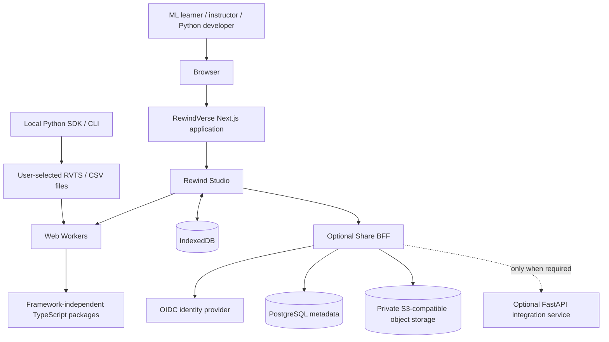
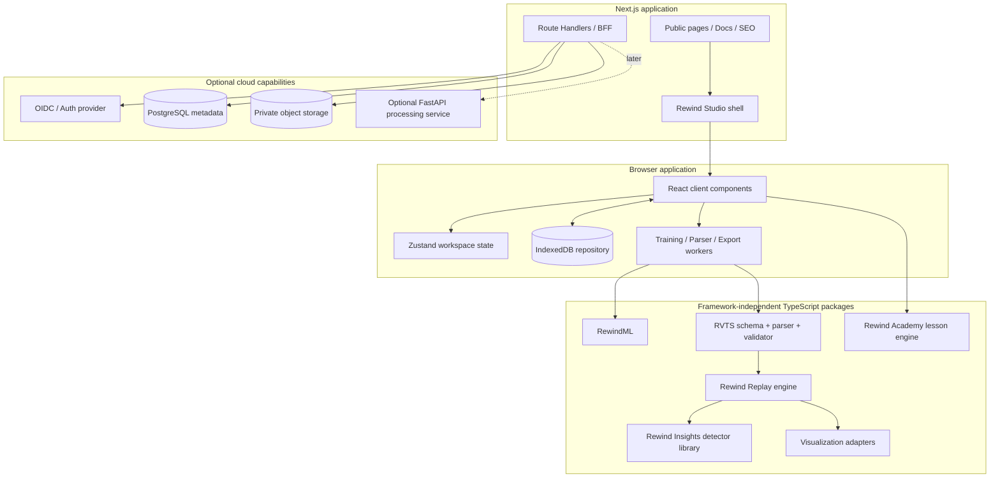
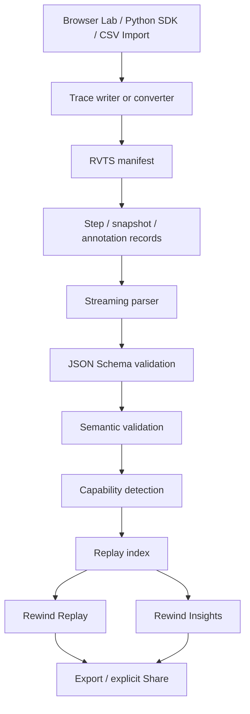
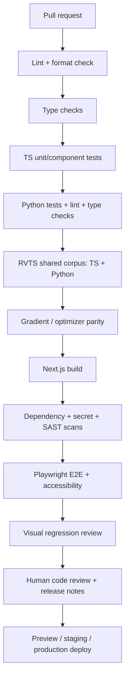

# REWINDVERSE

## Technical Stack & Architecture

**Product promise:** Train a model, then replay how it learned.  
**Tagline:** Every Model Has a Story.  
**Main application:** Rewind Studio  
**Document:** Technical Stack, Architecture and Engineering Standards  
**Version:** 2.0  
**Date:** 7 November 2026

> **Document purpose:** This document defines the recommended implementation stack, architecture boundaries, engineering practices, testing strategy, deployment model and technical delivery sequence for RewindVerse. It is the engineering companion to the RewindVerse PRD Edition 4.1 and the Website Design & Engineering Specification. It describes what should be built; it is not evidence that these technologies or features have already been implemented.

---

# Document control

| Field | Decision |
|---|---|
| Product | RewindVerse |
| Main experience | Rewind Studio |
| Training and computation engine | RewindML |
| Training replay experience | Rewind Replay |
| Evidence-backed diagnostics | Rewind Insights |
| Experiment comparison | Rewind Compare |
| Learning experience | Rewind Academy |
| Trace interchange | Rewind Trace / RewindVerse Training Trace Specification (RVTS) |
| Product source of truth | RewindVerse Final PRD, Edition 4.1 |
| Design source of truth | RewindVerse Website Design & Engineering Specification |
| Architecture style | Next.js application shell + framework-independent TypeScript domain packages + local-first browser compute |
| Backend posture | Thin Next.js BFF for account/share workflows; optional FastAPI integration service only when needed |
| Core operating principle | The core lab, trace import, replay and export must work without a cloud account or hosted training service |
| Delivery target | 24-week v1.0 plan, gated by product acceptance criteria |

## How to use this document

1. The PRD defines **what** the product must do. This document defines the recommended **how**.
2. The website design specification defines visual hierarchy, interaction principles, responsive behaviour and brand usage. This document translates those rules into implementable technologies and engineering constraints.
3. The architecture decision records (ADRs) in this document explain major decisions. A changed decision must be recorded with its trade-offs and migration impact.
4. The RVTS specification is the source of truth for trace semantics. TypeScript types, Python models and API payload models must not silently redefine it.
5. Use the recommended technologies only where they solve a real requirement. Do not add infrastructure simply because it is popular.
6. Pin exact dependency versions in lockfiles. The version notes in this document are a point-in-time reference, not permission to use floating `latest` versions in production.
7. Mark a technology **implemented** only after it exists in the repository and passes its acceptance tests. A technology listed here is a recommendation until then.

---

# 1. Executive technical recommendation

Build RewindVerse as a **Next.js App Router product with a browser-first, local-first ML core**.

Use one Next.js application for the public website, documentation, account boundaries and Rewind Studio shell. Use React Client Components only for genuinely interactive browser experiences. Keep RewindML, RVTS parsing/validation, replay, diagnostic algorithms and learning logic in independent TypeScript packages that do not import React or Next.js.

The core baseline is:

- **Next.js App Router + React + TypeScript** for the public website and Rewind Studio.
- **Tailwind CSS 4 + CSS custom properties using OKLCH** for responsive styling and semantic design tokens.
- **Radix UI primitives with project-owned/shadcn-style components** for accessible interaction patterns.
- **Motion for React** for selective spring-based transitions; CSS transitions remain the default for simple states.
- **Zustand** for small client interaction state; **TanStack Query** only when a server-backed cache is actually required.
- **D3 + React-rendered SVG** for charts and interactive axes; **Canvas 2D** for dense datasets; **Three.js / React Three Fiber** only for future, justified 3D learning features.
- **Web Workers + TypedArrays / Float64Array** for training, parsing, decompression, indexing, diagnostics and large exports away from the main thread.
- **RVTS** as the canonical versioned JSON Lines interchange contract. Use **Ajv 2020** for TypeScript structural validation and **jsonschema Draft 2020-12** in Python, plus semantic validation in both languages.
- **IndexedDB behind a repository adapter** for local experiments and traces. Portable `.rvtrace` files remain the user's durable source of truth.
- **Python SDK and CLI** for local training-loop recording, with optional NumPy, PyTorch and scikit-learn adapters.
- **Next.js Route Handlers as the browser-facing BFF** for optional identity, share metadata and signed object-storage access.
- **PostgreSQL + private S3-compatible object storage** only when opt-in sharing/account features are enabled.
- **FastAPI** only as a later, optional Python processing/integration service if a real server-side Python requirement emerges. It must not duplicate the Next.js BFF.
- **Vitest, React Testing Library, Playwright, pytest and Hypothesis** for quality assurance.
- **GitHub Actions** for CI/CD; privacy-configured error monitoring and product analytics only after privacy review.

The architecture should not start with Kubernetes, Redis, Kafka, Celery, a GPU training fleet, hosted arbitrary code execution, or a microservice per feature.

## 1.1 The core engineering proof

The first complete engineering milestone is one reproducible path:

**Run a real supported algorithm → record actual state → write an RVTS trace → validate it → replay it → inspect evidence → export and reopen it.**

A Python-recorded run must later enter the same trace pipeline and display in the same viewer. This single path is the central integration test for the product.

## 1.2 Stack decision status

| Decision | Status | Notes |
|---|---|---|
| Next.js App Router for public website + Studio shell | **Selected** | Supersedes the earlier React + Vite-only proposal |
| TypeScript domain packages independent of UI framework | **Selected** | Preserves portability and testability |
| Web Workers for compute and file processing | **Required** | No long-running ML work on the main UI thread |
| RVTS as canonical trace format | **Required** | Legacy MVTS supported only by explicit importer |
| IndexedDB local persistence | **Required** | Local workflows cannot depend on login/cloud availability |
| Next.js Route Handlers as BFF | **Selected for cloud features** | No heavy training or untrusted code execution in route handlers |
| FastAPI integration service | **Conditional / later** | Introduce only for a demonstrated Python server-processing need |
| PostgreSQL + object storage | **Conditional / later** | Required for scalable sharing/account metadata, not local-only v0.1 |
| Three.js / WebGL | **Future / optional** | Only where 3D improves a validated learning outcome |

---

# 2. Product and architecture boundaries

## 2.1 What the system must support

- Public, SEO-friendly pages describing RewindVerse and its product capabilities.
- An interactive Rewind Studio application for running supported ML experiments in the browser.
- A local-first training lab using real, deterministic algorithms in Web Workers.
- RVTS trace creation, validation, import, replay, inspection, comparison, export and optional sharing.
- Evidence-backed diagnostics that state which trace signals were used.
- A Python SDK and CLI for local recording from supported user-owned training workflows.
- Progressive expansion into data observability, model intelligence, transformer education and classroom workflows under the PRD roadmap.

## 2.2 What the architecture must not become

- It is not a hosted arbitrary Python or notebook execution service.
- It is not a general-purpose MLOps replacement.
- It is not a managed GPU training platform.
- It must not execute uploaded pickle/joblib files, shell commands or arbitrary plugins.
- It must not infer gradients, parameters, activations or snapshots that were not recorded or validly derived.
- It must not require a user account for the basic browser lab, local trace import, replay or export journey.

## 2.3 Non-functional engineering goals

| Attribute | Engineering goal | Evidence |
|---|---|---|
| Correctness | Numerical and trace semantics are reproducible | Gradient checks, optimizer parity reports and shared RVTS fixtures |
| Responsiveness | Interaction remains responsive during compute | Worker isolation and browser performance profiles |
| Portability | A trace can move between supported producers and consumers | TypeScript/Python validator parity and round-trip fixtures |
| Safety | Untrusted files are parsed as data, never executed | File-security tests and upload limits |
| Privacy | User trace contents remain local unless explicitly shared | Network/analytics inspection and privacy tests |
| Accessibility | Core flows usable with keyboard and assistive technology | WCAG 2.2 AA-oriented audits and manual checks |
| Maintainability | Domain logic independent of the web framework | Dependency graph and package-level tests |
| Operability | Deployments are observable and reversible | CI reports, runbooks and rollback tests |

---

# 3. Technology stack at a glance

## 3.1 Recommended stack

| Layer | Technology | Responsibility | Priority |
|---|---|---|---|
| Web framework | Next.js App Router 16.x | Public site, docs, route shell, server rendering and BFF routes | P0 |
| UI runtime | React 19.x | Component application and interactive experience | P0 |
| Language | TypeScript strict mode | Web app, workers, core packages and contracts | P0 |
| Runtime | Node.js 24 LTS baseline | Local development, CI and Next.js server runtime | P0 |
| Package manager | pnpm workspaces | Monorepo, reproducible dependency graph | P0 |
| Styling | Tailwind CSS 4.x + CSS variables | Responsive layouts and design system | P0 |
| UI primitives | Radix UI + project-owned shadcn-style components | Dialogs, tabs, menus, sliders, popovers and focus behaviour | P0 |
| Icons | Lucide | Consistent interface icons | P0 |
| Motion | `motion` package / Motion for React | Selective spring transitions and gestures | P1 |
| Client state | Zustand | Small transient workspace state | P0 |
| Server cache | TanStack Query | Optional server-backed metadata cache | P1 when API exists |
| Form validation | React Hook Form + Zod 4.x | Form state and runtime validation at TS boundaries | P0/P1 as needed |
| Charts | D3 7.x + React-rendered SVG | Loss curves, event markers, brushing, axes and trajectories | P0 |
| Dense rendering | Canvas 2D | Large scatter sets and dense heatmaps | P1 |
| 3D visualization | Three.js / React Three Fiber | Selected future teaching visualisations | P2 |
| Compute | Web Workers + TypedArrays | Browser training, parsing, validation and exports | P0 |
| Browser persistence | IndexedDB + Dexie (or a thin `idb` wrapper) | Local runs, trace metadata, lessons and preferences | P0 |
| Compression | Native Compression Streams + `fflate` fallback | `.rvtrace.gz` support | P0/P1 |
| Trace standard | JSON Schema Draft 2020-12 | RVTS structural schema | P0 |
| TS trace validator | Ajv 2020 entry point | Structural validation | P0 |
| Python runtime | Python 3.13 baseline | SDK and optional Python services | P1 |
| Python environment | uv + pyproject.toml | Python dependency and environment management | P1 |
| Python data | NumPy 2.x | Array and numerical interoperability | P1 |
| ML adapters | PyTorch and scikit-learn optional extras | Selected local training recorder support | P1/P2 |
| Python validation | `jsonschema` Draft 2020-12 | Cross-language RVTS validation | P1 |
| API / BFF | Next.js Route Handlers | Browser-facing account/share operations | P1 |
| Optional Python API | FastAPI + Pydantic | Isolated Python processing/integration API if justified | P2/conditional |
| Database | Managed PostgreSQL 18.x | User, workspace and share metadata | P1 when sharing/account features ship |
| DB access | Drizzle ORM + SQL migrations | Typed data access for Next.js BFF | P1 |
| Object storage | Private S3-compatible storage | Explicitly shared trace objects | P1 when sharing ships |
| Authentication | OIDC provider through Auth.js or equivalent adapter | Optional accounts and share ownership | P1 when needed |
| Unit tests | Vitest + Testing Library | TS logic and component behaviour | P0 |
| Browser tests | Playwright | Critical end-to-end journeys, visual checks and cross-browser | P0 |
| Accessibility tests | axe-core + manual keyboard/screen-reader checks | Accessibility verification | P0 |
| Python tests | pytest + Hypothesis | SDK, validators, adapters and property tests | P1 |
| Python lint/types | Ruff + mypy or Pyright | Formatting, linting and type checks | P1 |
| CI/CD | GitHub Actions | Build, test, security checks and deployments | P0 |
| Security scanning | Dependabot/Renovate, CodeQL, Gitleaks, OSV/Trivy as appropriate | Dependency, code, secret and image checks | P0/P1 |
| Error monitoring | Sentry or equivalent with sensitive-data scrubbing | Runtime errors and performance signals | P1 after privacy review |
| Analytics | PostHog or equivalent, allow-listed events only | Activation and product usage | P1 after privacy review |
| Hosting | Vercel-compatible Next.js hosting; provider-neutral alternative | Public website and Studio | P0 |
| Python deployment | Managed container platform | Optional FastAPI service | P2/conditional |

## 3.2 Point-in-time version baseline

The versions below are reference targets checked on 7 November 2026. Confirm exact compatibility using the current official installation guide and package peer dependencies at implementation time. Commit exact resolved versions in lockfiles; do not use floating production tags.

| Technology | Recommended baseline | Version policy |
|---|---|---|
| Next.js | 16.2.x line | Use current supported 16.x patch; follow Next.js compatibility requirements |
| React / React DOM | 19.3.x where supported by selected Next.js patch | Use the exact peer-compatible version resolved by the framework and verified by CI |
| Node.js | 24 LTS | Pin major in `.nvmrc`/`.node-version`; update patch in CI images |
| TypeScript | Current stable 5.x/6.x compatible with Next.js and dependencies | Pin exact version in lockfile; no nightly builds in production |
| Tailwind CSS | 4.x | Follow official Next.js integration guide |
| Motion | Current stable `motion` package | Use `motion/react`; do not introduce the old `framer-motion` import path in new code |
| Zod | 4.x | Verify schema behaviour and package compatibility before upgrade |
| D3 | 7.x | Use modular imports where possible |
| Ajv | 8.x with Draft 2020-12 implementation | Use `Ajv2020` / `ajv/dist/2020`, not the default Draft-07 instance for RVTS |
| Python | 3.13 release baseline; test 3.14; add 3.15 after ML-wheel compatibility | Do not claim framework support until tested on each OS/runtime |
| NumPy | 2.5.x reference line | Pin patch and test with SDK matrix |
| scikit-learn | 1.9.x reference line | Optional extra; pin and test supported estimator adapters |
| FastAPI | 0.162.x reference line if service is enabled | Pin to a tested patch; review breaking changes |
| Pydantic | 2.14.x reference line if FastAPI is enabled | Pin to tested patch |
| PostgreSQL | 18.x stable; apply current minor/security updates | Do not deploy a release candidate as production DB |
| Playwright | Current stable release | Upgrade browser binaries and test package together |

**Version verification notes:** React's official version page lists 19.3 as its latest release; the React release list includes 19.3.1. Next.js 16.2 has an official release announcement. Python.org identifies Python 3.15 as newly released while 3.13 and 3.14 remain supported branches; the SDK baseline stays conservative until ML framework wheels are proven. NumPy 2.5.4 supports Python 3.12–3.15. FastAPI 0.162.0 and Pydantic 2.14.3 were published in October/November 2026. PostgreSQL 18.6 is a stable supported release; PostgreSQL 19 was still a release candidate in the current reference window. See the official links in Section 29.

---

# 4. High-level system architecture

## 4.1 Architecture style

Use a **modular monolith for the product application** with independently testable domain packages. Deploy one Next.js application first. Add a FastAPI service only if a real Python server-side integration or conversion workload requires it. Do not split every module into a separate service.

The architecture has four primary execution/trust zones:

1. **Browser main thread:** rendering, user interaction, navigation and orchestration.
2. **Worker zone:** ML training, file parsing, gzip decompression, validation, replay indexing, diagnostics and export.
3. **Local data zone:** IndexedDB and user-selected files; the default location for experiments and traces.
4. **Optional cloud zone:** identity, share metadata and private trace object storage. It does not execute user-supplied training code.

## 4.2 System context



## 4.3 Logical component architecture



## 4.4 Dependency direction

- `apps/web` may depend on domain packages.
- Domain packages must not import React, Next.js, browser routing, database clients or cloud provider SDKs.
- Web Workers may import domain packages, never UI components.
- Rewind Replay consumes validated RVTS records; it does not depend on the original producer.
- Rewind Insights consumes recorded/derived data and returns evidence objects; it does not mutate the source trace.
- The Python SDK follows the RVTS contract and shared fixtures. It does not need to call a hosted service to write a trace.
- The Next.js BFF owns browser-facing cloud operations. FastAPI, if added, owns only specifically assigned Python processing endpoints.

## 4.5 Architecture rules

1. A browser training run must remain possible with network access disabled after the app shell loads.
2. Trace import and replay must remain local operations by default.
3. No trace contents, datasets, raw model state or sample payloads are sent to analytics.
4. Server routes must not run long-running ML loops.
5. Large trace files must be processed incrementally and subject to size/time/memory limits.
6. Every cross-boundary message and API request has a versioned contract.
7. Every optional cloud feature must degrade cleanly when cloud services are unavailable.

---

# 5. Frontend application architecture

## 5.1 Why Next.js App Router

RewindVerse has two connected experiences: a public website that needs search-friendly content, documentation and examples; and a highly interactive application that uses browser APIs, workers, charts and local storage. Next.js allows both to share a layout, design system and navigation architecture.

Use **Server Components by default** for public content, documentation, page metadata and static route shells. Use **Client Components** for Rewind Studio interactions, browser storage, charts, drag/drop, file processing orchestration and worker communication.

The earlier React + Vite-only recommendation is superseded. Do not run a separate Vite application for the main Studio in v1. Vite may be used later for isolated package demos or embed builds only if a concrete deployment requirement appears.

## 5.2 Application route map

```text
/
├── /product
├── /how-it-works
├── /learn
│   ├── /learn/[lessonSlug]
├── /docs
│   ├── /docs/quick-start
│   ├── /docs/rewind-trace
│   ├── /docs/python-sdk
│   └── /docs/algorithms/[algorithm]
├── /changelog
├── /studio
│   ├── /studio (overview)
│   ├── /studio/lab
│   ├── /studio/import
│   ├── /studio/replay/[runId]
│   ├── /studio/compare
│   ├── /studio/insights
│   └── /studio/academy
├── /share/[shareId] (read-only shared trace)
└── /api/* (Route Handlers / BFF)
```

Route names are product decisions. Route segments must not reveal private object keys, raw file paths or bearer credentials.

## 5.3 Rendering boundaries

| UI area | Rendering | Reason |
|---|---|---|
| Marketing pages | Server-rendered / statically generated | SEO, metadata, fast content rendering |
| Documentation and learning articles | Static/server-rendered MDX or content source | Readable, crawlable content |
| Studio shell | Server-rendered route shell + client workspace | Fast initial structure; interactive state is client-side |
| Training lab | Client Component + Worker | Requires user input, browser compute and live progress |
| Replay viewer | Client Component + replay package | Chart interaction and trace indexing |
| Import centre | Client Component + Parser Worker | File APIs and validation in browser |
| Share view | Server metadata + client replay | Server verifies access; viewer runs locally in browser |
| Account settings | Server route + client forms as needed | Session and persisted preferences |

Do not turn the whole application into one giant Client Component. Keep the client boundary around actual interactivity.

## 5.4 State management

| State type | Tool | Examples | Rules |
|---|---|---|---|
| Local component state | React state | Dialog open, tooltip state, local field value | Keep near the component |
| Workspace session state | Zustand | Active run ID, selected step, playing/paused, selected panels | Small, serialisable UI state only |
| Persisted browser data | IndexedDB repository | Trace files, run history, experiment metadata | Access through repository methods |
| Remote metadata | TanStack Query when needed | Share metadata, account preferences | Do not fetch large trace bodies into a global cache |
| URL state | Route/query parameters | Current tab, public filters, share view settings | Never place secrets or personal data in URL state |

Avoid storing full 100k-step arrays in Zustand or React state. The Replay Engine owns indexes and typed arrays; views request only the visible range or a downsampled representation.

## 5.5 Forms and validation

- Use **Zod** for TypeScript runtime validation at forms, route boundaries and environment configuration.
- Use **React Hook Form** only when the form complexity justifies it; small forms may use controlled React inputs.
- The RVTS JSON Schema remains the canonical trace structure; a Zod form schema must not replace or diverge from RVTS.
- The server must independently validate data; client validation is for fast feedback, not a trust boundary.

## 5.6 Component architecture

Recommended layers:

- **Foundation:** Button, IconButton, Input, Select, Slider, Switch, Tabs, Dialog, Tooltip, Badge, Card, Separator, Skeleton, Toast.
- **Navigation:** MarketingHeader, StudioSidebar, WorkspaceTopbar, Breadcrumbs, MobileNavigation.
- **Data display:** MetricCard, DataTable, CodeBlock, MetadataPanel, EmptyState, StatusPanel.
- **ML visuals:** LossChart, GradientMonitor, ParameterTrajectory, DecisionBoundaryCanvas, TrainingTimeline, ActivationHeatmap.
- **Product features:** ExperimentCard, RunComparePanel, TraceDropzone, ValidationReport, CapabilityInspector, DiagnosticCard, LessonStep, ShareDialog.

All shared components require loading, empty, disabled, error, focus-visible and responsive states where relevant. Product components must not reimplement primitive accessibility behaviour.

---

# 6. Design system and visual technology

## 6.1 Design direction

RewindVerse should look futuristic, premium and technically credible, not like a generic SaaS dashboard or a game interface. Use the reference-site inspiration as a source of design patterns, not as a source to copy page layouts or brand assets.

- Use the information hierarchy and clarity associated with Linear/Notion-style productivity tools.
- Use distinctive art direction and cinematic restraint for public hero sections.
- Use Spline/Canvas-like interactive scenes only when they communicate an ML concept.
- Keep Rewind Studio more restrained and information-dense than the marketing site.
- Prioritise readable charts, evidence labels and interaction clarity over visual decoration.

## 6.2 Layout system

- Default to clean bento grids: one column on narrow screens, three/four columns when space permits.
- Use generous but consistent spacing (`p-6`/`p-8` on larger surfaces); compact controls may use tighter spacing.
- Use subtle 1px borders and layered surfaces rather than heavy shadows on every card.
- Use a maximum readable content width for documentation and marketing copy.
- Make the Studio's primary layout a responsive workspace: sidebar + canvas + inspector on wide screens; collapsible panels and drawers on small screens.
- Every page must have a clear primary action and a visually distinct active state.

## 6.3 Semantic color tokens

All colors must be semantic CSS variables defined in `globals.css`. Components must not scatter brand hex values or raw palette classes across the codebase.

Starter token example (values are design starting points; validate contrast before release):

```css
@import "tailwindcss";

:root {
  color-scheme: dark;
  --background: oklch(0.12 0.025 270);
  --surface: oklch(0.16 0.03 270);
  --surface-raised: oklch(0.20 0.035 270);
  --text: oklch(0.97 0.01 260);
  --muted: oklch(0.72 0.035 255);
  --border: oklch(0.32 0.035 270 / 0.72);
  --primary: oklch(0.74 0.16 220);
  --secondary: oklch(0.62 0.20 285);
  --accent: oklch(0.68 0.22 315);
  --success: oklch(0.77 0.17 155);
  --warning: oklch(0.82 0.16 85);
  --danger: oklch(0.68 0.20 20);
  --focus-ring: oklch(0.80 0.16 220);
}

[data-theme="light"] {
  color-scheme: light;
  --background: oklch(0.985 0.004 260);
  --surface: oklch(1 0 0);
  --surface-raised: oklch(0.97 0.008 260);
  --text: oklch(0.22 0.025 270);
  --muted: oklch(0.48 0.025 260);
  --border: oklch(0.88 0.012 260);
  --primary: oklch(0.53 0.17 240);
  --secondary: oklch(0.52 0.17 285);
  --accent: oklch(0.55 0.19 310);
  --success: oklch(0.50 0.15 155);
  --warning: oklch(0.62 0.14 80);
  --danger: oklch(0.54 0.18 20);
  --focus-ring: oklch(0.53 0.17 240);
}

@theme inline {
  --color-background: var(--background);
  --color-surface: var(--surface);
  --color-surface-raised: var(--surface-raised);
  --color-foreground: var(--text);
  --color-muted: var(--muted);
  --color-border: var(--border);
  --color-primary: var(--primary);
  --color-secondary: var(--secondary);
  --color-accent: var(--accent);
}
```

Required semantic tokens include `--text`, `--background`, `--primary`, `--secondary`, `--accent`, `--surface`, `--border`, `--muted`, `--success`, `--warning`, `--danger` and `--focus-ring`.

**Contrast rule:** gradients are decorative accents, not the only means of communicating information. All text, icons, focus indicators, charts and controls must be evaluated against the actual rendered backgrounds. Use axe-core and a contrast-analysis tool during implementation. The target is WCAG 2.2 AA for core flows.

## 6.4 Typography

- Headings: Inter or Geist Sans; choose one primary family and use it consistently.
- Body: the same sans family or a highly compatible system stack.
- Code, metric identifiers and technical labels: Geist Mono or Fira Code.
- Use a defined scale for page title, section heading, body, caption and metric values.
- Avoid ultra-thin text, excessive all-caps labels and long lines in technical panels.
- Use tabular numerals for metrics and step counters.

## 6.5 Backgrounds and visual assets

- Do not use unstyled flat blocks for the public hero.
- Use layered SVG waves, mesh gradients, subtle grid fields or low-poly SVG forms.
- Authored SVGs should be stored in `public/assets/` or a versioned design asset package.
- Keep decorative visuals behind content with sufficient contrast.
- Any animated background must have a static fallback and respect `prefers-reduced-motion`.
- Use original or properly licensed assets; do not copy supplied reference-site images or proprietary design elements.

## 6.6 Motion and micro-interactions

Use the current **Motion for React** package (`motion`) and import from `motion/react`. Framer Motion is the historical package name; new code should use the current package/API documented by Motion.

Recommended spring baseline:

```ts
const spring = { type: "spring", stiffness: 300, damping: 30 } as const;
```

Use Motion for:
- Bento card hover/press feedback where it improves discoverability.
- Dialog and drawer presence transitions.
- Layout changes between workspace panel states.
- Timeline marker or chart selection transitions when they do not create misleading movement.

Prefer native CSS transitions for simple color, border and opacity changes. Avoid animating large chart geometries on every data tick. Honour reduced motion by disabling or shortening non-essential movement. Never make animation the only way to perceive a state change.

## 6.7 Motion performance limits

- Animate `transform` and `opacity` where possible.
- Do not animate `width`, `height`, `top` or `left` continuously for large layouts when transforms can be used.
- Keep scroll-linked effects sparse.
- Do not animate the entire background of the Studio.
- Avoid continuous 3D scenes on mobile or low-power devices.
- Test interaction at 60Hz/120Hz capable displays, but do not promise a specific frame rate without measurement.

---

# 7. Responsive and accessibility engineering

## 7.1 Responsive breakpoints

Use mobile-first CSS. The exact Tailwind breakpoint defaults may be used unless design testing requires custom values. The product must be explicitly tested at:

| Profile | Target viewport examples | Expected behaviour |
|---|---|---|
| Small phone | 320–375 px wide | Single-column layout; compact navigation; charts simplified |
| Standard phone | 390–430 px wide | Main interactions available; panels become drawers |
| Large phone | 431–599 px wide | Responsive cards and controls; no fixed desktop inspector |
| Tablet portrait | 600–899 px wide | Collapsible navigation; two-column lab where feasible |
| Tablet landscape / small laptop | 900–1199 px wide | Reduced inspector width; charts retain interaction |
| Desktop | 1200–1599 px wide | Full Studio three-region workspace |
| Wide desktop | 1600 px and above | Constrained content width; no excessive line length |

## 7.2 Responsive acceptance rules

- No horizontal overflow on supported routes at the target widths.
- Main navigation collapses predictably and remains keyboard accessible.
- Studio sidebar becomes a drawer or compact navigation at smaller widths.
- Inspector panels become drawers/accordions rather than squeezing the chart below usable width.
- Charts resize when their parent container changes; do not depend only on window resize.
- Canvas and WebGL resize after orientation changes and device-pixel-ratio changes.
- Drag/drop upload has a visible button alternative.
- Touch targets should be comfortably usable; aim for at least 44×44 CSS px for primary touch controls where practical.

## 7.3 Accessibility

- Target WCAG 2.2 AA for key flows.
- Full keyboard access for navigation, lab controls, play/pause, timeline scrubbing, compare selectors and dialogs.
- Visible focus ring with sufficient contrast.
- Correct names/roles/states for sliders, charts and controls.
- Provide a text/data-table alternative for charts and visual-only diagnostics.
- Do not encode series identity solely by color; use labels, patterns, symbols or line styles.
- Use accessible error summaries and field-level errors.
- Respect reduced motion and high-contrast settings where possible.
- Avoid focus traps except in modal/dialog contexts with expected focus return.
- Test with at least one screen reader/browser combination in the release process; automated checks alone are insufficient.

---

# 8. Visualization and rendering stack

## 8.1 Rendering strategy

| Visualization | Primary renderer | Secondary support | Constraints |
|---|---|---|---|
| Loss / metric curves | SVG + D3 | Accessible table and event list | Keyboard step selection; clear axis labels and units |
| Gradient magnitude | SVG + D3 | Table summary | Distinguish norm, mean and sampled components |
| Parameter trajectory | SVG for low-dimensional objectives | Optional Canvas for many points | Only show trajectories when actual parameter snapshots exist |
| Decision boundary | Canvas 2D for dense points | SVG axes, labels and selection | Do not render thousands of DOM nodes |
| Training timeline | DOM + SVG markers | Accessible event list | Supports keyboard navigation and event details |
| Run comparison | SVG + D3 | Tabular metric deltas | Compare compatible units and aligned step definitions |
| Heatmaps / activation views | Canvas or virtualised table | Text summary | Shape, dtype and sampling provenance shown |
| 3D loss surface | Three.js / React Three Fiber | 2D contour fallback | P2; only for supported objective/model semantics |

## 8.2 D3 integration rules

- D3 owns scales, ticks, paths, layouts, zoom/brush calculations and coordinate transforms.
- React owns component lifecycle and DOM rendering.
- Prefer React-rendered SVG from D3-computed geometry. Avoid D3 DOM mutations behind React's back.
- Use memoised derived geometry, but never store a second unbounded copy of the entire trace in component state.
- Keep chart view models separate from RVTS raw records.
- Every chart includes units, step unit and source/cadence details where they affect interpretation.

## 8.3 Canvas rules

- Use Canvas for dense scatter points, large heatmaps or high-volume point rendering.
- Keep accessible controls, axes, selected-point overlays and summaries in semantic HTML/SVG.
- Use OffscreenCanvas only as a progressive enhancement after browser support and worker flow are tested.
- Provide a fallback if a browser lacks the required Canvas feature.

## 8.4 3D rules

- Three.js and React Three Fiber are not part of the initial critical path.
- 3D scenes must teach something that a 2D view cannot communicate as clearly.
- The scene must be lazy-loaded and optional.
- Provide a 2D fallback, keyboard alternatives and reduced-motion behaviour.
- Set a device/profile threshold and automatically use the 2D fallback on constrained devices.
- Never create a generic 3D hero animation that obscures the actual product workflow.

---

# 9. RewindML: computation and algorithm architecture

## 9.1 Package responsibility

`RewindML` is a framework-independent TypeScript package for supported objectives, data generation, losses, model implementations, gradient functions, optimizers and deterministic execution. It must run in a browser Worker and in Node-based tests without importing React, Next.js or DOM APIs.

Core responsibilities:
- Objective and model registry.
- Deterministic seeded random-number generation.
- Loss and gradient calculation.
- Optimizer state and update rules.
- Training loop orchestration.
- Sampling policy for trace records.
- Numerical correctness fixtures and reports.

## 9.2 Core interface proposal

```ts
export interface Objective2D {
  id: string;
  version: string;
  value(theta: Float64Array): number;
  gradient(theta: Float64Array): Float64Array;
}

export interface OptimizerState {
  step: number;
  parameters: Float64Array;
  slots: Record<string, Float64Array | number>;
}

export interface OptimizerConfig {
  learningRate: number;
  beta1?: number;
  beta2?: number;
  epsilon?: number;
  momentum?: number;
}

export interface Optimizer {
  id: "sgd" | "momentum" | "adam";
  version: string;
  initialize(parameterCount: number): OptimizerState;
  update(gradient: Float64Array, state: OptimizerState, config: OptimizerConfig): OptimizerState;
}
```

The interfaces are proposals; freeze exact public types in the core package before downstream adapters depend on them.

## 9.3 Initial supported objectives and models

| Release | Objective/model | Requirement |
|---|---|---|
| v0.1 | Quadratic bowl | Exact value and gradient; 2D contour and parameter trajectory |
| v0.1 | Rosenbrock function | Exact formula/gradient fixtures; stable sampling range |
| v0.1 | Saddle objective | Demonstrate saddle/flat-direction behaviour |
| v0.2 | Logistic regression | Binary classification, loss, regularisation conventions and decision boundary |
| v0.3 | Small MLP | Forward pass, backpropagation, selected activation/gradient inspection |
| Later | Transformer Explorer | Educational internals; no arbitrary large model training |

A visualization may only claim to show model internals when the corresponding values are recorded or computed from a registered model definition.

## 9.4 Optimizer equations and conventions

### Stochastic gradient descent

\[
\theta_{t+1}=\theta_t-\eta g_t
\]

### Momentum (initial contract: PyTorch-style buffer, no dampening or Nesterov)

\[
v_t=\mu v_{t-1}+g_t,\qquad \theta_{t+1}=\theta_t-\eta v_t
\]

### Adam (epsilon after square root of bias-corrected second moment)

\[
m_t=\beta_1m_{t-1}+(1-\beta_1)g_t
\]

\[
v_t=\beta_2v_{t-1}+(1-\beta_2)g_t^2
\]

\[
\hat m_t=\frac{m_t}{1-\beta_1^t},\qquad \hat v_t=\frac{v_t}{1-\beta_2^t}
\]

\[
\theta_{t+1}=\theta_t-\eta\frac{\hat m_t}{\sqrt{\hat v_t}+\epsilon}
\]

These formula conventions are part of the reproducibility contract. Do not silently add weight decay, AMSGrad, alternative momentum variants or different epsilon placement. Each variant needs an explicit algorithm/configuration identifier and fixtures.

## 9.5 Numerical correctness requirements

- Use Float64 for the reference browser objective/optimizer path where practical.
- Preserve source dtype metadata for external traces; do not imply Float64 precision for values captured as Float32.
- Use finite-difference gradient checks at smooth points away from kinks.
- Use deterministic seeded PRNG for reproducible browser examples.
- Do not claim PRNG sequence equality with `Math.random`, NumPy or PyTorch.
- For strict parity, feed the same parameters, gradient fixtures, minibatch order, objective and optimizer config to every implementation.
- Document tolerances by dtype, platform and algorithm.
- Compare outputs with absolute and relative error; state the maximum observed error.
- Maintain a numerical parity report with commit, runtime, fixtures and pass count.

## 9.6 Training job lifecycle

```text
CREATED → VALIDATING → RUNNING
                        ├── PAUSING → PAUSED → RUNNING
                        ├── COMPLETED
                        ├── CANCELLED
                        └── FAILED
```

- A run has explicit terminal states.
- Cancel is cooperative and checked at safe boundaries.
- Partial runs must be labelled partial; they must not be shown as complete.
- A run cannot be resumed from a final checkpoint unless optimizer, scheduler, RNG and data-order states are present and supported.
- Errors are structured and safe to display; stack traces remain developer-only.

---

# 10. Web Worker and compute architecture

## 10.1 Worker responsibilities

Use narrow workers rather than one all-purpose worker:

1. **Training Worker:** runs supported RewindML computations, handles pause/resume/cancel and produces trace batches.
2. **Parser Worker:** reads selected files, decompresses supported gzip, parses JSONL, performs structural and semantic validation, and builds trace indexes.
3. **Analysis Worker:** computes expensive derived diagnostics and downsampling if separated from parser responsibilities by profiling.
4. **Export Worker:** serialises RVTS records, calculates checksum and compresses files for download.

Workers should be created when the relevant workflow starts, not all eagerly at first page load.

## 10.2 Typed message protocol

All worker messages must be versioned, typed and correlated.

```ts
export type WorkerCommand<T = unknown> = {
  protocolVersion: 1;
  requestId: string;
  runId?: string;
  command: string;
  payload: T;
};

export type WorkerEvent<T = unknown> = {
  protocolVersion: 1;
  requestId: string;
  runId?: string;
  event:
    | "accepted"
    | "progress"
    | "batch"
    | "warning"
    | "completed"
    | "cancelled"
    | "failed";
  payload?: T;
  error?: {
    code: string;
    message: string;
    recoverable: boolean;
  };
};
```

Rules:
- Every command has `requestId`; training commands also include `runId`.
- Progress events are batched/throttled, not posted per optimizer update by default.
- The UI ignores stale events whose request/run ID does not match the active view.
- Cancellation is cooperative and acknowledged.
- Large typed arrays may be sent with transferable `ArrayBuffer`s; transfer moves ownership and detaches the sender's buffer.
- Do not introduce `SharedArrayBuffer` in v1; it adds cross-origin isolation and deployment constraints.
- Do not pass unbounded object graphs through the worker message channel.

## 10.3 Worker failure behaviour

- A parser failure must not terminate an active training job.
- Worker crashes are reported with a safe error code and request ID.
- A recoverable worker can be recreated with an explicit state snapshot where appropriate.
- Partial trace writes must be detectable and clearly labelled.
- The UI must remain responsive when a worker is terminated.

---

# 11. RVTS trace architecture and validation

## 11.1 Canonical contract

The **RewindVerse Training Trace Specification (RVTS)** is the portable, versioned interchange format shared by RewindML, the Python SDK, importers and Rewind Replay. It is a project-owned format, not an industry standard unless independent producers and consumers prove interoperability.

- File extensions: `.rvtrace` and `.rvtrace.gz`.
- Encoding/container: UTF-8 JSON Lines with a manifest first and optional footer last.
- Record families: manifest, step, snapshot, annotation, optional footer and namespaced extension records.
- Numeric policy: non-finite numeric values use an explicit tagged encoding where supported by the schema; raw non-standard JSON `NaN`/`Infinity` tokens are not emitted.
- Step unit: explicit and never inferred silently.
- Capability levels: describe what a viewer can truthfully render.
- Privacy labels: `no_data`, `summary_only`, `includes_samples`.

## 11.2 Trace lifecycle



## 11.3 TypeScript validation

Use Ajv's **Draft 2020-12 implementation**, not the default Draft-07 instance:

```ts
import Ajv2020 from "ajv/dist/2020";

const ajv = new Ajv2020({
  allErrors: true,
  strict: true,
  validateFormats: true,
});
```

Do not mix incompatible JSON Schema drafts inside one Ajv instance. Add format validators only for formats RVTS actually uses.

## 11.4 Python validation

Use `jsonschema` with `Draft202012Validator` and explicitly configured format checks. TypeScript and Python validators must run the same versioned conformance corpus. Compare not only valid/invalid totals but rejection categories and semantic outcomes.

## 11.5 Validation pipeline

1. Check file byte size and extension/media hint; do not trust the extension alone.
2. Validate UTF-8; reject invalid encoding and unsupported BOM according to RVTS rules.
3. Decompress gzip with compressed-size, decompressed-size and expansion-ratio limits.
4. Stream records line-by-line; enforce maximum line length and JSON nesting depth.
5. Validate the manifest and format version before later records.
6. Validate each record structurally against the correct schema.
7. Run stateful semantic checks: monotonicity, step unit, cadence, shape, timestamps, references, numeric encoding and resource limits.
8. Build an index and capability report.
9. Return actionable errors/warnings and a fidelity report for imported formats.

## 11.6 Legacy migration

The previous working project name was Modelverse and the first trace draft was MVTS. New code, docs and exports use RewindVerse/RVTS identifiers. Legacy support remains explicit:

| Previous artifact | New canonical artifact | Rule |
|---|---|---|
| MVTS draft format | RVTS | Explicit converter; never silently reinterpret fields |
| `.mvtrace` / `.mvtrace.gz` | `.rvtrace` / `.rvtrace.gz` | Import as legacy input; show a legacy badge and conversion report |
| `mvts-0.1.schema.json` | `rvts-0.1.schema.json` | Preserve legacy schema/fixtures; publish renamed canonical schema |
| `modelverse_trace` Python package proposal | `rewindverse_trace` | Confirm package name availability before public package release |

A migration report must show source format, source version, mapped/transformed/dropped fields, unsupported fields, step-unit changes, warnings and resulting capability level. Do not claim lossless conversion unless it is proven.

## 11.7 Importer priorities

| Source | Priority | Fidelity rule |
|---|---|---|
| RVTS | P0 | Native read/write path |
| Metrics CSV | P0 | Mapping preview; preserve original columns and step values; do not fabricate model internals |
| Python SDK | P1 | Native RVTS producer with shared conformance fixtures |
| TensorBoard scalar export/events | P1/P2 | Preserve supported scalar data and provenance; report unsupported tags |
| MLflow export | P2 | Import documented export fields only; preserve run metadata and provenance |
| Weights & Biases export | P2 | User-provided export path; respect access/export permissions |
| Generic JSON/JSONL | P2 | Only through documented mapping profiles |

## 11.8 Capability and replay truthfulness

If a trace does not record gradients, the gradient panel is unavailable—not a zero line. If it contains scalar metrics but no registered model semantics, the viewer shows metrics, not a simulated model replay. Every insight must identify its detector version, required signals, step range and evidence.

---

# 12. Local persistence and browser file management

## 12.1 IndexedDB

Use IndexedDB behind a typed `LocalRepository` abstraction. Dexie is the recommended wrapper where its transaction/index/migration ergonomics are useful; alternatively use a small `idb` wrapper if minimizing dependencies is more important. Do not expose IndexedDB object-store calls throughout UI components.

Proposed stores:

- `experiments`: configurations, objective/model reference and timestamps.
- `runs`: run state, source/provenance and experiment relation.
- `traces`: manifest summary, RVTS version, checksum, size and local storage reference.
- `traceChunks`: chunked trace data or Blob records where size requires it.
- `lessons`: completion and checkpoint state.
- `preferences`: theme, chart settings and onboarding state.

Requirements:
- Explicit database schema version and migration functions.
- Recoverable migration failure; never silently delete traces.
- Storage quota monitoring and user-facing warnings.
- Cleanup of stale temporary files and incomplete writes.
- Export/reopen works without relying on IndexedDB's internal representation.

## 12.2 File handling

- Use `<input type="file">` as the primary cross-browser path; drag/drop is an enhancement.
- Use File System Access API only as progressive enhancement with download/upload fallback.
- Use Blob/object URLs for downloads and revoke URLs after use.
- Large serialization/compression belongs in a worker.
- Preserve source bytes where practical; conversions create a new output with a report.
- Never extract arbitrary archives or trust paths embedded in uploads.

---

# 13. Python SDK and CLI

## 13.1 Purpose

The Python SDK records supported local training workflows into RVTS so a user can open the result in Rewind Studio. It should be small, optional and safe: users train on their own machine, and the recorder samples/serializes selected values without sending them to RewindVerse.

## 13.2 Python runtime policy

- Release baseline: Python 3.13 until the chosen ML framework matrix is proven.
- CI: Python 3.13 and 3.14.
- Python 3.15: add after PyTorch/scikit-learn and required OS wheels are verified.
- Use `uv` for development environments and lock management.
- Use `pyproject.toml` for package metadata, extras, tool configuration and CLI entry points.

## 13.3 Optional extras

| Extra | Dependency | Capability |
|---|---|---|
| base | Standard library + RVTS validation dependency | Recorder, JSONL writing, metrics, annotations, CLI validate/inspect |
| `numpy` | NumPy 2.x | Array conversion and numeric metadata |
| `torch` | Compatible stable PyTorch | Selected gradients, parameters, activations and metrics |
| `sklearn` | Compatible scikit-learn | Narrow adapters for supported estimators/incremental training |
| `all` | Supported optional extras | Contributor/test convenience; not required for end users |

## 13.4 Proposed API

```python
from rewindverse_trace import RunRecorder

with RunRecorder("demo-run", output="./runs/demo.rvtrace") as run:
    run.log_params({"optimizer": "adam", "learning_rate": 0.01})
    for step in range(100):
        loss = train_one_step()  # The user's real training operation
        run.log_metrics({"train/loss": float(loss)}, step=step)
        if step % 10 == 0:
            run.annotate("checkpoint", step=step, message="sampled checkpoint")
```

The actual package API must freeze argument names, exception rules, write semantics and sampling behaviour before publishing. The example is a proposed interface, not an implemented API promise.

## 13.5 Recorder reliability rules

- Write incrementally; do not retain an unbounded run in RAM.
- Support sampling cadence and flush intervals.
- Do not mask the user's training exception when the recorder fails.
- Provide explicit recorder warnings and a safe fallback for serialization failure.
- Avoid calling `.item()` / `.cpu()` for every GPU tensor at every step because it may force synchronization; sample and batch based on policy.
- Benchmark overhead relative to an uninstrumented run.
- Do not capture raw datasets or samples unless explicitly requested and declared in the trace privacy level.
- Do not use `pickle`/`joblib` for untrusted deserialization.

## 13.6 CLI commands

Recommended commands:

```bash
rewindverse validate ./run.rvtrace
rewindverse inspect ./run.rvtrace
rewindverse convert ./legacy.mvtrace --output ./run.rvtrace
rewindverse redact ./run.rvtrace --output ./run-redacted.rvtrace
rewindverse view ./run.rvtrace
```

Commands are proposed. The `convert` command must clearly identify legacy conversion and show field transformations. The `view` command may open a local Rewind Studio URL or local viewer build; it must not upload trace contents automatically.

---

# 14. Backend, APIs and cloud services

## 14.1 Backend philosophy

The basic product is local-first. A backend is not required for the core training/replay promise. Add cloud capabilities only for a validated user need: share links, cross-device sync, classroom ownership or team metadata.

## 14.2 Next.js BFF responsibilities

Next.js Route Handlers are the browser-facing Backend-for-Frontend (BFF). They own:

- Session and identity checks when accounts are enabled.
- Share creation/revocation and visibility changes.
- Workspace/share metadata reads and writes.
- Issuing short-lived signed object-storage URLs after authorization.
- Rate limits and request-size checks for web-facing operations.
- Server-only environment secrets and safe error responses.

They must not:
- Run long model-training loops.
- Execute user Python, notebooks, pickles, scripts or plugin code.
- Parse arbitrarily large uploads synchronously in a serverless request.
- Trust client-provided owner IDs or storage keys.

## 14.3 Optional FastAPI service boundary

FastAPI is not a second general backend. Add it only when a specific Python-only operation cannot be handled appropriately by the local Python SDK or TypeScript BFF.

Allowed future responsibilities:
- Versioned Python-specific conversion/validation endpoints.
- Server-side import transformations that require Python packages, after file-size and resource limits are defined.
- Integration adapter endpoints where a third-party Python library is unavoidable.

Not allowed:
- Arbitrary Python execution submitted by a user.
- Hosted training jobs in v1.
- A duplicate share/account API with conflicting ownership logic.

If FastAPI is enabled, use FastAPI + Pydantic 2.x. Use generated OpenAPI for API contract documentation and cross-check it with TypeScript client types. Keep the service stateless where possible.

## 14.4 Backend stack when cloud features ship

| Concern | Choice | Notes |
|---|---|---|
| BFF | Next.js Route Handlers | Browser-facing entry point |
| Request validation | Zod | Validate request bodies/query/path params at route boundary |
| Python integration | FastAPI + Pydantic | Conditional separate service, not required for v0.1 |
| Database | PostgreSQL 18.x managed | User/workspace/share metadata only |
| TypeScript DB access | Drizzle ORM | Typed SQL queries and migrations; keep queries server-only |
| Object storage | Private S3-compatible bucket | Trace files only when user explicitly shares/syncs |
| Authentication | OIDC provider through Auth.js/managed adapter | No custom password/auth protocol |
| API specification | OpenAPI for FastAPI; versioned TS contract for BFF | Treat as a reviewed compatibility contract |
| Rate limiting | CDN/WAF plus server-side per-user/share quota | Redis only if measured traffic requires a shared high-throughput limiter |

## 14.5 API versioning and error contract

- Prefix public endpoints with `/api/v1` or an equivalent explicit versioning convention.
- Use stable machine-readable error codes.
- Return safe messages without stack traces or internal object keys.
- Use pagination for list endpoints.
- Use idempotency keys for share creation/upload completion where retries may occur.
- Use strict allow-lists for writable fields to avoid mass assignment.
- Reject unknown high-risk fields rather than silently accepting them.
- Document request limits and expected status codes.

## 14.6 Initial endpoint proposal

| Method | Endpoint | Purpose | Availability |
|---|---|---|---|
| POST | `/api/v1/shares` | Create a share after explicit user consent | P1 |
| GET | `/api/v1/shares/{shareId}` | Read share metadata and access state | P1 |
| DELETE | `/api/v1/shares/{shareId}` | Revoke share and schedule object deletion | P1 |
| POST | `/api/v1/shares/{shareId}/upload-intent` | Authorize a time-limited object upload | P1 |
| POST | `/api/v1/shares/{shareId}/complete` | Verify uploaded object and mark validation pending/complete | P1 |
| GET | `/api/v1/workspaces` | List user-owned workspaces | P2 |
| POST | `/api/v1/imports/validate` | Python import validation if separate service is justified | P2 |

Never expose permanent public bucket URLs. Share access must be verified server-side before issuing a read URL.

---

# 15. Database and cloud data model

## 15.1 Data ownership principle

- Local experiments and traces belong to the user by default and stay on the device.
- Cloud data is created only by an explicit account/share/sync action.
- Database stores metadata, not large arrays or model tensors.
- Object storage stores trace artifacts only when sharing or sync is enabled.

## 15.2 Proposed metadata entities

| Entity | Example fields | Notes |
|---|---|---|
| `users` | id, OIDC issuer, subject, created_at | No local password hash if external OIDC is used |
| `workspaces` | id, owner_user_id, name, created_at | P2 if workspace feature ships |
| `workspace_members` | workspace_id, user_id, role | P2; enforce membership on every request |
| `shares` | id, owner_user_id, object_key, RVTS version, status, visibility, expiry, size, checksum | Core share metadata |
| `share_access_events` | share_id, timestamp, coarse outcome | Keep minimal; no trace content or unnecessary IP retention |
| `audit_events` | actor, action, resource, timestamp | Security-sensitive actions only; define retention |

## 15.3 Object storage rules

- Bucket private by default; block public ACLs.
- Use short-lived pre-signed URLs.
- Validate file size, media type, checksum and RVTS conformance before a share is published.
- Use random server-generated object keys; never use uploaded filenames as object keys.
- Apply lifecycle expiry and deletion rules.
- Do not persist raw trace files in PostgreSQL bytea columns.
- Separate staging/quarantine objects from validated published share objects.

## 15.4 Database migrations

- Use versioned SQL migrations generated/reviewed through Drizzle.
- Require backward-compatible expand/contract migrations for production changes.
- Back up metadata before destructive migrations.
- Test migrations from the previous supported schema in CI or staging.
- Do not mix manual production schema changes with migration history.

---

# 16. Security, privacy and trust engineering

## 16.1 Security baseline

Use a threat-model-driven security process aligned to OWASP ASVS 5.0 controls applicable to the product. Security is not satisfied by adding an input-validation library alone.

## 16.2 Trust boundaries

| Boundary | Untrusted input | Required controls |
|---|---|---|
| Browser UI | User inputs, route params, pasted labels | Zod, output encoding, safe rendering |
| Trace parser | File bytes and JSONL records | Streaming parser, schema + semantic validation, resource limits |
| Worker messages | Main-thread/worker messages | Versioned schemas, request IDs, finite payload sizes |
| Next.js BFF | Requests and cookies | Session check, Zod validation, CSRF strategy where relevant, rate limits |
| Object storage | User trace bytes | Private bucket, signed URLs, checksum and RVTS validation |
| Python SDK | Model values and custom metric names | Safe scalar/array conversion, bounded serialization, no arbitrary code capture |
| Third-party imports | CSV/JSON exports | Explicit mapping, no fabricated fields, provenance report |
| Dependencies | npm/PyPI packages | Lockfiles, automated scanning, trusted publishing and update review |

## 16.3 Input validation

- TypeScript route/form/environment boundaries: Zod.
- RVTS documents: JSON Schema Draft 2020-12 plus semantic validator.
- Python external request models/configuration: Pydantic.
- Python RVTS records: `jsonschema` Draft 2020-12 plus semantic validator.
- Database writes: server-side authorization and allow-listed fields in addition to schema validation.
- UI validation is never treated as authoritative for a cloud operation.

## 16.4 Authentication and authorization

- Basic browser lab, import, replay and export do not require authentication.
- Accounts are introduced only for sharing/sync/classroom features that require ownership.
- Use an OIDC-compatible managed provider through an adapter (Auth.js or equivalent); do not invent password storage or session protocols.
- Use secure, HttpOnly, SameSite cookies for sessions where applicable.
- Rotate/revoke sessions and share tokens.
- Enforce object-level authorization on every share/workspace request.
- Never trust an owner ID supplied by the client.
- Share links should be unguessable, revocable, optionally expiring and read-only by default.

## 16.5 File and trace security

- Reject malformed encoding and malformed JSON.
- Bound compressed bytes, decompressed bytes, expansion ratio, line length, nesting depth, record count and tensor/snapshot size.
- Stream parsing and permit cancellation.
- Treat text fields as untrusted content; render as text, not HTML.
- Do not execute uploaded scripts, notebooks, plugins, pickle or joblib payloads.
- Do not unpack arbitrary archive paths.
- Keep cloud-uploaded files quarantined until validation passes.
- Check object ownership and share visibility on every read/write.

## 16.6 Secrets and configuration

- No secrets in source code, Git history, client bundles or `NEXT_PUBLIC_*` variables.
- Use secret manager/environment injection in deployment.
- Validate required environment variables at server startup.
- Rotate credentials and use the least-privilege service identity.
- Use separate credentials per environment.
- Add Gitleaks or an equivalent secret scan to CI.

## 16.7 Privacy rules

- Do not send raw traces, model parameters, sample data, gradient values, private labels or raw annotations to analytics.
- Telemetry events are allow-listed and coarse (e.g. `experiment_started`, `run_completed`, `trace_opened`, `lesson_completed`).
- Make sharing an explicit user action with a clear preview of what is shared.
- Provide revoke/delete and expiry controls.
- Document data retention for server logs, object storage and metadata.
- Default shareable traces to `no_data` or `summary_only` when safe and useful.

## 16.8 Security release checklist

- [ ] No critical/high findings open in dependency, code or container scans.
- [ ] Authorization tests cover IDOR/object ownership for all share operations.
- [ ] CSRF/session/cookie protections reviewed for deployed BFF.
- [ ] Upload size, type, gzip expansion and time limits enforced.
- [ ] Parser never evaluates imported content.
- [ ] Secret scan and environment validation pass.
- [ ] Privacy review confirms analytics contains no trace payloads.
- [ ] Share revoke/expiry/delete flow passes tests.
- [ ] Incident and credential-rotation runbook exists.

---

# 17. Testing and quality engineering

## 17.1 Test stack

| Test category | Technology | Purpose |
|---|---|---|
| TypeScript unit | Vitest | Domain algorithms, parser helpers, state and utility logic |
| React components | React Testing Library + Vitest | User-visible component behaviour |
| Browser end-to-end | Playwright | Critical journeys in Chromium, Firefox and WebKit where supported |
| Visual regression | Playwright screenshots / approved visual test tooling | Detect unintended layout/design changes |
| Accessibility automation | axe-core / `@axe-core/playwright` | Catch common WCAG issues |
| Python unit/integration | pytest | SDK, CLI, validators and adapters |
| Property-based testing | Hypothesis (Python), fast-check (TypeScript) where useful | Parser edge cases and algorithm properties |
| Static typing | TypeScript strict; mypy/Pyright as appropriate | Contract and type quality |
| Lint/format | ESLint + Prettier; Ruff | Consistency and common defects |
| Security | CodeQL, dependency audits, Gitleaks, Trivy/OSV as relevant | Static analysis, dependencies, secrets and containers |

## 17.2 Required test layers

1. **Unit:** loss functions, gradients, optimizers, step alignment, parsers and UI utilities.
2. **Numerical:** analytic gradients vs finite differences; optimizer outputs vs reference fixtures.
3. **Contract:** common RVTS valid/invalid corpus must agree across TypeScript and Python validators.
4. **Property:** monotonic step rules, shape invariants, bounded parser behaviour and round-trip properties.
5. **Component:** forms, keyboard controls, timeline, charts and error states.
6. **Integration:** browser training → trace → validation → replay → export/reopen.
7. **Python integration:** Python SDK recorder → RVTS → TypeScript parser → Rewind Replay.
8. **Importer:** mapping preview, provenance, unsupported fields and step-unit preservation.
9. **End-to-end:** all P0 user journeys.
10. **Security:** malformed input, gzip bombs, XSS-like metadata, authz/IDOR, CSRF and rate-limit paths.
11. **Visual:** approved screenshots at target breakpoints and themes.
12. **Performance:** loading, parser throughput, replay latency, memory and worker cancellation.

## 17.3 Core E2E journeys

- Anonymous visitor opens the landing page and enters Rewind Studio.
- User trains an objective with a seeded run configuration.
- User pauses, resumes and cancels a run.
- User completes a run, opens Rewind Replay, scrubs and inspects a recorded step.
- User exports `.rvtrace`, reloads the browser and reopens the trace.
- User imports a valid trace and receives an accurate capability report.
- User imports an invalid trace and receives actionable, non-crashing feedback.
- User imports a CSV and reviews the mapping/fidelity report.
- User compares compatible runs and sees alignment warnings for incompatible ones.
- User uses core navigation and timeline controls with keyboard only.
- User tests public and Studio pages at mobile/tablet/desktop widths.
- When sharing exists: owner publishes, recipient views read-only, owner revokes, recipient loses access.

## 17.4 Provisional quality gates

These are release targets, not current claims:

| Area | Target |
|---|---|
| Critical domain logic | 90%+ line coverage plus numerical/property tests |
| P0 E2E workflows | 100% pass on release candidate |
| Shared RVTS fixtures | All expected valid/invalid outcomes agree across languages |
| TypeScript strict mode | No new type errors |
| Accessibility | No known critical blocker; axe scan plus manual keyboard checks |
| Security | No open critical/high finding without documented risk acceptance |
| UI errors | No uncaught errors on P0 routes in verification run |
| Performance | Benchmark report meets agreed profile thresholds; no unreviewed regressions |
| Documentation | Clean setup from a fresh clone succeeds by a second developer |

Coverage is not proof of correctness. The numerical parity suite, trace conformance corpus and user journey tests are mandatory even when line coverage is high.

---

# 18. Performance, memory and resilience

## 18.1 Public website Web Vitals

Use Core Web Vitals as the field-performance target at the 75th percentile, segmented by mobile and desktop:

| Metric | Good target |
|---|---:|
| Largest Contentful Paint (LCP) | ≤ 2.5 seconds |
| Interaction to Next Paint (INP) | ≤ 200 milliseconds |
| Cumulative Layout Shift (CLS) | ≤ 0.1 |

Measure real-user field data where consent/privacy policy permits; lab results alone are not field compliance.

## 18.2 Studio performance profiles

Benchmark separate device classes:

- Standard laptop: full lab and replay.
- Lower-powered laptop: reduced concurrent work and simplified dense visualisation.
- Mobile: responsive viewer and lightweight learning flows; heavy model training may be disabled or bounded.

Benchmark tiers should include 10k and 100k steps, plus larger traces only after recording device, browser, trace byte size, series count and memory. Do not publish performance claims without reproducible benchmark results.

## 18.3 Performance rules

- Server-render public content and keep the initial client bundle small.
- Lazy-load Studio-only and advanced visualisation dependencies.
- Do not load Three.js on routes that do not use it.
- Run training, parsing and heavy diagnostics in workers.
- Batch worker messages; avoid one message or React update per optimizer step.
- Use transferable `ArrayBuffer`s for large batches when beneficial.
- Downsample only for rendering; preserve raw source values for export/inspection.
- Use Canvas for dense point clouds; SVG for axes, overlays and accessible selection.
- Virtualise long lists and tabular inspectors.
- Release workers, object URLs, event listeners and large buffers when a trace closes.
- Profile memory before adding caching layers or shared buffers.

## 18.4 Resilience

- Handle browser storage quota errors with recovery guidance.
- Mark partial traces and failed/cancelled runs accurately.
- Make local export possible before risky migrations or destructive operations.
- Do not silently discard unsaved trace data during navigation.
- Show network status for optional cloud actions without disabling local functions.
- Provide retry controls for recoverable import/share operations.

---

# 19. CI/CD, environments and deployment

## 19.1 Environments

| Environment | Purpose | Data policy |
|---|---|---|
| Local | Developer workflow and local services | Synthetic/test data only |
| Preview | Per-PR visual and integration verification | Synthetic data; restricted access |
| Staging | Release candidate, migration, security and E2E | Synthetic or specifically consented test data |
| Production | Public RewindVerse | Strict secrets, privacy and monitoring controls |

## 19.2 CI pipeline



Required pipeline checks:
- `pnpm install --frozen-lockfile` and Python lock verification.
- Formatting/lint/type check.
- Vitest and pytest suites.
- RVTS schema + semantic conformance fixtures in TypeScript/Python.
- Numerical parity fixtures.
- Production Next.js build.
- Dependency, secret and source scans.
- Playwright P0 journeys.
- Accessibility and responsive screenshots.
- Artifact and deployment verification.

## 19.3 Hosting baseline

**Public website and Studio:** A managed platform with first-class Next.js App Router support is recommended. Vercel is a convenient default; the application should remain portable enough for compatible Node hosting.

**Optional API:** Deploy FastAPI as a managed container only after its use case is approved. Keep it private or authenticated; do not expose internal conversion endpoints directly without authorization/rate limits.

**Database:** Managed PostgreSQL 18.x with TLS, automated backups and connection pooling when accounts/sharing ship.

**Object storage:** Private S3-compatible bucket with versioning/lifecycle policies as appropriate and short-lived signed URLs.

Do not introduce Kubernetes or multi-region deployment in v1.

## 19.4 Release and rollback

- Use semantic versioning for public packages and clear release tags for the web product.
- Run schema/migration compatibility tests before production deployment.
- Deploy immutable build artifacts.
- Keep database migrations backward compatible during rollout.
- Document rollback steps for application and metadata schema.
- RVTS format changes require compatibility fixtures and migration notes.
- Roll back automatically or manually when critical health checks fail.

---

# 20. Observability and product analytics

## 20.1 Engineering observability

Use structured logs, stable error codes and request/run correlation IDs. Use Sentry or an equivalent error platform after privacy review. Add OpenTelemetry only when distributed tracing provides operational value; do not instrument the product with complex tracing infrastructure prematurely.

Monitor:
- Next.js route errors and server latency.
- Worker failures, cancellation and parse error categories.
- IndexedDB quota/write failures.
- Share API latency, authorization failures and object validation failures when cloud features exist.
- Python service errors/latency if deployed.
- Release health and rollback indicators.

Do not send trace contents, model parameters or datasets in error reports. Scrub request bodies, query strings and custom context by default.

## 20.2 Product analytics

Use privacy-configured PostHog or an equivalent only after a privacy review. Allow-list events such as:

- `studio_opened`
- `experiment_started`
- `run_completed`
- `trace_opened`
- `replay_step_selected`
- `lesson_completed`
- `trace_exported`
- `share_published`

Allowed properties should be coarse and non-sensitive (e.g. feature name, outcome code, anonymised cohort). Never send trace payloads, raw model state, user annotations, dataset samples or private labels.

## 20.3 Product measurement

Measure first-run completion, time to first experiment, replay engagement, export/share actions, 7-day return, lesson completion and Python SDK activation. Report denominators, cohort windows and sample sizes. Targets remain hypotheses until baseline data exists.

---

# 21. Repository structure

Use one pnpm monorepo for the web application and TypeScript packages, with the Python SDK as a sibling workspace. The exact folder names may evolve, but ownership boundaries must remain.

```text
rewindverse/
├── apps/
│   └── web/                         # Next.js public site + Rewind Studio + BFF
│       ├── app/
│       │   ├── (marketing)/          # Public site routes
│       │   ├── (studio)/             # Rewind Studio routes
│       │   ├── share/[shareId]/      # Read-only share page
│       │   └── api/v1/               # Route Handlers / BFF
│       ├── components/
│       │   ├── foundation/
│       │   ├── marketing/
│       │   ├── studio/
│       │   └── visualizations/
│       ├── styles/globals.css
│       └── public/assets/
├── packages/
│   ├── ml-core/                     # RewindML algorithms and deterministic RNG
│   ├── rvts-schema/                 # JSON Schema, spec, fixtures and version registry
│   ├── rvts-ts/                     # TypeScript parser, validator and writer
│   ├── replay-engine/               # Index, step alignment and capability model
│   ├── insights/                    # Evidence-backed diagnostic detectors
│   ├── visualization/               # D3/SVG/Canvas visual components and adapters
│   ├── lesson-engine/               # Lesson content contracts and progression logic
│   ├── design-system/               # Tokens and shared components if extracted
│   ├── worker-protocol/             # Typed worker commands/events
│   └── config/                      # Shared lint/TS/test configuration
├── python/
│   ├── rewindverse-trace/           # Python recorder, validator, adapters and CLI
│   └── share-api/                   # Optional FastAPI integration service
├── specs/
│   ├── rvts/
│   ├── adr/
│   ├── api/
│   └── benchmarks/
├── docs/
│   ├── architecture/
│   ├── user-guides/
│   └── developer-guides/
├── tests/
│   ├── conformance/
│   ├── fixtures/
│   └── e2e/
├── infra/                           # IaC only when hosting needs justify it
├── .github/workflows/
├── pnpm-workspace.yaml
├── package.json
├── pnpm-lock.yaml
├── pyproject.toml                   # Workspace/tool configuration if shared
├── .nvmrc
├── .python-version
├── .env.example
├── README.md
└── SECURITY.md
```

Rules:
- Keep packages independently type-checkable and testable.
- Do not import `apps/web` from `packages/*`.
- Avoid premature publishing of internal packages; use workspace packages until stable.
- Keep RVTS schema and fixtures language-neutral.
- Keep secrets and generated build outputs out of version control.

---

# 22. Developer environment and tooling

## 22.1 Required local tools

| Tool | Purpose |
|---|---|
| Node.js 24 LTS | Next.js and TypeScript development |
| pnpm | JavaScript monorepo package manager |
| Python 3.13 | SDK and Python test environment |
| uv | Python environment/dependency management |
| Git | Source control |
| Docker Desktop / compatible engine | Optional local PostgreSQL/object-store/API integration |
| VS Code or equivalent | Editor with TypeScript/Python tooling |
| Browser devtools | Console, network, performance and memory inspection |

## 22.2 Documentation-first workflow

Before implementing a feature using Next.js, Tailwind, Motion, a browser API or an external SDK:

1. Inspect the documentation for the exact installed version.
2. Use the Context7 MCP server if it is available in the development environment.
3. If Context7 is unavailable, use the official documentation directly and note the version/page used in the implementation ticket or PR.
4. Do not rely on old blog snippets where official docs differ.
5. Add or update an ADR when the implementation changes a platform-level choice.

Context7 is a developer workflow aid, not a runtime dependency of RewindVerse.

## 22.3 Visual verification workflow

After implementing or changing a UI component:

1. Run the app locally using a production-like build where relevant.
2. Inspect the route in Playwright or Chrome DevTools.
3. Verify desktop, tablet and mobile widths.
4. Check browser console, failed network requests, hydration errors and layout shifts.
5. Test dark/light theme and reduced-motion behaviour.
6. Run axe-core and manually inspect keyboard focus.
7. Capture screenshots for high-value states and review the diff.

Use Playwright or Chrome DevTools MCP when available; otherwise use the normal browser tooling directly. The MCP server is not required to run the product.

## 22.4 Color verification workflow

- Use the semantic tokens in `globals.css`.
- Use a color-contrast tool or the color-scheme MCP if available to evaluate foreground/background combinations.
- Confirm text, controls, focus indicators and chart elements against WCAG 2.2 AA expectations.
- Test dark and light themes independently.
- Never infer contrast compliance from the chosen hex/OKLCH values alone.

The color-scheme MCP, when available, is a development aid—not a product dependency.

## 22.5 Code review workflow

- Pull requests require a human reviewer.
- Use CodeRabbit MCP or an equivalent AI review tool if available to identify possible issues.
- Treat AI review as an additional signal, not a security certification or approval substitute.
- Review dependency changes, generated code, API/data changes and RVTS compatibility manually.

---

# 23. Environment configuration and secrets

## 23.1 Environment policy

- `.env.example` contains key names and fake placeholders only.
- Local secrets live in an ignored `.env.local` or approved secret manager.
- Production secrets are injected by the hosting provider/secret manager.
- Only intentionally public values may use the `NEXT_PUBLIC_` prefix.
- Validate required variables at server startup using Zod (web) or Pydantic (Python).
- Fail closed when a critical secret is missing; do not expose it in error output.

## 23.2 Example environment variables

```dotenv
# Public values
NEXT_PUBLIC_APP_URL=http://localhost:3000
NEXT_PUBLIC_PRODUCT_NAME=RewindVerse
NEXT_PUBLIC_ANALYTICS_ENABLED=false

# Server-only values (examples; never commit real values)
AUTH_SECRET=replace-with-local-secret
OIDC_ISSUER_URL=
OIDC_CLIENT_ID=
OIDC_CLIENT_SECRET=
DATABASE_URL=
OBJECT_STORAGE_ENDPOINT=
OBJECT_STORAGE_REGION=
OBJECT_STORAGE_BUCKET=
OBJECT_STORAGE_ACCESS_KEY_ID=
OBJECT_STORAGE_SECRET_ACCESS_KEY=
SENTRY_DSN=
POSTHOG_SERVER_KEY=
```

Remove unused values rather than keeping a speculative secret list indefinitely. Do not put storage credentials, OIDC secrets, signing keys or server analytics keys in a `NEXT_PUBLIC_` variable.

## 23.3 Configuration validation

Create one typed server config module and one typed public config module. Validate required values at process startup. Do not read raw `process.env` from arbitrary feature files.

---

# 24. Local development commands

Exact scripts depend on the chosen monorepo tooling; the recommended command contract is:

```bash
# JavaScript workspace
pnpm install --frozen-lockfile
pnpm dev
pnpm build
pnpm lint
pnpm typecheck
pnpm test
pnpm test:e2e

# Python workspace
uv sync --all-extras
uv run pytest
uv run ruff check .
uv run mypy rewindverse_trace

# Optional local services (only after cloud features are implemented)
docker compose up -d postgres
```

`package.json` scripts should expose these commands consistently. The README must provide a fresh-clone setup and troubleshooting guide.

## 24.1 Definition of local-ready

A contributor following only the repository instructions can:
- Install the pinned Node/Python toolchains.
- Install dependencies without an uncommitted lockfile change.
- Run the public site and Studio.
- Run the P0 test suites.
- Train a supported objective.
- Generate and validate an RVTS file.
- Open the trace in Rewind Replay.
- Export and reopen it.

No secret or cloud account should be required for the core local-ready definition.

---

# 25. Technology explicitly deferred

| Technology/capability | Why deferred | Reconsider when |
|---|---|---|
| Vite as separate main Studio app | Next.js now owns public website + Studio; avoid duplicate shell/routing | A separate embed/desktop app needs a different build target |
| Kubernetes / service mesh | Excess operating overhead | Measured production scale and team capability justify orchestration |
| Redis | No initial shared cache/queue need | Rate limiting, locking or cache load cannot be handled by current provider/DB |
| Kafka / event streaming | Trace files and bounded worker messages are sufficient | Independent high-volume real-time producers/consumers exist |
| Celery / distributed task queue | No hosted training or long-running conversion requirement at launch | Validated server-side asynchronous jobs require retry/queue semantics |
| GPU training fleet | Core promise is local browser/Python training, not hosted training | A new approved product goal justifies infrastructure and safety model |
| General plugin execution | Expands attack surface and governance burden | A sandboxed capability ecosystem is designed, tested and funded |
| Arbitrary notebook hosting | Unsafe and outside the product boundary | Separate reviewed execution environment and isolation model exist |
| Three.js in every page | 3D is not automatically better for learning | A specific validated educational feature passes performance gates |
| Microservices per module | Creates unnecessary deployment and network complexity | Independent scaling/team ownership is a measured requirement |
| Elasticsearch/OpenSearch | No initial search volume requiring a dedicated search cluster | Trace/gallery content volume and query needs justify it |
| Redis-backed distributed sessions | Not required for a minimal OIDC integration | Auth provider/session throughput demonstrates the need |

---

# 26. Implementation sequence

The product roadmap remains 24 weeks in the PRD. This engineering sequence aligns the stack work with product gates.

## Phase 0 — Architecture and repository foundation (Weeks 1–2)

- Create the Next.js App Router monorepo.
- Configure TypeScript strict mode, pnpm workspaces and Node 24 baseline.
- Add Tailwind CSS, semantic CSS variables, Radix primitives and the first RewindVerse wordmark/logo usage.
- Add lint, format, typecheck, Vitest and Playwright setup.
- Add architecture ADRs and shared package boundaries.
- Establish preview deployment and visual review workflow.

**Exit gate:** public shell builds; design tokens and navigation work; CI is green; a second developer can set up the repo from the README.

## Phase 1 — RewindML and workers (Weeks 3–5)

- Implement objective registry and deterministic RNG.
- Implement SGD, Momentum and Adam with frozen conventions.
- Add finite-difference gradient checks and optimizer parity fixtures.
- Implement Training Worker protocol, cancellation and batched progress.
- Build the minimal Interactive Lab UI.

**Exit gate:** a real seeded run completes in a worker; the UI remains responsive; algorithm fixtures pass.

## Phase 2 — RVTS and Rewind Replay (Weeks 6–8)

- Freeze RVTS v0.1 schema, semantics, capability levels and privacy labels.
- Implement TypeScript streaming parser/writer and Ajv 2020 validation.
- Implement Python validator/conformance fixtures where SDK starts.
- Build parser/export workers and replay index.
- Build loss chart, step selector, event timeline and capability inspector.
- Add `.rvtrace` export/reopen and local persistence.

**Exit gate:** run → trace → validate → replay → export/reopen passes an automated E2E journey.

## Phase 3 — Product differentiation (Weeks 9–12)

- Add logistic regression and decision boundary.
- Add run comparison and explicit alignment rules.
- Add first versioned Rewind Insights detectors.
- Add first Rewind Academy lesson.
- Add CSV importer and fidelity report.

**Exit gate:** target users complete core tasks; diagnostic outputs include evidence and limits; comparison handles incompatible runs safely.

## Phase 4 — Python bridge (Weeks 13–16)

- Build Python recorder and CLI.
- Implement custom-loop recording and a defined PyTorch subset.
- Add supported scikit-learn path only where estimator semantics are explicit.
- Benchmark recorder overhead.
- Verify Python-produced RVTS opens in Rewind Replay.

**Exit gate:** independent Python example produces a valid trace; TS/Python validators agree on the conformance corpus.

## Phase 5 — Sharing and release hardening (Weeks 17–24)

- Add OIDC/account support only if share ownership needs it.
- Add Next.js BFF share lifecycle and private object storage.
- Add PostgreSQL metadata only for features that need it.
- Add optional FastAPI only if a defined Python processing API is required.
- Complete security, accessibility, responsive, performance and documentation reviews.
- Run instructor/user pilots and fix onboarding issues.
- Publish release candidate, compatibility matrix, known limitations and rollback guide.

**Exit gate:** v1.0 acceptance criteria in the PRD are met and supported by implementation evidence.

---

# 27. Architecture decision records (ADRs)

Create one file per decision in `specs/adr/` using a standard template: status, context, decision, alternatives, consequences, migration and review date.

| ADR | Decision | Selected direction |
|---|---|---|
| ADR-001 | Main web framework | Next.js App Router for public site + Studio |
| ADR-002 | Domain package independence | RewindML/RVTS/replay packages must not import React or Next.js |
| ADR-003 | Browser compute | Web Workers for training, parsing and export |
| ADR-004 | Trace container | RVTS JSONL with explicit version/capability semantics |
| ADR-005 | Trace validation | JSON Schema 2020-12 + Ajv2020 and Python `jsonschema` |
| ADR-006 | Local persistence | IndexedDB behind repository adapter; files remain portable source of truth |
| ADR-007 | Visualization rendering | D3 geometry + React SVG; Canvas for dense data; WebGL only for justified features |
| ADR-008 | Client state | Zustand for UI state; avoid global storage of full trace arrays |
| ADR-009 | Backend boundary | Next.js BFF first; optional FastAPI only for Python-specific processing |
| ADR-010 | Sharing storage | PostgreSQL metadata + private S3-compatible object storage |
| ADR-011 | Authentication | OIDC provider through replaceable adapter; no custom auth protocol |
| ADR-012 | Animation system | Motion for React with reduced-motion support and measured performance |
| ADR-013 | Python compatibility | Python 3.13 baseline until framework matrix validates newer versions |
| ADR-014 | Legacy rename | MVTS/Modelverse import compatibility; new identifiers use RewindVerse/RVTS |
| ADR-015 | Analytics privacy | Allow-listed event analytics; never transmit trace contents |

---

# 28. Risks and mitigations

| Risk | Impact | Mitigation |
|---|---|---|
| Next.js server/client boundary becomes confusing | Hydration bugs and oversized client bundles | Keep client components focused; test route bundle and use clear package boundaries |
| UI framework leaks into ML core | Reuse and worker testing become difficult | Enforce dependency rules and package-level CI |
| Browser main thread performs expensive computation | UI freezes | Worker-only policy for training/parser/heavy analysis |
| RVTS semantics change while producers are being built | Compatibility failures | Freeze v0.1 semantics, fixtures and migration policy before adding producers |
| Browser and Python numerical results differ | Trust and reproducibility loss | Shared fixtures, formula conventions and tolerance reports |
| Imported files are oversized or malicious | Crash or security issue | Streaming parsing, hard resource caps and negative test corpus |
| UI looks futuristic but performs poorly | High bounce/poor usability | Progressive enhancement, responsive tests and performance budgets |
| 3D features dominate v1 delivery | Scope creep | Keep Three.js P2 and require a validated teaching outcome |
| FastAPI duplicates Next.js backend | More operational complexity | Explicit service boundary and approval ADR before deployment |
| Cloud sharing leaks trace data | Severe privacy/trust harm | Private storage, signed URLs, server-side authorization, no trace analytics |
| Python framework wheels lag latest Python | SDK installation failures | Conservative Python baseline and OS/version CI matrix |
| Overengineering infra | Slow delivery and operational burden | Defer Redis, queues, Kubernetes and microservices until measured need exists |

---

# 29. Official documentation and version references

The following official sources were used to establish the point-in-time technical baseline. Verify them again when starting implementation and during dependency upgrades.

## Core web framework and language

- [Next.js App Router documentation](https://nextjs.org/docs/app)
- [Next.js 16.2 release notes](https://nextjs.org/blog/next-16-2)
- [Next.js installation guide](https://nextjs.org/docs/app/getting-started/installation)
- [Next.js production checklist](https://nextjs.org/docs/app/guides/production-checklist)
- [React versions](https://react.dev/versions)
- [React 19.3 announcement](https://react.dev/blog/2026/09/09/react-19-3)
- [Node.js releases](https://nodejs.org/en/about/previous-releases)
- [TypeScript documentation](https://www.typescriptlang.org/docs/)
- [pnpm workspaces](https://pnpm.io/workspaces)

## Styling, UI and motion

- [Tailwind CSS with Next.js](https://tailwindcss.com/docs/installation/framework-guides/nextjs)
- [Radix UI documentation](https://www.radix-ui.com/primitives/docs/overview/introduction)
- [shadcn/ui documentation](https://ui.shadcn.com/docs)
- [Lucide icons](https://lucide.dev/guide/packages/lucide-react)
- [Motion for React](https://motion.dev/docs/react)
- [Motion installation](https://motion.dev/docs/react-installation)
- [Realtime Colors](https://www.realtimecolors.com/)
- [Haikei](https://haikei.app/)
- [WCAG 2.2](https://www.w3.org/TR/WCAG22/)

## Visualization and browser APIs

- [D3 documentation](https://d3js.org/)
- [MDN Web Workers](https://developer.mozilla.org/en-US/docs/Web/API/Web_Workers_API)
- [MDN Transferable objects](https://developer.mozilla.org/en-US/docs/Web/API/Web_Workers_API/Transferable_objects)
- [MDN IndexedDB](https://developer.mozilla.org/en-US/docs/Web/API/IndexedDB_API)
- [MDN Compression Streams API](https://developer.mozilla.org/en-US/docs/Web/API/Compression_Streams_API)
- [Three.js documentation](https://threejs.org/docs/)
- [React Three Fiber](https://r3f.docs.pmnd.rs/)

## Validation, Python and data

- [Zod](https://zod.dev/)
- [Ajv JSON Schema 2020-12](https://ajv.js.org/json-schema.html)
- [Python active release status](https://devguide.python.org/versions/)
- [Python downloads](https://www.python.org/downloads/)
- [FastAPI release notes](https://fastapi.tiangolo.com/release-notes/)
- [Pydantic release history](https://pypi.org/project/pydantic/)
- [NumPy release notes](https://numpy.org/news/)
- [scikit-learn releases](https://pypi.org/project/scikit-learn/)
- [PyTorch installation selector](https://pytorch.org/get-started/locally/)
- [uv documentation](https://docs.astral.sh/uv/)

## API, database, security and testing

- [PostgreSQL versioning policy](https://www.postgresql.org/support/versioning/)
- [PostgreSQL release notes](https://www.postgresql.org/docs/release/)
- [FastAPI documentation](https://fastapi.tiangolo.com/)
- [Drizzle ORM](https://orm.drizzle.team/docs/overview)
- [Auth.js](https://authjs.dev/)
- [OWASP ASVS](https://owasp.org/www-project-application-security-verification-standard/)
- [Playwright documentation](https://playwright.dev/docs/intro)
- [Playwright CI](https://playwright.dev/docs/ci)
- [Vitest](https://vitest.dev/guide/)
- [Testing Library](https://testing-library.com/docs/react-testing-library/intro/)
- [pytest](https://docs.pytest.org/)
- [Hypothesis](https://hypothesis.readthedocs.io/)
- [GitHub Actions](https://docs.github.com/actions)

## Developer workflow aids

- [Context7](https://context7.com/) — documentation retrieval aid for installed library versions; optional MCP workflow tool.
- [Playwright](https://playwright.dev/) — browser automation and visual verification; product test dependency, MCP integration optional.
- [Chrome DevTools](https://developer.chrome.com/docs/devtools/) — browser debugging, performance and memory inspection.
- [CodeRabbit](https://www.coderabbit.ai/) — optional automated PR review assistant; findings require human triage.
- [Realtime Colors](https://www.realtimecolors.com/) — color token exploration; final contrast must be measured in the actual UI.

---

# 30. Final engineering decision

Build RewindVerse as a **Next.js App Router product with a local-first browser ML core**. Use Next.js for the public site, documentation, Rewind Studio shell and narrow browser-facing BFF. Use framework-independent TypeScript packages for RewindML, RVTS, Rewind Replay and Rewind Insights. Run training and heavy file operations in Web Workers. Store local experiments in IndexedDB and keep `.rvtrace` files portable. Add PostgreSQL, object storage, OIDC and FastAPI only when validated account, sharing or Python-processing requirements justify them.

The first release must prove the complete path:

**Real training → RVTS trace → structural + semantic validation → replay → evidence-backed inspection → export and reopen.**

This stack is intentionally focused. It supports an attractive, responsive and futuristic public website without turning the product into a fragile animation demo, and it supports meaningful ML engineering without prematurely building a cloud MLOps platform.

## Definition of engineering completion

- [ ] Next.js public site and Studio shell are deployed and responsive.
- [ ] TypeScript core packages are independent from React/Next.js.
- [ ] RewindML implements the supported algorithms with numerical tests.
- [ ] Training, parser and export workers use versioned messages and cancellation.
- [ ] RVTS schema, validators, fixtures and migration rules are frozen and cross-language tested.
- [ ] Rewind Replay renders only capabilities the trace actually supports.
- [ ] Local persistence and export/reopen work without an account.
- [ ] Python SDK produces RVTS traces accepted by the browser validator.
- [ ] Security, privacy, accessibility and performance gates pass.
- [ ] Optional cloud features have an explicit data model, authorization tests and deletion/rollback plan.
- [ ] A second developer can reproduce the core workflow from a fresh clone.
- [ ] Every implemented stack item is recorded in the implementation/evidence ledger.

---

**End of document — RewindVerse Technical Stack & Architecture, Version 2.0.**
