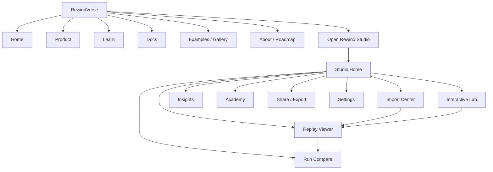
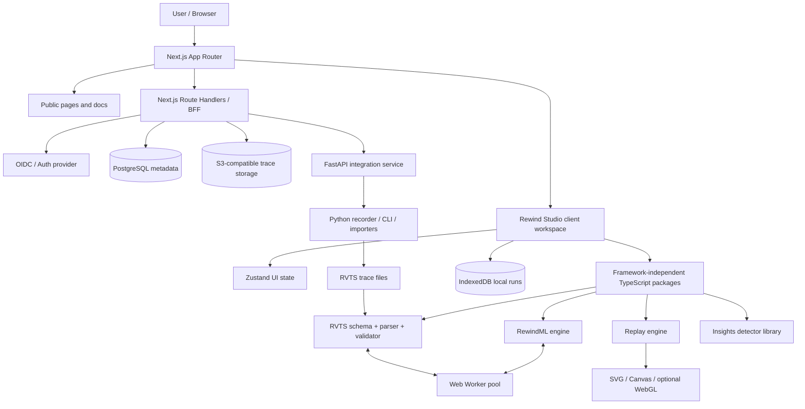
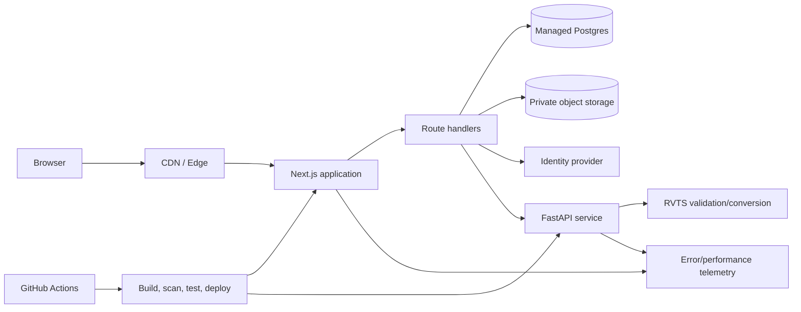
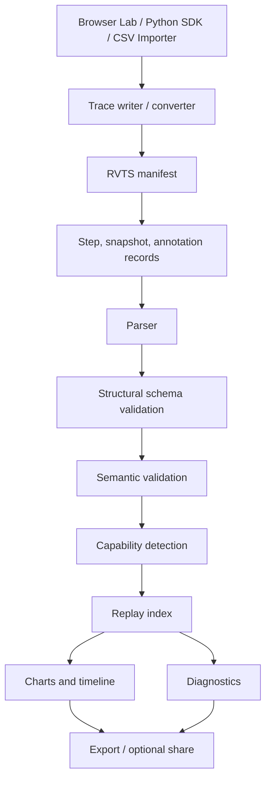
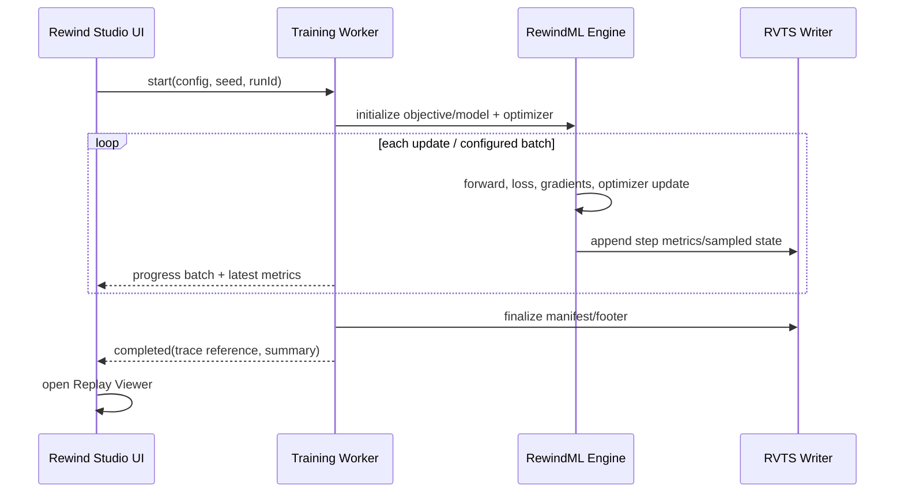
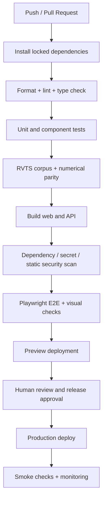

# RewindVerse — Website Design & Engineering Specification

**Document type:** Product website, application UX, visual design system, technical stack, engineering architecture and security standard  
**Product:** RewindVerse  
**Primary application:** Rewind Studio  
**Version:** 1.0  
**Date:** 7 November 2026  
**Status:** Authoritative implementation baseline — proposed architecture; implementation and verification are pending unless explicitly marked otherwise.

---

## 0. How to use this document

This document is the implementation guide for the RewindVerse public website and its browser-first ML workspace. It translates the final PRD into concrete design and engineering decisions. It should be used by product designers, frontend engineers, backend engineers, ML engineers, QA, and anyone reviewing the project.

### Decision labels

- **MUST** — required for the first production release.
- **SHOULD** — strongly recommended; deviations require a recorded reason.
- **MAY** — optional or later-stage capability.
- **P0** — blocks a usable release if missing.
- **P1** — important for product quality and adoption.
- **P2** — future expansion; do not delay the core vertical slice for it.

### Evidence rule

A design specification is not implementation evidence. A feature is only **implemented** when code exists, and only **verified** when automated or observed tests demonstrate that it works. This document defines the target architecture and acceptance criteria; it does not claim that the application, integrations, or security controls have already been built.

---

# 1. Product identity and design intent

## 1.1 Official identity

- **Platform:** RewindVerse
- **Main application:** Rewind Studio
- **Tagline:** Every Model Has a Story.
- **Product promise:** Train a model, then replay how it learned.
- **Core experience:** Train → Record → Replay → Inspect → Understand → Share.
- **Primary differentiator:** A learner-first, browser-first training replay experience connected by a portable, capability-aware trace format.

### Product module naming

| Name | Responsibility | Release horizon |
|---|---|---|
| RewindVerse | Public platform and umbrella brand | v1 |
| Rewind Studio | Main interactive ML workspace | v1 |
| RewindML | Browser-side training and ML computation engine | v1 |
| Rewind Replay | Deterministic trace viewer and timeline | v1 |
| Rewind Insights | Evidence-backed diagnostics and explanations | v1 initial detectors; expanded later |
| Rewind Compare | Side-by-side run and checkpoint comparison | v1/P1 |
| Rewind Academy | Lessons, guided challenges and learning paths | v1 basic lessons; expanded later |
| Rewind Data Observatory | Dataset profiling and data quality | Later release |
| Rewind Model Intelligence | Extended evaluation and model analysis | Later release |
| RVTS | RewindVerse Trace Specification | v1 draft; versioned standard over time |

The public brand name and application module names must be used consistently across navigation, documentation, repository naming, onboarding, release notes and screenshots. Preserve legacy `.mvtrace` support during migration; do not silently rename or invalidate existing files.

## 1.2 Positioning

RewindVerse is an interactive ML training replay and learning platform for people who want to understand not only a model's final metric, but also the sequence of events that produced it.

It is not positioned as a full MLOps replacement, hosted GPU training service, general AutoML service, or arbitrary code execution environment. Existing experiment tools already provide tracking and visualizations; RewindVerse must differentiate through guided replay, trace portability, careful capability disclosure, and explanations tied to recorded evidence.

## 1.3 Design principles

1. **Clarity before spectacle.** Visual design should make training behaviour easier to understand.
2. **Real data before decorative animation.** A chart or model state must come from recorded or computed evidence.
3. **One system, two experiences.** The public marketing site may be immersive; the Studio must remain focused and productive.
4. **Fast by default.** Heavy visuals, 3D scenes and dense charts load only when needed.
5. **Progressive disclosure.** Beginners see useful explanations; advanced users can inspect raw signals and metadata.
6. **Accessible interaction.** Every core operation works with keyboard, screen reader and reduced-motion settings.
7. **Local-first privacy.** Training and trace inspection happen in the browser by default; sharing is deliberate and revocable.
8. **Capability-aware UI.** Never show gradients, parameters, activations or replay controls if the trace does not contain the required information.
9. **Responsive at every size.** Mobile is a supported viewing and learning experience, not a compressed desktop dashboard.
10. **Honest system status.** Loading, unavailable, incomplete, failed and unsupported states must be clear.

---

# 2. Reference-site analysis and design translation

The following sites were supplied as visual and interaction references. They are inspiration for patterns, not assets or templates to copy. Use original layouts, illustrations, language, code and brand expression.

| Reference | Useful design lesson for RewindVerse | How to apply it | Guardrail |
|---|---|---|---|
| [Heron AI](https://heronaiapp.com/) | Product-specific hero that demonstrates the actual use case; interactive visual explanation | Show a small training replay in the hero instead of a generic AI slogan | The demo must be understandable without interaction and must not block initial rendering |
| [Cerebrium](https://cerebrium.ai/) | Clear technical product positioning, use-case navigation and conversion paths | Use concise audience/use-case routes and a clear “Open Studio” action | Avoid copying its cloud infrastructure positioning; RewindVerse is browser-first |
| [SharpLink](https://www.sharplink.com/) | High-trust dashboard and institutional product framing | Use clear KPI labels, source details, and stable layouts for metrics | Avoid finance-style claims or decorative number inflation |
| [Trionn](https://trionn.com/) | Crafted typography, deliberate brand storytelling and curated project presentation | Strong editorial hierarchy, restrained motion and carefully composed sections | Do not let agency-style portfolio animation impair product usability |
| [Dragonfly 2 / Studio Freight](https://dragonfly2.studiofreight.dev/) | Experimental interaction and art direction reference supplied by the user | Use as inspiration for a distinctive transition or visual moment after manual review | Automated page extraction was unavailable during this review; do not attribute specific behaviours without visual inspection |
| [Casa di Solare](https://casadisolare.com/) | Typographic personality and variable-type presentation | Use expressive display type sparingly in the landing hero and section transitions | Body text, tables and code remain highly legible |
| [ZRK Technology](https://www.zrk.technology/) | Technology-brand reference supplied by the user | Review manually during visual discovery and compare its information density and navigation | Automated extraction was unavailable; no specific page claims are made |
| [1367 Studio](https://www.1367studio.com/) | Simple service/product message and compact credibility structure | Use direct copy, compact trust signals and straightforward contact/documentation access | Avoid agency lead-generation patterns in the Studio app |
| [Zera Studio](https://zerasoftwarestudio.com/) | Minimal studio navigation and portfolio-led hierarchy | Keep public navigation short and purposeful | Do not create unnecessary pages purely for visual symmetry |
| [Active Theory](https://activetheory.net/) | Immersive, motion-led creative direction | Use one controlled, high-quality motion or spatial element in the public hero | The primary navigation and product CTA must remain immediate and accessible |
| [Sam Sy tutorial](https://samsy.ninja/tutorial) | Interactive/tutorial reference supplied by the user | Consider guided, step-by-step interactions in Rewind Academy | Supplied path returned 404 during automated review; inspect a current path before borrowing a specific pattern |
| [Spline](https://spline.design/) | Interactive 3D objects and real-time scene manipulation | Use optional 3D to explain a loss surface, parameter movement or model structure | 3D is progressive enhancement; provide a 2D/SVG fallback and a reduced-motion path |
| [Linear](https://linear.app/) | Dense product UI with clean hierarchy, command-driven navigation and crisp interaction | Use a calm application shell, compact command palette, keyboard shortcuts and disciplined spacing | Do not over-compress labels, controls or chart explanations |
| [Notion](https://www.notion.com/) | Scannable information architecture, flexible content surfaces and helpful empty states | Use predictable navigation, simple documentation pages and useful empty states | Avoid a generic block-editor interface; RewindVerse is a specialist ML tool |
| [Luma](https://lumalabs.ai/) | Strong visual storytelling, clear product actions and a cohesive creative system | Use a concise hero, strong product demo and clear path from concept to finished outcome | Avoid implying generative AI features that are not implemented |
| [Epiminds](https://epiminds.com/) | Bold AI product identity and agent/workflow storytelling | Use a clear narrative around a sequence of meaningful product actions | No agentic-AI claims unless a real, tested feature exists |
| [21 Hours on the Moon](https://www.21hrs.space/) | Narrative world-building and immersive atmosphere | Use subtle cosmic/orbital motifs aligned to the RewindVerse identity | Keep metaphor subtle; don't turn the full UI into a space game |
| [Porsche India](https://www.porsche.com/middle-east/_india_/) | Premium product storytelling, strong photography and confident restraint | Use high-quality product imagery, clean spacing and deliberate CTA placement | Do not replicate proprietary layout, assets, copy or brand elements |
| [Canvas UI](https://canvasui.dev/) | Reusable canvas/WebGL creative components | Use selected canvas/WebGL primitives for model landscapes and live visualizations | Treat canvas as a rendering surface, not a replacement for semantic HTML controls |

### Reference synthesis

The final design should combine:

- **Linear:** disciplined product interface and keyboard-first efficiency.
- **Notion:** strong information architecture and approachable content layout.
- **Trionn / Active Theory:** distinctive visual craft and purposeful motion.
- **Spline / Canvas UI:** interactive spatial visuals where they explain the model.
- **Luma / Cerebrium:** direct product storytelling and clear product entry points.
- **Porsche / Casa di Solare:** premium restraint and confident typography.
- **Heron AI / SharpLink:** a product demonstration and trustworthy data presentation.

Do not create a collage of these references. RewindVerse must have its own recognizable visual language: dark slate surfaces, cyan/blue/violet brand accents, a custom rewind-inspired R symbol, precise charts, compact diagnostics and a replay timeline.

---

# 3. Experience architecture and sitemap

## 3.1 Two experience layers

### Public website

Purpose: explain the product, establish trust, show what makes it different, teach the concept, and bring visitors into Rewind Studio.

### Rewind Studio application

Purpose: let users run, import, replay, inspect, compare and share training experiments.

The public website may use immersive storytelling. The Studio must optimize for task completion, legibility, keyboard navigation and reliable data inspection.

## 3.2 Sitemap



## 3.3 Route definition

| Route | Page | Access | Purpose |
|---|---|---|---|
| `/` | Home | Public | Main brand story, demo and conversion |
| `/product` | Product overview | Public | Explain lab, replay, diagnostics, imports and learning |
| `/learn` | Learning hub | Public | Explain concepts and link to guided experiences |
| `/docs` | Documentation | Public | RVTS, SDK, importers, guides and API docs |
| `/examples` | Example gallery | Public | Curated safe traces and guided experiments |
| `/roadmap` | Roadmap | Public | Transparent shipped/planned status |
| `/studio` | Studio home | Public/optional account | Recent local experiments, create/open actions |
| `/studio/lab` | Interactive Lab | Public/optional account | Run a supported model/optimizer in a worker |
| `/studio/import` | Import Center | Public/optional account | Validate and map uploaded trace/CSV files |
| `/studio/replay/[id]` | Replay Viewer | Local/share context | Inspect supported trace capabilities |
| `/studio/compare` | Run Compare | Local/share context | Compare two selected traces or runs |
| `/studio/insights` | Insights | Local/share context | Evidence-backed diagnostics |
| `/studio/academy` | Academy | Public/optional account | Lessons and challenges |
| `/share/[token]` | Shared trace | Public with token | View explicitly shared, read-only artifact |
| `/settings` | Settings | Optional account | Theme, privacy, exports and account preferences |

A public visitor must be able to try the first browser lab without creating an account. Accounts are introduced only when needed for cross-device persistence, team spaces or share management.

---

# 4. Visual design system

## 4.1 Overall aesthetic

**Direction:** premium technical, futuristic but restrained, dark-first with a fully designed light theme.

- Primary background: deep navy/slate, not pure black.
- Surfaces: layered slate neutrals with subtle 1px borders.
- Brand accent: cyan → electric blue → violet.
- Semantic status colors: green, amber, red, used sparingly and consistently.
- Main visual motif: rewind symbol + orbital path + training trajectory.
- Charts: neutral grid and axes; accent colors identify series, not decoration.
- Cards: bento-grid composition for public pages and selected overview panels; compact dense layouts inside the Studio.

Do not use a full-page glow, glassmorphism on every surface, or gradients behind every card. The brand should be recognizable without reducing text contrast.

## 4.2 Color tokens

All tokens MUST be semantic CSS variables in `globals.css`. Components use tokens, never direct brand hex values or Tailwind palette colors scattered through the codebase.

The values below are proposed starting tokens. They MUST be checked with a contrast tool before release; the final token values are not considered accessibility-certified until testing is recorded.

```css
@import "tailwindcss";

:root {
  color-scheme: light;
  --background: oklch(0.985 0.006 255);
  --surface: oklch(0.965 0.009 255);
  --surface-raised: oklch(1 0 0);
  --surface-overlay: oklch(0.995 0.004 255);
  --text: oklch(0.21 0.025 260);
  --text-muted: oklch(0.48 0.025 260);
  --border: oklch(0.88 0.012 260);
  --border-strong: oklch(0.80 0.018 260);
  --primary: oklch(0.56 0.19 255);
  --primary-foreground: oklch(0.99 0.004 255);
  --secondary: oklch(0.61 0.15 225);
  --accent: oklch(0.62 0.19 305);
  --success: oklch(0.57 0.15 155);
  --warning: oklch(0.68 0.15 75);
  --danger: oklch(0.58 0.20 25);
  --focus-ring: oklch(0.63 0.18 245);
  --chart-1: oklch(0.62 0.17 225);
  --chart-2: oklch(0.62 0.18 285);
  --chart-3: oklch(0.68 0.15 155);
  --chart-4: oklch(0.72 0.15 75);
  --chart-5: oklch(0.62 0.18 20);
  --brand-gradient: linear-gradient(110deg, oklch(0.76 0.16 210), oklch(0.62 0.21 255), oklch(0.68 0.21 315));
}

[data-theme="dark"] {
  color-scheme: dark;
  --background: oklch(0.15 0.025 265);
  --surface: oklch(0.19 0.025 265);
  --surface-raised: oklch(0.225 0.028 265);
  --surface-overlay: oklch(0.255 0.03 265);
  --text: oklch(0.96 0.009 255);
  --text-muted: oklch(0.72 0.02 255);
  --border: oklch(0.34 0.025 265);
  --border-strong: oklch(0.43 0.03 265);
  --primary: oklch(0.78 0.15 210);
  --primary-foreground: oklch(0.18 0.03 265);
  --secondary: oklch(0.72 0.17 255);
  --accent: oklch(0.73 0.19 315);
  --success: oklch(0.76 0.15 155);
  --warning: oklch(0.82 0.14 80);
  --danger: oklch(0.72 0.18 25);
  --focus-ring: oklch(0.78 0.15 210);
  --chart-1: oklch(0.78 0.15 210);
  --chart-2: oklch(0.73 0.19 285);
  --chart-3: oklch(0.76 0.15 155);
  --chart-4: oklch(0.82 0.14 80);
  --chart-5: oklch(0.72 0.18 25);
  --brand-gradient: linear-gradient(110deg, oklch(0.78 0.15 210), oklch(0.67 0.20 255), oklch(0.72 0.20 315));
}

:where(button, a, input, select, textarea, [tabindex]):focus-visible {
  outline: 2px solid var(--focus-ring);
  outline-offset: 3px;
}

html { background: var(--background); color: var(--text); }
body { min-height: 100vh; background: var(--background); color: var(--text); }
```

### Color rules

- Use `--text` on `--background` and `--surface` for normal content.
- Use `--text-muted` only where its contrast remains adequate for the relevant font size.
- Use `--primary` for action emphasis, not as a large background behind long text unless the foreground contrast is checked.
- Do not communicate success, failure or severity through color alone; include text or an icon with an accessible label.
- Chart series colors must be accompanied by labels, line styles or marker distinctions.
- Validate all text and essential graphical controls against WCAG 2.2 AA; target 4.5:1 for normal text and 3:1 for large text and meaningful UI graphics.

## 4.3 Typography

| Role | Typeface | Guidance |
|---|---|---|
| Display | Geist Sans / approved geometric sans | Strong, compact; use sparingly |
| Headings | Geist Sans | Clear scale, restrained weights |
| Body | Geist Sans | Comfortable line-height 1.5–1.65 |
| Code / data / metrics | Geist Mono | Numeric alignment, code and trace metadata |
| Optional editorial accent | Licensed variable display type | Only for marketing storytelling; never for dense app UI |

Font loading MUST be local/self-hosted or use a framework font pipeline that avoids layout shifts. Always specify fallback stacks. Avoid more than two font families in the primary interface.

Suggested scale (desktop):

| Token | Size | Use |
|---|---:|---|
| `display-xl` | 64–80 px | Landing hero only |
| `display-lg` | 48–60 px | Marketing section hero |
| `h1` | 36–44 px | Page title |
| `h2` | 28–32 px | Section title |
| `h3` | 20–24 px | Card/panel title |
| `body-lg` | 18 px | Lead copy |
| `body` | 15–16 px | Default body |
| `small` | 13–14 px | Metadata and helper text |
| `micro` | 11–12 px | Avoid for essential content |

Use `clamp()` for responsive display type and never allow heading text to overflow its container.

## 4.4 Layout and spacing

- Main marketing content max-width: 1320–1440 px.
- Studio content max-width: fluid; preserve usable chart widths.
- Desktop gutters: 32–48 px; tablet: 24 px; mobile: 16–20 px.
- Base spacing unit: 4 px; standard gaps: 8, 12, 16, 24, 32, 48, 64 px.
- Card radius: 12–18 px; larger hero surfaces: 20–28 px.
- Borders: subtle 1 px; use shadow only to indicate elevation, not to outline every card.
- Bento grids: `grid-cols-1 md:grid-cols-3` or `md:grid-cols-4`, with explicit spans and a consistent gap.
- Studio app: denser than marketing pages; never apply marketing whitespace to every tool panel.

## 4.5 Backgrounds and visual assets

Never build the hero as a flat, empty color block. Use a layered but restrained composition:

1. Deep navy base gradient.
2. Soft blurred cyan/blue/violet mesh gradients.
3. Fine grain/noise overlay at very low opacity if it does not affect readability.
4. Original SVG orbital arcs, trace nodes or wave paths.
5. A real, small interactive training replay visual (preferred) or a 3D loss surface as a progressive enhancement.

Asset rules:

- Store authored assets in `public/assets/` with descriptive names.
- Prefer SVG for the brand mark and simple diagram art.
- Use optimized AVIF/WebP for raster images and responsive `srcset`/framework image optimization.
- Never use a large background video as the only source of product explanation.
- Decorative SVG must be `aria-hidden="true"`; explanatory visuals need a text equivalent.
- Respect reduced-motion and data-saving preferences.

---

# 5. Brand and logo usage

The approved visual direction is a custom RewindVerse “R” symbol integrated with rewind arrows and a subtle training/data trajectory, paired with the RewindVerse wordmark. The standalone symbol is suitable for favicon and compact app mark; the unified wordmark is suitable for marketing header and documents.

### Brand lockups

- **Primary header:** symbol + wordmark on one baseline.
- **Compact header:** symbol only when available width is insufficient; accessible name remains “RewindVerse”.
- **Favicon/app tile:** symbol only, simplified to remain legible at 16–32 px.
- **Light mode:** use a dark wordmark and brand-gradient symbol.
- **Dark mode:** use white/light wordmark and brand-gradient symbol.
- **Clear space:** at least the width of the inner rewind triangle around the logo.
- **Minimum size:** define and test the final exported SVG/PNG variants before release.

Do not place a second large standalone R next to the complete RewindVerse wordmark. The custom R is the first character of the wordmark, not an unrelated badge.

---

# 6. Website page design specification

## 6.1 Global header

**Desktop:** logo left; Product, Learn, Docs, Examples/Resources; theme switch; “Open Studio” primary action right.  
**Mobile:** logo left, accessible menu button right; the menu opens a full-height or anchored panel with the same navigation and an obvious Studio action.

Header requirements:

- Sticky only after a small scroll threshold; do not consume excessive vertical space.
- Use a low-opacity surface with a subtle border/backdrop only if text contrast remains clear.
- Keyboard focus must be visible.
- Mobile menu traps focus while open and returns focus to the trigger when closed.
- Route changes close the mobile menu.

## 6.2 Landing page

### Section order

1. **Hero:** concise product promise and a real replay visual.
2. **Product proof:** show a training run timeline with loss/parameter movement.
3. **Core workflow:** Train → Record → Replay → Inspect → Understand.
4. **Feature bento:** Interactive Lab, Replay, Insights, Compare, Academy.
5. **How it works:** browser engine + RVTS trace + replay engine.
6. **Example trace:** let the user scrub through a sample run.
7. **Learning value:** explain optimizer behaviour and training diagnostics.
8. **Developer integration:** show Python recorder/CLI and trace portability.
9. **Trust and privacy:** local-first processing, file safety and transparent limitations.
10. **Closing CTA:** open Rewind Studio; view documentation.

### Hero content (working copy)

**Headline:** Every Model Has a Story.  
**Supporting copy:** Train a model, replay every important step, and understand what changed along the way.  
**Primary action:** Open Rewind Studio  
**Secondary action:** Explore a replay

### Hero visual behaviour

- Demonstrate a small actual optimizer run or an authored deterministic sample trace.
- The display must label demo data as a sample when it is not a live user run.
- The user can press play/pause, scrub and inspect one or two events.
- Do not autoplay audio or force a full-screen WebGL experience.
- On small screens, replace complex 3D with a responsive SVG/canvas snapshot and a clear “Try the interactive demo” action.

## 6.3 Product page

Use a clear overview of the platform and its five core capabilities. Each feature block links to an actual in-product workflow or documentation page. Do not present future capabilities as shipped.

## 6.4 Learn page

- Group lessons by topic: optimization, gradients, generalization, model architectures, diagnostics.
- Show level, estimated time, prerequisites and learning outcome.
- Lessons must have a concise conceptual explanation, interactive activity, checkpoint questions and answer explanation.
- Avoid gamification that pressures users; progress is supportive, not coercive.

## 6.5 Documentation page

- Sidebar + readable article column + optional right-side table of contents on desktop.
- Mobile uses a drawer/table-of-contents panel.
- Code examples have copy controls and language labels.
- Show version badges for RVTS and SDK documentation.
- Clearly label stable, experimental and deprecated APIs.

---

# 7. Rewind Studio application design

## 7.1 App shell

Desktop structure:

- **Left sidebar:** logo, primary navigation and recent runs.
- **Top bar:** breadcrumb/page title, current run, status, theme, help and account actions.
- **Main workspace:** task-specific panels and visualizations.
- **Inspector panel:** contextual details; collapsible on smaller desktop/tablet.
- **Bottom replay bar:** timeline and play/scrub controls on replay pages.

Mobile structure:

- Sidebar becomes a drawer or compact bottom navigation with no more than five primary destinations.
- Inspector becomes a sheet or collapsible section.
- Charts stack vertically.
- Replay controls remain reachable and do not cover axis labels or content.
- Wide data tables scroll inside their own container and retain visible column labels.

## 7.2 Studio overview

Show:

- Create experiment.
- Open/import trace.
- Recent runs (local-first).
- Example traces.
- Learning progress (if Academy data exists).
- Product/system status and helpful next actions.

Empty state must include at least one practical action: “Run your first experiment” and one sample trace to explore.

## 7.3 Interactive Lab

Layout:

- Main visualization canvas (loss contour or model-specific view).
- Side control panel: objective/model, optimizer, learning rate, iteration count, initialization, batch settings when relevant.
- Training metrics: loss, gradient norm, learning rate, step.
- Bottom transport controls: run, pause, step, reset, save trace.

Requirements:

- Every control has a label, helper text and valid range.
- Invalid combinations are explained before execution.
- A running job can be paused, cancelled and reset.
- Training runs in a Web Worker.
- A run generates a trace with actual values; visual interpolation is for rendering only and must not fabricate recorded states.
- Persist recent runs locally with user-controlled deletion.

## 7.4 Import Center

Stages:

1. Choose source: `.rvtrace`, `.rvtrace.gz`, legacy `.mvtrace`/`.mvtrace.gz`, supported metrics CSV; additional formats only after their importer is implemented.
2. Validate file type, compressed and decompressed sizes, line count and schema.
3. Parse manifest/columns and detect supported capabilities.
4. Show a mapping preview for CSV imports.
5. Display warnings: missing series, duplicated steps, non-monotonic steps, unknown metadata, unsupported records.
6. Confirm import.
7. Open trace in Replay Viewer.

Never silently invent gradients, parameters, activations, dataset records or training events from metrics that were not supplied.

## 7.5 Replay Viewer

Main zones:

- Header with run name, source, model/optimizer metadata, conformance and privacy label.
- Timeline with step index and event markers.
- Synchronized charts: loss/metrics, gradient summary, parameter summary, learning-rate schedule.
- Detail inspector with exact value, step unit, original source and provenance.
- Capability panel that lists available and unavailable views.

The viewer must state whether a view is:

- Recorded directly in the trace.
- Derived from recorded data by a versioned diagnostic.
- A visualization of a declared replay model/objective.
- Unavailable because the input trace lacks required information.

## 7.6 Run Compare

- Select two runs.
- Show their source, model/objective, optimizer, hyperparameters, step unit and trace capabilities.
- Align by step only when units and semantics match.
- Offer an explicit alignment strategy if units differ; never silently compare epoch 4 to optimizer update 4.
- Highlight metric deltas and event differences.
- Allow switching between overlay and side-by-side mode.

## 7.7 Insights

- Every detector shows the detector name/version, required signals, thresholds, analysis window, evidence range and confidence/limitations.
- Wording is cautious: “may indicate overfitting” rather than “the model is overfitting” unless a deterministic criterion supports the stronger statement.
- User can jump to evidence steps in Replay.
- Diagnostics never alter the source trace.

## 7.8 Academy

- Guided lesson, interactive activity, checkpoint questions, feedback and next step.
- Explain concepts in beginner and advanced layers.
- Keep lesson completion local until sync is enabled.
- No leaderboards or manipulative streak patterns in v1.

---

# 8. Responsive design requirements

## 8.1 Breakpoint strategy

Use mobile-first layout. The exact breakpoints can follow the chosen Tailwind configuration, but the layout must be tested at these widths:

| Test width | Representative device | Required behaviour |
|---:|---|---|
| 320 px | Small mobile | No horizontal page overflow; key actions usable |
| 360–390 px | Common mobile | Hero, nav, cards and charts stack cleanly |
| 430 px | Large mobile | Use available width without microscopic controls |
| 768 px | Tablet portrait | Sidebar/drawer and two-column card layouts |
| 1024 px | Tablet landscape/small laptop | Compact Studio shell and readable charts |
| 1280 px | Laptop | Full workspace with collapsible inspector |
| 1440 px | Desktop | Full navigation and standard bento layouts |
| 1920 px | Large desktop | Content width remains controlled; no stretched text |

## 8.2 Responsive acceptance criteria

- No horizontal overflow at any required width except intentional table/chart scrollers.
- No text truncation that hides a control's purpose.
- Touch targets should meet WCAG 2.2 target-size expectations or an applicable spacing exception; aim for 44×44 CSS px for primary touch controls.
- Chart controls remain usable with touch and keyboard.
- Canvas and WebGL resize correctly after orientation or container changes.
- Mobile layout must not depend on hover.
- Navigation and modals work at 200% zoom.

---

# 9. Motion and interaction system

Use Motion for React (`motion/react`) for React motion components; use selected motion-primitives only where they improve a real pattern. Framer Motion is the historical package name; new code should follow the current Motion documentation and package API.

## 9.1 Motion tokens

Default spring for layout and interaction transitions:

```ts
export const motionTokens = {
  spring: { type: "spring", stiffness: 300, damping: 30 },
  quick: { duration: 0.16, ease: "easeOut" },
  standard: { duration: 0.24, ease: "easeOut" },
  slow: { duration: 0.42, ease: "easeInOut" },
};
```

This is a baseline, not a command to spring-animate every element. Use short, subtle transitions for hover/focus; use the spring profile for layout transitions, drawers and selected spatial objects.

## 9.2 Interaction rules

- Hover state must not be the only way to reveal important information.
- Buttons show pressed, disabled, loading and success/error states.
- Drag/reorder actions must have keyboard alternatives.
- Modals and drawers must manage focus correctly.
- Avoid parallax that moves content under the pointer or causes motion discomfort.
- Use `prefers-reduced-motion: reduce` to remove or substantially simplify non-essential animation.
- Never animate chart values in a way that suggests data that was not recorded.
- Keep motion purposeful: show cause, progression, focus or state transition.

---

# 10. Technical stack — recommended baseline

The stack is optimized for a product with a public marketing site, a highly interactive browser workspace, Python integration and portable trace files. Avoid splitting the app into microservices prematurely.

| Layer | Selected technology | Why | Status |
|---|---|---|---|
| Web app and public site | Next.js App Router + React + TypeScript | SEO/public routes, server rendering for content, client components for Studio interactivity | Recommended |
| Styling | Tailwind CSS + CSS custom properties using OKLCH | Fast responsive implementation and semantic theming | Recommended |
| UI primitives | shadcn/ui + Radix UI primitives | Accessible, source-owned components and consistent interaction patterns | Recommended |
| Motion | Motion for React; selective motion-primitives | Spring-based UI motion without building an animation system from scratch | Recommended |
| Client state | Zustand | Small, predictable state store for lab/replay UI | Recommended |
| Server/cache state | Next.js server data patterns; TanStack Query only for complex client cache needs | Avoid duplicate state libraries unless needed | Recommended |
| Validation (web/API) | Zod | Runtime validation at TypeScript boundaries and inferred types | Recommended |
| Trace schema validation | JSON Schema Draft 2020-12 + Ajv 2020 entry | Canonical cross-language RVTS contract | Required |
| Charts | D3 scales/shape/layout with React-rendered SVG | Fine control over chart interaction and responsive drawing | Recommended |
| Dense plots | Canvas 2D; WebGL for selected advanced scenes | Handles large point clouds without thousands of DOM nodes | Recommended |
| 3D | Three.js / React Three Fiber (lazy-loaded) | Optional loss surfaces and model visualizations | P2/progressive |
| Browser compute | Web Workers + TypedArrays/Float64Array | Keeps training and parsing away from main UI thread | Required |
| Local persistence | IndexedDB; Dexie optional wrapper | Store recent runs and traces locally | Required |
| Backend API | FastAPI + Python + Pydantic | Python SDK, conversion/import jobs and future integrations | P1 |
| BFF/API routes | Next.js Route Handlers | Auth, share lifecycle, metadata and web-facing operations | Recommended |
| Metadata database | PostgreSQL (managed provider) | Accounts, workspaces, share metadata, preferences | P1/when accounts are enabled |
| Object storage | S3-compatible object storage | Store explicitly shared trace artifacts | P1/when sharing is enabled |
| Authentication | OIDC-compatible provider; Auth.js or managed auth adapter | Avoid homemade auth; keep provider replaceable | P1 |
| Python SDK | Python, NumPy; optional PyTorch/scikit-learn adapters | Record real training state with predictable overhead | P1 |
| API contract docs | OpenAPI generated from FastAPI; versioned TS schemas | Cross-team and SDK contract clarity | Required |
| Unit/component tests | Vitest + Testing Library | Fast feedback for logic and components | Required |
| Browser/E2E tests | Playwright | Cross-browser journeys, screenshots and traces | Required |
| Python tests/lint | Pytest + Ruff + mypy/pyright as appropriate | SDK reliability and typed Python code | Required |
| CI/CD | GitHub Actions | Reproducible build, checks, release workflow | Required |
| Error/observability | Sentry + OpenTelemetry where needed | Errors, traces and performance without collecting raw trace contents | P1 |
| Product analytics | Privacy-configured PostHog or similar | Funnel and adoption evidence | P1 |
| Documentation | Markdown/MDX in repo | Docs version with implementation | Required |

### Architecture decision: Next.js rather than Vite-only

The earlier technical concept considered React + Vite. For a product with a public SEO-oriented website, docs, examples and an interactive Studio, the recommended baseline is one Next.js App Router application. Use Server Components for public content and route shells; use Client Components for interactive Studio panels, charts and browser APIs. This reduces duplicated routing and design systems. Keep the ML engine, trace parser and replay engine as framework-independent TypeScript packages so they can later be used in a Vite-based embed or desktop client if there is a proven need.

### Do not add in v1 without evidence

- Kubernetes, service mesh or multi-region distributed compute.
- Redis for simple metadata or single-user local runs.
- A GPU training fleet.
- Kafka/event streaming for ordinary trace imports.
- A microservice per feature.
- A general-purpose plugin marketplace.
- Arbitrary code execution or notebook server hosting.

---

# 11. System architecture

## 11.1 Logical architecture



## 11.2 Responsibility boundaries

### Next.js application

- Public website and documentation.
- Studio shell and routing.
- Authentication/session boundaries when accounts are enabled.
- Share-link creation/revocation APIs.
- Metadata endpoints and BFF operations.
- Do not run heavy model training in server route handlers.

### TypeScript core packages

- Algorithm implementations and deterministic fixtures.
- Trace parsing, validation, capability detection and migration.
- Replay state and indexing.
- Diagnostics and evidence calculations.
- Shared units/step alignment and numeric conventions.

These packages MUST NOT import React or Next.js. They should be testable in Node and usable in a browser worker.

### Web Workers

- Run optimizer iterations and supported toy/model training.
- Parse large traces and validate JSONL records.
- Compute derived indices and diagnostics.
- Return progress/results in batches.
- Support cancellation and error reporting.
- Never assume worker message transfer is zero-cost; use transferable ArrayBuffers when beneficial and account for ownership transfer.

### FastAPI service

- Python SDK validation and conversion endpoints where required.
- Optional server-side trace inspection or asynchronous conversions.
- No execution of user-submitted Python or notebook code.
- No arbitrary pickle deserialization.
- Strict request size, timeout and concurrency limits.

### PostgreSQL and object storage

- Database stores user/workspace/share metadata, not large trace arrays.
- Object storage stores trace objects only when a user explicitly shares or syncs them.
- Private by default; access checked server-side for every object read/write.

## 11.3 Deployment architecture



Deployment recommendation:

- Next.js: managed platform supporting App Router and edge/CDN delivery (Vercel is a viable default; provider remains replaceable).
- FastAPI: managed container platform such as Cloud Run/Fly.io/AWS ECS after the service is needed.
- PostgreSQL: managed PostgreSQL, private network/connection pooling.
- Object storage: private S3-compatible bucket with lifecycle rules and signed URLs.
- CI: GitHub Actions with protected main branch and environment-specific secrets.

Do not introduce a public backend dependency for the core local lab/replay journey. The site must still support browser lab, trace import and replay when the API is temporarily unavailable, within documented local capability boundaries.

---

# 12. Data architecture and RVTS integration

## 12.1 Trace-first principle

Every supported training source produces a trace conforming to the RewindVerse Trace Specification (RVTS). The viewer consumes RVTS; it does not need to know whether the trace came from the browser lab, Python SDK or an importer.

Recommended extension: `.rvtrace` and compressed `.rvtrace.gz`. Legacy `.mvtrace` remains readable through a migration/compatibility adapter. The canonical format and its JSON Schema must be versioned independently of the web app release.

## 12.2 Trace lifecycle



## 12.3 Required trace metadata

- `format`, `format_version`, `created_at`, `producer`, producer version.
- Run identifier and optional human-readable run title.
- Model/objective type, optimizer and hyperparameter metadata when known.
- Explicit `step_unit` (e.g. optimizer update, epoch, iteration).
- Series definitions, data type, role and sampling cadence.
- Privacy label: `no_data`, `summary_only`, or `includes_samples`.
- Capability/conformance declaration.
- Optional snapshots and annotations.
- Optional integrity footer/checksum; checksum is not authentication.

## 12.4 Capability-aware UI rules

| Capability | Minimum information needed | UI outcome when present |
|---|---|---|
| Scalar metrics | Metric records and step unit | Metric charts |
| Gradient summaries | Gradient norm or grouped gradient series | Gradient panel |
| Parameter summaries | Parameter norms or selected values | Parameter panel |
| Snapshots | Declared snapshot payloads | Snapshot inspector |
| Model/objective replay | Registered semantics and required model state | Interactive model-specific replay |
| Diagnostics | Detector-required input series | Evidence-backed insight |

If a capability is missing, show “Not available in this trace” and the reason. Do not display fake/zero values as placeholders.

## 12.5 Validation and file safety

- Validate file extension and content; extension alone is not trusted.
- Reject unsupported encodings, BOM if not supported, malformed JSON and invalid gzip.
- Enforce compressed and decompressed size limits, line-size limits, record-count limits and nesting-depth limits.
- Stream JSONL parsing; do not load unbounded files fully into memory.
- Prevent gzip bombs with decompressed byte and expansion-ratio limits.
- Reject path traversal and never extract arbitrary archive paths.
- Do not deserialize Python pickle, joblib or arbitrary model objects.
- Treat all trace strings, metadata and annotations as untrusted; render as text, never raw HTML.
- Preserve original step values and warnings in conversion reports.

---

# 13. ML engine and algorithm architecture

## 13.1 Execution model

The browser lab runs real supported algorithms in a Web Worker. The main thread controls the interface, visualizes received data and stores UI state. Worker communication uses versioned typed message unions.



## 13.2 Core algorithm contracts

### Gradient descent

For objective \(J(\theta)\):

\[
\theta_{t+1}=\theta_t-\eta\nabla J(\theta_t)
\]

Where \(\eta\) is the learning rate. The implementation must specify whether the gradient is based on the entire dataset or a batch.

### Momentum

PyTorch-style convention must be documented and tested. One acceptable baseline is:

\[
v_t=\mu v_{t-1}+g_t,\quad \theta_{t+1}=\theta_t-\eta v_t
\]

Do not claim parity with another framework unless initialization, dampening, Nesterov, weight decay and step ordering match.

### Adam

\[
m_t=\beta_1m_{t-1}+(1-\beta_1)g_t
\]
\[
v_t=\beta_2v_{t-1}+(1-\beta_2)g_t^2
\]
\[
\hat m_t=\frac{m_t}{1-\beta_1^t},\quad \hat v_t=\frac{v_t}{1-\beta_2^t}
\]
\[
\theta_{t+1}=\theta_t-\eta\frac{\hat m_t}{\sqrt{\hat v_t}+\epsilon}
\]

The epsilon placement is part of the parity contract. AMSGrad and decoupled weight decay are not part of the initial parity contract unless implemented and tested separately.

## 13.3 Numerical correctness

- Use deterministic PRNG seeded in the run manifest.
- Browser and Python PRNGs do not need to produce identical streams; exact parity fixtures must inject the same input arrays, weights and batch order.
- Use Float64 for educational optimizer parity and gradient checks where feasible.
- Record dtype in trace metadata.
- Use central finite-difference gradient checks on smooth objectives; avoid non-differentiable points such as ReLU kinks.
- Define absolute/relative tolerances per algorithm and dtype.
- Publish parity reports with equation, implementation version, fixtures, tolerance, maximum observed error and pass count.
- Keep training and visualization interpolation separate. UI interpolation must never be written back as a model state.

## 13.4 Initial supported models/objectives

- 2D quadratic bowl, saddle and Rosenbrock objective for optimizer demonstration.
- Logistic regression with clear loss and regularization convention.
- Small MLP only after forward/backprop and numerical tests pass.
- Transformer explorer is future scope; do not add a fake 3D “loss landscape” for real large models.

---

# 14. Frontend component system

## 14.1 Component ownership

Build reusable components in source, not one-off page markup. Use shadcn/ui and Radix as starting primitives but apply RewindVerse design tokens and interaction rules.

### Foundation

- `Button`, `IconButton`, `Input`, `Select`, `Checkbox`, `Switch`, `Slider`, `Tabs`.
- `Tooltip`, `Popover`, `Dialog`, `Drawer`, `DropdownMenu`, `CommandPalette`.
- `Card`, `Panel`, `Badge`, `StatusIndicator`, `Divider`, `Skeleton`, `Toast`.

### Product components

- `BrandLogo`, `AppShell`, `Sidebar`, `Topbar`, `Breadcrumbs`.
- `ExperimentCard`, `RunMetadata`, `CapabilityList`, `TraceDropzone`, `ImportMappingTable`.
- `ReplayTimeline`, `PlaybackControls`, `StepScrubber`, `EventMarker`, `TraceInspector`.
- `MetricChart`, `GradientChart`, `ParameterChart`, `LossLandscape`, `RunCompareChart`.
- `DiagnosticCard`, `EvidenceRange`, `LearningCheckpoint`, `ShareDialog`.

### Component requirements

- Typed props and documented empty/loading/error states.
- Accessible names and keyboard behaviours.
- No raw database/trace models directly as UI props; map through view models.
- Visual regression snapshots for critical components.
- No component may bypass design tokens without documented reason.

## 14.2 Chart standards

- All charts have titles, units, step unit and legend.
- Axes include readable ticks and no overlapping labels.
- Hover is supplemental; keyboard and touch inspection are supported.
- A table/summary provides an accessible alternative to canvas-only charts.
- Decimation is applied for dense data; raw data remains available for exact inspection.
- Never smooth or interpolate data without labeling it as a visual transformation.

---

# 15. UX states and error handling

Every core page must define:

- Initial/empty state.
- Loading state.
- Success state.
- Validation error.
- Recoverable error.
- Fatal/unrecoverable error.
- Offline or server-unavailable state.
- Unsupported capability state.
- Permission denied state.

### Example copy patterns

- “This trace contains scalar metrics only. Gradient and parameter views are not available.”
- “The file is larger than the current import limit. Try a compressed trace or a smaller export.”
- “The training worker stopped unexpectedly. Your last saved trace remains available.”
- “This share link has expired or has been revoked.”

Do not expose internal stack traces, database messages, secrets or raw server exception text to users.

---

# 16. Accessibility standard

Target WCAG 2.2 AA for all core journeys.

- Semantic HTML first; ARIA only when necessary.
- Full keyboard operation for navigation, controls, dialogs, timeline and charts.
- Visible focus rings and logical tab order.
- Screen-reader labels for icon-only buttons.
- Reduced-motion handling.
- Contrast validation for text, UI boundaries and focus indicators.
- Do not rely solely on color or hover.
- Provide a textual/table representation for charts and visual model states.
- Captions/transcripts for instructional media.
- Respect 200% zoom and reflow; avoid two-dimensional scrolling except for content where it is essential (e.g. wide data tables).
- Automated checks with axe plus manual keyboard and screen-reader testing.

---

# 17. Performance and resilience

## 17.1 Web performance goals

Field targets at the 75th percentile, segmented by mobile and desktop:

| Metric | Good target |
|---|---:|
| Largest Contentful Paint (LCP) | ≤ 2.5 s |
| Interaction to Next Paint (INP) | ≤ 200 ms |
| Cumulative Layout Shift (CLS) | ≤ 0.1 |

These are web.dev Core Web Vitals “good” thresholds; record actual field and lab results rather than claiming compliance from a Lighthouse score alone.

## 17.2 Studio performance profiles

Benchmark separately:

- Standard laptop profile.
- Lower-powered laptop profile.
- Mobile viewer profile.

Measure:

- Initial route load and JS bundle sizes.
- Trace parse and validation time by file size/record count.
- Replay scrub latency.
- Chart redraw time and memory.
- Worker throughput.
- IndexedDB write/read latency.
- Cancellation responsiveness.

Use 10k, 100k and larger trace fixtures as explicit benchmark tiers, with hardware and browser stated. Set numerical acceptance targets after a baseline measurement; do not invent speed figures.

## 17.3 Performance techniques

- Keep Server Components for static public content.
- Lazy-load 3D and rarely used modules.
- Dynamically import large visualization libraries only on routes that need them.
- Use workers for training, parsing and CPU-heavy diagnostics.
- Batch worker messages; avoid per-point React state updates.
- Use transferable ArrayBuffers for large typed arrays where beneficial; remember transfer moves ownership and detaches the sender's buffer.
- Use Canvas for large scatter/point clouds; SVG for interactive axes and smaller charts.
- Use virtualization for long run lists and data tables.
- Avoid large base64 data URLs and unbounded in-memory copies.

---

# 18. Security architecture and secure development rules

Security is a release requirement. Use OWASP ASVS 5.0 as a verification baseline and adapt the applicable controls to the actual architecture. A security checklist is not a substitute for a threat model, tests and review.

## 18.1 Threat model

| Asset | Threat | Required mitigation |
|---|---|---|
| User account/session | Session theft, account takeover | OIDC/managed auth, secure cookies, MFA option, session rotation/revocation |
| Private traces | IDOR, unintended exposure | Server-side ownership checks, private storage, short-lived signed URLs |
| Uploaded traces | Malformed JSON, decompression bomb, parser DoS | Streaming parser, strict size/depth/count limits, worker isolation and cancellation |
| Metadata/annotations | XSS or HTML injection | Treat as untrusted text; no raw HTML rendering; sanitize if rich text is ever allowed |
| API endpoints | Injection, mass assignment, over-posting | Zod/Pydantic schemas, allow-listed fields, parameterized DB operations |
| Public share links | Brute force, leakage, indefinite exposure | High-entropy tokens, expiry, revocation, rate limits, least data |
| Environment secrets | Repo/history/log leak | Secret manager, CI secret scanning, no client exposure |
| Build pipeline | Dependency/supply-chain compromise | Lockfile, dependency review, SCA, provenance/signing where practical |
| Browser compute | CPU/memory exhaustion | Worker timeouts, cancellation, input ceilings, no unbounded loops |
| Python integration | Pickle/code execution | Never load arbitrary pickle/joblib; no arbitrary user code execution |

## 18.2 Validation at every boundary

- TypeScript web/API requests: Zod schemas at route/form boundaries.
- RVTS format: JSON Schema Draft 2020-12 with Ajv 2020 validator; semantic checks separately.
- Python: Pydantic models for external payloads and configuration.
- Environment: validate required environment variables at startup with Zod/Pydantic; fail fast with a safe message.
- Uploads: validate magic/content, size and structure; never trust filename/MIME type alone.
- Database: parameterized queries and least-privilege service role.
- UI forms: client-side validation improves feedback, server-side validation remains authoritative.

## 18.3 Authentication and authorization

- Anonymous local mode is supported for v1 core journeys.
- When accounts are introduced, use OIDC/managed identity; do not write password handling from scratch.
- Use Secure, HttpOnly, SameSite cookies for session identifiers.
- Protect state-changing requests against CSRF according to the chosen session architecture.
- Authorize every trace metadata and object-storage operation server-side.
- Public share IDs must be unguessable, revocable and optionally expiring.
- Never trust client-side role, workspace ID or owner ID.
- Account deletion must remove or orphan owned cloud artifacts according to a disclosed retention policy.

## 18.4 API protection

- HTTPS only in production; HSTS after HTTPS deployment is confirmed.
- Strict CORS allowlist; do not use wildcard origins with credentials.
- Content Security Policy with nonces/hashes as appropriate; avoid `unsafe-eval`.
- Security headers: frame restrictions, MIME sniffing protection, referrer policy and permissions policy.
- Rate limit authentication, sharing, import and conversion endpoints.
- Apply request body, file size, execution time and concurrency limits.
- Use idempotency keys for operations that create share records or remote artifacts where retries could duplicate actions.
- Return generic errors; log a correlation ID, not secrets or file contents.

## 18.5 File and trace security

- No arbitrary script execution from a trace.
- No raw HTML injection from labels, annotations or markdown-like content.
- No pickle/joblib deserialization of untrusted artifacts.
- No archive extraction unless required; if required, block path traversal and enforce entry-count/size limits.
- Limit compressed and decompressed bytes, expansion ratio, JSON depth, per-line bytes and record count.
- Parse in a worker or isolated service with timeout/cancellation.
- Keep imported trace local unless a user explicitly chooses cloud sharing.
- Public-share export defaults to metadata minimization and excludes raw samples unless the user explicitly opts in.

## 18.6 Privacy and analytics

- Never send trace values, raw data samples, model parameters or user code to product analytics.
- Analytics should record coarse events such as `lab_started`, `trace_imported`, `replay_completed`, `share_created` without the trace itself.
- Provide clear analytics opt-in/opt-out where required.
- Document retention, export, deletion and incident contact process.
- Review applicable Indian DPDP Act obligations and other relevant privacy laws with qualified counsel before public launch; do not claim legal compliance without review.

## 18.7 Security release checklist

- [ ] Threat model updated for current routes and integrations.
- [ ] ASVS-relevant controls mapped and reviewed.
- [ ] Dependency, secret and static analysis scans pass.
- [ ] Auth/session and authorization tests pass.
- [ ] IDOR and share-token tests pass.
- [ ] Malformed trace, oversized file and gzip bomb tests pass.
- [ ] XSS payloads in names/annotations render as inert text.
- [ ] CSP and security headers verified in production-like deployment.
- [ ] No private trace content appears in logs/analytics.
- [ ] Backup, deletion and revocation paths tested.

---

# 19. API and interface contracts

## 19.1 API conventions

- Base API namespace: `/api/v1`.
- JSON request/response by default; binary/stream endpoints documented separately.
- OpenAPI generated from FastAPI and reviewed as a contract.
- Stable error envelope:

```json
{
  "error": {
    "code": "TRACE_VALIDATION_FAILED",
    "message": "The trace could not be validated.",
    "requestId": "req_...",
    "details": [{ "path": "records[8].step", "reason": "must be monotonic" }]
  }
}
```

Do not expose internal stack traces, SQL, filesystem paths or secrets in `details`.

## 19.2 Initial endpoint plan

| Method | Endpoint | Purpose | Release |
|---|---|---|---|
| GET | `/api/v1/health` | Safe health/readiness signal | P0 |
| POST | `/api/v1/traces/validate` | Validate supported trace upload | P1; local worker first |
| POST | `/api/v1/traces/convert` | Convert supported importer input to RVTS | P1 |
| POST | `/api/v1/shares` | Create share record and upload object | P1 |
| GET | `/api/v1/shares/{token}` | Read allowed shared artifact metadata | P1 |
| DELETE | `/api/v1/shares/{id}` | Revoke share | P1 |
| GET | `/api/v1/runs` | List cloud-synced run metadata | P2/optional accounts |
| POST | `/api/v1/runs` | Create metadata record | P2 |

The browser core does not depend on remote endpoints to run a local lab or reopen a local trace.

## 19.3 Worker message contract

Use a discriminated union with a protocol version:

```ts
export type WorkerRequest =
  | { protocol: 1; type: "START_RUN"; runId: string; config: RunConfig; seed: number }
  | { protocol: 1; type: "PAUSE_RUN"; runId: string }
  | { protocol: 1; type: "RESUME_RUN"; runId: string }
  | { protocol: 1; type: "CANCEL_RUN"; runId: string }
  | { protocol: 1; type: "RESET_RUN"; runId: string }
  | { protocol: 1; type: "PARSE_TRACE"; fileBuffer: ArrayBuffer };

export type WorkerResponse =
  | { protocol: 1; type: "PROGRESS"; runId: string; currentStep: number; metrics: MetricBatch }
  | { protocol: 1; type: "COMPLETED"; runId: string; trace: TraceHandle; summary: RunSummary }
  | { protocol: 1; type: "CANCELLED"; runId: string }
  | { protocol: 1; type: "FAILED"; runId?: string; code: string; message: string };
```

All inbound messages are validated. Worker errors must be handled; workers can be terminated and recreated after fatal failure.

---

# 20. Data storage and domain model

## 20.1 Browser-local data

IndexedDB stores:

- Local trace metadata.
- RVTS trace chunks or file blobs.
- Run summaries and replay indexes.
- User preferences.
- Lesson progress.

Use explicit storage quotas and eviction rules. Never delete a user's local data silently. Offer export before destructive clear operations.

## 20.2 Cloud metadata tables (when enabled)

Proposed minimal entities:

- `users` (provider subject reference; no local password hash if managed auth is used).
- `workspaces`.
- `workspace_memberships`.
- `runs` (metadata only; source and capability summary).
- `trace_objects` (object key, size, hash, privacy level, RVTS version).
- `shares` (token hash, scope, expiry, revoked_at).
- `audit_events` (administrative/security-relevant events, no trace payload).

Every table needs ownership/tenant constraints and deletion rules. Do not duplicate object bytes in Postgres.

---

# 21. Repository structure and developer workflow

Recommended monorepo:

```text
rewindverse/
├── apps/
│   ├── web/                     # Next.js public site + Rewind Studio
│   └── api/                     # FastAPI service (add when P1 begins)
├── packages/
│   ├── ui/                      # Design system and shared components
│   ├── design-tokens/           # CSS variables, themes, typography
│   ├── rvts-schema/             # JSON Schema + TypeScript types
│   ├── rvts-core/               # Parser, validator, capability detector
│   ├── rvts-migrations/         # Legacy MVTS to RVTS adapters
│   ├── rewindml/                # Algorithms and deterministic fixtures
│   ├── replay-engine/           # Replay indexing and step navigation
│   ├── insights/                # Versioned diagnostic detectors
│   └── visualizations/          # SVG, canvas and optional WebGL views
├── sdk/
│   └── python/                  # Python recorder and CLI
├── docs/
│   ├── architecture/
│   ├── decisions/
│   ├── rvts/
│   ├── security/
│   └── runbooks/
├── fixtures/
│   ├── rvts-valid/
│   ├── rvts-invalid/
│   └── optimizer-parity/
├── tests/
│   ├── e2e/
│   ├── visual/
│   └── performance/
├── .github/workflows/
├── pnpm-workspace.yaml
├── package.json
└── README.md
```

Python may use `uv` for environment/package management. Keep JS/TS and Python tooling separate but lock and document both.

## 21.1 Branching and pull requests

- Protected `main` branch.
- Short-lived feature branches.
- Pull request required for changes.
- CI checks must pass before merge.
- Require one human review for security-sensitive changes; automated review does not replace human review.
- Keep PRs focused and include screenshot/video evidence for UI changes.
- Record architectural decisions in ADRs.

## 21.2 Required code quality

- TypeScript strict mode.
- No unexplained `any` in core packages.
- ESLint and formatter enforced.
- Python lint/type checks in CI.
- No secret in source control.
- No unsafe `dangerouslySetInnerHTML` with untrusted content.
- All TODOs must have an issue or removal date.
- New feature must include tests, docs and error states.

---

# 22. Testing and verification strategy

## 22.1 Test pyramid

1. **Unit:** algorithms, validators, replay indexing, diagnostic detectors, format converters.
2. **Component:** buttons, dialogs, charts, controls, empty/error/loading states.
3. **Integration:** worker ↔ engine, parser ↔ schema, import ↔ replay, API ↔ DB/object storage.
4. **E2E:** first-run lab, export/reopen, CSV import, share/revoke, responsive navigation.
5. **Visual:** stable critical screenshots for desktop/tablet/mobile and light/dark.
6. **Performance:** trace loading, replay, charts, worker compute and Web Vitals.
7. **Security:** upload abuse, authz/IDOR, XSS, CSRF, rate limits, dependency/security scans.
8. **Accessibility:** automated axe checks plus manual keyboard/screen-reader tests.

## 22.2 Critical end-to-end journeys

- Anonymous user opens Studio and runs first experiment.
- User pauses, scrubs, inspects and exports a trace.
- User reloads the browser and reopens the trace.
- User imports a valid trace and sees only available capabilities.
- User imports an invalid trace and receives a safe, actionable explanation.
- User compares compatible runs and receives a warning for incompatible step units.
- User creates a share link, opens it in a private browser and revokes it.
- User uses core navigation and replay controls with keyboard only.
- User uses the site at 320 px, 390 px, 768 px, 1024 px, 1440 px and 1920 px.

## 22.3 Visual verification

After each UI feature:

1. Start the app in a clean local environment.
2. Inspect target routes in Chromium at mobile, tablet and desktop sizes.
3. Check console errors, hydration errors, failed network requests and layout overflow.
4. Capture Playwright screenshots for critical states.
5. Run visual diff against approved baselines.
6. Verify light and dark themes.
7. Run reduced-motion and keyboard checks.
8. Attach evidence to the PR.

Use Playwright/Chrome DevTools MCP if available in the development environment; otherwise use Playwright Test and browser devtools directly. The MCP tool is an optional workflow aid, not a dependency of the product.

## 22.4 Quality gates

- No critical or high severity security issue open for release.
- No P0 E2E journey broken.
- No unhandled runtime/console errors in core routes.
- No horizontal overflow at supported responsive breakpoints.
- Core flows pass axe automation and manual keyboard review.
- Numerical parity fixtures pass for supported optimizers.
- Trace parser passes valid/invalid corpus.
- Performance baseline recorded and regression thresholds enforced.

---

# 23. Documentation-first engineering workflow

The following steps are mandatory for engineers:

1. Before implementing a Next.js, Tailwind, Motion or SDK-specific feature, inspect the official documentation for the currently installed version. Use Context7 MCP if it is available; otherwise use the official documentation URL and record the version consulted in the PR or issue.
2. Do not copy snippets from stale blog posts when current official docs are available.
3. Validate API payloads, environment variables, forms and persisted data at the boundary.
4. Build the smallest vertical slice and test it before expanding scope.
5. After UI work, run browser verification and inspect console/network errors.
6. Before merge, review the diff for security, accessibility, performance and consistency with this spec.
7. Use CodeRabbit MCP or an equivalent automated reviewer if available, but treat findings as suggestions requiring human triage—not a security certification.

### Documentation records required

- ADR for major architecture changes.
- Component usage docs for shared UI.
- RVTS compatibility and migration docs.
- Algorithm formula and numerical parity docs.
- Security threat model and incident runbook.
- Environment variable documentation with example names only (no secret values).
- Release notes and known limitations.

---

# 24. Environment configuration

Use `.env.example` with placeholder values only. Validate variables at startup and separate public variables from server-only secrets.

```dotenv
# Public app settings
NEXT_PUBLIC_APP_NAME=RewindVerse
NEXT_PUBLIC_APP_URL=http://localhost:3000
NEXT_PUBLIC_ANALYTICS_ENABLED=false

# Server-only settings — never expose with NEXT_PUBLIC_
DATABASE_URL=
AUTH_SECRET=
AUTH_ISSUER_URL=
AUTH_CLIENT_ID=
AUTH_CLIENT_SECRET=
OBJECT_STORAGE_ENDPOINT=
OBJECT_STORAGE_BUCKET=
OBJECT_STORAGE_ACCESS_KEY_ID=
OBJECT_STORAGE_SECRET_ACCESS_KEY=
SENTRY_DSN=
POSTHOG_API_KEY=
FASTAPI_INTERNAL_URL=
```

Rules:

- `.env*` files containing real secrets are gitignored.
- CI and hosting secrets live in protected secret stores.
- Do not commit production URLs/credentials unless intentionally public.
- Validate all required variables at process startup and show a safe failure message.
- Rotate compromised secrets and document the rotation path.

---

# 25. Deployment, observability and operations

## 25.1 Environments

- Local development.
- Preview deployment per pull request.
- Staging with production-like configuration and synthetic data.
- Production.

No production data is copied into development/staging unless sanitized and explicitly approved.

## 25.2 CI pipeline



## 25.3 Observability

- Structured logs with request/correlation IDs.
- Error tracking for client/server exceptions.
- Performance telemetry for route loading, worker errors and import/replay timings.
- Trace contents, model values, raw sample data and user code MUST NOT be included in analytics or logs.
- Metrics: uptime, API latency, import failures, worker failure rate, share access errors, storage operations, Core Web Vitals.
- Product analytics: coarse event names only, privacy configured and documented.

## 25.4 Backup and recovery

- Back up PostgreSQL metadata on a defined schedule once cloud accounts are enabled.
- Enable object versioning/lifecycle policies where supported.
- Define RPO/RTO before enabling paid/team-dependent use.
- Test restore and deletion workflows.
- Local data is the user's responsibility; clearly explain export and backup options.

---

# 26. Analytics and product success metrics

Track only data needed to improve the experience. Do not upload trace content into analytics.

| Metric | Definition | Initial target/hypothesis |
|---|---|---|
| Time to first experiment | Time from Studio entry to first run completed | Under 60 seconds for the guided first-run path |
| First replay completion | Users who reach a meaningful replay interaction / users who start a run | Establish baseline, then improve |
| Import success rate | Valid supported imports completed / valid import attempts | At least 95% on supported fixtures and pilot inputs |
| Core task completion | Users who complete run → replay → export without assistance | At least 80% in final usability round |
| Repeat usage | Users who return in a 7-day window | Establish baseline in beta; validate value rather than optimize vanity DAU |
| Share rate | Users who create a share / users who complete a run | Track only after sharing is implemented |
| Lesson completion | Users completing a lesson task / users starting lesson | Compare by lesson and difficulty |
| Learning gain | Pre/post task result change | Exploratory study with sample and limitations reported |

Do not claim a learning outcome or market fit solely from a dashboard. Pair quantitative evidence with observed user behaviour and interviews.

---

# 27. Phased implementation roadmap

The previous PRD defines a 24-week target. Use these phases as gated milestones; extend the calendar if acceptance tests fail.

| Phase | Weeks | Build | Exit criteria |
|---|---:|---|---|
| 0. Discovery and design | 1–2 | User interviews, brand/UI tokens, Figma/wireframes, repository, ADRs | 10–15 interview plan/findings; key journeys tested in prototype |
| 1. Vertical slice | 3–5 | Next.js shell, RewindML optimizer, worker, RVTS writer, replay | Real run → trace → replay → export works |
| 2. v0.1 public | 6–8 | Trace validation, optimizer lab, sample traces, basic Academy lesson | Public demo, E2E smoke suite, docs and known limits |
| 3. Core intelligence | 9–12 | Logistic regression, Insights detectors, Compare, CSV importer | Diagnostics evidence tests and run-comparison tests pass |
| 4. Python integration | 13–16 | SDK/CLI, custom loop recorder, selected PyTorch adapter | Real Python run records and opens in browser; overhead benchmark |
| 5. Product readiness | 17–20 | Sharing, privacy controls, import UX, instructor pilot, onboarding | Usability and pilot exit criteria pass |
| 6. Release hardening | 21–24 | Performance, accessibility, security, docs, reproducible builds | Release checklist complete; independent reproduction succeeds |

### Priorities

**P0:** Brand and public shell; interactive lab; Web Worker; RVTS writer/parser; replay; export/reopen; accessibility foundations; responsive layout; tests.  
**P1:** CSV import; logistic regression; diagnostics; Compare; Python SDK; sharing; analytics; instructor beta.  
**P2:** Three.js visualizations beyond small teaching examples, transformer explorer, Data Observatory, advanced Model Intelligence, Jupyter extensions, classrooms, team collaboration, plugin ecosystem.

---

# 28. Risks and architectural guardrails

| Risk | Consequence | Mitigation |
|---|---|---|
| Too much 3D/motion | Slow page and reduced usability | Lazy-load, measure bundle/INP, 2D fallback, reduced motion |
| Feature sprawl | No complete core product | P0 release gates; backlog review against core user journeys |
| Inaccurate training replay | Loss of user trust | Real recorded values, parity fixtures, provenance and capability flags |
| Trace format fragmentation | Import incompatibility | Versioned RVTS schema, conformance corpus, migration adapters |
| Overbuilt backend | Cost and complexity | Local-first, narrow BFF, no microservices until proven need |
| User data leakage | Severe trust/security impact | Private-by-default traces, no trace analytics, safe shares and authorization tests |
| Imported file abuse | Browser/API denial of service | Streaming limits, worker isolation, decompression caps and safe parsing |
| UI looks premium but is hard to use | Poor adoption | Task-based usability tests, responsive and accessibility gates |
| Unverified docs or framework APIs | Build regressions | Official docs/context7-first workflow and locked dependencies |
| Incomplete brand rights | Rebrand cost | Clearance before commercial launch; keep assets and naming replaceable |

---

# 29. Release Definition of Done

A RewindVerse release is not done until all applicable checks pass:

### Product and UX
- [ ] Landing site clearly explains the product in one screen.
- [ ] New user completes first experiment without assistance in usability testing.
- [ ] Studio navigation works at mobile, tablet and desktop breakpoints.
- [ ] Loading, empty, error and unsupported states are implemented.
- [ ] Dark and light modes are readable and tested.
- [ ] Reduced-motion mode works.

### Core engineering
- [ ] Training runs in a worker, not on the main thread.
- [ ] Trace is produced from actual algorithm states.
- [ ] Trace validates against RVTS schema and semantic checks.
- [ ] Replay uses exact recorded states and explicit step units.
- [ ] Exported trace can be reopened with the same capability set.
- [ ] Optimizer parity and gradient tests pass.

### Security and privacy
- [ ] Upload limits, malicious input fixtures and gzip protections pass.
- [ ] No arbitrary uploaded code or pickle execution.
- [ ] Server-side authorization and share revocation tests pass where sharing is enabled.
- [ ] No secrets or trace payloads in logs/analytics.
- [ ] Security headers and dependency checks pass.

### Quality and operations
- [ ] Unit/integration/E2E tests pass.
- [ ] Visual screenshots reviewed at target widths.
- [ ] Console/network checks clean on core routes.
- [ ] Web Vitals measured in representative devices.
- [ ] Error monitoring and recovery paths verified.
- [ ] README, docs, changelog and known limitations updated.
- [ ] Demo and independent setup instructions reproduce successfully.

---

# 30. Architecture decisions to record (ADRs)

Create one ADR per decision; recommended initial set:

1. **ADR-001:** Next.js App Router for public site + Studio; framework-independent core packages.
2. **ADR-002:** Browser-first local execution; no hosted arbitrary training in v1.
3. **ADR-003:** RVTS as canonical trace format; legacy `.mvtrace` compatibility adapter.
4. **ADR-004:** JSON Schema 2020-12 as canonical structural schema; Ajv 2020 and Python validation in CI.
5. **ADR-005:** Web Workers for CPU-heavy training, parsing and diagnostics.
6. **ADR-006:** IndexedDB for local traces; cloud object storage only for explicit sync/share.
7. **ADR-007:** Next.js BFF + narrow FastAPI integration service; no premature microservices.
8. **ADR-008:** SVG for moderate charts, Canvas for dense plots, WebGL only when its value is demonstrated.
9. **ADR-009:** Semantic CSS variables and OKLCH tokens for theming.
10. **ADR-010:** Motion system with reduced-motion support and measured performance budgets.
11. **ADR-011:** Security baseline mapped to OWASP ASVS 5.0.
12. **ADR-012:** WCAG 2.2 AA target and responsive acceptance matrix.

---

# 31. Final engineering recommendation

Build RewindVerse as a focused, browser-first product with an immersive but lightweight public website and a precision-oriented Studio. Use Next.js for the site and app shell, keep ML/trace/replay code in framework-independent TypeScript packages, move CPU-heavy operations into Web Workers, and use FastAPI only for Python integration and conversion workflows that cannot run locally.

The most important product experience remains:

**Train a real model → record a valid RVTS trace → validate it → replay it → inspect evidence → export/reopen it.**

Every visual feature, integration, design flourish and future capability must strengthen this loop. If it does not improve understanding, reliability, accessibility, adoption or developer value, it should not delay the core release.

---

# 32. Reference links and source notes

## Supplied visual references

- [Heron AI](https://heronaiapp.com/) — product-specific visual demo and context-led hero.
- [Cerebrium](https://cerebrium.ai/) — technical product clarity and use-case structure.
- [SharpLink](https://www.sharplink.com/) — trust, metrics and dashboard hierarchy.
- [Trionn](https://trionn.com/) — creative direction, typography and digital product craft.
- [Dragonfly 2 / Studio Freight](https://dragonfly2.studiofreight.dev/) — experimental interaction reference supplied by user; manual review required.
- [Casa di Solare](https://casadisolare.com/) — typography and variable type.
- [ZRK Technology](https://www.zrk.technology/) — technology brand reference supplied by user; manual review required.
- [1367 Studio](https://www.1367studio.com/) — direct message and structured credibility.
- [Zera Studio](https://zerasoftwarestudio.com/) — compact studio navigation and portfolio presentation.
- [Active Theory](https://activetheory.net/) — immersive digital experiences.
- [Sam Sy tutorial](https://samsy.ninja/tutorial) — tutorial interaction reference; supplied URL returned 404 during automated review.
- [Spline](https://spline.design/) — interactive 3D and browser-based design.
- [Linear](https://linear.app/) — product interface clarity and interaction hierarchy.
- [Notion](https://www.notion.com/) — documentation and information architecture.
- [Luma](https://lumalabs.ai/) — visual product storytelling.
- [Epiminds](https://epiminds.com/) — AI product narrative.
- [21 Hours on the Moon](https://www.21hrs.space/) — immersive narrative mood.
- [Porsche India](https://www.porsche.com/middle-east/_india_/) — premium product presentation.
- [Canvas UI](https://canvasui.dev/) — canvas/WebGL creative component reference.

## Official engineering references

- [Next.js App Router](https://nextjs.org/docs/app) and [Server/Client Components](https://nextjs.org/docs/app/getting-started/server-and-client-components).
- [Next.js production checklist](https://nextjs.org/docs/app/guides/production-checklist).
- [Tailwind CSS dark mode](https://tailwindcss.com/docs/dark-mode).
- [Motion for React transitions](https://motion.dev/docs/react-transitions).
- [Zod](https://zod.dev/) for TypeScript runtime validation.
- [OWASP Application Security Verification Standard](https://owasp.org/www-project-application-security-verification-standard/) — version 5.0.0.
- [MDN Web Workers](https://developer.mozilla.org/en-US/docs/Web/API/Web_Workers_API/Using_web_workers) and [Worker.postMessage](https://developer.mozilla.org/en-US/docs/Web/API/Worker/postMessage).
- [Playwright visual comparisons](https://playwright.dev/docs/test-snapshots) and [Trace Viewer](https://playwright.dev/docs/trace-viewer).
- [web.dev Core Web Vitals](https://web.dev/articles/vitals).
- [W3C WCAG 2.2](https://www.w3.org/TR/WCAG22/).

**Source note:** Website references were opened on 7 November 2026 where accessible. Some supplied sites did not expose readable page content to the automated review; they remain listed as user-provided visual references and should be inspected manually before any specific pattern is adopted. Third-party sites and brand assets remain the property of their respective owners.

---

**End of document — RewindVerse Website Design & Engineering Specification v1.0**
