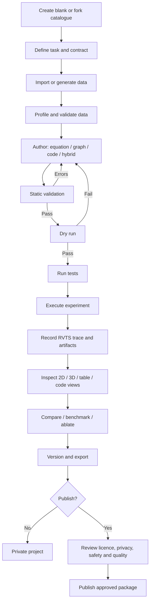
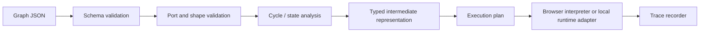

# RewindVerse — Advanced Algorithm Forge & Research Workbench

**Document type:** Product / Engineering / Research Workbench Specification  
**Product:** RewindVerse  
**Primary module:** Algorithm Forge  
**Version:** 1.0  
**Status:** Proposed implementation baseline  
**Audience:** Product owner, frontend engineers, ML engineers, research scientists, security engineers, QA, developer contributors  
**Document role:** Extends the RewindVerse PRD, Technical Stack, Security Standard, Algorithm Catalogue, and 2D/3D Visualization Standard. It does not replace those documents.

---

## 0. Executive summary

Algorithm Forge is a full-featured algorithm research and engineering workspace inside RewindVerse. A user must be able to create a new algorithm, customize an existing catalogue algorithm, or combine several approaches into a new reproducible experiment.

The workspace must support multiple ways of expressing an algorithm:

1. **Data-first design:** import, inspect, profile, clean, transform, split, and version datasets.
2. **Equation-first design:** define mathematical expressions, objective functions, constraints, update rules, and custom derivatives.
3. **Flow-first design:** construct an executable data-flow or control-flow graph using typed nodes and connections.
4. **Code-first design:** write and debug Python or TypeScript/JavaScript, with a local Python runtime for advanced scientific packages and frameworks.
5. **Hybrid design:** combine data pipelines, equations, visual nodes, and code components in one algorithm project.
6. **Fork and customize:** start from an existing RewindVerse algorithm, preserve its lineage, and change its parameters, architecture, loss, optimizer, schedule, transformations, or implementation.

After authoring, the user can validate, dry-run, execute, inspect, visualize, benchmark, compare, document, version, export, and—when explicitly chosen—publish an algorithm.

The key product promise is:

> **Design the algorithm. Control the experiment. Inspect how it works. Reproduce the result.**

Algorithm Forge is not merely a code editor or a node canvas. It is a workflow that connects algorithm definition, data, execution, trace recording, visual analysis, reproducibility, and sharing.

### 0.1 Critical product principles

- Give users deep control without making the interface unusable for learners.
- Never represent a conceptual diagram as executable code unless it has been compiled and validated.
- Never fabricate internal states. Every displayed parameter, gradient, activation, metric, or event must be recorded or explicitly computed from supported data.
- Preserve algorithm and dataset lineage across edits, forks, and runs.
- Make 2D, 3D, table, code, and text representations complementary views of the same underlying result.
- Keep private work private by default.
- Do not execute arbitrary user code on the main RewindVerse application server.
- Use reproducible run specifications and trace artifacts, not screenshots alone, as the source of truth.
- Support both a guided workflow and an advanced research workspace.
- Keep browser, local-machine, and hosted execution capabilities explicit and distinguishable.

### 0.2 The three execution environments

| Environment | Intended use | Runtime | Default network policy | Product stage |
|---|---|---|---|---|
| Browser-safe | Formula evaluation, visual graphs, small simulations, selected Python tasks | TypeScript worker; constrained expression engine; optional Pyodide worker | No external network access from algorithm execution | First release |
| Local research runtime | Full Python, NumPy, SciPy, scikit-learn, PyTorch, TensorFlow and user-installed packages | User's own machine through RewindVerse CLI / SDK | User-controlled; explicitly disclosed | First advanced release |
| Hosted isolated runtime | Optional collaborative/remote execution for approved workloads | Ephemeral isolated VM or hardened sandbox service | Deny by default; controlled allow-list only when required | Later release after security review |

The word *sandbox* must not be used as a blanket guarantee. A Web Worker improves responsiveness and provides a separate execution context, but it is not equivalent to a hardened operating-system isolation boundary. Browser-based Python runtimes can expose browser APIs depending on their embedding. The implementation must limit capabilities, isolate origins, enforce execution budgets, and clearly describe the trust boundary.

---

# 1. Product vision and outcomes

## 1.1 Vision

Make RewindVerse the workspace where people can move from an algorithm idea to a testable, observable, reproducible implementation without losing the link between mathematical intent, data, code, execution, and results.

## 1.2 Target users

| Persona | Primary need | Required experience |
|---|---|---|
| ML learner | Understand and modify known algorithms | Guided templates, visual blocks, equations, playback, explanations |
| ML engineer | Prototype and compare model/training variants | Data handling, code, parameter controls, trace inspection, benchmarks |
| Research scientist | Test novel equations, optimizers, losses, and methods | Custom code, mathematical expressions, reproducibility, experiments, artifacts |
| Data scientist | Build and evaluate analysis pipelines | Dataset profiling, transformations, classical ML, statistics, validation |
| Deep-learning researcher | Inspect tensors, layers, gradients, activations, and training | Framework integration, selected internal state capture, large-run support |
| Instructor | Build and share understandable algorithm demonstrations | Lessons, templates, safe sharing, student-friendly visualizations |
| Algorithm author | Publish reusable algorithms and variants | Versioning, manifests, tests, documentation, provenance and gallery workflow |

## 1.3 Core outcomes

1. A user can start from a blank algorithm project or a catalogue template.
2. A user can import data and understand its schema before executing an algorithm.
3. A user can express algorithm logic through supported formulas, nodes, and code.
4. A user can mix authoring methods without losing a single canonical algorithm definition.
5. A user can validate shape, type, parameter, and execution constraints before a full run.
6. A user can execute locally or in a constrained browser runtime, depending on the workload.
7. A run can generate a Rewind Trace (RVTS) record with enough evidence to inspect and replay supported states.
8. A user can compare a custom algorithm against a baseline or an earlier version.
9. A user can export a portable algorithm bundle and reproduce the run with the recorded environment.
10. A user can fork an existing catalogue algorithm while preserving attribution and lineage.

## 1.4 Product success measures

Targets below are proposed acceptance goals, not current measured performance.

| Metric | Initial target | Measurement method |
|---|---:|---|
| Time to create first runnable template fork | Under 5 minutes | Product usability test |
| Time to first successful simple custom algorithm | Under 15 minutes for a technical user | Task study |
| Valid algorithm manifests | 100% pass schema and semantic validation | CI conformance corpus |
| Reproducible deterministic reference runs | 100% pass within defined tolerance | Re-run fixture suite |
| Trace-to-view synchronization | No step mismatch in conformance tests | Replay integration tests |
| Algorithm editor recovery | No loss after normal navigation/reload when autosave is enabled | Browser persistence tests |
| Unsupported feature honesty | UI never offers a visualization requiring unavailable signals | Capability tests |
| Custom run safety | No arbitrary public server-side code execution | Architecture and penetration review |
| Publishability | Every public algorithm has manifest, version, licence, tests and provenance | Gallery release gate |

---

# 2. Product scope and boundaries

## 2.1 In scope

- Blank algorithm projects and templates.
- Existing algorithm catalogue and fork workflow.
- Algorithm parameter and architecture customization.
- Dataset import, schema inspection, profiling, transformation and split management.
- Equation editor and mathematical expression evaluation.
- Objective, constraint, update-rule and custom metric definition.
- Visual algorithm graph and flowchart editor.
- Code editor for Python and TypeScript/JavaScript.
- Local Python execution through CLI / SDK.
- Constrained browser execution for supported tasks.
- Optional notebook-style workspace integration.
- Run control, logs, debugging, checkpoints and cancellation.
- Rewind Trace recording and replay.
- 2D / 3D / table / matrix / graph / code views where semantically supported.
- Evaluation, benchmarking, sensitivity and ablation studies.
- Version history, fork, export, private sharing and public publishing.
- Tests, numerical validation, reproducibility metadata and documentation.

## 2.2 Explicit boundaries

Algorithm Forge must not initially:

- Promise that every Python package or ML framework can run in the browser.
- Run untrusted arbitrary Python, shell, JavaScript or compiled binaries on the main application server.
- Provide unrestricted cloud GPU access to anonymous users.
- Load Python pickle files or other executable serialization formats from untrusted sources.
- Claim that attention maps automatically provide faithful explanations.
- Render a 3D surface for arbitrary high-dimensional models as though it were the complete loss landscape.
- Claim numerical equivalence across different hardware, precision modes, library versions, or nondeterministic kernels without evidence.
- Allow public algorithms to silently access a user's private datasets, secrets, tokens, or local filesystem.
- Auto-publish private algorithms or traces.

## 2.3 Capability tiers

| Tier | Capability | Example |
|---|---|---|
| F0 — Configure | Edit parameters and supported options | Change learning rate or max depth |
| F1 — Compose | Build with approved nodes and formulas | Create a custom optimization graph |
| F2 — Extend | Add custom functions/code in a supported runtime | Write a new loss function or optimizer |
| F3 — Research | Full local framework/runtime access | Implement a custom PyTorch training loop |
| F4 — Publish | Package, test, document, version and share | Publish a reusable algorithm package |

The UI must show which tier a project uses and what runtime is required.

---

# 3. Information architecture and workspace layout

## 3.1 Navigation

Add **Algorithm Forge** as a first-class Rewind Studio tab.

Recommended Studio navigation:

- Overview
- Training Lab
- Replay
- Algorithm Catalogue
- **Algorithm Forge**
- Data Workbench
- Experiments / Compare
- Insights
- Learning / Academy
- My Projects
- Public Gallery (when enabled)

Algorithm Forge sub-navigation:

1. My Algorithms
2. Create New
3. Templates
4. Catalogue Forks
5. Datasets
6. Experiments
7. Versions
8. Published (optional)

## 3.2 Main workspace layout

Desktop layout should support a configurable multi-pane workspace:

```text
┌──────────────────────────────────────────────────────────────────────────────┐
│ RewindVerse / Algorithm Forge     Project: Custom Adam Variant   Run  Save  │
├─────────────┬───────────────────────────────────────────┬────────────────────┤
│ PROJECT     │ AUTHORING WORKSPACE                       │ INSPECTOR          │
│ EXPLORER    │                                           │                    │
│             │ [Data] [Equation] [Flow] [Code] [Tests]    │ Parameters         │
│ Files       │                                           │ Inputs / Outputs   │
│ Datasets    │ Graph canvas / equation editor / code     │ Shapes / Types     │
│ Components  │ editor / pipeline editor                  │ Constraints        │
│ Algorithms │                                           │ Capabilities       │
│ Versions    │                                           │ Run configuration  │
│             │                                           │                    │
├─────────────┴───────────────────────────────────────────┴────────────────────┤
│ RUN CONSOLE | LOGS | METRICS | TRACE | ARTIFACTS | TEST RESULTS | WARNINGS   │
└──────────────────────────────────────────────────────────────────────────────┘
```

### 3.2.1 Pane requirements

- Left explorer: project files, datasets, nodes, catalogue, versions, reusable components.
- Main workspace: switchable Data, Equation, Flow, Code, Tests, Documentation views.
- Right inspector: selected node, variable, equation, parameter, data port or run property.
- Bottom dock: run console, structured logs, metrics, trace events, artifacts, tests, errors and warnings.
- Top command bar: project name, dirty/saved status, runtime selector, validation state, run/cancel, export/share.
- Panels can resize, collapse and restore saved layouts.
- The default layout must be useful at 1280px width and have a mobile/tablet navigation mode.

## 3.3 Responsive behavior

- Desktop: multi-pane authoring environment.
- Tablet: two-pane editor with inspector drawer.
- Mobile: read/inspect and simple configuration first; advanced graph/code editing may show a capability notice and recommend a larger display.
- Do not reduce essential controls to hover-only interactions.
- Preserve keyboard navigation and screen-reader labels for graph nodes and connections.

---

# 4. Creation workflows

## 4.1 Create from blank

1. User chooses **Create Algorithm**.
2. Enters name, purpose, algorithm family, task type, and short description.
3. Chooses an authoring path: Data-first, Equation-first, Flow-first, Code-first, or Hybrid.
4. Chooses an execution target: Browser-safe, Local Python, or unavailable/disabled Hosted (future).
5. Defines inputs, outputs, parameters, state, and expected artifacts.
6. Adds data or chooses a synthetic fixture.
7. Implements equations, nodes, code, or a combination.
8. Runs schema/type/shape/static validation.
9. Executes a tiny dry-run.
10. Runs tests and records a trace.
11. Inspects results and visualizations.
12. Saves a versioned algorithm project.

## 4.2 Customize an existing catalogue algorithm

1. Open catalogue entry.
2. Read implementation notes, assumptions, supported data types, licence, tests and limitations.
3. Select **Use as template** or **Fork and customize**.
4. Create a new immutable fork linked to the original algorithm ID and version.
5. Choose configuration-only, graph-level, equation-level, architecture-level or source-code customization.
6. Review the change diff.
7. Run inherited tests and new tests.
8. Run baseline and modified variants with the same data split and seed where appropriate.
9. Compare metrics and trace behavior.
10. Save a new semantic version.

The original catalogue item must never be overwritten by a user's edits.

## 4.3 Hybrid authoring

A single project may contain:

- Dataset loading and preprocessing nodes.
- Equations for objective functions and custom transformations.
- Visual nodes for conditional/iterative logic.
- Code modules for operations that cannot be expressed by built-in nodes.
- Test nodes and assertion rules.
- Trace instrumentation and visualization declarations.

The system must identify the execution backend for each component and reject incompatible combinations before execution.

## 4.4 Algorithm project lifecycle



---

# 5. Data Workbench — datasets as first-class project assets

## 5.1 Supported initial data formats

| Format | Initial support | Rules |
|---|---|---|
| CSV / TSV | P0 | Schema inference, delimiter detection, preview, encoding checks |
| JSON / JSONL | P0 | Strict parsing, depth/size limits, schema validation |
| Parquet | P1 | Columnar reading through a tested browser/local adapter |
| Apache Arrow IPC | P1 | Typed columnar interchange |
| NPY | P1 | Numeric arrays only; object dtype disabled |
| NPZ | P1 | `allow_pickle=False`; inspect member count and decompressed limits |
| Image folder / ZIP | P1 | Safe path extraction, class-folder convention, image validation |
| Audio files | P2 | WAV/FLAC and declared sample-rate/channel metadata |
| Video | P3 | Frame extraction metadata and strict size/duration budgets |
| SQL / warehouse connectors | Later | Read-only, explicit credentials and allow-listed connectors |
| Hugging Face datasets | Later | Snapshot/version pinning and licence checks |

Do not accept pickle, arbitrary Python objects, or untrusted serialized executable objects. For model artifacts, prefer safe formats such as safetensors or ONNX where compatible, and validate files before parsing.

## 5.2 Import interface

For every import, show:

- File name and detected type.
- File size and estimated in-memory size.
- Rows/samples, columns/features, dimensions and dtype.
- Target/label detection suggestion (never assume without user confirmation).
- Missing values, duplicates, infinite values and malformed records.
- Class balance or target distribution where relevant.
- Train/validation/test split status.
- Data leakage warnings.
- Licence/provenance and privacy classification.
- Fields ignored or not understood.
- Whether import remains local or uploads to a remote service.

## 5.3 Dataset profiling

Support profiling by data type:

### Tabular
- Numeric distribution, quantiles, variance, skewness, missing rate, outliers.
- Categorical cardinality, rare labels, top values.
- Correlation and mutual information where enabled.
- Target imbalance and train/test distribution comparison.
- Duplicate rows and duplicate identifiers.
- Potential leakage detection (heuristic only, clearly labelled).

### Time series
- Time index type, duplicates, missing intervals, frequency inference.
- Trend, seasonality, stationarity diagnostics (when supported).
- Leakage-safe temporal split and rolling-origin evaluation.

### Images
- Dimensions, channels, format, corrupted files, class distribution.
- Image grid, histogram and sample preview.
- Augmentation preview with exact transform parameters.

### Text
- Encoding, document length, empty documents, token count estimate.
- Class distribution and language inference (heuristic).
- PII warning detector as assistive, not a guarantee.

### Audio / video (later)
- Sample rate, duration, codec, channel count, frame rate, dimensions and corrupted segments.

## 5.4 Preprocessing pipeline

Provide reusable, versioned pipeline components:

- Missing-value strategies.
- Scaling and normalization.
- Encoding of categorical features.
- Tokenization and text normalization.
- Image resizing, normalization and augmentation.
- Feature selection and projection.
- Time-window generation and resampling.
- Train/validation/test splitting.
- Class balancing and sampling.

Every transformation records fit scope. For example, scalers and imputers must be fitted only on training data and then applied to validation/test data. The UI should warn about leakage when a transformation is fitted on the full dataset before splitting.

## 5.5 Dataset manifest

Each dataset reference should include:

- `dataset_id`, `dataset_version`, name and description.
- Source type: local upload, generated, connector or imported project.
- File hashes and byte sizes.
- Schema and column-level metadata.
- Row/sample count.
- Split definitions and random seed.
- Preprocessing pipeline version.
- Licence and provenance.
- Privacy level: `private`, `redacted`, `shareable`, `public`.
- Optional content-addressed artifact references.

Raw data must not be included in public algorithm packages unless the owner explicitly chooses to include it and has rights to distribute it.

---

# 6. Equation Studio — mathematical authoring

## 6.1 Required capabilities

Equation Studio must support:

- Scalar, vector, matrix and tensor variables.
- Named constants and parameters.
- Arithmetic, matrix operations and supported broadcasting.
- Element-wise and linear-algebra operations.
- Piecewise functions and conditions within a defined grammar.
- Common statistical functions and probability distributions.
- Loss/objective functions.
- Constraints and penalty terms.
- Update rules and recurrence definitions.
- Custom metrics.
- Symbolic differentiation for supported expressions.
- Numerical gradient and Jacobian checks.
- LaTeX rendering and copyable source expressions.
- Unit/shape annotations.
- Equation history and version comparison.

## 6.2 Example objective

A user can define a regularized objective:

```text
J(theta) = mean((X @ theta - y)^2) + lambda * sum(theta[1:]^2)
```

The editor must require the user to identify:

- `X`: matrix of shape `[batch, features]`.
- `theta`: vector of shape `[features]`.
- `y`: vector of shape `[batch]`.
- `lambda`: non-negative scalar.
- Whether the intercept is regularized.
- Whether the mean is over samples or elements.

The system should derive or request the expected output shape and flag incompatible dimensions.

## 6.3 Safe expression processing

- Parse into an AST; do not pass user expressions to JavaScript `eval` or `new Function`.
- Permit only an explicit operator/function allow-list.
- Disable dynamic imports, object construction, arbitrary property access and host API access.
- Define maximum AST depth, node count, array size, evaluation time and recursion depth.
- Reject unknown functions and non-finite values according to the selected policy.
- Use a separate worker for evaluation and terminate it on budget exceedance.
- Apply dimension/shape checks before allocating large tensors.
- Keep symbolic simplification separate from runtime evaluation.
- Add regression tests for malicious expressions and computational denial-of-service cases.

Math.js is a candidate for expression parsing and AST handling, but its own security guidance calls out risks and stability limits for arbitrary expressions. RewindVerse must restrict exposed functions, use a safe scope, disable high-risk parser functions where possible, and apply worker/time/memory limits. Do not treat a library parser as a complete sandbox.

## 6.4 Symbolic and automatic differentiation

Support a staged approach:

1. Analytic gradients supplied by the user.
2. Symbolic differentiation for supported expression grammar.
3. Automatic differentiation through supported tensor/code backends.
4. Finite-difference checking for verification.

For central finite differences:

```text
g_i ≈ (f(theta + epsilon * e_i) - f(theta - epsilon * e_i)) / (2 * epsilon)
```

The gradient checker must allow configurable epsilon and tolerance, report per-coordinate absolute/relative error, and warn about nondifferentiable points, precision loss, stochastic objectives, and shape mismatch. It must not automatically label an algorithm correct simply because one gradient check passed.

---

# 7. Visual Algorithm Builder — flowcharts and computational graphs

## 7.1 Two distinct graph types

Do not collapse these concepts into one ambiguous canvas.

### A. Algorithm flowchart
Represents conceptual/control flow:
- Start/end.
- Input/output.
- Process.
- Decision/branch.
- Loop/iteration.
- State update.
- Error handling.
- Checkpoint.
- Subroutine/function.
- Stop condition.

### B. Executable data-flow graph
Represents typed operations and data dependencies:
- Dataset source.
- Feature selection.
- Preprocessing.
- Tensor operation.
- Loss.
- Gradient.
- Optimizer.
- Model/layer.
- Evaluation metric.
- Plot/trace sink.
- Custom code node.

A conceptual flowchart is not executable until its nodes are mapped to supported operations and it passes graph compilation.

## 7.2 Node schema

Each node must declare:

- Stable node type and version.
- Input and output ports.
- Data types and shape constraints.
- Parameter schema and defaults.
- Runtime/backend compatibility.
- Whether it is pure, stateful, stochastic, or side-effecting.
- Resource estimate or budget class.
- Validation rules.
- Visualization metadata.
- Documentation and example.

## 7.3 Connection validation

- Validate port type compatibility.
- Validate shape compatibility and explicit reshape/broadcast nodes.
- Reject missing required inputs.
- Detect unsupported cycles.
- Allow loops only through explicit bounded loop/state nodes.
- Enforce maximum graph nodes, nesting depth, iteration count and graph compilation time.
- Detect unreachable nodes and outputs not connected to the result.
- Warn on side effects and stochastic nodes.
- Provide graph-level error locations and suggested fixes.

## 7.4 Graph compile pipeline



## 7.5 Graph editor features

- Drag/drop node palette.
- Searchable node library.
- Custom node inspector.
- Multi-select, align, group and annotate.
- Minimap and zoom controls.
- Undo/redo with command history.
- Auto-layout (optional, never overwrite user layout without permission).
- Node-level preview and test.
- Graph diff between versions.
- Export to SVG/PNG/PDF for documentation.
- Keyboard operation and accessible node list alternative.

React Flow is a suitable candidate because it supports custom nodes, handles and graph save/restore, but the persisted representation must be RewindVerse's own versioned graph schema rather than an opaque UI-library object.

---

# 8. Code Studio — full source-code authoring

## 8.1 Initial languages

| Language | Browser editor | Execution target | Priority |
|---|---|---|---|
| Python | Yes | Pyodide for bounded supported tasks; local Python for full research | P0/P1 |
| TypeScript | Yes | Browser-safe runtime or local Node.js | P1 |
| JavaScript | Yes | Browser-safe runtime or local Node.js | P1 |
| SQL | Yes | Read-only local data query engine / controlled database adapter | P2 |
| Julia | Possible editor integration | Local runtime adapter | P3 |
| R | Possible editor integration | Local runtime adapter | P3 |
| Rust/C/C++ | Source/FFI integration | Local compiler/toolchain only at first | P3 |

Use Monaco Editor (or a compatible code editor) with syntax highlighting, diagnostics, language services, snippets, search, diff view, formatting and theme support. The editor must not imply that every language can run in every environment.

## 8.2 Code workspace features

- Multi-file algorithm project.
- Entry-point selection.
- Code modules and reusable components.
- Inline diagnostics and lint output.
- Parameter/argument schema.
- Dependency manifest and lock file.
- Run configuration.
- Structured logs and standard output/error.
- Breakpoints/debugging in local runtime where supported.
- Save checkpoints and capture selected state.
- Test discovery and test runner.
- Code diff and version history.
- Export as a source bundle.
- Documentation and comments.

## 8.3 Python algorithm contract

A general algorithm interface should be capability-based; not every algorithm is a trainable estimator. An initial illustrative protocol:

```python
from typing import Protocol, Any

class RewindAlgorithm(Protocol):
    def validate(self, context: Any) -> list[dict]: ...
    def initialize(self, context: Any) -> Any: ...
    def step(self, state: Any, batch: Any, context: Any) -> Any: ...
    def snapshot(self, state: Any) -> dict: ...
    def finalize(self, state: Any, context: Any) -> dict: ...
```

A particular plugin may instead declare `fit`, `predict`, `transform`, `evaluate`, `optimize`, `generate`, or `act` capabilities. The manifest, not a guessed method name, defines which contract is required.

## 8.4 TypeScript contract (illustrative)

```ts
export interface AlgorithmContext {
  seed: number;
  parameters: Record<string, unknown>;
  emit(event: AlgorithmEvent): void;
  shouldCancel(): boolean;
}

export interface AlgorithmPlugin<State = unknown> {
  manifest: AlgorithmManifest;
  validate(input: AlgorithmInput): ValidationIssue[];
  initialize(input: AlgorithmInput, ctx: AlgorithmContext): Promise<State>;
  step?(state: State, ctx: AlgorithmContext): Promise<StepResult<State>>;
  run?(input: AlgorithmInput, ctx: AlgorithmContext): Promise<AlgorithmOutput>;
  snapshot?(state: State): SerializableSnapshot;
  finalize?(state: State, ctx: AlgorithmContext): Promise<AlgorithmOutput>;
}
```

This is a contract sketch; final implementation must use concrete discriminated unions, typed arrays/tensor abstractions, serializable payloads, versioned events, and error types. Do not transport huge tensors through JSON messages.

---

# 9. Execution architecture and code isolation

## 9.1 Execution modes

### Mode A — Browser-safe graph/formula interpreter

Use for:
- Small numeric operations.
- Built-in algorithm nodes.
- Bounded equation evaluation.
- Toy optimizers and supported ML demonstrations.
- Preview and dry-run.

Controls:
- Run in a Web Worker.
- No DOM access.
- No arbitrary network access.
- No filesystem access beyond explicit in-memory/imported data abstractions.
- Maximum execution time, memory estimate, tensor size and graph iteration count.
- Cancellation and worker termination.
- Versioned function/node registry.

### Mode B — Browser Python (optional, limited)

Pyodide can bring CPython and selected scientific packages into a browser/WASM environment. It is useful for low-to-medium-size, supported experiments and educational use. It is not equivalent to a full native Python environment; package wheels, runtime capabilities, performance, memory and browser compatibility differ. Pyodide documentation identifies common scientific packages such as NumPy, pandas, SciPy and scikit-learn and documents Web Worker use to avoid blocking the UI.

Requirements:
- Lazy-load the runtime only when selected.
- Pin runtime and package versions.
- Run in a dedicated worker.
- Apply strict CPU/time/memory/tensor quotas.
- Do not expose application tokens, cookies or authenticated API clients to user code.
- Do not enable arbitrary package installation by default.
- Preinstall an approved package set; custom package import requires a clear trust/compatibility flow.
- Use a separate execution origin and restrictive CSP where the hosting architecture permits.
- Treat browser APIs reachable from the runtime as a capability risk; explicitly remove or restrict bridges.
- Display runtime and package limitations before the run.

### Mode C — Local Research Runtime (recommended for advanced scientists)

A local CLI/SDK executes on the user's own computer, giving access to native Python, installed packages, CPU/GPU, files and developer tools subject to the user's operating-system permissions.

Recommended commands:

```bash
rewindverse init my-algorithm
rewindverse validate ./my-algorithm
rewindverse test ./my-algorithm
rewindverse run ./my-algorithm --dataset ./data/train.parquet --seed 42
rewindverse inspect ./runs/latest.rvtrace
rewindverse export ./my-algorithm --output my-algorithm.rvalgorithm
```

The CLI should:
- Create a virtual environment or use an explicitly selected environment.
- Install from a lockfile, not an uncontrolled floating dependency list.
- Validate algorithm manifest and code entry point.
- Record package versions, Python version, OS, hardware, device and precision mode.
- Write trace records incrementally.
- Support cancellation and periodic checkpoints.
- Never upload data or source code unless the user explicitly selects sync/share.
- Export a portable bundle with checksums.

### Mode D — Hosted isolated execution (later, opt-in)

This is a separate service with a high security and operational cost. It must not be introduced as a shortcut to execute arbitrary user code on the main web/API server.

Minimum architecture requirements:
- Per-run ephemeral sandbox/VM; never reuse a writable environment across untrusted tenants.
- Dedicated worker identity with no cloud credentials.
- Network disabled by default; explicit egress allow-list if a use case requires it.
- No access to application database, internal APIs, metadata endpoints, or other users' files.
- Read-only base filesystem and bounded ephemeral scratch volume.
- Non-root user and reduced Linux capabilities.
- Resource limits: CPU, memory, PID count, file size, open files, runtime, output bytes and disk.
- Seccomp plus namespaces/AppArmor/Landlock or a stronger workload isolation runtime such as gVisor or a microVM design.
- Signed, scanned, pinned base images.
- Job queue with tenant-level concurrency and spending quotas.
- Independent job network policy and egress monitoring.
- Complete logs without leaking code/data into general application logs.
- Automatic destroy/cleanup after job completion or timeout.
- Security review and penetration test before public launch.

A hardened runtime such as gVisor adds an isolation layer but does not remove the need for network policy, host hardening, resource limits, credential separation, and defense in depth. Hosted execution must remain disabled until these controls are implemented and tested.

## 9.2 Execution decision table

| Workload | Preferred environment |
|---|---|
| Small built-in graph | Browser worker |
| Simple equation and derivative check | Constrained expression engine / worker |
| Small supported Python demonstration | Pyodide worker |
| Custom NumPy/SciPy algorithm | Local Python |
| Custom PyTorch/TensorFlow model | Local Python |
| CUDA/GPU experiment | Local machine initially |
| Large training job | Local infrastructure controlled by user; hosted option only later |
| Public community algorithm | Static package and review; run locally/browser only when its declared capability is supported |

---

# 10. Algorithm manifest and package format

## 10.1 Manifest requirements

Every algorithm must have a machine-readable manifest. The manifest is the canonical contract for validation, display, execution selection, visualization capability, dependency checks and trace integration.

Required fields:

- Schema version.
- Algorithm ID and version.
- Display name and description.
- Author/maintainer metadata.
- Category and tags.
- Licence.
- Task/capability types.
- Input/output contract.
- Parameter schema with constraints/defaults.
- State schema where applicable.
- Implementation references and languages.
- Runtime requirements.
- Dependency declarations.
- Determinism and random-seed behavior.
- Resource estimates/budgets.
- Visualization declarations and required signals.
- Test suite references.
- Documentation and examples.
- Provenance/parent algorithm reference for forks.

## 10.2 Example manifest (illustrative)

```json
{
  "schema_version": "1.0.0",
  "algorithm": {
    "id": "org.example.adaptive-optimizer",
    "version": "0.1.0",
    "name": "Adaptive Optimizer Prototype",
    "description": "Research implementation of an adaptive update rule.",
    "category": ["optimization", "custom"],
    "license": "MIT",
    "capabilities": ["optimizer", "stepwise", "snapshot"]
  },
  "author": {
    "display_name": "Algorithm Author"
  },
  "implementation": {
    "language": "python",
    "entrypoint": "src/optimizer.py:AdaptiveOptimizer",
    "runtime": "local-python",
    "dependencies_lock": "requirements.lock"
  },
  "inputs": [
    {
      "name": "gradient",
      "type": "tensor",
      "dtype": ["float32", "float64"],
      "shape": ["...", "parameter_shape"],
      "required": true
    }
  ],
  "parameters": {
    "learning_rate": {
      "type": "number",
      "default": 0.001,
      "minimum": 0.0,
      "exclusive_minimum": true,
      "maximum": 10.0
    },
    "epsilon": {
      "type": "number",
      "default": 1e-8,
      "minimum": 1e-16,
      "maximum": 0.1
    }
  },
  "outputs": [
    {"name": "updated_parameters", "type": "tensor"},
    {"name": "optimizer_state", "type": "state"}
  ],
  "determinism": {
    "supports_seed": true,
    "may_be_nondeterministic": true,
    "notes": "Backend and device may affect floating-point results."
  },
  "visualizations": [
    {
      "id": "parameter-trajectory",
      "requires": ["parameter_snapshot"],
      "views": ["2d", "3d", "table"],
      "availability": "when-recorded"
    }
  ],
  "provenance": {
    "kind": "original",
    "parent_algorithm_id": null,
    "parent_version": null
  },
  "tests": {
    "suite": "tests/",
    "required_before_publish": true
  }
}
```

The final schema must be validated with a versioned JSON Schema and additional semantic validation. A schema-valid manifest can still be semantically invalid (for example, an entry point may not exist, a tensor shape may be incompatible, or a required runtime may not be available).

## 10.3 Package structure

Recommended `.rvalgorithm` bundle:

```text
my-algorithm.rvalgorithm
├── algorithm.json
├── README.md
├── LICENSE
├── CHANGELOG.md
├── src/
│   ├── algorithm.py
│   └── helpers.py
├── equations/
│   └── objective.json
├── graph/
│   └── pipeline.json
├── schemas/
│   └── inputs.schema.json
├── tests/
│   ├── test_reference.py
│   └── fixtures/
├── examples/
│   └── demo-config.json
├── docs/
│   └── method.md
├── requirements.lock
└── checksums.sha256
```

Bundle parser requirements: path traversal protection, archive member count limits, uncompressed size limits, filename normalization, no executable auto-run on import, no symlink extraction, and safe handling of unknown files.

---

# 11. Catalogue customization and lineage

## 11.1 Customization levels

| Level | User can change | Example |
|---|---|---|
| C0 — Parameter | Exposed parameters | Learning rate, depth, batch size |
| C1 — Configuration | Training/evaluation settings | Scheduler, loss, regularization |
| C2 — Composition | Supported building blocks | Add normalization, dropout, preprocessing node |
| C3 — Mathematical | Objective, update rule, constraints | Replace loss or optimizer equation |
| C4 — Architecture | Layers, blocks, topology | Change MLP depth or CNN block layout |
| C5 — Source | Algorithm implementation | Fork and edit Python/TypeScript source |

## 11.2 Fork semantics

A fork stores:
- Parent algorithm ID and exact parent version.
- Parent package hash.
- User's fork ID and version.
- Changed files/parameters/equations/graph nodes.
- Licence inheritance and attribution obligations.
- Tests inherited, changed, added, removed.
- Migration status when the upstream version changes.

Upstream changes must never silently overwrite the user's fork. Provide a diff and an explicit merge/rebase workflow.

## 11.3 Variant experiments

Support named variants such as:
- Baseline.
- Custom loss.
- Custom optimizer.
- Architecture variant.
- Feature selection variant.
- Regularization variant.
- Augmentation variant.

Run comparison must display which fields differ and which conditions are held constant.

---

# 12. Experiment runner and reproducibility

## 12.1 Run configuration

A run definition must include:
- Algorithm ID/version and package hash.
- Dataset ID/version/hash and split specification.
- Preprocessing graph/version.
- Parameter values.
- Random seeds (global and component-level where relevant).
- Runtime/environment and package lock hash.
- Precision mode and hardware/device metadata.
- Batch ordering/sampler metadata where relevant.
- Number of steps/epochs/iterations and stopping criteria.
- Checkpoint and logging cadence.
- Visualization signal selection.
- Resource limits and cancellation policy.

## 12.2 Runner capabilities

- Start, pause, resume where state is supported, cancel and rerun.
- Validate inputs before expensive execution.
- Emit structured logs.
- Emit progress and metric events.
- Record parameter/gradient/state snapshots at a declared cadence.
- Support checkpoint creation and restore where the algorithm supports it.
- Capture warnings, exceptions and termination reasons.
- Preserve partial traces after an interrupted run when the file is structurally recoverable.
- Avoid forcing expensive GPU synchronization on every iteration; allow sampling cadence and asynchronous buffering.

## 12.3 Deterministic replay versus retraining

The product must distinguish:

- **Trace replay:** view the exact recorded run without executing training again.
- **Reproduction run:** execute again under a recorded environment and compare results.
- **Interactive continuation:** resume from a compatible checkpoint when optimizer state, scheduler state, RNG state, data order and model state are available.

Do not imply that a trace alone can resume training if it does not contain all required state.

---

# 13. Visualization and inspection system

## 13.1 User-selectable views

Every visualization should declare its valid views. Where semantically appropriate, offer:
- 2D.
- 3D.
- Auto (choose based on data, device and user preference).
- Table/matrix.
- Code/equation.
- Graph/flow.

Do not force 3D for metrics that have no meaningful spatial dimension. For high-dimensional models, a 3D plot must clearly identify whether it is a slice, projection, embedding, or true low-dimensional objective surface.

## 13.2 Core visualization families

### Optimization and training
- Loss/metric curves.
- 2D contour and 3D objective surfaces for valid low-dimensional objectives.
- Optimizer trajectories and update vectors.
- Gradient norm and coordinate distributions.
- Learning-rate schedules.
- Parameter trajectories and weight distributions.
- Convergence and stopping diagnostics.

### Classical machine learning
- Decision boundaries and probability surfaces.
- Regression fit, residuals and prediction intervals.
- Tree structure and feature split inspection.
- Ensemble contribution and feature importance.
- Clustering assignments, centroids and density.
- PCA/t-SNE/UMAP projections.

### Deep learning
- Architecture graphs.
- Activation maps and feature maps.
- Gradient flow by layer.
- Weight/gradient histograms.
- Attention matrices and head comparisons.
- Embedding spaces.
- CNN filters and convolution outputs.
- Transformer block/layer and token-level views.

### Evaluation and explainability
- Confusion matrix.
- ROC and precision-recall.
- Calibration and threshold curves.
- Error slices and subgroup metrics.
- SHAP/LIME-style feature explanations where correctly implemented.
- Integrated gradients and Grad-CAM where model adapters provide required signals.
- Counterfactual examples with feasibility warnings.

### Data and performance
- Feature distributions and correlations.
- Missingness maps.
- Data drift comparisons.
- Dataset sample browser.
- Memory/CPU/GPU utilization where available.
- Throughput/latency timelines.

## 13.3 Capability-aware rendering

A visualization is enabled only when its required signals are present or safely computable. Examples:
- No gradients recorded → gradient panel unavailable with explanation.
- No model topology → no fabricated architecture graph.
- No logits/probabilities → ROC and calibration are unavailable unless derivable from supported outputs.
- No dataset examples → no sample-level explanation.
- No objective function registered → do not show an invented loss surface.

## 13.4 Synchronization

All linked views must share a run ID and selected step/time cursor. A change in one linked view updates the others where applicable. The user can lock or unlock panels independently.

---

# 14. Testing, scientific validity and benchmark design

## 14.1 Required test layers

1. Manifest schema and semantic validation.
2. Node graph compilation and shape/type validation.
3. Formula parser AST allow-list tests.
4. Dataset parser and malformed-file tests.
5. Unit tests for mathematical functions.
6. Gradient checks and finite-difference comparisons.
7. Algorithm contract tests.
8. Deterministic fixture tests.
9. Numerical parity tests against an independent reference.
10. Property-based tests and fuzzing.
11. Resource-exhaustion and cancellation tests.
12. Trace writer/parser compatibility tests.
13. Replay synchronization tests.
14. UI tests for authoring and editing workflows.
15. Security tests for package imports, code execution boundaries and privacy.

## 14.2 Algorithm correctness test suite

Each algorithm should provide:
- Known small reference fixture.
- Valid input shape tests.
- Invalid shape/type tests.
- Empty and degenerate input tests.
- Non-finite input policy tests.
- Deterministic seed test where relevant.
- Edge conditions.
- Expected output shape and dtype.
- Numerical tolerance and reference environment.
- Performance profile at declared sizes.

For optimizers and differentiable algorithms, include gradient parity and update-step parity. For stochastic algorithms, define statistical test criteria rather than requiring identical samples across every runtime.

## 14.3 Benchmark protocol

A benchmark result must state:
- Dataset/fixture hash.
- Algorithm version and configuration.
- Number of repeats.
- Random seeds.
- Metric definition.
- Mean, standard deviation or confidence interval where appropriate.
- Hardware and runtime.
- Precision mode.
- Warm-up policy.
- Whether data loading and preprocessing are included.
- Failure/timeout count.

Do not compare algorithms on different data splits or budgets and present the difference as a fair performance advantage.

## 14.4 Scientific claims

- Label heuristic insights as heuristics.
- Do not overstate feature importance or attention as causal explanation.
- Display uncertainty and sample size where applicable.
- Keep training, validation and test metrics distinct.
- Warn about data leakage and repeated test-set tuning.
- Preserve raw results alongside transformed visualizations.

---

# 15. Collaboration, sharing and gallery

## 15.1 Privacy defaults

- New algorithms and datasets are private.
- No public listing without explicit publication action.
- No dataset raw bytes included by default.
- No secrets in project manifest, trace or logs.
- Share permissions are scoped to a specific algorithm/version or experiment.
- Revocation must disable future access to private share links.

## 15.2 Sharing modes

- Private local project.
- Private account project.
- Invite-only collaboration.
- Read-only share link.
- Public algorithm package.
- Public example without private dataset.

## 15.3 Gallery review requirements

Before publishing:
- Manifest passes schema and semantic validation.
- Licence is declared and compatible with reused components.
- Provenance and parent attribution are preserved.
- No secrets, PII, raw private data or credentials in bundle.
- Static analysis and file scan pass.
- Tests are provided and pass.
- Runtime and dependencies are declared.
- Resource class and supported execution modes are visible.
- Algorithm description states known limitations.
- Unsafe or unsupported code does not execute on the gallery server.

The gallery should initially distribute packages as inert artifacts; preview/inspection must not execute source automatically.

---

# 16. Security and privacy threat model

## 16.1 Threat categories

- Malicious source code in imported algorithm packages.
- Malicious or oversized data files.
- Archive path traversal and decompression bombs.
- Formula parser abuse and computational denial of service.
- Graph loops and unbounded recursion.
- Cross-site scripting in descriptions, code output and markdown.
- Cross-user data access and broken object-level authorization.
- Secret leakage through logs, traces, notebooks or environment dumps.
- Dependency/supply-chain compromise.
- Local runner abuse through unsafe browser-to-localhost communication.
- GPU/CPU/memory exhaustion.
- Public gallery content used for phishing or deceptive downloads.

## 16.2 Mandatory controls

- Never execute uploaded source during import or preview.
- Treat every algorithm package and dataset as untrusted.
- Validate all manifest, graph, formula, API and file inputs at boundaries.
- Parse archives safely; ignore paths supplied inside archives.
- Disable pickle and unsafe deserialization for untrusted files.
- Use strict HTML/Markdown sanitization for user-authored descriptions.
- Separate user code execution from the authenticated application origin.
- Do not pass application cookies, tokens or privileged API handles into execution contexts.
- Enforce time, memory, tensor-size, output-size and recursion limits.
- Keep network disabled for hosted untrusted execution by default.
- Store source and datasets using explicit private access controls.
- Audit all publication, permission and download operations.
- Scan dependencies and pin packages.
- Perform security testing against the relevant OWASP ASVS baseline.

## 16.3 Local runner safety

If a browser-to-local runner bridge is introduced:
- Bind only to loopback, not all network interfaces.
- Use a short-lived, high-entropy one-time pairing token.
- Verify exact allowed Origin and Host headers.
- Reject cross-origin requests and invalid content types.
- Require explicit user pairing.
- Do not expose arbitrary filesystem paths or shell commands through the bridge.
- Limit allowed operations to typed run requests, trace retrieval and cancellation.
- Rotate/revoke pairing tokens and log security-relevant actions.

---

# 17. API and internal service boundaries

The exact URL structure may evolve, but service responsibilities must remain clear.

## 17.1 Suggested API areas

| Area | Purpose | Example operations |
|---|---|---|
| Algorithm | Metadata, versions, manifests | Create, validate, fork, update, export |
| Dataset | Metadata and safe import | Inspect, profile, split, transform, hash |
| Graph | Visual algorithm structure | Validate, compile, save, diff |
| Formula | Parse and validate expressions | Parse, type-check, differentiate, evaluate-preview |
| Run | Experiment lifecycle | Create, start, cancel, inspect status |
| Trace | RVTS handling | Validate, inspect, import, export, replay metadata |
| Artifact | Run outputs | List, download, checksum, delete |
| Benchmark | Repeated evaluation | Create suite, execute, aggregate, compare |
| Gallery | Public algorithm metadata | Search, review, publish, unpublish |

## 17.2 Example TypeScript service contracts

```ts
export type ExecutionTarget =
  | "browser-safe"
  | "pyodide-limited"
  | "local-python"
  | "local-node"
  | "hosted-isolated";

export interface CreateAlgorithmRequest {
  name: string;
  category: string[];
  authoringMode: "data" | "equation" | "flow" | "code" | "hybrid";
  executionTarget: ExecutionTarget;
  parent?: { algorithmId: string; version: string };
}

export interface ValidationReport {
  valid: boolean;
  errors: ValidationIssue[];
  warnings: ValidationIssue[];
  unsupportedCapabilities: string[];
}

export interface StartRunRequest {
  algorithmId: string;
  algorithmVersion: string;
  datasetVersion?: string;
  config: Record<string, unknown>;
  seed: number;
  executionTarget: ExecutionTarget;
}
```

All contracts must be validated at runtime with Zod (TypeScript) or Pydantic (Python), and authorized on the server for every resource operation.

---

# 18. Storage model and data entities

Core entities:

- `AlgorithmProject`
- `AlgorithmVersion`
- `AlgorithmManifest`
- `AlgorithmSourceFile`
- `GraphDefinition`
- `EquationDefinition`
- `Dataset`
- `DatasetVersion`
- `PreprocessingPipeline`
- `Experiment`
- `Run`
- `RunEvent`
- `TraceArtifact`
- `ModelArtifact`
- `BenchmarkSuite`
- `BenchmarkResult`
- `TestSuite`
- `TestResult`
- `ForkRelationship`
- `ShareGrant`
- `PublicationReview`

Use content hashes for immutable artifact identity. Keep metadata in the database and large trace/dataset/model artifacts in private object storage or the local filesystem/IndexedDB depending on execution mode. Do not store unbounded trace contents in relational rows.

---

# 19. RVTS trace integration

Every supported run should emit a Rewind Trace where meaningful. RVTS is the interchange layer between execution and visualization.

The trace should be able to represent:
- Run manifest and algorithm version.
- Dataset reference and privacy classification.
- Step and epoch semantics.
- Scalar metrics.
- Parameters and selected tensor snapshots.
- Gradients and optimizer state summaries.
- Activation summaries.
- User annotations and events.
- Evaluation outputs.
- Diagnostics with detector version and evidence range.
- Artifact references and checksums.
- Execution environment and reproducibility metadata.

Trace capabilities must be declared. The viewer must not infer unavailable states. Legacy MVTS / `.mvtrace` artifacts from earlier project development should be handled through a versioned compatibility importer rather than silently renamed or reinterpreted.

---

# 20. UX details and interaction requirements

## 20.1 Empty states

Each mode should include an example project and clear starter action. No empty editor should leave a new user guessing what to do.

## 20.2 Validation messages

Each error must include:
- File/node/equation/parameter location.
- What failed.
- Why it matters.
- Expected value or shape.
- Suggested next action.
- Whether the issue blocks execution.

## 20.3 Run states

- Draft.
- Validating.
- Ready.
- Queued (local/hosted if applicable).
- Running.
- Pausing.
- Paused.
- Cancelling.
- Completed.
- Failed.
- Cancelled.
- Timed out.
- Resource limit reached.

Do not show a run as completed until output and trace finalization have completed or a clear partial/finalization status has been displayed.

## 20.4 Autosave and recovery

- Autosave editor state and graph changes with visible saved status.
- Version snapshots at explicit milestones.
- Conflict-safe saves for collaborative editing.
- Crash recovery from last valid draft.
- User export at any stage.
- Never autosave raw sensitive dataset content to a remote account without user consent.

---

# 21. Performance and scalability

## 21.1 Performance principles

- Lazy-load Code Studio, graph editor, Pyodide and 3D libraries only when needed.
- Keep React UI state separate from large tensor arrays.
- Use typed arrays / columnar representations for numeric work.
- Use transferable buffers for worker communication where safe.
- Stream large traces and data previews.
- Render only visible table rows and graph nodes.
- Use decimation/downsampling for dense plots while preserving raw source values.
- Avoid full model snapshots on every step unless explicitly requested.
- Use sampling cadence and asynchronous logging for GPU runs.
- Dispose GPU/WebGL resources and release worker memory after runs.
- Provide progress and cancellation for long operations.

## 21.2 Suggested configurable resource classes

These are starting defaults to benchmark, not universal hard limits:

| Class | Intended work | Initial guardrail |
|---|---|---|
| Preview | formula/graph preview | 1–3 seconds, small inputs |
| Browser standard | small interactive examples | 10–30 seconds, bounded memory and tensor dimensions |
| Browser extended | selected small ML runs | explicit confirmation and higher quota |
| Local research | user-owned CPU/GPU runs | governed by user's machine; product still supports cancellation and trace sampling |
| Hosted isolated | later | tenant budget, job quota and per-run policy |

Measure limits on supported devices and tune them from telemetry. Do not claim a fixed maximum dataset size independent of the user's hardware.

---

# 22. Accessibility and responsible research design

- Keyboard-accessible editors and graph navigation.
- Screen-reader text alternatives for graph nodes and visualization summaries.
- Colorblind-safe palettes and non-color encodings.
- Reduced-motion mode.
- 2D/table alternatives to 3D where possible.
- Captions/annotations for educational content.
- Clear distinction between measured, inferred, approximate and synthetic data.
- Warning labels for low sample size, imbalance, leakage, unstable metrics and unsupported claims.
- Preserve uncertainty and limitations in exported reports.

---

# 23. Recommended technology choices for Algorithm Forge

These are proposed choices; confirm exact versions and APIs against official documentation at implementation time.

| Concern | Recommended technology | Reason / note |
|---|---|---|
| Workspace UI | Existing Next.js + React + TypeScript | Consistency with RewindVerse app |
| Typed schemas | Zod + JSON Schema | Boundary validation and portable manifests |
| Graph editor | React Flow / XYFlow | Custom nodes, handles, graph interaction |
| Code editor | Monaco Editor | Mature code-editing experience |
| Formula parsing | math.js parser with a strict allow-list | AST-based parsing; must harden exposed functions |
| Symbolic maths | SymPy in local Python runtime | Research-grade symbolic manipulation |
| Formula display | KaTeX | Fast math rendering |
| Python in browser | Pyodide in worker for bounded workflows | Useful subset of Python packages; not full native environment |
| Full Python | RewindVerse CLI / SDK | Native scientific stack and user-controlled resources |
| Flow compilation | RewindVerse typed intermediate representation | Avoid coupling saved graph data to UI library |
| Numeric frontend | TypedArrays and tested numerical libraries | Efficient numerical buffers |
| Trace | RVTS | Reproducibility and replay contract |
| Local data | IndexedDB | Local-first project and dataset metadata |
| Cloud metadata | Existing selected database | Only when account sync is enabled |
| Artifact storage | Private object storage | Large traces and packages |
| Testing | Vitest, Playwright, pytest, hypothesis/property tests | UI, contract, numerical and Python tests |

### 23.1 Documentation-first implementation rule

Before implementing integrations or relying on new framework APIs:
- Query the project's documentation assistant/Context7 where available.
- Verify the exact version and official API docs.
- Pin package versions.
- Add a small integration spike before committing to a major dependency.
- Add a test that verifies the chosen integration's expected behavior.

---

# 24. Repository structure additions

Suggested extension to the existing RewindVerse monorepo:

```text
RewindVerse/
├── apps/
│   └── studio/
│       └── src/
│           ├── app/algorithm-forge/
│           ├── features/algorithm-forge/
│           │   ├── project-explorer/
│           │   ├── data-workbench/
│           │   ├── equation-studio/
│           │   ├── flow-builder/
│           │   ├── code-studio/
│           │   ├── experiment-runner/
│           │   ├── test-workbench/
│           │   ├── version-control/
│           │   └── gallery/
│           └── workers/
├── packages/
│   ├── algorithm-contracts/
│   ├── algorithm-manifest/
│   ├── algorithm-validator/
│   ├── algorithm-registry/
│   ├── algorithm-graph/
│   ├── graph-compiler/
│   ├── formula-engine/
│   ├── formula-validator/
│   ├── dataset-schema/
│   ├── dataset-profiler/
│   ├── preprocessing-pipeline/
│   ├── execution-protocol/
│   ├── browser-runtime/
│   ├── trace-recorder/
│   ├── rvts/
│   ├── replay-engine/
│   ├── visualization-registry/
│   └── benchmark-engine/
├── sdk/
│   └── python/
│       ├── rewindverse/
│       ├── examples/
│       └── tests/
├── tools/
│   └── cli/
├── services/
│   └── hosted-runner/        # disabled until security approval
├── examples/
│   ├── algorithms/
│   ├── datasets/
│   └── traces/
├── tests/
│   ├── conformance/
│   ├── security/
│   ├── numerical/
│   ├── integration/
│   └── performance/
└── docs/
    ├── algorithms/
    ├── forge/
    ├── execution/
    ├── security/
    └── research-methods/
```

---

# 25. Implementation roadmap

The roadmap is milestone-based. Existing development may already have completed some tasks; verify the repository and mark evidence before duplicating work.

## Phase A — Contracts and authoring foundation (P0)

- [ ] Define Algorithm Manifest JSON Schema.
- [ ] Define algorithm capability contract and type system.
- [ ] Define project/package file format.
- [ ] Define RVTS run/trace mapping.
- [ ] Create Algorithm Forge workspace shell.
- [ ] Implement blank project and template fork.
- [ ] Implement parameter inspector and schema validation.
- [ ] Add autosave and project version snapshots.
- [ ] Add built-in algorithm registry.

**Exit gate:** A user can create a project, fork an algorithm, change parameters, validate, save and reopen it.

## Phase B — Data Workbench (P0/P1)

- [ ] CSV/TSV and JSONL import.
- [ ] Schema and data preview.
- [ ] Data profiling.
- [ ] Dataset version/hash.
- [ ] Train/validation/test splitting.
- [ ] Preprocessing graph and leakage checks.
- [ ] Safe NumPy import path with pickle disabled.
- [ ] Dataset privacy labels and local-first defaults.

**Exit gate:** User can import a dataset, inspect it, define a split and attach it reproducibly to an algorithm project.

## Phase C — Equation Studio (P1)

- [ ] Expression grammar and AST parser.
- [ ] Variable/parameter definitions.
- [ ] Tensor shape/type inference.
- [ ] Safe evaluation worker.
- [ ] Objective/loss definition.
- [ ] Update rule definition.
- [ ] Derivative support for declared subset.
- [ ] Finite-difference checker.
- [ ] Adversarial expression tests.

**Exit gate:** User can define an objective and update expression, validate it, run a bounded preview and export the equation definition.

## Phase D — Visual Flow Builder (P1)

- [ ] Separate conceptual flowchart from executable graph.
- [ ] Node registry and custom node schema.
- [ ] Port type and shape validation.
- [ ] Graph compiler/intermediate representation.
- [ ] Explicit bounded loop/state nodes.
- [ ] Node-level preview and test.
- [ ] Graph version diff.
- [ ] Graph export and keyboard alternative.

**Exit gate:** User can construct and execute a supported data-flow graph with deterministic results and trace events.

## Phase E — Code Studio and local research runtime (P1)

- [ ] Monaco editor integration.
- [ ] Multi-file project model.
- [ ] Python manifest and entry-point contract.
- [ ] RewindVerse Python SDK.
- [ ] CLI init/validate/test/run/inspect/export.
- [ ] Dependency lock and environment metadata.
- [ ] Incremental trace writer.
- [ ] Cancellation and checkpoint support.
- [ ] Safe package import/export.

**Exit gate:** A user can write a custom local Python algorithm, run tests, execute it, generate a trace and open that trace in Rewind Studio.

## Phase F — Experiment and visualization integration (P1/P2)

- [ ] Browser/local runtime selection.
- [ ] Run state machine.
- [ ] Structured logs and metrics.
- [ ] RVTS trace recording.
- [ ] Capability-aware visualizations.
- [ ] 2D/3D/table view synchronization.
- [ ] Run comparison and benchmark suite.
- [ ] Reproducibility report.

**Exit gate:** A custom algorithm can be inspected and compared without fabricated data or unavailable panels.

## Phase G — Research-grade validation (P2)

- [ ] Property-based tests.
- [ ] Numerical parity suite.
- [ ] Gradient and Jacobian checks.
- [ ] Ablation and sensitivity workflows.
- [ ] Benchmark repeat statistics.
- [ ] Dataset leakage checks.
- [ ] Research notes and citations.
- [ ] Exportable experiment report.

**Exit gate:** User can produce a reproducible experiment report containing methods, data, environment, metrics, uncertainty and limitations.

## Phase H — Sharing and community (P2/P3)

- [ ] Private project sync.
- [ ] Share grants and revocation.
- [ ] Public algorithm package review.
- [ ] Attribution and licence checks.
- [ ] Gallery search and versioning.
- [ ] Dependency/security scan.
- [ ] Optional isolated execution design review.

**Exit gate:** Public packages are inert on import, reviewed, documented, attributable, and execute only in supported user-controlled or approved isolated runtimes.

---

# 26. Acceptance criteria by user story

## User story A — Build a formula-based optimizer

**As a** researcher, **I want** to define a custom objective and update rule, **so that** I can evaluate a new optimization method.

Acceptance:
- Define variables and tensor shapes.
- Define objective expression.
- Define update expression and state variables.
- Parser reports invalid identifiers/operators.
- Shape/type checks run before execution.
- Numerical gradient comparison is available when derivative is applicable.
- Run can be stopped and produces a trace.
- Every rendered path corresponds to recorded parameter updates.

## User story B — Build from a visual graph

**As a** learner or engineer, **I want** to connect typed algorithm nodes, **so that** I can understand and modify the algorithm structure.

Acceptance:
- Node ports show types/shapes.
- Invalid connections are rejected with explanation.
- Loops require explicit bounded nodes.
- Graph can be saved/reopened without losing edges or node parameters.
- Compiler displays an execution plan.
- Run output is repeatable under the same deterministic fixture and seed.

## User story C — Write a Python algorithm

**As a** scientist, **I want** to write my own Python code and use scientific libraries, **so that** I can prototype methods without being limited to built-in operations.

Acceptance:
- Editor supports multi-file project and manifest entry point.
- Local CLI validates and runs the project.
- Dependency versions are captured.
- User data stays local unless explicitly uploaded.
- Trace is incrementally written.
- Errors identify file and line where possible.
- Run can be cancelled without corrupting completed trace records.

## User story D — Customize a catalogue algorithm

**As an** engineer, **I want** to fork an existing algorithm and modify its configuration or source, **so that** I can build a new method without losing the original reference.

Acceptance:
- Original is immutable.
- Parent ID/version/hash are recorded.
- Diff shows changed fields and files.
- Inherited tests run.
- New version can be compared against parent using the same dataset split and run budget.

## User story E — Reproduce and publish

**As a** research author, **I want** to export a complete algorithm and experiment package, **so that** others can inspect and reproduce my method.

Acceptance:
- Export contains manifest, code/equations/graph, docs, tests, dependency lock and hashes.
- Privacy scanner detects potential secrets and private data.
- Licence is declared.
- The package does not execute during import or preview.
- Recipient sees runtime requirements and known limitations.

---

# 27. Definition of done

A feature is not complete merely because the UI is visible. It is complete only when:

- User workflow exists end-to-end.
- Inputs and outputs are typed and validated.
- Errors and empty states are implemented.
- Keyboard/responsive/accessibility expectations are addressed.
- Unit and integration tests pass.
- Security boundaries are tested.
- Logs/metrics are privacy-safe.
- Documentation and example are supplied.
- Run/trace semantics are stable.
- Performance is benchmarked on declared test hardware.
- Feature limitations are visible to users.

---

# 28. Key architectural decisions

| ID | Decision | Rationale |
|---|---|---|
| AF-ADR-001 | Algorithm Forge is a first-class Studio tab | Custom creation is core product capability, not a settings page |
| AF-ADR-002 | Use one versioned Algorithm Manifest | Consistent catalogue, validation, runtime and export contract |
| AF-ADR-003 | Separate flowchart and executable data graph | Avoid implying all diagrams are runnable |
| AF-ADR-004 | Formula engine parses AST with allow-list | Avoid arbitrary source execution for mathematical expressions |
| AF-ADR-005 | Browser-safe, local and hosted runtimes are separate | Explicit trust and capability boundaries |
| AF-ADR-006 | Local Python is the advanced research baseline | Supports user-chosen packages and native hardware without server-side code hosting |
| AF-ADR-007 | Hosted untrusted execution is disabled by default | Requires independent isolation/security investment |
| AF-ADR-008 | RVTS is the trace interchange layer | Reuse RewindVerse replay and visualization infrastructure |
| AF-ADR-009 | Catalogue customization uses immutable forks | Preserve lineage and upstream integrity |
| AF-ADR-010 | Public algorithm bundles are inert on import | Prevent automatic execution of community code |
| AF-ADR-011 | Dataset privacy is explicit and local-first | Reduce accidental leakage |
| AF-ADR-012 | Visualization capability is declared | Prevent fabricated/internal states and misleading panels |

---

# 29. Risks and mitigations

| Risk | Impact | Mitigation |
|---|---|---|
| Feature scope becomes too large | Delayed launch, unfinished UX | Deliver authoring modes in phases; P0 is fork + parameter + graph/formula foundation |
| Arbitrary code execution vulnerability | Platform compromise or visitor harm | Local runtime first; hosted runner only after security audit and strong isolation |
| Data leakage | Sensitive datasets become public | Local-first data, privacy labels, explicit share flow, leak scanner |
| Poor numerical correctness | False research conclusions | Independent references, parity tests, tolerances and reproducibility reports |
| Graph editor becomes confusing | Low adoption | Templates, grouped nodes, zoom levels and clear conceptual/executable distinction |
| Pyodide package gaps | Broken browser workflow | Clearly label supported package matrix; local runtime fallback |
| Large dataset memory exhaustion | Browser crash | Streaming, columnar formats, sampling, size guards and local mode |
| Trace too large | Slow import/replay | Sampling, chunking, snapshots cadence, compression and lazy loading |
| Visualizations imply unavailable state | Misleading science | Capability registry and required-signal checks |
| Dependency supply-chain risk | Malicious packages | Lockfiles, vulnerability scanning, provenance and isolated local install instructions |
| Community algorithm licence conflict | Legal and trust issue | Licence metadata, attribution and publication review |
| Multi-runtime numerical differences | Confusing comparisons | Runtime metadata and explicit numerical tolerances |

---

# 30. Open decisions to resolve during implementation

These should be decided through prototypes, not guessed globally:

1. Exact RVTS schema version and whether the algorithm manifest shares a package release cycle.
2. Supported tensor abstraction in TypeScript (typed-array-first versus a tensor library adapter).
3. Which packages are bundled into Pyodide and their maximum supported versions.
4. Whether JupyterLite is embedded or a lightweight notebook-like editor is built first.
5. The local runner communication method (CLI-generated trace import first; live local bridge later).
6. Whether graph execution targets a custom interpreter, a typed IR compiler, or adapters to existing runtimes.
7. Which algorithms qualify for first-party verified status.
8. Whether public gallery begins as metadata/download only or includes online preview.
9. Whether hosted execution is ever commercially justified.
10. How private project sync and collaboration are priced and retained.

---

# 31. Official technical references

These references support implementation choices and should be rechecked during development. Pin actual dependency versions in the repository and verify APIs against the version being used.

- **Pyodide documentation:** https://pyodide.org/en/stable/ — Python on WebAssembly, package support and browser execution.
- **Pyodide Web Worker guidance:** https://pyodide.org/en/stable/usage/webworker.html — moving Python execution off the browser UI thread.
- **Math.js expression parser:** https://mathjs.org/docs/expressions/ — mathematical expression parsing and AST operations.
- **Math.js security guidance:** https://mathjs.org/docs/expressions/security.html — expression parser security and stability considerations.
- **React Flow custom nodes:** https://reactflow.dev/learn/customization/custom-nodes — typed visual node editor building blocks.
- **React Flow save/restore:** https://reactflow.dev/examples/interaction/save-and-restore — graph persistence pattern; RewindVerse should still own its schema.
- **JupyterLite:** https://jupyterlite.readthedocs.io/en/stable/ — browser-based notebooks and kernel choices; browser kernel limitations should be considered.
- **WebAssembly security:** https://webassembly.org/docs/security/ — WebAssembly isolation model and embedding constraints.
- **gVisor security model:** https://gvisor.dev/docs/architecture_guide/security/ — additional isolation and defense-in-depth concepts for a possible hosted runner.
- **OWASP ASVS:** https://asvs.owasp.org/ — application security verification requirements.

---

# 32. Final product recommendation

Algorithm Forge should be ambitious, but the implementation must be layered.

**Build first:** a polished workspace, immutable catalogue forks, parameter customization, CSV/JSONL data import, typed visual graph, formula editor, RVTS recording, local Python SDK/CLI, and synchronized inspection.

**Build next:** advanced notebook/code workflow, more data formats, symbolic math, deeper tensor/gradient inspection, benchmark and ablation tooling, version diffs and private collaboration.

**Build later:** a reviewed public algorithm gallery, Julia/R/compiled adapters, remote execution and shared hosted GPU jobs.

The product should offer the freedom an algorithm scientist expects—data, equations, graphs, source code, experiments, debugging and reproducibility—while making the execution environment and security limits transparent.

The standard of success is not that a user can draw a beautiful flowchart or type code into a page. The standard is that they can **define a method, validate it, execute it in an appropriate runtime, inspect the actual computation, reproduce the result, compare it honestly, and package it for another researcher**.
