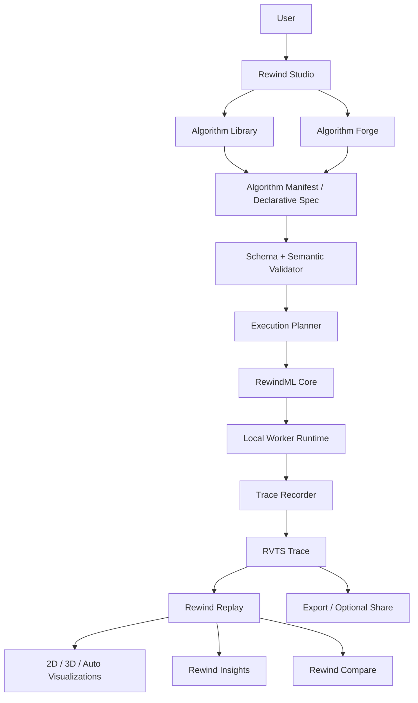

# REWINDVERSE

# Complete Machine Learning, AI & Deep Learning Algorithm Catalogue + Algorithm Forge Specification

**Document type:** Product and Engineering Specification  
**Version:** 1.0  
**Date:** 8 November 2026  
**Product:** RewindVerse  
**Primary application:** Rewind Studio  
**Algorithm workspace:** Algorithm Forge  
**Core computation layer:** RewindML  
**Replay experience:** Rewind Replay  
**Diagnostics:** Rewind Insights  
**Trace interchange:** RewindVerse Training Trace Specification (RVTS)  
**Status:** Proposed implementation baseline. This document defines the intended algorithm catalogue and capabilities; it does not claim that every listed algorithm is already implemented.

> **Product promise:** Train a model, then replay how it learned.  
> **Brand tagline:** Every Model Has a Story.

---

# Document control and how to use this specification

This document extends the RewindVerse PRD, Technical Stack, Security Architecture, and 2D/3D Visualization specifications. It is not a replacement for those documents.

| Artifact | Responsibility |
|---|---|
| RewindVerse Final PRD | Product goals, audience, user journeys, release strategy and requirements |
| Technical Stack & Architecture | Frameworks, packages, interfaces, deployment and engineering conventions |
| Security Architecture & Implementation Standard | Threat model, application security, privacy and release security gates |
| 2D/3D Visualization Product Standard | Visualization modes, rendering, synchronization and performance |
| **This document** | Algorithm catalogue, algorithm-specific learning objectives, data requirements, visualization mapping, Algorithm Forge product and execution contract |
| RVTS specification | Canonical trace records, metadata, capabilities, versioning and validation |

## Status vocabulary

| Status | Meaning |
|---|---|
| **Existing foundation** | Previously specified in RewindVerse documents; implementation must still be verified in the repository |
| **P0** | Required for the first complete and credible algorithm experience |
| **P1** | High-value expansion for a strong v1.x product |
| **P2** | Advanced catalogue expansion after core engine and trace correctness are stable |
| **P3** | Research-grade or costly capabilities requiring a separate business and technical decision |
| **Adapter** | RewindVerse imports or displays results from an external library; it does not claim to implement the algorithm itself |
| **Research / preview** | Educational prototype only; not production-grade or benchmarked |

All priorities are targets, not proof of implementation. The project backlog must track each capability as `proposed → designed → in_progress → implemented → verified → released`.

# 1. Executive decision

RewindVerse should grow into a broad algorithm learning and experiment-intelligence platform, with a unified engine that can explain classical machine learning, deep learning, generative AI, reinforcement learning, and selected modern AI workflows.

The catalogue should not become a collection of disconnected animations. Every supported algorithm must connect to the same product contract:

1. **Understand:** explain the problem, inputs, assumptions and mathematical idea.
2. **Configure:** expose meaningful parameters and constraints.
3. **Run:** execute a real supported algorithm or a clearly labelled external adapter.
4. **Record:** capture actual metrics, state and events in RVTS.
5. **Replay:** navigate through the recorded run without inventing missing values.
6. **Visualize:** choose 2D, 3D or Auto where the data and representation support it.
7. **Inspect:** show parameters, gradients, predictions, residuals, embeddings or other evidence available.
8. **Compare:** compare algorithms, configurations and runs using aligned metrics and clear step semantics.
9. **Customize:** fork a built-in algorithm or create a new constrained algorithm in Algorithm Forge.
10. **Share:** export or publish a validated declarative algorithm definition and/or trace with explicit privacy and licensing controls.

## 1.1 Core product decision

Add a first-class navigation tab named **Algorithm Forge** inside Rewind Studio.

Algorithm Forge allows users to:

- Explore the built-in algorithm library.
- Fork a supported built-in algorithm into a personal copy.
- Change parameters, initialization, update rules and supported components.
- Create an algorithm using a visual block/node editor.
- Create an algorithm using a constrained formula/expression editor.
- Inspect pseudocode and a step-by-step explanation generated from the declarative definition.
- Validate an algorithm before running it.
- Run it locally in a constrained execution engine.
- Compare it with a built-in baseline.
- Save, version, export and optionally publish it.
- Import other users' declarative algorithm packages after validation.

The first public version must not execute arbitrary user-submitted JavaScript, Python, shell commands, notebooks, serialized Python objects, native binaries or plugins on RewindVerse infrastructure.

## 1.2 Product differentiation

The differentiator is not the claim that RewindVerse contains every algorithm. The differentiator is the combination of:

- A coherent algorithm catalogue spanning multiple ML domains.
- A consistent explanation and visualization experience.
- Synchronized training replay, metrics and internal-state inspection.
- User-controlled 2D / 3D / Auto visualization where meaningful.
- A safe algorithm creation and customization workspace.
- Portable, capability-declared RVTS traces.
- Transparent provenance: native implementation, imported adapter, approximation or illustrative example.

# 2. Goals, scope and non-goals

## 2.1 Product goals

| ID | Goal | Release horizon | Success evidence |
|---|---|---|---|
| ALG-GOAL-01 | Teach core supervised and unsupervised algorithms interactively | P0/P1 | Users can run, replay and explain supported experiments |
| ALG-GOAL-02 | Make optimization behaviour observable | P0 | Actual optimizer trajectory and state are synchronized with replay |
| ALG-GOAL-03 | Add deep-learning architecture and training explainers | P1/P2 | Layer, activation, gradient and architecture panels use trace-backed data |
| ALG-GOAL-04 | Expand into generative AI, transformers and reinforcement learning | P2/P3 | Defined demonstrations pass correctness and usability gates |
| ALG-GOAL-05 | Let users customize and create algorithms | P0/P1 | A user can fork, edit, validate, run, save and export a declarative algorithm |
| ALG-GOAL-06 | Support community discovery and sharing | P1/P2 | Users can publish reviewed declarative definitions with provenance and license |
| ALG-GOAL-07 | Keep the same replay contract across browser, Python and importers | P0/P1 | Conformance fixtures pass across supported producers and consumers |
| ALG-GOAL-08 | Provide 2D/3D choice without making 3D mandatory | P0/P1 | Mode switch preserves state; accessible fallback is available |
| ALG-GOAL-09 | Protect users and visitors from unsafe algorithms and files | P0 | Security gates pass; arbitrary untrusted code is not executed |

## 2.2 True non-goals / prohibited approaches

- Running arbitrary public user code on shared application servers.
- Treating an isolated Web Worker as a complete security sandbox.
- Executing uploaded pickle, joblib, shell, notebook or native executable files.
- Guaranteeing that every algorithm has a useful 3D representation.
- Claiming all adapters are native RewindML implementations.
- Presenting synthetic example output as a real user training run.
- Automatically publishing private algorithms, datasets, traces or model artifacts.
- Building a full cloud GPU training service as part of the initial release.
- Reimplementing every library algorithm from scratch when a validated adapter is more appropriate.
- Marketing a research preview as production-ready or scientifically validated without evidence.

# 3. Algorithm platform architecture

## 3.1 Logical flow

## 3.2 Architectural layers

| Layer | Responsibility | Required boundary |
|---|---|---|
| Catalogue | Discover algorithms, categories, tutorials and compatibility | Metadata only; catalogue browsing must not execute algorithms |
| Algorithm Definition | Store manifest, allowed operations, parameter schemas and visualization capabilities | Versioned declarative format; no arbitrary executable code in public packages |
| Validator | Validate schema, semantic constraints and resource budgets | Reject unknown operators, invalid dimensions and unsupported graph structures |
| Execution Planner | Select native RewindML, declarative interpreter or approved adapter | Must record implementation provenance and runtime version |
| RewindML Core | Algorithms, objective functions, optimizers and numerical utilities | Framework-independent TypeScript packages where possible |
| Worker Runtime | Run supported work off the UI thread | Bounded input, time, memory, operations and cancellation |
| Recorder | Capture actual metrics, state, events and annotations | RVTS-compliant records only |
| Replay Engine | Select step, synchronize views and expose capabilities | Must not fabricate unavailable state |
| Visualization Registry | Map capabilities to 2D/3D renderers | 3D only when scientifically meaningful and supported |
| Algorithm Forge | Create, edit, fork, validate, version and share definitions | Safe declarative authoring by default |
| Optional SDK bridge | Record local Python workflows | Runs in the developer's own environment, not on shared web servers |

## 3.3 Native, adapter and illustrative provenance

Every algorithm card, experiment and trace must disclose how the result was produced:

- **Native RewindML:** implemented by RewindVerse and tested against documented fixtures.
- **External adapter:** executed by a named supported external library or environment.
- **Imported run:** metrics or artifacts were imported from another tool; not recomputed by RewindVerse.
- **Declarative custom:** executed by the safe Algorithm Forge interpreter.
- **Illustrative:** a teaching example with simplified or synthetic data; never label it as a real model run.

A user must be able to identify this provenance from the algorithm page, run summary and exported trace.

# 4. Complete algorithm catalogue: category overview

The following catalogue is intentionally broad. P0 and P1 form the practical product build. P2 and P3 are staged expansions, and some algorithms should be provided as external adapters rather than custom low-level implementations.

| Domain | Main catalogue groups | Priority emphasis |
|---|---|---|
| Mathematical foundations | Vectors, matrices, derivatives, chain rule, probability, distributions | P0 |
| Optimization | Gradient descent, SGD variants, Momentum, Adam family, second-order methods, schedules | P0/P1 |
| Loss functions | Regression, classification, ranking, contrastive, segmentation and generative losses | P0/P1 |
| Classical supervised ML | Linear/logistic models, kNN, Naive Bayes, SVM, trees and ensembles | P0/P1 |
| Unsupervised ML | Clustering, density estimation, dimensionality reduction and topic models | P1/P2 |
| Semi/self-supervised ML | Pseudo-labeling, contrastive learning, masked prediction and consistency learning | P2 |
| Anomaly detection | Statistical, density, isolation, one-class and reconstruction methods | P1/P2 |
| Time-series ML | Classical forecasting, state-space, recurrent, convolutional and transformer methods | P2 |
| Neural networks | Perceptron, MLP, CNN, RNN, LSTM, GRU and residual networks | P0/P1/P2 |
| Computer vision | Classification, detection, segmentation, tracking and vision transformers | P2/P3 |
| NLP | Tokenization, vectorization, embeddings, sequence models, attention and transformers | P1/P2 |
| Generative AI | Autoencoders, VAE, GAN, diffusion and normalizing flows | P2/P3 |
| Reinforcement learning | Bandits, dynamic programming, TD learning, Q-learning, policy gradients and actor-critic | P2/P3 |
| Graph ML | Graph embeddings, GCN, GraphSAGE, GAT and graph pooling | P3 |
| Evaluation | Classification, regression, ranking, clustering, calibration and robustness | P0/P1 |
| Explainability | SHAP, LIME, PDP, ICE, saliency, Grad-CAM and counterfactuals | P1/P2 |
| Data science | Preprocessing, feature engineering, validation, leakage and drift | P1/P2 |

# 5. Mathematical foundations and core optimization algorithms

These are the foundation of RewindML. The optimizer lab should use a shared objective-function interface, deterministic initialization and explicit step semantics.

## 5.1 Mathematical concepts

| Concept | What the user learns | Expected visualization |
|---|---|---|
| Scalars, vectors and matrices | How model parameters are represented | 2D vector diagrams, matrix heatmaps and tensor-shape inspector |
| Dot product and matrix multiplication | How weighted inputs and layer operations work | Animated computation graph and optional 3D tensor view |
| Derivatives | Rate of change | Function curve, tangent and derivative plot |
| Partial derivatives | Sensitivity to one parameter | 2D slices and 3D surface |
| Gradient | Direction of steepest local increase | Gradient arrows and contour map |
| Chain rule | How derivatives flow through compositions | Computation graph with derivative annotations |
| Jacobian and Hessian | First- and second-order behaviour | Matrix heatmaps, curvature and eigenvector views |
| Probability distributions | Uncertainty and sampling | PDF/CDF, histogram and density plot |
| Expectation and variance | Average behaviour and spread | Distribution overlays and confidence bands |
| Bayes' theorem | Updating beliefs from evidence | Prior/likelihood/posterior visualization |
| Entropy and information gain | Uncertainty and split quality | Entropy curves and tree-split comparison |

## 5.2 Optimization algorithm catalogue

| Algorithm | Core idea | Important controls | Useful visualization | Priority |
|---|---|---|---|---|
| Batch Gradient Descent | Update parameters using the full dataset gradient | Learning rate, initialization | 2D contour, 3D loss surface, trajectory | P0 |
| Stochastic Gradient Descent | Update from one sampled example | Learning rate, shuffle, seed | Noisy trajectory, loss per update | P0 |
| Mini-batch Gradient Descent | Update from a subset of examples | Batch size, learning rate | Loss curve, gradient variance | P0 |
| Momentum | Accumulate an exponentially weighted velocity | Learning rate, momentum coefficient | Velocity vectors and smoother path | P0 |
| Nesterov Accelerated Gradient | Evaluate gradient at a look-ahead position | Learning rate, momentum | Look-ahead point and update path | P1 |
| Adagrad | Scale updates using accumulated squared gradients | Learning rate, epsilon | Per-parameter effective learning rates | P1 |
| RMSProp | Use an exponential average of squared gradients | Learning rate, decay, epsilon | Adaptive step size over time | P1 |
| Adadelta | Adapt updates using gradient and update histories | Decay, epsilon | Update magnitude and history | P2 |
| Adam | Combine first and second moment estimates | Learning rate, beta1, beta2, epsilon | Moment estimates, bias correction and path | P0 |
| AdamW | Decouple weight decay from adaptive gradient update | Learning rate, betas, weight decay | Parameter norm and update decomposition | P1 |
| AMSGrad | Use a non-decreasing second-moment maximum | Learning rate, betas, epsilon | Second-moment envelope | P2 |
| Nadam | Adam with Nesterov-style momentum adjustment | Learning rate, betas, epsilon | Momentum and adaptive step path | P2 |
| L-BFGS | Approximate inverse-Hessian updates from limited history | History size, tolerance | Curvature-informed trajectory | P2 |
| Newton's Method | Use gradient and Hessian for a second-order step | Damping, tolerance | Curvature and step size | P2 |
| Coordinate Descent | Optimize one coordinate or block at a time | Coordinate order, tolerance | Coordinate path on contour | P2 |
| Proximal Gradient | Combine gradient step and regularization proximal operator | Learning rate, penalty | Sparse coefficient evolution | P2 |
| Conjugate Gradient | Use conjugate directions for suitable optimization problems | Tolerance, iterations | Direction sequence and residual norm | P3 |
| Evolution Strategies | Search by sampling candidate parameter perturbations | Population, sigma, learning rate | Candidate distribution and best-so-far path | P3 |

### Required optimizer formulas and conventions

For parameters \(\theta_t\), learning rate \(\eta\), objective \(J(\theta)\), and gradient \(g_t=\nabla_\theta J(\theta_t)\):

**Basic SGD**

\[
\theta_{t+1}=\theta_t-\eta g_t
\]

**Momentum**

\[
v_t=\beta v_{t-1}+g_t,\qquad \theta_{t+1}=\theta_t-\eta v_t
\]

An implementation may use a different but equivalent convention (for example, scaling the gradient before accumulation). RewindVerse must document the exact convention and match its reference fixtures.

**Adam**

\[
m_t=\beta_1m_{t-1}+(1-\beta_1)g_t
\]
\[
v_t=\beta_2v_{t-1}+(1-\beta_2)g_t^2
\]
\[
\hat m_t=\frac{m_t}{1-\beta_1^t},\quad \hat v_t=\frac{v_t}{1-\beta_2^t}
\]
\[
\theta_{t+1}=\theta_t-\eta\frac{\hat m_t}{\sqrt{\hat v_t}+\epsilon}
\]

The epsilon placement is part of the implementation contract. Do not assume all libraries use identical numerical details. Publish parity reports per optimizer, including dtype, reference implementation, tolerance and observed maximum error.

**AdamW**

Weight decay is decoupled from the adaptive-gradient term. The exact decay convention and ordering must be explicitly documented and tested. Do not silently treat Adam with L2 penalty as AdamW.

## 5.3 Learning-rate schedules

| Schedule | Teaching objective | Visualization |
|---|---|---|
| Constant | Baseline learning rate | Horizontal schedule |
| Step decay | Reduce at milestones | Step function and loss overlay |
| Exponential decay | Smooth multiplicative decay | Exponential curve |
| Cosine decay | Gradual cosine-shaped reduction | Cosine schedule |
| Warmup | Increase from a small initial rate | Warmup plus main schedule |
| Warmup + cosine | Common deep-learning schedule | Combined curve |
| Reduce on plateau | React to validation metric stagnation | Trigger annotations |
| Cyclical learning rate | Repeated learning-rate range | Cycle and loss response |
| One-cycle policy | Single planned rise and fall | Full cycle with metric overlay |

## 5.4 Loss-function catalogue

| Family | Losses | Typical use | Visualization |
|---|---|---|---|
| Regression | MSE, RMSE, MAE, Huber, Log-Cosh, Quantile | Numeric prediction | Residual distribution, error curve and prediction-vs-target |
| Binary classification | Binary cross-entropy, focal loss, hinge | Two-class prediction | Probability and loss curves |
| Multiclass | Categorical cross-entropy, sparse cross-entropy, NLL | Multi-class classification | Class-probability bars and confusion matrix |
| Margin-based | Hinge, squared hinge, triplet margin | SVM and metric learning | Margin geometry and embedding distance |
| Distributional | KL divergence, Jensen-Shannon variants | Distribution matching | Density overlay and divergence curve |
| Contrastive | Contrastive loss, InfoNCE, NT-Xent | Representation learning | Positive/negative pair distances and embedding clusters |
| Ranking | Pairwise ranking, listwise ranking, Lambda-style objectives | Search and ranking | Ranking metrics and pair preference |
| Segmentation | Dice, IoU/Jaccard, focal, Tversky | Image segmentation | Mask overlay and region-level score |
| Generative | ELBO, adversarial loss, diffusion noise-prediction loss | VAE, GAN and diffusion | Reconstruction, discriminator/generator and denoising curves |
| Sequence | Token cross-entropy, CTC | Language and sequence tasks | Per-token loss and alignment |

Every loss visualization must state reduction mode (`none`, `sum`, `mean`), class weighting, masking rules and any normalization that changes interpretation.

# 6. Classical supervised machine-learning algorithms

These algorithms should teach the progression from simple linear models to nonlinear decision systems and ensembles.

| Algorithm | Problem and mechanism | Inputs / outputs | Core visualization | Priority |
|---|---|---|---|---|
| Ordinary Least Squares Linear Regression | Fit a linear combination of features by minimizing squared error | Numeric features → continuous prediction and coefficients | Scatter, regression line/plane, residuals, coefficient path | P0 |
| Polynomial Regression | Expand features with polynomial terms, then fit a linear model | Features → continuous prediction | Curve fit, overfitting as degree grows | P1 |
| Ridge Regression | L2-regularized linear regression | Features → continuous prediction | Coefficient shrinkage path | P1 |
| Lasso Regression | L1 penalty can drive coefficients to zero | Features → sparse linear prediction | Sparse coefficient path | P1 |
| Elastic Net | Combine L1 and L2 penalties | Features → continuous prediction | Coefficient path and regularization map | P1 |
| Logistic Regression | Model class probability using a sigmoid or softmax | Features → class probabilities | Decision boundary, probability field, loss | P0 |
| Perceptron | Linear threshold classifier updated on mistakes | Features → binary class | Separating hyperplane and updates | P0/P1 |
| k-Nearest Neighbors | Predict from nearest training examples | Feature vectors → label/value | Distance neighborhoods and decision regions | P1 |
| Gaussian Naive Bayes | Apply Bayes rule with conditional-independence assumption and Gaussian likelihoods | Features → class probabilities | Feature distributions and posterior | P1 |
| Multinomial Naive Bayes | Count-based event model | Nonnegative counts → class probabilities | Token likelihoods and class scores | P1 |
| Bernoulli Naive Bayes | Binary feature likelihood model | Binary features → class probabilities | Feature likelihood contribution | P2 |
| Linear SVM | Maximize a separating margin | Features → class/score | Margin bands, support vectors and boundary | P1 |
| Kernel SVM | Use kernel similarity for nonlinear separation | Features → class/score | Nonlinear boundary and support vectors | P1 |
| Decision Tree | Recursively split features using an impurity criterion | Features → class/value and tree | Tree graph, split thresholds and entropy/Gini | P1 |
| Random Forest | Aggregate randomized decision trees | Features → ensemble prediction | Tree diversity, feature importance and vote | P1 |
| Extra Trees | Increase split randomization across trees | Features → ensemble prediction | Tree diversity and feature importance | P2 |
| AdaBoost | Sequentially reweight difficult examples | Features → ensemble prediction | Sample weights and weak learner contribution | P2 |
| Gradient Boosting | Add learners to correct residual/gradient errors | Features → ensemble prediction | Additive model stages and residual reduction | P1 |
| HistGradientBoosting | Histogram-based gradient boosting | Features → ensemble prediction | Binned split and staged loss | P2 |
| XGBoost | Regularized gradient-boosted trees | Features → prediction | Tree contributions, gain and training curves | Adapter P2 |
| LightGBM | Histogram and leaf-wise boosted trees | Features → prediction | Leaf growth, feature importance and metrics | Adapter P2 |
| CatBoost | Ordered boosting and categorical feature handling | Mixed features → prediction | Categorical processing and stage metrics | Adapter P2 |
| Calibrated Classifier | Calibrate probabilities after or during training | Scores → calibrated probabilities | Reliability and calibration curve | P1 |
| Linear/Quadratic Discriminant Analysis | Model class-conditional distributions | Features → class scores | Decision boundary and covariance ellipses | P2 |

### Required supervised demonstrations

- Linear regression on a deterministic 1D and 2D dataset.
- Logistic regression on a 2D binary classification dataset.
- A multiclass example with class probabilities.
- A decision-tree split explorer showing information gain or impurity reduction.
- An ensemble demonstration showing weak learners and aggregate prediction.
- A regularization experiment demonstrating bias/variance effects.

# 7. Unsupervised learning and representation learning

| Algorithm | Mechanism | Inputs / outputs | Visualization | Priority |
|---|---|---|---|---|
| K-Means | Alternate centroid assignment and update | Numeric features → cluster labels and centroids | 2D/3D clusters, centroids and movement | P1 |
| K-Means++ | Initialize centroids with distance-aware sampling | Numeric features → initial centroids | Initialization comparison | P1 |
| Mini-Batch K-Means | Update centroids from batches | Numeric features → clusters | Centroid updates and convergence | P2 |
| Hierarchical Agglomerative Clustering | Merge nearest clusters iteratively | Features → dendrogram and labels | Dendrogram and cluster cut | P1 |
| DBSCAN | Identify dense regions and noise | Features → clusters and noise | Density neighborhoods and noise points | P1 |
| HDBSCAN | Hierarchical density-based clustering | Features → clusters, membership strength | Condensed tree and cluster stability | P2 |
| OPTICS | Order points by reachability density | Features → ordering and clusters | Reachability plot | P2 |
| Gaussian Mixture Model | Fit weighted Gaussian components using EM | Features → component probabilities | Gaussian ellipses and likelihood | P2 |
| Mean Shift | Find modes of a density estimate | Features → cluster modes | Density peaks and converging points | P2 |
| Spectral Clustering | Embed using graph Laplacian eigenvectors, then cluster | Similarity graph → cluster labels | Similarity graph and eigen-embedding | P2 |
| BIRCH | Build a compact clustering-feature tree | Large numeric dataset → clusters | CF tree and hierarchical summary | P3 |
| PCA | Project onto directions of maximum variance | Numeric matrix → components and scores | 2D/3D projection, explained variance | P1 |
| Truncated SVD | Low-rank approximation without centering requirement | Matrix → low-rank factors | Singular values and projections | P2 |
| t-SNE | Preserve local neighbor probabilities in an embedding | Feature matrix → 2D/3D embedding | Cluster/neighbor maps | P2 |
| UMAP | Construct and optimize a fuzzy neighborhood graph embedding | Feature matrix → 2D/3D embedding | Cluster structure and neighborhood views | P2 |
| ICA | Find statistically independent components | Signal matrix → independent components | Component signals and mixing matrix | P2 |
| NMF | Factorize nonnegative matrix into nonnegative factors | Nonnegative matrix → parts-based factors | Factor heatmaps and reconstruction | P2 |
| Latent Dirichlet Allocation | Infer topic mixtures and word distributions | Document-term matrix → topics | Topic-word matrix and document-topic mixture | P2 |
| Autoencoder | Learn latent representation through reconstruction | Data → latent vector and reconstruction | Latent space and reconstruction error | P1/P2 |

**Interpretation rule:** PCA, t-SNE and UMAP displays are projections. A 2D/3D embedding can distort distances or global geometry. Provide the method, parameters, seed, trustworthiness/quality diagnostics when available, and a warning that visual separation is not proof of real class separation.

# 8. Semi-supervised, self-supervised and metric learning

| Method | Core idea | Learning visualization | Priority |
|---|---|---|---|
| Self-training / pseudo-labeling | Add confident unlabeled predictions to training data | Confidence threshold, pseudo-label acceptance and errors | P2 |
| Label propagation | Spread labels over a similarity graph | Graph nodes, label diffusion and uncertainty | P2 |
| Label spreading | Regularized graph-based label propagation | Iterative label scores | P3 |
| Consistency regularization | Require predictions to remain stable under perturbations | Augmentation pairs and prediction divergence | P2 |
| MixUp | Train on convex combinations of examples and labels | Mixed samples and loss comparison | P2 |
| CutMix | Replace an image region and mix labels by area | Patch overlays and label weighting | P2 |
| SimCLR | Contrastive learning over augmented views | Positive/negative pairs and embedding distances | P2 |
| MoCo | Momentum encoder and queue-based contrastive learning | Queue, keys and query embeddings | P3 |
| BYOL | Bootstrap representations using online/target networks | Target/online network and embedding similarity | P3 |
| Triplet Learning | Pull anchor-positive together and push negatives away | Triplet distances and margin | P2 |
| Siamese Networks | Learn similarity using paired encoders | Pair similarity and distance distribution | P2 |
| Metric Learning | Learn a distance function or embedding | Pairwise distance heatmap and embedding | P2 |

# 9. Anomaly detection and outlier analysis

| Algorithm | Mechanism | Visualization | Priority |
|---|---|---|---|
| Z-score / robust Z-score | Standardized distance from central tendency | Distribution, threshold and flagged points | P1 |
| IQR rule | Flag values outside robust quartile bounds | Box plot and outlier markers | P1 |
| Isolation Forest | Isolate anomalies using random partitions | Isolation path length and score | P2 |
| Local Outlier Factor (LOF) | Compare local density with neighbors | Local density and anomaly score | P2 |
| One-Class SVM | Learn a boundary around normal data | Boundary, support vectors and outliers | P2 |
| Elliptic Envelope | Estimate robust Gaussian-like central region | Covariance ellipse and flagged points | P3 |
| Autoencoder anomaly detection | Use reconstruction error as anomaly score | Reconstruction error distribution and examples | P2 |
| Change-point detection | Identify distribution or process shifts | Time-series segments and change markers | P2 |
| Robust PCA | Separate low-rank structure and sparse corruption | Original, low-rank and sparse components | P3 |

# 10. Time-series and forecasting algorithms

| Algorithm | Mechanism | Inputs / outputs | Visualization | Priority |
|---|---|---|---|---|
| Naive / seasonal naive | Forecast from last or seasonal observation | Indexed series → forecast | Baseline and forecast intervals | P1 |
| Moving Average | Smooth local fluctuations | Series → smoothed series | Raw vs smoothed line | P1 |
| Exponential Smoothing | Weighted update favouring recent values | Series → level forecast | Level and forecast curve | P2 |
| Holt Linear Trend | Smooth level and trend | Series → trend forecast | Level/trend components | P2 |
| Holt-Winters | Add seasonal component | Seasonal series → forecast | Level/trend/seasonality decomposition | P2 |
| AR | Model dependence on past values | Series → autoregressive prediction | Lag plot and coefficients | P2 |
| MA | Model dependence on past forecast errors | Series → prediction | Residual autocorrelation | P2 |
| ARIMA | Combine autoregression, differencing and moving average | Series → forecast | Differenced series, ACF/PACF and residuals | P2 |
| SARIMA | Extend ARIMA with seasonality | Seasonal series → forecast | Seasonal decomposition and forecast | P2 |
| VAR | Joint autoregression over multiple series | Multivariate series → joint forecast | Cross-series dynamics | P3 |
| STL decomposition | Separate trend, seasonal and remainder components | Series → components | Component panels | P2 |
| Kalman Filter | Recursive state estimation | Observations and state model → state estimate | State, uncertainty and innovations | P2 |
| Prophet-style decomposable forecast | Trend, seasonality and holiday effects | Series + calendar features → forecast | Trend/seasonality/holiday components | Adapter P2 |
| TCN | Temporal convolutional network | Sequence windows → forecast | Receptive field and temporal activations | P2 |
| LSTM forecasting | Gated recurrent sequence model | Sequence → forecast | Hidden/cell state summaries and prediction | P2 |
| GRU forecasting | Gated recurrent sequence model | Sequence → forecast | Gate activations and prediction | P2 |
| Time-series Transformer | Attention over historical sequence | Sequence → forecast | Attention and horizon errors | P3 |

Forecasting views must separate training, validation and test windows. Never allow future values to leak into the input window. Provide prediction intervals only when supported by the method.

# 11. Neural networks and deep-learning foundations

## 11.1 Core neural-network components

| Component | What to teach | Visualization |
|---|---|---|
| Perceptron | Weighted sum and threshold | Inputs, weights, bias and boundary |
| Dense / Linear Layer | Matrix multiplication plus bias | Weight matrix, tensor shapes and node graph |
| Forward Propagation | Compute outputs layer by layer | Animated signal flow and intermediate activations |
| Backpropagation | Apply chain rule to compute gradients | Reverse gradient flow and local derivatives |
| Computational Graph | Represent operations and dependencies | Interactive node-edge graph |
| Dropout | Randomly mask activations during training | Active/inactive units and mask distribution |
| Batch Normalization | Normalize intermediate activations using batch statistics | Before/after activation distribution and running stats |
| Layer Normalization | Normalize across feature dimensions | Feature distribution and scale/shift parameters |
| Residual Connection | Add identity or projected skip path | Main path and skip path |
| Embedding Layer | Map IDs to learned vectors | Embedding matrix and nearest neighbors |
| Attention Layer | Weight information from other positions | Attention matrix and query-key-value flow |

## 11.2 Neural-network architectures

| Architecture | Purpose | Required visualization | Priority |
|---|---|---|---|
| MLP / Feedforward Network | General tabular and vector learning | Layer graph, activations, weights and gradients | P0/P1 |
| LeNet-style CNN | Introductory convolution | Input, filters, feature maps and pooling | P2 |
| AlexNet-style CNN | Deeper convolutional feature learning | Layer stack and feature maps | P3 |
| VGG-style CNN | Repeated small convolutions | Receptive field and feature maps | P3 |
| ResNet | Residual learning for deep networks | Residual/skip graph and activation statistics | P2 |
| DenseNet | Dense layer-to-layer feature reuse | Dense connectivity graph | P3 |
| MobileNet | Efficient depthwise separable convolution | FLOPs/parameter comparison and feature map sizes | P3 |
| EfficientNet | Compound scaling of depth, width and resolution | Scaling visualization and compute comparison | P3 |
| RNN | Sequence modelling with recurrent state | Unrolled time steps and hidden state | P2 |
| LSTM | Gated recurrent cell with cell state | Input/forget/output gates and cell state | P2 |
| GRU | Gated recurrent cell | Reset/update gates and hidden state | P2 |
| Seq2Seq | Map an input sequence to an output sequence | Encoder/decoder timelines and alignment | P2 |
| Encoder-Decoder Transformer | Attention-based sequence processing | Encoder/decoder blocks, attention and residuals | P2/P3 |
| Vision Transformer (ViT) | Treat image patches as tokens | Patch embedding, token flow and attention | P3 |
| U-Net | Encoder-decoder segmentation architecture with skip connections | Feature scales, skip connections and masks | P3 |
| GNN | Learn from graph-structured inputs | Nodes, edges, aggregation and embeddings | P3 |

## 11.3 Activations and normalization

Activation catalogue: Identity, Sigmoid, Tanh, ReLU, Leaky ReLU, PReLU, ELU, SELU, GELU, SiLU/Swish, Softplus and Softmax.

Normalization catalogue: BatchNorm, LayerNorm, GroupNorm, InstanceNorm and RMSNorm.

The activation explorer should plot function, first derivative, saturation range and numerical stability. Softmax must be treated as a vector operation, not a scalar activation curve alone.

# 12. Computer vision algorithms and tasks

| Task / algorithm | Core concept | Visualization | Priority |
|---|---|---|---|
| Image filtering | Blur, sharpen, edge and convolution kernels | Original/filtered image and kernel heatmap | P1/P2 |
| Convolution | Sliding kernel and feature extraction | Kernel movement and activation map | P2 |
| Pooling | Downsample local regions | Before/after feature-map dimensions | P2 |
| Image classification | Assign image class probabilities | Top classes, saliency and confusion matrix | P2 |
| Object detection | Predict bounding boxes and classes | Boxes, confidence and IoU | P3 |
| YOLO-family detector | Single-stage detection | Grid/anchor or head outputs as relevant to version | P3 adapter/education |
| Faster R-CNN | Region proposal plus classification/refinement | Proposals, RoI and boxes | P3 |
| Semantic segmentation | Assign class per pixel | Mask overlays and per-class metrics | P3 |
| U-Net segmentation | Encoder-decoder pixel prediction | Feature scales and output mask | P3 |
| Instance segmentation | Separate objects individually | Masks, boxes and instance labels | P3 |
| Mask R-CNN | Detection plus per-instance masks | Region proposals and masks | P3 |
| Optical flow | Estimate apparent motion between frames | Flow vectors and color wheel | P3 |
| Object tracking | Associate detections across frames | Track paths, IDs and confidence | P3 |
| Grad-CAM | Use gradients to highlight influential feature-map regions | Heatmap overlay with provenance | P2/P3 |
| Saliency maps | Estimate input sensitivity | Pixel heatmap and perturbation comparison | P2 |
| Integrated Gradients | Attribute output change along a baseline path | Attribution map and completeness check | P2 |

# 13. Natural language processing and language-model algorithms

## 13.1 Text preparation and classical NLP

| Algorithm / method | Purpose | Visualization | Priority |
|---|---|---|---|
| Tokenization | Convert text into tokens | Token boundaries and token IDs | P1 |
| Character/word n-grams | Capture local token sequences | N-gram frequency and feature matrix | P1 |
| One-hot encoding | Sparse categorical representation | Vector index visualization | P1 |
| Bag of Words | Count token occurrence | Vocabulary and document-term matrix | P1 |
| TF-IDF | Weight terms by informativeness | Term scores and document matrix | P1 |
| BM25 | Rank documents using term statistics | Query-term contribution and ranked results | P2 |
| Word2Vec CBOW | Predict target word from context | Context window and embedding space | P2 |
| Word2Vec Skip-gram | Predict context from target word | Target/context probability and embeddings | P2 |
| GloVe | Factorize global word co-occurrence statistics | Co-occurrence and embedding projections | P3 |
| FastText | Use subword information for embeddings | Character n-grams and vector composition | P2 |
| Byte Pair Encoding | Iteratively merge frequent symbol pairs | Merge table and tokenization changes | P2 |
| Sentence embeddings | Represent text as vectors | Similarity and 2D/3D embedding explorer | P2 |

## 13.2 Sequence and transformer models

| Model / concept | Purpose | Visualization | Priority |
|---|---|---|---|
| RNN language model | Predict next token from recurrent context | Unrolled state and token probability | P2 |
| LSTM / GRU language model | Gated sequential memory | Gate activations and token predictions | P2 |
| Seq2Seq | Conditional sequence generation | Encoder-decoder attention and outputs | P2 |
| Attention | Weighted combination of values | Attention matrix and query/key/value | P2 |
| Transformer encoder | Contextual bidirectional representation | Self-attention and token embeddings | P2 |
| Transformer decoder | Autoregressive generation | Causal mask, next-token probabilities and cache concept | P2 |
| BERT-style encoder | Masked language modelling / encoder tasks | Masked token recovery and attention | P3 |
| GPT-style decoder | Causal next-token prediction | Causal attention and generation timeline | P3 |
| T5/BART-style sequence-to-sequence | Text-to-text transformation | Encoder/decoder alignment and token loss | P3 |
| Named Entity Recognition | Sequence token classification | Token labels and span boundaries | P2 |
| Text classification | Document/sentence category | Class probabilities, confusion and saliency | P2 |
| Translation | Conditional sequence generation | Source-target alignment and token progress | P3 |
| Summarization | Condense source into generated sequence | Source coverage and generation trace | P3 |

## 13.3 Retrieval-augmented generation (RAG) learning path

RAG is a system pattern, not one single algorithm. RewindVerse should teach it as a pipeline:

1. Document ingestion and extraction.
2. Chunking and metadata.
3. Sparse retrieval (BM25).
4. Dense embedding retrieval.
5. Hybrid retrieval.
6. Reranking.
7. Context assembly.
8. Prompt construction.
9. Model generation.
10. Citation/grounding checks and evaluation.

Visualizations: chunk map, embedding neighborhood, retrieval ranking, reranker score changes, context window budget, source attribution and answer-evidence links. The product must clearly distinguish retrieved context from generated model output.

# 14. Generative AI and representation-learning algorithms

| Algorithm | Core idea | Visualizations | Priority |
|---|---|---|---|
| Autoencoder | Encode and reconstruct input | Input, latent space and reconstruction | P1/P2 |
| Variational Autoencoder (VAE) | Learn probabilistic latent distribution using ELBO | Mean/log-variance, latent sampling and reconstruction | P2 |
| Denoising Autoencoder | Reconstruct clean input from corruption | Corruption severity and reconstruction | P2 |
| Sparse Autoencoder | Encourage sparse latent activations | Activation sparsity and feature distributions | P3 |
| GAN | Generator competes with discriminator | Generator/discriminator losses and generated samples | P2 |
| DCGAN | Convolutional GAN architecture | Feature maps and sample progression | P3 |
| Conditional GAN | Generate conditioned on labels or attributes | Condition input and generated output | P3 |
| WGAN/WGAN-GP | Use critic objective and optional gradient penalty | Critic score and gradient penalty | P3 |
| Diffusion / DDPM | Learn to reverse a gradual noising process | Forward noise schedule and reverse denoising steps | P3 |
| DDIM | Alternative sampling path for diffusion | Sampling trajectory and step count | P3 |
| Score-based models | Learn score of data/noise distributions | Score field and noise levels | P3 |
| Normalizing Flows | Learn invertible transformations with tractable density | Transformation stages and density evolution | P3 |
| Autoregressive density model | Factorize joint distribution into conditionals | Token/sample generation path | P3 |
| Flow Matching | Learn vector field connecting source and target distributions | Vector field and transport paths | Research/P3 |

Heavy generative models should begin as small educational models or adapters to locally executed models. Do not imply that the website trains large foundation models in the cloud.

# 15. Reinforcement learning and decision-making

| Algorithm / concept | Core idea | Visualization | Priority |
|---|---|---|---|
| Multi-Armed Bandit | Choose among actions with uncertain reward | Reward distribution, regret and selection counts | P2 |
| Epsilon-Greedy | Explore randomly with probability epsilon | Exploration/exploitation timeline | P2 |
| UCB | Choose actions using confidence upper bound | Confidence intervals and action score | P2 |
| Thompson Sampling | Sample from posterior reward distributions | Posterior distributions and action choices | P2 |
| Markov Decision Process | State, action, transition and reward model | State transition graph | P2 |
| Policy Iteration | Alternate policy evaluation and improvement | Policy/value iteration steps | P3 |
| Value Iteration | Repeated Bellman optimality updates | Value heatmap and policy arrows | P3 |
| Monte Carlo Prediction/Control | Learn values from complete episodes | Return distribution and episode timeline | P3 |
| TD(0) | Bootstrap one-step value updates | Temporal difference error and value curve | P2/P3 |
| SARSA | On-policy temporal-difference control | State-action values and episode path | P2 |
| Q-Learning | Off-policy temporal-difference control | Q-table heatmap and greedy policy | P2 |
| DQN | Approximate Q-values with neural network and replay buffer | Replay buffer, target network and Q values | P3 |
| Double DQN | Reduce overestimation with separated selection/evaluation | Online/target Q comparison | P3 |
| Dueling DQN | Separate value and advantage streams | Value/advantage contribution | P3 |
| REINFORCE | Monte Carlo policy-gradient method | Policy probabilities and return-weighted updates | P3 |
| Actor-Critic | Learn policy and value together | Actor probabilities and critic value | P3 |
| A2C/A3C | Advantage actor-critic variants | Advantage estimates and rollout timeline | P3 |
| PPO | Constrain policy update using clipped objective | Probability ratio, clipping and KL | P3 |
| DDPG | Off-policy continuous-action actor-critic | Actor, critic and target networks | P3 |
| TD3 | Twin critics and delayed policy updates | Twin-Q estimates and policy delay | P3 |
| SAC | Entropy-regularized off-policy actor-critic | Reward, entropy and temperature | P3 |

Reinforcement-learning visualizers must make environment assumptions visible: action space, observation space, reward function, episode length, seed and reset rules.

# 16. Graph machine learning

| Algorithm | Purpose | Visualization | Priority |
|---|---|---|---|
| Graph traversal (BFS/DFS) | Explore graph structure | Animated frontier and visited nodes | P1 educational |
| PageRank | Estimate node importance | Rank scores and iteration | P2 |
| DeepWalk | Learn node embeddings from random walks | Walk sequence and embedding map | P3 |
| Node2Vec | Biased random walks for graph embeddings | Walk strategy and embedding space | P3 |
| Graph Convolutional Network (GCN) | Aggregate normalized neighbor features | Message passing and layer embeddings | P3 |
| GraphSAGE | Sample and aggregate neighborhood features | Neighborhood sampling and aggregation | P3 |
| Graph Attention Network (GAT) | Learn attention weights over neighbors | Edge attention weights | P3 |
| Graph Isomorphism Network (GIN) | Aggregate neighborhood structure | Layer-wise graph representation | P3 |
| Link prediction | Predict missing/future edges | Candidate edges and score ranking | P3 |

# 17. Model evaluation, explainability and responsible ML

## 17.1 Metrics catalogue

| Problem type | Metrics |
|---|---|
| Classification | Accuracy, balanced accuracy, precision, recall, specificity, F1, macro/micro/weighted averages, ROC-AUC, PR-AUC, log loss, top-k accuracy |
| Regression | MAE, MSE, RMSE, R², adjusted R², MAPE/sMAPE with zero-value caveats, median absolute error, quantile loss |
| Clustering | Silhouette, Davies-Bouldin, Calinski-Harabasz, adjusted Rand index, normalized mutual information where labels exist |
| Ranking/retrieval | Precision@k, Recall@k, MAP, MRR, NDCG@k, hit rate |
| Forecasting | MAE, RMSE, MASE, sMAPE, pinball loss, coverage and interval width |
| Detection | Precision/recall at IoU thresholds, mean average precision, IoU |
| Segmentation | Dice, IoU, per-class metrics and boundary metrics |
| Calibration | Brier score, expected calibration error, reliability curves |
| Fairness diagnostics | Group performance gaps, demographic parity difference, equalized-odds-related metrics where assumptions and labels justify them |
| Robustness | Perturbation sensitivity, subgroup performance, stress-test degradation |

Metric panels must disclose class averaging, threshold, positive class, label mapping, missing data policy and sample count.

## 17.2 Explainability algorithms

| Method | Scope | Visualization | Priority |
|---|---|---|---|
| Permutation Feature Importance | Global/permutation-based | Ranked bar chart and score distribution | P1 |
| SHAP | Local/global additive attribution framework | Beeswarm, waterfall, force-style and dependence plots | P2 |
| LIME | Local surrogate explanation | Local feature weights and neighborhood fit | P2 |
| PDP | Average prediction dependence on feature | Partial dependence line/surface | P2 |
| ICE | Per-example feature response | Individual curves and average | P2 |
| Accumulated Local Effects | Local feature effects with less extrapolation in some settings | ALE curve/surface | P3 |
| Integrated Gradients | Path-based input attribution | Attribution map and completeness residual | P2 |
| Saliency | Input sensitivity | Pixel/token attribution map | P2 |
| Grad-CAM | Gradient-weighted activation localization | Heatmap on image | P2/P3 |
| Counterfactual Explanation | Find input change that changes prediction | Before/after feature diff and constraint report | P2/P3 |
| Feature Ablation | Measure output change when feature removed | Ablation contribution chart | P2 |

Explanations are diagnostic tools, not proof of causal reasoning. State the method, model, baseline, sample, assumptions and known limitations.

# 18. Algorithm card: mandatory information for every catalogue entry

Every algorithm detail page must use a consistent template.

| Field | Requirement |
|---|---|
| Algorithm ID | Stable slug, e.g. `optim.adam` |
| Display name | Canonical readable title |
| Category | Supervised, optimization, NLP, RL, etc. |
| Problem type | Classification, regression, clustering, generation, control, etc. |
| Short explanation | Plain-language explanation |
| Learning objectives | What the user should understand after using it |
| Mathematical definition | Equation(s), symbols and conventions |
| Assumptions | Required assumptions and limitations |
| Inputs | Shape, type, units and preprocessing expectations |
| Outputs | Predictions, parameters, state or scores |
| Hyperparameters | Range, default and effect |
| Data requirements | Dataset and sample constraints |
| Execution provenance | Native, adapter, imported, declarative or illustrative |
| Trace capabilities | Signals recorded and supported RVTS capabilities |
| Visualizations | 2D, 3D, table, graph, heatmap, timeline, etc. |
| Complexity | Time and memory guidance where meaningful |
| Reproducibility | Seed, deterministic settings and known nondeterminism |
| Comparison baseline | Suitable reference algorithm or naive baseline |
| Tests | Unit, numerical, integration and UI tests |
| Limitations | Known failure modes and warnings |
| References | Textbook, paper or official library docs |
| Status | Proposed, in progress, implemented, verified, released |

---

> **Note:** For the Algorithm Forge product and engineering specification (visual node builder, formula DSL editor, manifest format, safe Web Worker execution engine), see [ALGORITHM_FORGE_SPECIFICATION.md](../forge/ALGORITHM_FORGE_SPECIFICATION.md).

---

# 20. RVTS trace requirements for algorithm coverage

The replay system is only as useful as the information recorded by the algorithm. Each algorithm must declare trace capabilities before execution.

## 20.1 Common trace signals

| Signal | Meaning | Example visualizations |
|---|---|---|
| `metrics.loss` | Recorded training/validation/test objective values | Loss curves, event annotations |
| `metrics.task` | Task metric such as accuracy, F1 or MAE | Metric curves, scorecards |
| `optimizer.learning_rate` | Effective learning rate per step/group | Schedule and step overlay |
| `gradients.summary` | Gradient norm, finite counts, selected summaries | Gradient monitor, vanishing/exploding diagnostics |
| `gradients.tensor` | Selected full or sampled gradient tensor | Histograms, heatmaps, layer flow |
| `parameters.summary` | Parameter norm, min/max/mean or group summaries | Parameter monitor and comparison |
| `parameters.snapshot` | Actual parameter state snapshot | Weight evolution and registered replay views |
| `activations.summary` | Layer activation statistics | Activation distribution and flow |
| `activations.tensor` | Selected activation tensor | Feature maps and layer inspector |
| `optimizer.state.summary` | Optimizer internal state summaries | Momentum/moment panel |
| `predictions.sample` | Selected prediction/target examples | Decision surface, error inspection |
| `embeddings.snapshot` | Vector embedding set with metadata | 2D/3D projector |
| `events.training` | Start, end, epoch, checkpoint, failure etc. | Timeline and annotations |
| `environment.rl` | State/action/reward/episode details | Policy, state graph and reward path |

## 20.2 Trace capability rules

- A panel is enabled only when the relevant capability is declared and validated.
- Missing signals appear as “not recorded” rather than zero.
- An imported scalar-only run cannot display gradients, activations or weight trajectories.
- A projected 2D/3D visualization must show projection method and parameters.
- A 3D surface for a high-dimensional model is a selected two-parameter slice, projection or local approximation; it is not the full loss surface.
- If a custom algorithm exposes a parameter update but no gradient, the gradient panel must not be fabricated.
- Trace producers must state sample cadence and whether values are exact, sampled, aggregated or derived.

## 20.3 Legacy format migration

Earlier project drafts used the working format name **MVTS**. The current product baseline uses **RVTS**. Migration must be explicit:

- Keep an MVTS importer during the compatibility period.
- Preserve the original file and record the conversion tool/version.
- Map supported fields to RVTS without inventing missing fields.
- Produce a conversion report with mapped, transformed, dropped and unsupported content.
- Keep original step units and original step values.
- Do not silently rename a file and claim the content has been converted.

# 21. 2D / 3D visualization capability matrix

The user's preference is explicit: where both representations are meaningful, offer **2D**, **3D** and **Auto**. A single 3D view must never be forced on all algorithms.

| Visualization | 2D | 3D | Important caveat |
|---|---:|---:|---|
| Training loss vs step | Yes | Optional 3D surface over two parameters and step | Do not make 3D the default for a simple metric curve |
| Loss contour | Yes | Yes | 3D only for a registered objective or explicitly computed slice |
| Optimizer trajectory | Yes | Yes | Full parameter vector may exceed 3 dimensions; show selected projection |
| Linear regression | Yes | Yes for two-feature surface | More features require slice/projection |
| Logistic decision boundary | Yes | Yes for two input features/probability surface | Do not imply 3D plot represents arbitrary high-D boundary |
| kNN neighborhoods | Yes | Yes | Dimensionality reduction changes geometry |
| Decision tree | Yes | Possible 3D layered tree | 2D tree is usually more readable |
| Clustering | Yes | Yes | State projection and clustering space separately |
| PCA/t-SNE/UMAP | Yes | Yes | Projection distortion must be disclosed |
| Neural architecture | Yes | Yes | 3D must not hide topology or edge meaning |
| Weight/activation matrices | Heatmap | 3D tensor exploration when valuable | 2D heatmap often more precise |
| Confusion matrix | Yes | Not recommended | A 3D bar chart usually hurts comparison |
| ROC/PR/calibration | Yes | Not recommended by default | 2D is the correct primary representation |
| Attention matrix | Yes | 3D stack/sequence view optional | Heatmap remains canonical for exact reading |
| Time-series forecast | Yes | 3D time/feature/value for multivariate exploration | 3D must not obscure time ordering |
| Embeddings | Yes | Yes | Always disclose algorithm and projection parameters |
| RL state/action map | Yes | 3D for suitable low-dimensional states | High-dimensional state must be projected |
| Graph neural network | 2D network | 3D graph layout optional | Layout is not a semantic metric |

## 21.1 Mode selector behavior

- **2D:** preferred for precision, accessibility and many metric charts.
- **3D:** available when a registered renderer and sufficient data exist.
- **Auto:** choose 2D or 3D based on capability, user preference, viewport, device performance and accessibility setting.
- Preserve selected step, filters, selected run, camera-independent selection and comparison state when switching.
- Provide keyboard-operable alternatives for camera movement and point selection.
- Respect reduced-motion preferences and low-power settings.

# 22. Algorithm comparison and experiment design

Every comparable algorithm should support a controlled comparison protocol.

- Same dataset split and preprocessing pipeline.
- Same random seed where supported; document when exact parity cannot be guaranteed.
- Same evaluation metric and threshold.
- Same training budget or clearly stated budget difference.
- Same validation strategy.
- Correct handling of model-specific hyperparameters.
- Show both absolute performance and runtime/resource cost where measured.
- Display confidence intervals or repeated-seed variation when enough runs exist.
- Do not rank algorithms from incomparable imported data without warning.

**Comparison views:** metric overlays, aligned step plots, small multiples, hyperparameter parallel coordinates, decision-surface side-by-side, confusion matrices, residual distributions, embedding comparisons and training-cost tables.

# 23. Dataset, preprocessing and data leakage controls

Algorithm examples should include deterministic, documented educational datasets and user-imported datasets under size limits.

Preprocessing catalogue:

- Missing value imputation (mean, median, mode, constant and model-based adapter where supported).
- Scaling (standard, min-max, robust, max-abs).
- Encoding (one-hot, ordinal, target encoding only with leakage-safe folds).
- Text processing (tokenization, n-grams, TF-IDF, subword tokens).
- Image transformations (resize, crop, normalize, flip and controlled augmentation).
- Feature selection (variance threshold, univariate tests, model-based importance, recursive elimination where supported).
- Train/validation/test split, stratified split, group split and time-based split.
- Cross-validation (k-fold, stratified, group, time-series split).
- Class imbalance handling (class weights, sampling; synthetic sampling only with explicit caveats).

**Critical rules:**

- Fit transformations on training data only; apply fitted transforms to validation/test.
- Time-series splitting must preserve chronology.
- Grouped data must not leak across splits when groups represent dependent observations.
- Explain data leakage with a warning and an educational example.
- Do not upload raw dataset rows to analytics.
- Record dataset hashes/metadata only where privacy-safe and consented.

# 39. Core algorithm reference equations for implementation

The equations below provide a shared starting point for algorithm cards, implementation tests and teaching explanations. They do not remove the need to document each algorithm's exact convention, assumptions and numerical implementation.

## 39.1 Linear and logistic regression

**Linear regression prediction**

\[
\hat y = Xw + b
\]

**Mean squared error objective**

\[
J(w,b)=\frac{1}{n}\sum_{i=1}^{n}(y_i-\hat y_i)^2
\]

The residual plot must show \(y_i-\hat y_i\), and the visualization must disclose whether the objective uses a factor of \(1/2\), which changes gradient scaling.

**Binary logistic regression**

\[
z=Xw+b,\qquad p=\sigma(z)=\frac{1}{1+e^{-z}}
\]

\[
J(w,b)=-\frac{1}{n}\sum_i\left[y_i\log p_i+(1-y_i)\log(1-p_i)\right]
\]

Use numerically stable `log-sigmoid` / logits-based loss implementations. Clip probabilities only as a documented numerical safeguard; do not hide overflow silently.

**Multiclass softmax**

\[
p_k=\frac{e^{z_k}}{\sum_j e^{z_j}},\qquad J=-\sum_k y_k\log p_k
\]

Use max-subtraction before exponentiation for numerical stability.

## 39.2 Regularization

**Ridge (L2)**

\[
J_{ridge}=J_{data}+\lambda\|w\|_2^2
\]

**Lasso (L1)**

\[
J_{lasso}=J_{data}+\lambda\|w\|_1
\]

**Elastic Net**

\[
J_{EN}=J_{data}+\lambda\left(\alpha\|w\|_1+\frac{1-\alpha}{2}\|w\|_2^2\right)
\]

The treatment of the intercept, scaling, sample count and penalty normalization must be consistent and recorded for reference parity.

## 39.3 k-Nearest Neighbors

For a query point \(x\), compute distances \(d(x,x_i)\), select the nearest \(k\) examples, then aggregate labels or values. Support explicit distance metric, feature scaling, tie-breaking, and optional distance weighting. A 2D/3D decision map must state the feature dimensions used.

## 39.4 Support Vector Machine

A simplified linear soft-margin primal objective is:

\[
\min_{w,b,\xi}\;\frac{1}{2}\|w\|^2+C\sum_i\xi_i
\]

subject to:

\[
y_i(w^Tx_i+b)\geq 1-\xi_i,\qquad \xi_i\geq0
\]

A kernelized model uses a kernel function \(K(x_i,x_j)\). Visualize margin and support vectors only where the fitted model exposes the required values.

## 39.5 Decision trees and ensemble models

A tree split selects a feature and threshold that reduce a declared impurity measure. Common classification impurities:

\[
Gini=1-\sum_k p_k^2
\]

\[
Entropy=-\sum_k p_k\log_2 p_k
\]

Regression trees commonly reduce squared error/variance. For an ensemble, show individual learner contribution and aggregate output. Do not equate feature importance across libraries without explaining the definition (impurity gain, permutation, SHAP, etc.).

## 39.6 K-Means

\[
\min_{C_1,\ldots,C_k}\sum_{j=1}^{k}\sum_{x_i\in C_j}\|x_i-\mu_j\|_2^2
\]

The run consists of assignment and centroid-update steps. Record initialization, seed, number of restarts, distance metric, convergence tolerance and iteration limit. Visualize initialization separately from final clusters.

## 39.7 Gaussian Mixture Model and EM

For component \(k\):

\[
\gamma_{ik}=\frac{\pi_k\mathcal{N}(x_i\mid\mu_k,\Sigma_k)}{\sum_j\pi_j\mathcal{N}(x_i\mid\mu_j,\Sigma_j)}
\]

The M-step updates mixture weights, means and covariance using responsibilities. Visualize soft assignment probabilities, not only hard cluster labels. Record covariance type and any regularization.

## 39.8 PCA

Given centered data matrix \(X\), compute covariance or use an SVD-based method. Principal directions are eigenvectors of the covariance matrix ordered by descending eigenvalue. The displayed explained-variance ratio is:

\[
EVR_j=\frac{\lambda_j}{\sum_l\lambda_l}
\]

The visualization must disclose centering, scaling, components, variance retained and whether the projection was fitted on training data only.

## 39.9 Convolution and pooling

A 2D convolution (cross-correlation convention used by common deep-learning libraries) can be expressed as:

\[
Y_{i,j,o}=\sum_{u,v,c}X_{i+u,j+v,c}K_{u,v,c,o}+b_o
\]

Document stride, padding, dilation, groups, channels-last/first convention and output shape. Pooling must show window, stride and padding. The visualizer must not label a cross-correlation implementation as mathematical kernel-flip convolution without clarifying the convention.

## 39.10 RNN, LSTM and GRU

**Vanilla RNN**

\[
h_t=\phi(W_xx_t+W_hh_{t-1}+b)
\]

**LSTM gates** (one common convention)

\[
i_t=\sigma(W_i[x_t,h_{t-1}]+b_i),\quad f_t=\sigma(W_f[x_t,h_{t-1}]+b_f)
\]
\[
o_t=\sigma(W_o[x_t,h_{t-1}]+b_o),\quad \tilde c_t=\tanh(W_c[x_t,h_{t-1}]+b_c)
\]
\[
c_t=f_t\odot c_{t-1}+i_t\odot\tilde c_t,\quad h_t=o_t\odot\tanh(c_t)
\]

Gate naming and equation variants differ across implementations. The visualizer must follow the exact source implementation.

## 39.11 Scaled dot-product attention

\[
Attention(Q,K,V)=softmax\left(\frac{QK^T}{\sqrt{d_k}}+M\right)V
\]

where \(M\) is an optional attention mask. Visualize mask semantics, head dimensions, token order and whether the displayed attention is pre- or post-dropout. Do not imply attention weights are a complete explanation of model reasoning.

## 39.12 VAE objective

A common evidence lower bound (ELBO) training objective is:

\[
\mathcal{L}_{ELBO}=\mathbb{E}_{q_\phi(z\mid x)}[\log p_\theta(x\mid z)]-D_{KL}(q_\phi(z\mid x)\|p(z))
\]

Training commonly maximizes this expression or minimizes its negative. State reconstruction term, KL term, beta weighting if used, and the sign convention.

## 39.13 Diffusion model objective

For a common noise-prediction formulation:

\[
\mathcal{L}=\mathbb{E}_{x_0,\epsilon,t}\left[\|\epsilon-\epsilon_\theta(x_t,t)\|_2^2\right]
\]

\(x_t\) is produced by the declared forward noising schedule. The visualizer must show schedule, timestep, prediction target and sampling method. Different parameterizations (noise, data, velocity) must be labelled precisely.

## 39.14 Reinforcement learning updates

**Q-learning**

\[
Q(s,a)\leftarrow Q(s,a)+\alpha\left[r+\gamma\max_{a'}Q(s',a')-Q(s,a)\right]
\]

**SARSA** uses the next action actually selected by the current policy rather than the max over next actions.

**PPO clipped objective** (one common form)

\[
L^{CLIP}(\theta)=\mathbb{E}_t\left[\min\left(r_t(\theta)\hat A_t,\;clip(r_t(\theta),1-\epsilon,1+\epsilon)\hat A_t\right)\right]
\]

where \(r_t(\theta)\) is the new/old policy probability ratio. The training interface should show ratio, clipping range, advantage, approximate KL and policy/value losses when recorded.

# 40. Final product principle

RewindVerse should make algorithms understandable, modifiable and inspectable—not simply enumerable. The Algorithm Library helps users learn known methods. Algorithm Forge helps users create their own supported methods. RewindML executes verified or constrained algorithms. RVTS records what actually happened. Rewind Replay and the visualization system explain the resulting evidence.

**Ship correctness, traceability, safe customization and a complete user journey before chasing catalogue size.**
