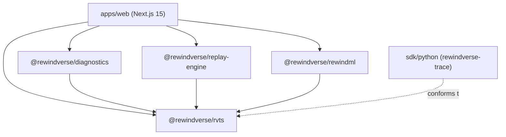

# RewindVerse — Repository Structure and Monorepo Architecture

**Document:** `docs/architecture/repository/REPOSITORY_STRUCTURE.md`  
**Version:** 1.0  
**Status:** APPROVED BASELINE  
**Standard:** RewindVerse Engineering Standards §4

---

## 1. Monorepo Organization

RewindVerse uses a `pnpm` monorepo configuration managed via `pnpm-workspace.yaml`. Workspaces are split into applications (`apps/*`) and shared domain packages (`packages/*`).

```text
rewindverse/
├── apps/                          # Deployable web applications
│   └── web/                       # Next.js 15 App Router web application & Rewind Studio
│       ├── app/                   # App Router pages and API route handlers
│       │   ├── (public)/          # Public marketing pages (/, /product, /explore, /learn, etc.)
│       │   ├── studio/            # Rewind Studio research workspaces (/studio/*)
│       │   └── api/               # API route handlers (/api/health, /api/traces/share, etc.)
│       ├── components/            # UI components and layout wrappers
│       │   ├── backgrounds/       # Reusable atmospheric layers (Mesh, Grid, TraceWave, Glow)
│       │   ├── hero/              # 3D Learning Orbit hero, client boundary, and static poster
│       │   ├── visualization/     # Three.js WebGL and Canvas visualizers
│       │   ├── Navbar.tsx         # 4-pillar top navigation
│       │   └── Footer.tsx         # Structured footer with trust statements
│       ├── features/              # Modular domain features
│       │   ├── algorithm-forge/   # Workbench, visual flow builder, equation studio
│       │   └── fit-lab/           # Data-to-algorithm compatibility matrix and radar charts
│       ├── lib/                   # Client state, DB adapters, and export helpers
│       ├── public/                # Static assets, logos, and background Web Workers
│       └── styles/                # Tailwind CSS v4 globals and semantic OKLCH tokens
│
├── packages/                      # Core domain and computational packages
│   ├── rvts/                      # RewindVerse Training Trace Specification (schemas, types, parser)
│   ├── rewindml/                  # Deterministic optimization and in-browser ML algorithms
│   ├── replay-engine/             # Scrubber timeline interpolation and state cache
│   └── diagnostics/               # Heuristic anomaly detectors and explainability engine
│
├── sdk/                           # Developer integration toolkits
│   └── python/                    # Python `rewindverse-trace` package
│       ├── examples/              # Working integration scripts (PyTorch, Scikit-Learn, Custom)
│       ├── rewindverse_trace/     # Non-blocking recorder, CLI tools, and validator
│       └── tests/                 # Unit test suite for Python recorder
│
├── fixtures/                      # Test assets and trace benchmarks
│   └── rvts/                      # Valid and invalid .rvtrace test files
│
├── tests/                         # End-to-end and integration test suites
│   └── unit/                      # Vitest unit test files for all packages
│
├── scripts/                       # DevOps, cloud integration, and verification scripts
│
├── docs/                          # Comprehensive technical documentation
│   ├── architecture/              # System architecture, data flow, repository audit
│   ├── algorithms/                # Algorithm catalogue and mathematical foundations
│   ├── algorithm-forge/           # Advanced Algorithm Forge specifications
│   ├── redesign/                  # Design tokens, motion system, and responsive audits
│   ├── security/                  # Security standards and threat models
│   ├── performance/               # Web Vitals and bundle reports
│   └── implementation/            # Implementation matrices, roadmaps, and cleanup reports
│
├── .github/                       # GitHub Actions CI and community templates
│   ├── workflows/ci.yml           # Automated CI quality gate
│   ├── ISSUE_TEMPLATE/            # Bug report and feature request templates
│   └── PULL_REQUEST_TEMPLATE.md   # Pull request verification checklist
│
├── .editorconfig                  # Cross-editor formatting consistency
├── .gitattributes                 # Line ending normalization (LF)
├── .gitignore                     # Git ignore rules
├── .npmrc                         # pnpm configuration
├── package.json                   # Root monorepo configuration and dev scripts
├── pnpm-workspace.yaml            # Monorepo workspace mapping
├── tsconfig.json                  # Root TypeScript configuration
└── README.md                      # Primary project readme
```

---

## 2. Package Dependency Matrix



### Dependency Rules:
1. `packages/rvts` is the foundational leaf package. It has zero dependencies on other packages and zero runtime UI dependencies.
2. `packages/rewindml`, `replay-engine`, and `diagnostics` depend exclusively on `rvts`. They never import React, Next.js, or DOM-specific libraries.
3. `apps/web` consumes packages via pnpm workspace links (`workspace:*`), allowing seamless development and hot module reloading.
4. Circular dependencies between packages or application features are strictly forbidden.

