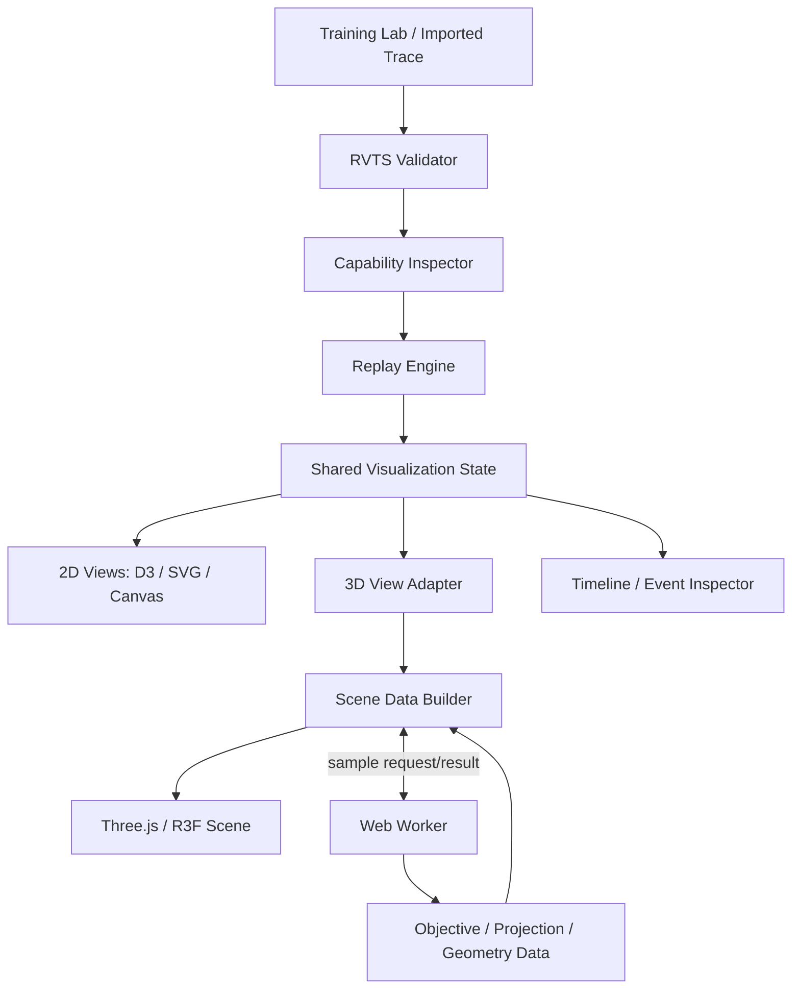

# RewindVerse — 3D Visualization & Pending Development Plan

**Document type:** Product/Engineering Addendum  
**Product:** RewindVerse  
**Primary application:** Rewind Studio  
**Related modules:** RewindML, Rewind Replay, Rewind Insights, Rewind Compare, Rewind Academy  
**Trace contract:** Rewind Trace / RVTS  
**Version:** 1.0  
**Date:** 7 November 2026  
**Status:** Proposed implementation baseline — validate against the live repository before assigning work

---

## 1. Purpose

This document extends the RewindVerse Product Requirements Document, Technical Stack, Website Design Specification and Security Standard. Its purpose is to define the 3D visualization capability and identify the remaining engineering work required to turn the current project plan into a complete, testable product.

The 3D layer must make machine-learning behaviour easier to understand. It must not be added only as decoration. Every 3D scene must be backed by a defined mathematical quantity, an explicit data source, a usable interaction model, a 2D/accessibility alternative and a measurable performance budget.

### Product principle

> 3D should reveal relationships that are difficult to understand in a flat chart; it must never hide the underlying data or imply information that was not measured.

### Important implementation-status note

The project has already been planned and development has begun, but this conversation does not include the current repository, issue tracker or running application. Therefore, this document is a **completion and extension plan**, not an audit claiming that a feature is missing from your actual code. Before creating duplicate work, compare each item in the pending register with the current codebase and mark it `implemented`, `verified`, `in progress`, `blocked` or `not started`.

---

## 2. Executive recommendation

Adopt the following 3D stack:

- **Three.js** as the underlying 3D rendering engine.
- **React Three Fiber (R3F)** as the React renderer for Three.js scenes.
- **Drei** for well-maintained scene helpers and controls where appropriate.
- **D3 + SVG/Canvas** for 2D charts, axes, accessible alternatives and dense plots.
- **Web Workers** for expensive surface sampling, trace transforms and derived numerical data.
- **TypedArrays / BufferGeometry** for efficient geometry transfer and GPU buffers.
- **WebGL 2 as the dependable default rendering path.**
- **WebGPU as an experimental progressive enhancement**, not a launch dependency, until browser/device coverage and required features are verified.

Do not use Three.js for every visualization. Use 3D only where depth adds analytical value. The application should keep its 2D charts as first-class views, not as broken fallbacks.

---

## 3. Product goals for 3D

### 3.1 Primary goals

1. Let users see how optimizer updates move across an objective surface when the objective is genuinely two-dimensional or when a valid 2D parameter slice has been defined.
2. Connect a selected training step to the same point in the 2D loss chart, parameter chart, event timeline and 3D scene.
3. Explain how the loss surface, gradient direction and optimizer update differ.
4. Allow users to inspect model structure and selected layer/activation summaries without rendering an unmanageable number of objects.
5. Provide a reusable visualization architecture that supports future embeddings, decision surfaces, CNN activations and transformer inspection.
6. Work on desktop, tablet and mobile with adaptive scene complexity and non-3D alternatives.
7. Preserve numerical correctness, trace provenance and privacy.

### 3.2 Secondary goals

- Make RewindVerse visually distinctive for demonstrations and portfolio reviews.
- Support guided learning challenges in Rewind Academy.
- Make experiment comparison more intuitive by showing two trajectories on comparable surfaces when the data supports that comparison.
- Support exportable screenshots or reports only with clear source metadata and privacy controls.

### 3.3 Non-goals for the first 3D release

- Photorealistic scenes, cinematic post-processing or 3D effects that do not communicate ML information.
- Rendering every neuron, tensor element or token for arbitrarily large models.
- Claiming to visualize the full loss landscape of a high-dimensional neural network from only two scalar coordinates.
- Replacing standard 2D charts, tables or accessible text explanations.
- Using WebGPU as the only renderer.
- Running untrusted uploaded code, custom shaders or arbitrary plugins supplied by trace files.
- Hosting large model training or using a user's GPU without explicit user action and clear resource limits.

---

## 4. Product scope and release priority

| Capability | Priority | Target release | Definition of done |
|---|---:|---|---|
| 3D quadratic loss surface | P0 | 3D MVP | Surface matches the objective evaluator and includes axes, scale, selected point and 2D fallback |
| Optimizer path on surface | P0 | 3D MVP | SGD, Momentum and Adam steps match the recorded trajectory and selected step |
| 3D camera and selection controls | P0 | 3D MVP | Orbit, zoom, reset, select point and keyboard-accessible alternatives work |
| 2D/3D synchronized replay | P0 | 3D MVP | One timeline selection updates every relevant view |
| Rosenbrock and saddle surfaces | P1 | 3D v1 | Surface sampling and scale handling tested against reference values |
| Surface sampling worker | P1 | 3D v1 | Expensive sampling does not block the main UI thread |
| Real-model 2D parameter slices | P1 | 3D v1 | Plane definition is visible and the view is labelled as a slice, not the full landscape |
| Run comparison trajectories | P1 | 3D v1 | Comparable objective, coordinate system and scale are enforced or clearly marked |
| Neural network architecture graph | P1 | 3D v1 | Large layers are aggregated; nodes/edges are selectable and have 2D equivalent |
| Activation/gradient flow view | P2 | Advanced | Recorded summaries only; sampling/cadence and missing values disclosed |
| Embedding projector | P2 | Advanced | PCA first; optional UMAP later with parameters and sampling disclosed |
| Decision surface for classifiers | P2 | Advanced | Probability/class surface matches model predictions on a test grid |
| CNN feature map explorer | P3 | Research/Advanced | Requires supported model adapters and explicit tensor summaries |
| Transformer attention explorer | P3 | Research/Advanced | Shows recorded attention data with cautions against over-interpreting attention |
| WebGPU compute/render path | P3 | Experimental | Benchmarked, device-gated and backed by WebGL2/2D fallback |

P0 is the first meaningful 3D deliverable. Do not start every P2/P3 capability before the P0 workflow is reliable.

---

## 5. Three-dimensional visualization catalogue

### 5.1 Loss landscape explorer — mandatory first 3D scene

**Purpose:** Show how a model's parameter values correspond to objective/loss values and how an optimizer moves through that surface.

For a two-parameter objective:

\[
L(\theta_1,\theta_2) \rightarrow z
\]

- X axis: parameter \(\theta_1\).
- Y axis: parameter \(\theta_2\).
- Z axis: objective/loss \(L\).
- Surface: evaluated objective values on a bounded grid.
- Path: ordered optimizer positions \((\theta_{1,t},\theta_{2,t},L_t)\).
- Current marker: selected replay step.
- Optional gradient arrow: displayed only when gradient components are recorded or can be correctly computed from the registered objective.
- Optional contour projection: same objective values projected onto a base plane.

**Initial supported objectives:** quadratic bowl, Rosenbrock function and saddle surface. The formulas and parameter ranges must live in a versioned objective registry shared by the training engine, trace generator and test fixtures.

Example formulas:

Quadratic bowl:
\[
f(x,y)=a(x-x_0)^2+b(y-y_0)^2+c
\]

Rosenbrock:
\[
f(x,y)=(a-x)^2+b(y-x^2)^2
\]

Saddle:
\[
f(x,y)=x^2-y^2
\]

**Important:** A surface is only as trustworthy as its objective definition, parameter range, sampling density and coordinate convention. Display the objective name, formula or formula reference, bounds, grid resolution and scale. Do not silently normalize or clamp values without indicating that transformation.

### 5.2 Optimizer trajectory and update vectors

Show the optimizer path as a sequence of points and a connected line. Provide separate visual encodings for:

- Current selected point.
- Previous point.
- Final/lowest observed point (not necessarily global optimum).
- Gradient direction \(-\nabla L\), when available.
- Actual optimizer update \(\Delta\theta_t=\theta_{t+1}-\theta_t\).

Gradient direction and optimizer update are not interchangeable. Momentum and Adam may update parameters using historical state and adaptive scaling. Label them separately. Do not draw the gradient arrow as though it were the actual optimizer step.

### 5.3 Real neural-network loss slices

A network with many parameters does not have a literal two-axis loss surface. A 3D view for a high-dimensional model must be described as a **two-dimensional slice through parameter space**.

Define a reference parameter vector \(\theta^*\) and two directions \(d_1,d_2\):

\[
S(\alpha,\beta)=L(\theta^*+\alpha d_1+\beta d_2)
\]

The UI must expose:

- Reference checkpoint/step used for \(\theta^*\).
- Direction construction method for \(d_1,d_2\) (for example, user-selected directions or a documented PCA basis).
- Alpha/beta ranges and grid resolution.
- Dataset or evaluation batch used to calculate loss.
- Whether weights were perturbed and whether normalization was applied.
- Evaluation budget, sampling and approximation warnings.

Do not call this the entire model's loss landscape. It is a sampled slice under a specified evaluation procedure.

### 5.4 Neural architecture graph

**Purpose:** Make layer connectivity, model shape and selected modules easier to inspect.

Represent model components as nodes and connections as edges. Use aggregation for large layers:

- Small networks: individual neurons may be shown.
- Medium networks: grouped nodes/channels.
- Large networks: layer/block summaries with expandable detail.

Show a clear legend for node type, edge meaning, tensor shape, parameter count and whether values are recorded, sampled or inferred. Never render millions of individual neurons or weights by default.

### 5.5 Activation and gradient flow

A layered flow visualization can use:

- X axis: layer/block order.
- Y axis: training step or batch index.
- Z or colour: activation/gradient magnitude summary.

Support mean, median, max, standard deviation and selected percentiles. Label the aggregation method and whether the signal is sampled. Use log scaling only with an explicit scale indicator and appropriate handling of zero/non-finite values.

This view must not imply access to full activations if the trace only contains summary statistics.

### 5.6 Embedding projector

Use a point cloud for vector embeddings with metadata filters and selection details.

- MVP algorithm: PCA with documented centering/scaling.
- Later: UMAP as an optional projection with fixed seed, parameter panel and provenance.
- Keep original vector dimension and projection algorithm visible.
- Explain that 2D/3D projection can distort distances and neighbourhoods.
- Avoid uploading raw private embeddings or labels to analytics.

### 5.7 Decision surface

For a 2-feature classifier, render a surface such as:

\[
z=P(y=1\mid x_1,x_2)
\]

Show data samples, probability surface and threshold plane. For more than two features, clearly state which two features are held visible and how other features are fixed or aggregated. Provide a 2D contour alternative.

### 5.8 Future specialized visualizers

CNN and transformer visualizers should be separate capabilities with their own trace contracts. For transformer attention, show the exact head, layer, token sequence and normalization used. A heatmap or 3D view of attention weights is not, by itself, proof of causal explanation or model reasoning.

---

## 6. Technical stack for 3D

| Layer | Recommended technology | Responsibility |
|---|---|---|
| 3D renderer | Three.js | Scene graph, camera, geometry, materials and GPU rendering |
| React integration | React Three Fiber | Declarative scene composition inside React |
| Helpers | Drei | Controls, labels, axes helpers and reusable scene utilities where appropriate |
| 2D charting | D3 + SVG/Canvas | Contours, axes, accessible 2D alternatives and dense data views |
| Numerical transforms | TypeScript core + Web Workers | Grid sampling, trajectory transforms, projections and derived arrays |
| Data buffers | Float32Array/Float64Array as appropriate | CPU/GPU transfer and compact numeric storage |
| Geometry | BufferGeometry | Vertex/index buffers for surfaces, paths and point clouds |
| State | Zustand or existing app state layer | Selected step, camera preset, view mode and filters |
| Validation | Zod at app boundaries; RVTS schema validator | Validate config, trace and scene input |
| Lazy loading | Next.js dynamic import | Load 3D bundles only on routes or panels that need them |
| Tests | Vitest + Playwright | Mathematical, integration, visual and interaction checks |

### 6.1 Renderer policy

- Default to **Three.js WebGLRenderer (WebGL 2)** for the first production-ready implementation.
- Evaluate **WebGPURenderer** as an optional path after testing browser, device and material coverage.
- Feature-detect runtime support; do not assume WebGPU because the browser is modern.
- If WebGPU initialization fails, fall back to WebGL 2. If WebGL 2 fails, provide the 2D visualization and an explanatory message.
- Keep custom shaders out of the first release unless a measured requirement cannot be satisfied by standard materials.
- Do not make a WebGPU-only shader or compute pipeline a release blocker.

Three.js describes `WebGPURenderer` as its next-generation renderer and says it can fall back to a WebGL 2 backend, while also documenting that it remains experimental and has feature/migration caveats. MDN currently labels WebGPU as limited availability and not Baseline. Therefore, progressive enhancement is the safe product choice, not a WebGPU-only requirement. See references in Section 21.

### 6.2 Next.js integration

3D components must be client-only and lazy-loaded. Keep the route shell, headings, metadata and explanatory text server-renderable. Load the Canvas component only when the 3D panel is opened or the relevant route is visited.

Use a dedicated client boundary for browser APIs and rendering. Do not import Three.js into every route's root layout. Supply a skeleton/loading state, error boundary and 2D fallback.

### 6.3 Rendering modes

- Static scene: render on demand.
- Interactive scene: render in response to user interaction.
- Animation/replay: render only while playback is active, then return to demand mode.
- Background tab: pause or throttle animation work.
- Reduced-motion preference: disable non-essential animated camera movement and replace autoplay with user-controlled playback.

---

## 7. RewindVerse visualization architecture



### 7.1 Separation of responsibilities

**RewindML core**
- Executes the supported algorithms.
- Emits real parameter, gradient, metric and optimizer-state records where configured.
- Does not import React, Three.js or browser UI components.

**RVTS / trace package**
- Validates data and capabilities.
- Defines which visualization features can be shown.
- Records provenance and coordinate semantics.

**Replay Engine**
- Maps a selected step to trace state.
- Does not fabricate missing gradients or parameters.
- Provides deterministic access to the selected trace frame.

**Visualization Data Builder**
- Converts domain data to chart/scene-ready arrays.
- Performs decimation, normalization and coordinate mapping only under explicit settings.
- Runs expensive operations in workers.

**3D Scene Layer**
- Renders scene data; it does not own training truth or compute model loss silently.
- Handles camera, selection, rendering and disposal.

**UI Layer**
- Hosts controls, legends, labels, accessibility alternatives, loading/error states and privacy notices.

### 7.2 Proposed package structure

```text
packages/
  rewindml-core/
  rvts-schema/
  rvts-validator/
  replay-engine/
  diagnostics-engine/
  visualization-core/
  visualization-2d/
  visualization-3d/
    src/
      components/
      scenes/
        loss-landscape/
        optimizer-trajectory/
        model-graph/
        activation-flow/
        embedding-projector/
        decision-surface/
      geometry/
      materials/
      camera/
      controls/
      adapters/
      workers/
      accessibility/
      performance/
      testing/
```

Do not move working packages solely to match this example. Adapt the structure to the repository that already exists.

---

## 8. Data contracts for 3D

The trace must explicitly declare capabilities. A visualization must check capability availability before rendering a panel.

### 8.1 Proposed visualization capabilities

| Capability identifier | Required information | Supported visualization |
|---|---|---|
| `objective_surface_2d` | Objective/model registry entry, two parameter dimensions, bounds and evaluator semantics | Exact registered 2D objective surface |
| `optimizer_trajectory_2d` | Ordered parameter pairs and step mapping | Optimizer path |
| `gradient_2d` | Gradient vector, parameter coordinate system and step | Gradient arrows |
| `parameter_slice_2d` | Reference parameter vector, two direction definitions, evaluator/data context | Sampled high-dimensional parameter slice |
| `model_graph` | Layer/block graph, tensor shapes and edge semantics | Architecture graph |
| `activation_summary` | Layer IDs, step/batch, summary metric and aggregation definition | Activation flow |
| `gradient_summary` | Layer/parameter group, step and summary definition | Gradient flow |
| `embedding_coordinates` | Stable point IDs, 2D/3D projection coordinates and projection metadata | Embedding projector |
| `decision_surface_2d` | Feature definitions, fixed-feature values, grid and prediction/probability | Decision surface |

These are proposed capability names. They must be reviewed against the existing RVTS schema before adoption. Do not introduce a second, conflicting capability vocabulary.

### 8.2 Scene data interface (TypeScript proposal)

```ts
export type Vec2 = readonly [number, number];
export type Vec3 = readonly [number, number, number];

export interface SurfaceGrid {
  kind: "objective-surface-2d";
  xLabel: string;
  yLabel: string;
  zLabel: string;
  xValues: Float32Array;
  yValues: Float32Array;
  zValues: Float32Array;
  width: number;
  height: number;
  objectiveId: string;
  bounds: {
    x: readonly [number, number];
    y: readonly [number, number];
  };
  valueScale: "linear" | "log";
  provenance: {
    source: "registered-objective" | "recorded-evaluation";
    objectiveVersion: string;
    samplingResolution: number;
  };
}

export interface TrajectoryFrame {
  step: number;
  parameters: Vec2;
  objectiveValue: number;
  gradient?: Vec2;
  update?: Vec2;
}

export interface TrajectoryData {
  kind: "optimizer-trajectory-2d";
  stepUnit: string;
  frames: readonly TrajectoryFrame[];
  provenance: "recorded" | "derived-from-registered-objective";
}
```

The types above are an implementation proposal, not an already approved wire-schema. The serialized RVTS format should use JSON-compatible arrays/records; typed arrays are an in-memory representation inside the viewer.

### 8.3 Capability-aware behavior

- If a trace has scalar loss only, show 2D metric charts and do not show a fabricated landscape.
- If it has a registered two-parameter objective and trajectory, show the true registered surface and path.
- If it has high-dimensional parameters and declared slice metadata, show the slice with its reference point/directions visible.
- If it has model graph metadata only, show architecture topology but no activation magnitudes.
- If it has activation summaries, show those summaries and label the aggregation.
- If a field is missing, show “not recorded” or “not supported” rather than estimating silently.

---

## 9. Mathematical and numerical correctness

This section is a hard release gate.

1. **One source of objective truth:** The browser training lab, objective sampler and test suite must use the same registered objective definition or independently cross-check the same fixtures.
2. **Step semantics:** The trace must state whether a step represents an optimizer update, batch, epoch or iteration. A plotted point must map to the correct state after that unit.
3. **Parameter ordering:** Axis labels and coordinate arrays must share a documented parameter ordering.
4. **Loss value:** The Z value must be evaluated using the same objective, regularization convention and data context as the trace claims.
5. **Gradient vs update:** Gradient vectors and optimizer update vectors must be distinct fields and distinct visual encodings.
6. **Non-finite values:** NaN and infinities must be handled under RVTS rules; they must not corrupt geometry buffers or axes.
7. **Scale:** Log/normalized/clipped axes must be clearly labelled. Preserve the original numeric value in tooltips.
8. **Sampling:** State the grid resolution and interpolation policy. Never imply unsampled regions were measured.
9. **Determinism:** Same input trace and visualization settings must produce the same sampled geometry within documented floating-point tolerance.
10. **No hidden interpolation:** If a selected step is between recorded steps, label interpolation as visual-only and never describe it as recorded training state.

### 9.1 Gradient verification

Use finite-difference checks for registered objectives. For each parameter coordinate:

\[
\frac{\partial L}{\partial \theta_i}\approx
\frac{L(\theta+h e_i)-L(\theta-h e_i)}{2h}
\]

Avoid test points at non-differentiable kinks unless the expected subgradient behaviour is defined. Use float64 for reference numerical checks where possible and set separate tolerances for float32/float64 execution.

### 9.2 Surface test fixtures

Create fixtures for:
- Minimum at known coordinates.
- Symmetric and anisotropic quadratic bowls.
- Rosenbrock valley.
- Saddle with positive and negative curvature directions.
- Flat/plateau regions.
- Extreme scale and overflow boundaries.
- NaN/Infinity tagged values.
- Empty/one-point trajectories.
- Out-of-bounds and mismatched trajectory/objective IDs.

---

## 10. 3D interactions and user journeys

### 10.1 Loss landscape journey

1. User opens Rewind Studio and selects an experiment.
2. The trace validator and capability inspector complete.
3. The UI shows supported views and hides unsupported views.
4. User opens “3D Landscape”.
5. A loading state appears while the worker builds the surface grid.
6. The user rotates, zooms, resets camera and selects a path point.
7. Selecting a point updates the replay timeline, 2D loss chart, parameter values and event inspector.
8. The user can switch to a 2D contour view without losing the selected step.
9. The user exports a report or shares the trace only after reviewing privacy settings.

### 10.2 Required interactions

- Orbit/rotate with pointer or touch.
- Zoom with wheel/pinch, with bounded min/max zoom.
- Pan only where it does not conflict with selection.
- Reset camera to a known preset.
- Select a trajectory point by click/tap and by keyboard-accessible step list.
- Play/pause/step backward/step forward.
- Jump to first, last, best observed or selected event step.
- Toggle surface, path, current point, gradient arrow, update arrow and contour projection.
- Toggle 2D contour / 3D surface.
- Display axis labels, legend, units, objective ID and bounds.
- Show a details panel for the selected step.
- Provide a help/control hint and an accessible non-canvas equivalent.

### 10.3 Interaction rules

- Avoid autoplay on first visit.
- No forced camera movement during user inspection.
- Respect reduced-motion settings.
- Use hover only as an enhancement; all essential information must be available on click/tap and keyboard.
- Keep a clear focus state for controls.
- Provide an explicit “Reset view” control.
- Do not place essential controls only inside the WebGL canvas.

---

## 11. Performance, responsiveness and graceful degradation

### 11.1 Rendering strategy

- Lazy-load the 3D bundle only when needed.
- Render on demand for static scenes.
- Animate only during playback or explicit transitions.
- Use `BufferGeometry` rather than thousands of individual React mesh components for dense surfaces/paths.
- Use instancing for repeated markers where applicable.
- Use decimation for very long trajectories, retaining exact selected/current points and original data for inspection.
- Avoid expensive post-processing in the default view.
- Avoid multiple independent WebGL canvases on one page; consolidate into one scene/view where possible.
- Use device-aware quality settings for pixel ratio, grid resolution and point count.
- Dispose geometry, materials, textures and render resources when scenes are replaced or unmounted.
- Monitor renderer memory/object counters during development.

Three.js requires explicit disposal for GPU-related geometries, materials and textures; removing an object from a scene does not automatically free those resources. See the Three.js disposal guide.

### 11.2 Initial engineering budgets (targets to benchmark)

These are project targets, not guaranteed results. Measure on named devices and real traces.

| Metric | Desktop target | Mid-range mobile target |
|---|---:|---:|
| 3D scene initial interactive readiness | <= 3.0 s after user opens 3D view | <= 5.0 s or show 2D default |
| Static idle rendering | Demand-driven / no continuous render loop | Demand-driven |
| Interaction frame rate | Aim for 60 FPS | Aim for 30 FPS minimum during normal interaction |
| Surface grid | Start at 128 x 128, scale after benchmark | Start at 64 x 64 or 2D fallback |
| Trajectory rendering | Decimate long paths for display; preserve data | Stronger decimation / selected-window view |
| Memory | Record baseline and peak; set regression budget after prototype | Lower quality profile and aggressive cleanup |

Do not make these thresholds a claim until measured. Use benchmark reports with device/browser/GPU, trace size, surface resolution and test steps.

### 11.3 Responsive layout

- Desktop: 3D scene with side inspector and synchronized 2D mini-chart.
- Tablet: scene above/beside a collapsible inspector, simplified controls.
- Mobile: 2D contour by default; 3D available as an opt-in full-screen panel if performance allows.
- Portrait: avoid dense side panels.
- Touch controls: larger hit targets, no hover-only features.
- Provide a “Low graphics mode” when context creation or frame performance fails.

### 11.4 WebGL context loss

Handle `webglcontextlost` and restoration paths. Pause playback, preserve selected trace/step in application state, display a recovery message and allow retry or fallback to 2D. Do not discard user experiment data because the renderer failed.

---

## 12. Accessibility requirements

3D content must not be the only route to information.

- Every canvas scene has a descriptive accessible label and concise summary.
- Provide a synchronized table/list of points and numeric values.
- Provide a 2D contour or chart equivalent.
- Provide keyboard controls for selection, timeline navigation and camera reset.
- Do not encode meaning only through colour; use shape, line style, labels and legends.
- Check contrast for axes, labels, selected point and tooltip surfaces.
- Respect `prefers-reduced-motion` and provide in-app motion settings.
- Avoid flashing, rapid pulsing or unnecessary continuous camera motion.
- Ensure focus returns to a sensible control when a modal/inspector closes.
- Keep text descriptions available when WebGL is unavailable.

---

## 13. Security and privacy for 3D features

1. Treat trace files and imported metadata as untrusted input.
2. Do not execute scripts, shaders, plugins, Python, WASM modules or arbitrary code from a trace.
3. Do not accept user-supplied shader source in the first release.
4. Validate dimensions, array lengths, finite/range limits, grid sizes and point counts before allocation.
5. Enforce limits on decompressed trace size, number of records, string lengths and nesting depth in the trace parser.
6. Prevent memory-exhaustion input such as enormous surface grids or millions of unbounded graph nodes.
7. Sanitize metadata for HTML rendering; treat labels as text, not HTML.
8. Do not send uploaded embeddings, labels, model parameters or traces to analytics by default.
9. Require explicit consent before publishing a trace or screenshot that includes private experiment details.
10. Apply resource budgets to workers; support cancellation and timeout.
11. Keep 3D package dependencies patched and covered by dependency scanning.
12. Do not let a failed renderer, worker or imported trace crash the full Studio session.

---

## 14. Testing strategy

### 14.1 Unit tests

- Objective function values and gradients.
- Surface grid coordinate generation.
- Axis mapping and value normalization.
- Parameter-to-world coordinate transforms.
- Trajectory ordering and step mapping.
- Decimation preserves endpoints/current/best-observed points.
- Non-finite handling.
- Capability gating.
- Worker cancellation and error responses.

### 14.2 Integration tests

- Training produces a trace with required objective/trajectory capability.
- Trace validates, loads and generates a 3D scene.
- Selecting a point updates timeline and 2D/3D views.
- Switching to 2D preserves selected step and values.
- Importing a scalar-only trace does not fabricate a surface.
- Large trace triggers safe sampling/decimation rather than blocking the main thread.

### 14.3 Visual and browser tests

Use Playwright in a real browser environment to verify:
- Canvas loads and renders expected scene state.
- Camera and selection controls work.
- Layout has no overflow at mobile/tablet/desktop breakpoints.
- WebGL unsupported/context failure falls back to 2D.
- Reduced-motion path works.
- Console has no unhandled errors.
- Route loads without pulling 3D bundles until requested.

Visual snapshot tests should avoid brittle exact pixel matching across different GPU vendors. Use stable fixtures and compare key layout/interaction states, with tolerance where GPU rasterization differs.

### 14.4 Performance and memory tests

- Benchmark scene readiness and interaction frame time.
- Track geometry count, draw calls, texture count and memory stats.
- Mount/unmount the scene repeatedly and confirm resources do not accumulate.
- Test context loss/restore.
- Test long traces and high grid resolutions under configured limits.

### 14.5 Security tests

- Malformed trace records.
- Declared grid dimensions inconsistent with array lengths.
- Oversized arrays and excessive node counts.
- NaN/Infinity/extreme magnitudes.
- HTML/script-looking labels.
- Worker cancellation/timeouts.
- Gzip decompression expansion limits.
- Unsupported/malicious content masquerading as a trace.

---

## 15. Implementation phases

### Phase 0 — Repository and architecture audit

- Identify what has already been implemented.
- Check the actual installed versions of Next.js, React, Three.js, R3F, Drei, TypeScript and current trace packages.
- Verify compatibility using the relevant official docs/Context7 before coding.
- Confirm existing RVTS capability and metadata design.
- Create feature flags for 3D routes/panels.

**Exit gate:** baseline repository map, dependency compatibility record and accepted design decision record.

### Phase 1 — 3D foundation

- Add `visualization-3d` package or equivalent module.
- Create client-only, lazy-loaded Canvas boundary.
- Add WebGL2 detection, error boundary and 2D fallback.
- Implement camera, axes, grid, legend and reset controls.
- Add scene performance telemetry in development mode.

**Exit gate:** empty 3D scene loads only on demand, handles unsupported WebGL and does not break the 2D app.

### Phase 2 — First real loss landscape

- Implement registered quadratic objective.
- Sample the grid in a Web Worker.
- Build `BufferGeometry` surface.
- Add contour projection and axis labels.
- Add one deterministic SGD trajectory.
- Synchronize selected point with replay timeline.

**Exit gate:** known function values and gradients pass numerical tests; 2D and 3D selected states match.

### Phase 3 — Optimizers and objective library

- Add Momentum and Adam recorded trajectories.
- Add Rosenbrock and saddle objectives.
- Distinguish gradient vector from optimizer update vector.
- Add replay playback and point selection.
- Add 3D/2D toggle.

**Exit gate:** all objective and optimizer fixtures pass parity tests and the 3D panel is usable with keyboard/touch alternatives.

### Phase 4 — Real model visualizers

- Define parameter slice contract.
- Add model graph aggregation.
- Add activation/gradient summaries.
- Add feature-gated visualizers based on trace capability.

**Exit gate:** all views clearly disclose whether data is recorded, sampled, derived or unavailable.

### Phase 5 — Advanced features

- Embedding projector.
- Classifier decision surface.
- CNN/transformer-specific views where supported.
- WebGPU evaluation only after browser/device matrix and shader/material parity tests.

**Exit gate:** feature-specific PRD, performance/security review and validated trace data model for each advanced scene.

---

## 16. User stories and acceptance criteria

### RV3D-001 — Open a 3D objective surface

**As a learner**, I want to open a 3D surface for a supported two-parameter objective so that I can understand how parameter values affect loss.

Acceptance:
- Surface is displayed only when the trace/objective registry provides valid support.
- Axis labels, units, bounds and objective identity are visible.
- Selected parameter point maps to the correct objective value within defined tolerance.
- 2D fallback is always available.

### RV3D-002 — Replay an optimizer trajectory

**As a learner**, I want to replay optimizer updates on the loss surface so that I can compare the optimizer's actual path with the objective geometry.

Acceptance:
- Every displayed point maps to a real recorded or explicitly derived step.
- Current point synchronizes with replay timeline and 2D chart.
- Gradient and update arrows are visually distinct.
- Missing gradient fields are not fabricated.

### RV3D-003 — Inspect a high-dimensional model slice

**As an advanced user**, I want to inspect a documented two-dimensional parameter slice so that I can explore local objective behaviour without being told it is the full loss landscape.

Acceptance:
- Reference checkpoint, directions, ranges, data context and grid resolution are exposed.
- The panel is labelled “parameter slice”.
- Sampling limits and approximation warnings are visible.

### RV3D-004 — Use 3D on a mobile device

**As a mobile user**, I want a usable visualization even when the device cannot render a complex 3D scene.

Acceptance:
- 2D mode is available at all times.
- 3D complexity is reduced based on device/performance constraints.
- Touch targets and gestures work without hover.

### RV3D-005 — Inspect imported traces safely

**As a developer**, I want unsupported or incomplete trace files to display only supported panels so that the application does not invent model internals.

Acceptance:
- Validator and capability inspector run before scene construction.
- Invalid arrays/oversized grids are rejected safely.
- User receives a useful error message and can still inspect available scalar metrics.

---

## 17. Remaining development register

Use this as the immediate project audit list. Mark status in your issue tracker; do not assume all items are unfinished without checking the repo.

| ID | Pending item to verify | Priority | Evidence required |
|---|---|---:|---|
| PEND-3D-01 | Current codebase and package-version audit | P0 | Repository inventory + dependency report |
| PEND-3D-02 | RVTS visualization capability contract | P0 | Schema, examples, validator tests |
| PEND-3D-03 | 3D scene package/client boundary | P0 | Lazy-loaded scene and fallback test |
| PEND-3D-04 | 2D objective and gradient reference fixtures | P0 | Mathematical test corpus |
| PEND-3D-05 | Worker surface sampler | P0 | Responsiveness and cancellation tests |
| PEND-3D-06 | Quadratic 3D surface | P0 | Numerical comparison and browser screenshot |
| PEND-3D-07 | Optimizer trajectory scene | P0 | Selected-step synchronization test |
| PEND-3D-08 | Mobile/2D fallback and accessibility | P0 | Playwright + keyboard/reduced-motion tests |
| PEND-3D-09 | WebGL context and resource cleanup | P1 | Repeated mount/unmount and context-loss test |
| PEND-3D-10 | Rosenbrock/saddle objectives | P1 | Formula and gradient fixtures |
| PEND-3D-11 | Model graph data adapter | P1 | Layer graph schema and large-model aggregation tests |
| PEND-3D-12 | Activation/gradient summary visualizer | P2 | Recorded-signal fixtures and labels |
| PEND-3D-13 | High-dimensional parameter slice | P2 | Documented slice method and repeatability report |
| PEND-3D-14 | Embedding projector | P2 | Projection provenance and privacy tests |
| PEND-3D-15 | Decision surface | P2 | Model output grid parity tests |
| PEND-3D-16 | CNN/transformer specialist visualizers | P3 | Separate product and trace capability specs |
| PEND-3D-17 | WebGPU progressive enhancement | P3 | Browser/device compatibility and fallback report |

### Definition of “verified complete”

An item is complete only when:
- Code is merged.
- Automated tests pass.
- The relevant acceptance criteria pass in a real browser.
- Documentation is updated.
- Security and performance implications have been reviewed.
- Evidence is linked in the issue/PR (test run, benchmark, screenshot or report).

---

## 18. Definition of done for the 3D MVP

The first 3D milestone is releasable only if all of the following are true:

- [ ] A registered two-parameter objective is evaluated by the real training/objective engine.
- [ ] A worker generates a bounded surface grid without freezing the main thread.
- [ ] The 3D surface uses values from the same objective definition.
- [ ] An optimizer trajectory is plotted from recorded steps.
- [ ] Selected step synchronizes with replay timeline and 2D chart.
- [ ] Gradient and optimizer update are not conflated.
- [ ] 2D contour fallback is available and accurate.
- [ ] WebGL failure/context loss is handled gracefully.
- [ ] Geometry/material/texture cleanup is implemented.
- [ ] Keyboard, touch and reduced-motion paths are supported.
- [ ] No untrusted trace content can run as code or shader.
- [ ] Performance has been benchmarked on at least one standard laptop and one mid-range mobile device.
- [ ] Public docs explain the limitations of the visualization.

---

## 19. Project-wide pending items beyond 3D

The following are broader RewindVerse items from the existing product vision and should be audited alongside 3D work:

### Product and market
- Validate the problem with 10–15 target-user interviews.
- Test the first workflow with users without explaining the interface.
- Collect instructor/developer pilot evidence.
- Establish a 4-week beta and repeat-use metrics.
- Run a small exploratory learning evaluation with disclosed sample size and limitations.

### Core engineering
- Complete train → record → validate → replay → export vertical slice.
- Ensure TypeScript/Ajv and Python RVTS validators share conformance fixtures.
- Add streaming trace parsing and file-size/decompression limits.
- Publish optimizer parity reports.
- Add CSV importer mapping preview and conversion report.
- Complete custom-loop Python recorder, flush/close semantics and overhead benchmarks.
- Add diagnostic detectors with labeled synthetic traces and precision/recall reporting.

### Product quality
- Complete responsive screen testing.
- Complete security threat model and upload abuse tests.
- Implement data export, deletion and trace privacy controls before public sharing.
- Add observability without capturing trace contents or secrets.
- Add backup/restore and incident response procedures for any cloud-stored artifacts.
- Publish reproducible local setup, architecture docs and example traces.

### Portfolio and public launch
- Stable live demo with sample traces.
- GitHub repository with contribution guide and CI.
- Architecture and numerical correctness write-up.
- Performance benchmark report.
- Short recorded product demo.
- Known limitations and roadmap page.

---

## 20. Decisions to keep stable

1. RewindVerse remains learner/instructor-first, with developers as a secondary audience.
2. Trace-first architecture remains the integration contract.
3. RewindML and Replay Engine remain framework-independent packages.
4. The browser performs supported interactive training locally; RewindVerse does not become a general hosted training service in the first release.
5. 2D and 3D visualizations share the same validated domain state.
6. The 3D viewer only renders capabilities supported by the trace.
7. WebGL2/2D fallback remains available even if WebGPU is added.
8. No uploaded executable code, arbitrary shader or pickle execution.
9. Raw datasets, embeddings and traces are private by default.
10. Features are accepted by evidence, not by visual appearance alone.

---

## 21. Official technical references

Use current official documentation and verify the installed version before implementation. Version-sensitive API details should be checked through Context7/official docs at the time the code is written.

1. Three.js documentation: https://threejs.org/docs/  
2. Three.js WebGLRenderer: https://threejs.org/docs/pages/WebGLRenderer.html  
3. Three.js BufferGeometry: https://threejs.org/docs/pages/BufferGeometry.html  
4. Three.js resource disposal guide: https://threejs.org/manual/en/how-to-dispose-of-objects.html  
5. Three.js WebGPURenderer overview and caveats: https://threejs.org/manual/en/webgpurenderer.html  
6. React Three Fiber performance/scaling: https://r3f.docs.pmnd.rs/advanced/scaling-performance  
7. React Three Fiber frame loop: https://r3f.docs.pmnd.rs/next/frame-loop  
8. Next.js lazy loading: https://nextjs.org/docs/app/guides/lazy-loading  
9. Next.js Server and Client Components: https://nextjs.org/docs/app/getting-started/server-and-client-components  
10. MDN WebGPU API support status: https://developer.mozilla.org/en-US/docs/Web/API/WebGPU_API  
11. MDN reduced motion accessibility: https://developer.mozilla.org/en-US/docs/Web/CSS/Guides/Media_queries/Using_for_accessibility  
12. OWASP File Upload Cheat Sheet: https://cheatsheetseries.owasp.org/cheatsheets/File_Upload_Cheat_Sheet.html

### Research notes applied

- Three.js currently documents WebGL 2 as the supported backend for `WebGLRenderer` and describes the WebGPU renderer as a newer path with fallback capability and some experimental caveats.
- MDN labels WebGPU as limited availability rather than Baseline; a product-wide WebGPU dependency would reduce compatibility.
- Next.js supports lazy loading client components/libraries and skipping SSR for browser-only components; use this so the 3D engine does not inflate every route.
- React Three Fiber documents demand-based rendering and performance scaling. Use demand rendering for idle scenes and invalidate/request frames only on user input or playback.
- Three.js requires explicit disposal of GPU resources when they are no longer needed.
- Reduced-motion preferences should affect non-essential movement and animation.
- Trace imports and file processing must be bounded and validated as untrusted input.

---

## 22. Final implementation advice

Do not add “3D” as a standalone visual feature and then try to connect it to the ML engine later. Build it as a rendering adapter over validated replay state from day one.

The strongest first demonstration for RewindVerse is:

1. Train on a real registered 2D objective.
2. Record actual optimizer positions and objective values.
3. Validate the resulting RVTS trace.
4. Generate a 3D surface from the same registered objective.
5. Overlay the recorded optimizer path.
6. Scrub the replay timeline and watch the current point update across the 3D surface, 2D chart and event inspector.
7. Export and reopen the trace and reproduce the same visualization.

That vertical slice proves mathematical correctness, trace interoperability, replay synchronization, 3D engineering and product value in one coherent experience. It will demonstrate more engineering depth than a complex animated 3D scene disconnected from real model training.

**Final rule:** Make the visualization advanced in what it explains—not merely in how much GPU power it uses.
