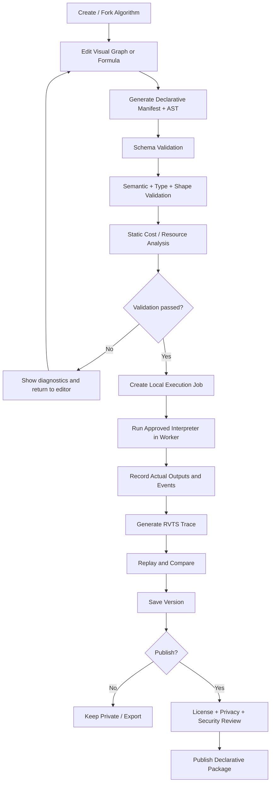

# REWINDVERSE\n\n# Algorithm Forge — Product & Engineering Specification\n\n**Document type:** Product and Engineering Specification  \n**Version:** 1.0  \n**Date:** 8 November 2026  \n**Product:** RewindVerse  \n**Primary application:** Rewind Studio  \n**Algorithm workspace:** Algorithm Forge  \n**Core computation layer:** RewindML  \n**Related specification:** [ALGORITHM_CATALOG.md](../algorithms/ALGORITHM_CATALOG.md)  \n\n---


> **Note:** For the Complete Machine Learning, AI & Deep Learning Algorithm Catalogue and reference equations, see [ALGORITHM_CATALOG.md](../algorithms/ALGORITHM_CATALOG.md).

---

# 19. Algorithm Forge — new first-class Rewind Studio tab

## 19.1 Product definition

**Algorithm Forge** is the user workspace for designing, editing, customizing, testing, versioning and sharing algorithms. It should serve beginners through guided templates and advanced users through a formula/graph editor, while keeping the default execution path constrained and safe.

Navigation proposal:

- Rewind Studio
  - Home
  - Algorithm Library
  - Training Lab
  - Rewind Replay
  - Rewind Insights
  - Rewind Compare
  - **Algorithm Forge**
  - Trace Gallery (later, opt-in public sharing)

## 19.2 User roles and capabilities

| Role | Capabilities |
|---|---|
| Visitor | Browse public algorithms, inspect read-only examples and documentation |
| Learner | Fork built-ins, customize allowed parameters and run safe templates |
| Creator | Build declarative algorithms, run tests, save versions and export packages |
| Publisher | Submit public declarative algorithms for review and publish under a license |
| Instructor | Create guided assignments from approved algorithms and traces |
| Maintainer | Review reports, manage catalogue metadata, deprecate unsafe or broken definitions |

A user must never need publishing permission to create a private algorithm.

## 19.3 Three creation modes

### Mode A — Customize a built-in algorithm

The easiest starting path:

1. Choose a built-in algorithm.
2. Select **Fork and Customize**.
3. Rename the personal copy and add a description.
4. Change exposed hyperparameters and supported components.
5. Optionally change initialization, objective, schedule or preprocessing within the template's capability contract.
6. Review a readable diff from the parent template.
7. Run the validation checklist.
8. Execute a local test run.
9. Save as a new version.

The original built-in definition remains immutable. A fork records its parent ID and version.

### Mode B — Visual algorithm builder

Provide a node/block canvas where users connect typed operations.

**Initial node families:**

- Inputs: feature matrix, labels, parameters, batch, random seed.
- Math: add, subtract, multiply, divide, power, square root, log, exp, clamp, min/max.
- Linear algebra: dot, matrix multiply, transpose, reduce sum/mean, norm, reshape, broadcast with explicit shape rules.
- ML primitives: sigmoid, tanh, ReLU, softmax, loss functions, gradient operation, optimizer state.
- Control: bounded repeat, finite map over declared tensor/array, conditional with scalar boolean.
- Outputs: prediction, loss, gradient, parameter update, metric, trace annotation.

Every node has typed inputs and outputs, validated dimensions, a short explanation and a documented cost estimate. The graph must be acyclic in v1 except for bounded loop constructs represented as explicit control nodes.

### Mode C — Formula / expression editor

Advanced users can define a transition rule using a constrained expression language (DSL). The formula editor supports syntax highlighting, type feedback, shape feedback, formula preview and a step-by-step interpreter trace.

A conceptual update rule might be:

```text
new_velocity = add(
  multiply(momentum, old_velocity),
  gradient(loss, parameters)
)
new_parameters = subtract(
  parameters,
  multiply(learning_rate, new_velocity)
)
```

This is a declarative expression example, not JavaScript. The runtime parses it into a typed abstract syntax tree (AST), validates it and executes only allow-listed operations.

### Future mode — Local developer SDK

Advanced developers can write custom algorithms in their own local Python environment using the RewindVerse Python SDK. The SDK records actual state into RVTS. The RewindVerse website imports and replays the trace; it does not execute arbitrary uploaded Python on shared servers.

## 19.4 Algorithm Forge screens

| Screen | Main elements |
|---|---|
| Forge Home | Recent algorithms, templates, create button and private/public filters |
| Template Gallery | Optimizer, classifier, clustering, loss, neural component and RL templates |
| Algorithm Builder | Node canvas, typed connections, operation palette and mini-map |
| Formula Editor | Expression input, syntax tree, variable/shape inspector and error panel |
| Parameter Inspector | Name, type, default, bounds, units, description and visual control mapping |
| Test Bench | Dataset/fixture selector, run controls, expected/actual output, assertions and resource budget |
| Live Visualization | Loss curve, parameter path, event list and supported 2D/3D views |
| Version History | Parent, version diff, changelog, test report and restore/fork actions |
| Publish Review | Manifest preview, dependency/provenance, license, privacy scan and validation report |
| Algorithm Detail | Description, math, examples, compatibility, provenance and reports |

## 19.5 Algorithm definition manifest

Every custom algorithm is packaged as declarative JSON plus optional assets that are themselves validated. The exact official schema must be versioned separately. A conceptual manifest:

```json
{
  "format": "rewindverse-algorithm",
  "format_version": "1.0",
  "id": "user.example.momentum-variant",
  "name": "Momentum Variant",
  "version": "1.0.0",
  "category": "optimization",
  "task": "parameter-update",
  "description": "A user-defined momentum update rule.",
  "parent": {
    "id": "optim.momentum",
    "version": "1.0.0"
  },
  "inputs": [
    {"name": "parameters", "type": "tensor", "shape": ["parameter_count"]},
    {"name": "gradient", "type": "tensor", "shape": ["parameter_count"]}
  ],
  "parameters": [
    {"name": "learning_rate", "type": "float", "default": 0.01, "min": 0.000001, "max": 1.0},
    {"name": "momentum", "type": "float", "default": 0.9, "min": 0.0, "max": 0.9999}
  ],
  "operations": [
    {"id": "velocity", "op": "momentum_update", "inputs": ["gradient", "state.velocity"], "params": ["momentum"]},
    {"id": "parameters_next", "op": "sgd_update", "inputs": ["parameters", "velocity"], "params": ["learning_rate"]}
  ],
  "outputs": ["parameters_next", "velocity"],
  "trace_capabilities": ["metrics.loss", "parameters.summary", "gradients.summary", "optimizer.state.summary"],
  "visualizations": ["loss_curve", "parameter_trajectory", "gradient_magnitude"],
  "deterministic": true,
  "resource_profile": {"max_steps": 10000, "max_tensor_elements": 1000000},
  "license": "CC-BY-4.0"
}
```

The manifest above is illustrative. It is not yet an approved schema and must not be accepted until the final JSON Schema, semantic validator and operation registry are implemented.

## 19.6 DSL rules and execution contract

**Allowed in v1 declarative runtime:**

- Explicit numeric constants and bounded typed parameters.
- Tensor/array operations from the operation allowlist.
- Deterministic random operations using an injected seed and approved PRNG.
- Bounded loops with statically validated maximum iteration counts.
- Pure expressions without network, filesystem, browser storage or global-state access.
- Explicit state inputs and outputs.

**Prohibited in v1:**

- `eval`, `Function`, dynamic imports and arbitrary module loading.
- General JavaScript/Python source execution.
- Unbounded loops or recursion.
- Dynamic access to browser globals or application state.
- Fetch/network requests, cookies, localStorage or IndexedDB access from algorithm definitions.
- File-system, process, shell or environment-variable access.
- Loading native binaries or arbitrary WASM modules supplied by users.
- Automatic server execution of a community algorithm.

The interpreter must have:

- Parser and AST schema validation.
- Operation allowlist and type/shape checking.
- Instruction/fuel budget.
- Maximum tensor dimensions and total element count.
- Maximum steps and loop counts.
- Memory estimate and runtime budget.
- Cancellation and worker termination.
- Numerical safety checks (NaN, Infinity, overflow/underflow warnings).
- Deterministic seed handling.
- Explicit error messages with node/expression references.
- Per-run resource accounting.

**Important security statement:** A Web Worker is a responsiveness and isolation mechanism, not a complete security sandbox for arbitrary code. Do not use Worker isolation as justification to execute untrusted general-purpose code. The safe v1 path is a constrained interpreter for a declarative AST.

## 19.7 Custom algorithm execution lifecycle



## 19.8 Versioning, forking and compatibility

- Definitions are immutable after a version is published; edits create a new version.
- A fork records parent algorithm ID and parent version.
- Each version stores manifest hash, operation-registry version, runtime version, test report, author, creation time and license.
- Breaking changes increment the major version; compatible feature additions increment minor; fixes increment patch.
- An RVTS trace records the exact algorithm ID/version and execution runtime/provenance.
- If an algorithm definition is missing later, the trace must still display recorded metrics and snapshots where possible.
- Never silently upgrade a historical run to a new algorithm version.

## 19.9 Algorithm marketplace / gallery

Later versions may provide:

- Public algorithm discovery and filtering.
- Category, difficulty, framework, license and verification filters.
- Read-only preview before import.
- One-click fork into a user's workspace.
- Ratings and comments only after moderation and abuse controls exist.
- Maintainer verification badge based on defined tests, not popularity.
- Report/flag workflow and takedown process.
- Versioned deprecation and migration notes.

Public packages contain declarative specifications, metadata, test fixtures and permitted assets—not arbitrary executable code. A published package must identify its license, author, source/provenance and supported RewindVerse runtime version.


# 24. Implementation priorities and roadmap

The catalogue is intentionally larger than v1. Use the following order to keep the project deliverable.

## P0 — Core product credibility

- Algorithm catalogue shell and detail-page template.
- Deterministic objective registry: quadratic bowl, Rosenbrock and saddle.
- Gradient Descent, SGD, Momentum and Adam.
- MSE and binary cross-entropy.
- Linear regression and logistic regression learning labs.
- RVTS recording for loss, task metric, parameter/gradient summaries and training events where available.
- Rewind Replay timeline and 2D views.
- First 3D loss landscape for registered 2-parameter objectives.
- 2D/3D/Auto selector with fallback.
- Algorithm Forge template fork and parameter customization.
- Declarative Algorithm Manifest v1 schema and safe operation registry.
- Algorithm Forge validation and test bench (basic).

## P1 — Strong v1.x catalogue

- Ridge, Lasso, Elastic Net.
- kNN, Naive Bayes, SVM and decision tree.
- Random forest and gradient boosting through validated implementation or adapter.
- K-Means, hierarchical clustering, DBSCAN and PCA.
- AdamW, RMSProp, Adagrad and learning-rate schedules.
- MLP and backpropagation visualizer.
- Confusion matrix, ROC/PR, calibration and residual diagnostics.
- Algorithm Forge visual node editor, formula editor, diff, versions and import/export.
- Python recorder integration and parity test suite.

## P2 — Advanced ML and learning breadth

- GMM, spectral clustering, UMAP and t-SNE.
- Isolation Forest, LOF and autoencoder anomaly detection.
- LSTM/GRU, basic CNN, ResNet conceptual explorer.
- Word2Vec, TF-IDF, attention and transformer-block visualizers.
- VAE, GAN educational examples.
- Explainability: permutation, SHAP/LIME adapters, Integrated Gradients and Grad-CAM.
- Time-series ARIMA/SARIMA and TCN/LSTM examples.
- Reinforcement learning: bandits, Q-learning and SARSA.
- Algorithm gallery with moderation and verified package metadata.

## P3 — Research and specialist breadth

- Diffusion and flow matching visualizers.
- Advanced transformer and language model internals.
- CNN detection and segmentation adapters.
- PPO, SAC, TD3 and advanced RL.
- GNN catalogue.
- Distributed training, mixed precision and specialized hardware profiling.
- Advanced custom backend adapters and approved extension ecosystem.

## 24.1 Release gates

Do not promote a catalogue item from preview to verified until:

1. Mathematical specification is reviewed.
2. Native implementation or adapter provenance is explicit.
3. Deterministic fixture(s) exist.
4. Numerical parity or trusted reference comparison passes.
5. Trace capabilities are declared and validated.
6. Supported visualizations are correct and synchronized.
7. 2D/3D mode behavior and fallback are tested.
8. Security/resource limits are tested.
9. Algorithm card, limitations and references are present.
10. User can complete the relevant journey without developer intervention.

# 25. Functional requirements and acceptance criteria

| ID | Requirement | Acceptance criteria |
|---|---|---|
| ALG-001 | Browse catalogue by domain and task | Search, filter, tags, priority/status and detail pages work |
| ALG-002 | Open algorithm detail | Explanation, math, assumptions, inputs, outputs, parameters, provenance and visualizations are present |
| ALG-003 | Run a supported algorithm | Uses deterministic configuration and real implementation/adapter; no fake states |
| ALG-004 | Replay a run | Step changes update all supported synchronized panels |
| ALG-005 | Select 2D/3D/Auto | State is preserved; unsupported 3D falls back with explanation |
| ALG-006 | Compare algorithms | Comparison data, seed, budget and preprocessing are disclosed |
| FORGE-001 | Fork a built-in algorithm | Original immutable; new item records parent and version |
| FORGE-002 | Edit parameters | Bounds, type, defaults and descriptions validated |
| FORGE-003 | Build a node graph | Typed ports, cycles/loop limits, missing nodes and shape errors validated |
| FORGE-004 | Edit formulas | Parsed to AST; no eval/Function or arbitrary import |
| FORGE-005 | Validate an algorithm | Schema, semantic, shape, operation and resource checks run before execution |
| FORGE-006 | Execute custom algorithm | Runs locally through approved interpreter with cancellation and resource budgets |
| FORGE-007 | Record custom run | Actual values recorded to RVTS with algorithm manifest/version |
| FORGE-008 | Save/version | Immutable versions, changelog and hash recorded |
| FORGE-009 | Export/import | Package validated; provenance and license preserved |
| FORGE-010 | Publish public package | Moderation, license, privacy and security review required |
| FORGE-011 | Compare custom and baseline | Same fixture/configuration rules; difference report visible |
| FORGE-012 | Cancel and recover | Long run can be stopped; partial trace is explicitly marked incomplete |

# 26. Security and abuse prevention for Algorithm Forge

Algorithm Forge increases the attack surface. Apply the RewindVerse Security Architecture as mandatory baseline.

## 26.1 Public package safety

- Store declarative definitions, schemas, tests and metadata—not executable scripts.
- Validate package size, archive expansion, JSON depth, string lengths, node counts and tensor dimensions.
- Reject unknown operation names and unsupported schema versions.
- Validate all URLs, Markdown and metadata to prevent unsafe rendering and link abuse.
- Treat user-provided names, descriptions and comments as untrusted input; render escaped content.
- Scan license declarations and source metadata; do not accept assets with unclear rights into a curated public gallery.
- Provide report, disable and takedown mechanisms for public items.

## 26.2 Runtime safety

- No `eval`, `new Function`, dynamic import or arbitrary runtime module loading.
- Use a deterministic allowlisted AST interpreter.
- Enforce step, operation, tensor, memory and time limits.
- Provide cancellation and termination; cleanup worker resources.
- Avoid network, filesystem, cookies, browser storage and application-state access from custom algorithm definitions.
- Do not send custom algorithm code/definition to analytics.
- Never run untrusted definitions in a privileged server process.

## 26.3 Future arbitrary-code execution

If a future business requirement demands executing user-written Python or JavaScript on a server, it requires a separate security project and independent review. A hardened design would need an ephemeral isolated runtime, non-root execution, read-only filesystem, strict CPU/memory/process/time limits, network egress disabled by default, no cloud credentials, short-lived scoped access, tenant separation, image provenance and active monitoring. Containerization alone must not be represented as a complete security boundary.

For local Python extension development, execution occurs in the user's own environment and is governed by their operating system and installed packages. RewindVerse receives a trace, not a live arbitrary-code execution request.

# 27. Testing strategy

## 27.1 Algorithm correctness tests

- Unit tests for each mathematical operation.
- Finite-difference gradient checking for differentiable objectives.
- Optimizer parity against documented reference fixtures.
- Edge cases: zero gradients, large gradients, non-finite values, empty batches, batch size one, extreme learning rate and ill-conditioned objective.
- Dtype-specific tolerances; Float64 and Float32 results must not use the same tolerance blindly.
- Reproducibility tests with fixed seed and fixed data order.
- Property-based tests for shapes, parameter bounds and safe arithmetic.

## 27.2 Algorithm Forge tests

- Reject malformed manifest and AST.
- Reject unknown operations and incompatible types/shapes.
- Reject unbounded loops, recursion and oversized graphs.
- Reject non-finite constants and invalid parameter bounds.
- Enforce operation/time/tensor budgets.
- Ensure cancellation terminates a run and cleans resources.
- Ensure failed runs produce no misleading success trace.
- Verify fork/version immutability and parent links.
- Fuzz parser and package importer.
- Verify public package renderer escapes untrusted strings.

## 27.3 Visualization tests

- Every visual value has provenance and capability mapping.
- 2D and 3D views use the same selected step/run/filter.
- Mode switch preserves selected step and selection where possible.
- 3D projections disclose selected dimensions/transform.
- Low-power/mobile mode has usable fallback.
- Keyboard controls, color contrast and reduced motion are tested.

# 28. Recommended repository additions

Extend the existing repository structure without replacing current folders:

```text
RewindVerse/
├── apps/
│   └── web/
│       └── src/
│           └── app/
│               └── (studio)/
│                   └── algorithm-forge/
├── packages/
│   ├── algorithm-catalog/
│   ├── algorithm-manifest/
│   ├── algorithm-validator/
│   ├── algorithm-dsl-parser/
│   ├── algorithm-interpreter/
│   ├── algorithm-templates/
│   ├── rewindml-core/
│   ├── optimizer-engine/
│   ├── objective-registry/
│   ├── trace-recorder/
│   ├── replay-engine/
│   ├── visualization-registry/
│   └── rvts/
├── sdk/
│   └── python/
├── examples/
│   ├── algorithms/
│   ├── custom-algorithms/
│   ├── traces/
│   └── datasets/
├── tests/
│   ├── algorithms/
│   ├── optimizer-parity/
│   ├── algorithm-forge/
│   ├── rvts-conformance/
│   └── visualization/
└── docs/
    ├── algorithms/
    ├── forge/
    └── engineering/
```

Keep package names and exact folder casing aligned with the actual repository before creating them. Do not duplicate existing package responsibilities.

# 29. Suggested API and internal package contracts

These are conceptual interfaces; implementation should create explicit TypeScript types and runtime validators.

```ts
export type AlgorithmProvenance =
  | "native"
  | "adapter"
  | "imported"
  | "declarative-custom"
  | "illustrative";

export interface AlgorithmDefinition {
  id: string;
  version: string;
  name: string;
  category: string;
  task: string;
  provenance: AlgorithmProvenance;
  inputs: InputDefinition[];
  parameters: ParameterDefinition[];
  outputs: OutputDefinition[];
  traceCapabilities: string[];
  visualizationCapabilities: VisualizationCapability[];
}

export interface AlgorithmRunRequest {
  algorithmId: string;
  algorithmVersion: string;
  inputRef: string;
  parameters: Record<string, number | string | boolean>;
  seed: number;
  maxSteps: number;
  resourceProfile: "standard" | "low-memory";
}

export interface AlgorithmRunResult {
  runId: string;
  status: "completed" | "cancelled" | "failed" | "resource-limit";
  traceRef?: string;
  provenance: AlgorithmProvenance;
  warnings: string[];
}
```

All incoming requests and imported definitions require runtime validation (Zod on the TypeScript boundary; Python validators in the SDK). Avoid accepting arbitrary object properties or trusting TypeScript types as runtime validation.

# 30. Acceptance criteria for market-ready Algorithm Forge

Algorithm Forge is not market-ready merely because it has a node canvas. It must demonstrate that a real user can create useful working behavior safely.

Minimum acceptance:

1. A learner can fork and customize a built-in optimizer without assistance.
2. A technically capable user can create a simple custom update rule with the formula or block editor.
3. The editor reports type, dimension and operation errors before execution.
4. The interpreter executes a supported declarative algorithm deterministically under stated limits.
5. The run produces a valid RVTS trace.
6. The trace replays in the same Rewind Replay experience as native algorithms.
7. A user can compare the custom algorithm against a built-in baseline.
8. Version history preserves parent, manifest hash, runtime version and test result.
9. A public package contains no arbitrary executable code and can be safely imported.
10. A user can export their algorithm and re-import it with equivalent results under the same runtime and fixture.
11. A user can cancel a run and understand whether the trace is partial.
12. The interface is usable by keyboard and has clear error recovery.

Suggested initial validation programme: observe 5–8 users creating/forking simple algorithms, then a broader beta once the workflow is stable. Treat these as project research targets, not statistically conclusive market validation.

# 31. Algorithm development definition of done

An algorithm may be marked **Verified** only when all applicable items pass:

- [ ] Algorithm card complete.
- [ ] Mathematical definition and assumptions reviewed.
- [ ] Native or adapter provenance clearly labelled.
- [ ] Inputs/outputs and tensor shapes documented.
- [ ] Hyperparameters and bounds defined.
- [ ] Deterministic fixtures and seed policy recorded.
- [ ] Unit tests pass.
- [ ] Reference/parity or expected-output tests pass.
- [ ] Edge-case tests pass.
- [ ] RVTS capability declarations validated.
- [ ] Replay displays actual supported data.
- [ ] 2D/3D support and limitations documented.
- [ ] Performance and resource budgets measured.
- [ ] Security checks pass.
- [ ] Accessibility and responsive checks pass.
- [ ] Tutorial and limitations are published.
- [ ] Release notes and compatibility status updated.

# 32. Project-level backlog

| ID | Work item | Priority | Dependency |
|---|---|---|---|
| ALG-B-001 | Audit current repository and map existing algorithms to this catalogue | P0 | Current source code |
| ALG-B-002 | Establish algorithm registry and shared algorithm card schema | P0 | TypeScript contracts |
| ALG-B-003 | Verify SGD/Momentum/Adam mathematical parity | P0 | RewindML core |
| ALG-B-004 | Complete objective registry and 3D loss landscape | P0 | Objective registry + visualization engine |
| ALG-B-005 | Connect optimizer trajectory to RVTS and replay | P0 | Trace recorder + replay |
| ALG-B-006 | Implement Algorithm Forge manifest schema | P0 | RVTS/algorithm package design |
| ALG-B-007 | Implement allowlisted DSL parser and AST validator | P0 | Manifest schema |
| ALG-B-008 | Implement safe local interpreter and resource budgets | P0 | AST validator |
| ALG-B-009 | Build parameter-customization/fork workflow | P0 | Algorithm registry |
| ALG-B-010 | Build test bench and deterministic fixtures | P0 | Execution runtime |
| ALG-B-011 | Implement visual node builder | P1 | AST and DSL stable |
| ALG-B-012 | Implement formula editor with parser feedback | P1 | DSL stable |
| ALG-B-013 | Add classical supervised model catalogue | P1 | Algorithm cards and adapters |
| ALG-B-014 | Add clustering/PCA and embedding views | P1/P2 | Visualization registry |
| ALG-B-015 | Add MLP and neural computation graph | P1/P2 | Tensor and trace support |
| ALG-B-016 | Add metrics and explainability catalogue | P1/P2 | Evaluation data contracts |
| ALG-B-017 | Add local Python SDK custom algorithm recording | P1 | RVTS Python validator |
| ALG-B-018 | Add versioned personal algorithm library | P1 | Manifest and persistence |
| ALG-B-019 | Add public declarative gallery and moderation | P2 | Security/privacy and moderation operations |
| ALG-B-020 | Add deep learning, generative, RL and graph algorithms | P2/P3 | Numerical/visualization capability and market validation |

# 33. Product analytics and evidence

Do not collect raw algorithm definitions, formula contents, source code, dataset rows, trace payloads, prompts or model weights in analytics by default.

Privacy-safe events may include:

- `algorithm_catalog_opened`
- `algorithm_detail_viewed`
- `algorithm_run_started`
- `algorithm_run_completed`
- `algorithm_run_cancelled`
- `visualization_mode_changed`
- `algorithm_fork_created`
- `forge_validation_passed`
- `forge_validation_failed` (error category only, no expression content)
- `custom_algorithm_saved`
- `algorithm_exported`
- `algorithm_imported`

Use these to measure funnel completion and usability, not to infer private model behavior. Provide consent and opt-out where required by the privacy policy.

# 34. Risks and mitigations

| Risk | Why it matters | Mitigation |
|---|---|---|
| Catalogue too broad too early | Shallow, unfinished algorithms reduce trust | P0/P1/P2/P3 gates and definition of done |
| Incorrect algorithm math | Educational product teaches errors | Reference fixtures, parity report and reviewer sign-off |
| Misleading 3D projections | High-dimensional structure can be misrepresented | Label slices/projections and retain 2D canonical views |
| Custom code attack | Arbitrary code could compromise visitors/platform | Declarative AST only for public Algorithm Forge v1 |
| Resource exhaustion | Large tensors/loops can freeze browser | Static cost checks, operation/time/tensor budgets and cancellation |
| Incompatible custom algorithm versions | Old runs may no longer reproduce | Immutable versions and runtime/manifest hashes |
| Adapter mismatch | Third-party defaults differ from RewindML | Explicit configuration mapping and conversion report |
| Data leakage in examples | Training/test leakage makes results invalid | Split-aware preprocessing and documented data lineage |
| User confusion | Too many algorithms can overwhelm learners | Guided pathways, difficulty levels and task-based discovery |
| False provenance claims | Imported or synthetic output may be mistaken for native | Persistent provenance badges and trace metadata |
| Marketplace abuse | Spam, malicious descriptions or license violations | Moderation, reports, rate limits and takedown process |
| Performance overload | Large network/embedding plots degrade UX | Sampling, virtualization, canvas/WebGL and budgets |

# 35. Release acceptance scorecard

Use evidence, not optimism. Each category is scored from 0–10 after the relevant tests and user evaluations.

| Category | Target | Required evidence |
|---|---:|---|
| Algorithm correctness | 9.0+ | Parity reports, reviewed formulas and edge tests |
| Algorithm catalogue quality | 8.5+ | Useful coverage with clear provenance and complete cards |
| Algorithm Forge usability | 8.5+ | Users can customize/build/validate/run/export without help |
| Algorithm Forge safety | 9.0+ | Security review, parser fuzz tests and resource-limit tests |
| Visualization correctness | 9.0+ | Capability/provenance integrity and synchronized views |
| 2D/3D flexibility | 8.5+ | Mode switching, projection disclosure and fallback tests |
| Performance | 8.5+ | Measured browser budgets on defined hardware profiles |
| Interoperability | 8.5+ | RVTS conformance across browser and Python paths |
| Learning value | 8.0+ | User task tests and exploratory pre/post evaluation |
| Market readiness | 8.5+ | Interviews, pilots, repeat use and clear differentiation |

A score cannot be claimed before the evidence exists. Missing evidence should be marked **Not Yet Rated** rather than assigned an assumed score.

# 36. Recommended learning pathways

To prevent the catalogue from feeling like an unstructured list, provide pathways.

## Path A — ML foundations

Vectors → derivatives → loss functions → gradient descent → linear regression → logistic regression → train/test split → evaluation metrics.

## Path B — Classical ML practitioner

Preprocessing → linear models → kNN → Naive Bayes → SVM → decision trees → random forests → gradient boosting → calibration and explainability.

## Path C — Unsupervised learning

Scaling → K-Means → DBSCAN → hierarchical clustering → PCA → t-SNE/UMAP → anomaly detection.

## Path D — Deep learning engineer

Perceptron → MLP → backpropagation → optimizers → regularization → CNN → RNN/LSTM/GRU → attention → Transformer.

## Path E — Generative AI explorer

Embeddings → autoregressive language model → attention → Transformer decoder → VAE → GAN → diffusion → RAG pipeline.

## Path F — Reinforcement learning

MDP → bandits → value iteration → Monte Carlo → TD learning → SARSA/Q-learning → DQN → policy gradient → PPO/SAC.

## Path G — Algorithm creator

Fork optimizer → edit parameters → inspect update rule → build formula → create visual graph → validate → run → replay → compare → export/share.

Each path should show prerequisites, estimated effort, learning outcomes and a completion project.

# 37. Reference standards and technical reading

This specification is a product design and engineering plan. Algorithm formulas and implementation details must be checked against primary papers, textbooks and official library documentation during implementation.

## Browser execution and sandboxing

- MDN, Web Workers API: https://developer.mozilla.org/en-US/docs/Web/API/Web_Workers_API
- MDN, iframe element and sandbox attribute: https://developer.mozilla.org/en-US/docs/Web/HTML/Reference/Elements/iframe
- MDN, CSP sandbox directive: https://developer.mozilla.org/en-US/docs/Web/HTTP/Reference/Headers/Content-Security-Policy/sandbox
- OWASP Content Security Policy Cheat Sheet: https://cheatsheetseries.owasp.org/cheatsheets/Content_Security_Policy_Cheat_Sheet.html
- Pyodide usage and Web Worker guidance: https://pyodide.org/en/stable/usage/index.html

The browser sandboxing guidance is important: sandbox flags grant capabilities, and allowing both scripts and same-origin access to same-origin content can defeat intended restrictions. Public algorithm execution should therefore remain declarative in v1. See MDN's iframe security notes and CSP sandbox documentation.

## ML and algorithm references to use during implementation

- scikit-learn User Guide: https://scikit-learn.org/stable/user_guide.html
- PyTorch Documentation: https://pytorch.org/docs/stable/index.html
- TensorFlow Guides: https://www.tensorflow.org/guide
- JAX Documentation: https://docs.jax.dev/
- NumPy Documentation: https://numpy.org/doc/stable/
- XGBoost Documentation: https://xgboost.readthedocs.io/
- LightGBM Documentation: https://lightgbm.readthedocs.io/
- CatBoost Documentation: https://catboost.ai/en/docs/
- Hugging Face Transformers: https://huggingface.co/docs/transformers/index
- Hugging Face Diffusers: https://huggingface.co/docs/diffusers/index
- Gymnasium Documentation: https://gymnasium.farama.org/

## Product and security alignment documents

- RewindVerse PRD: `docs/product/PRD.md` (use the actual repository path if different)
- RewindVerse Technical Stack: `docs/engineering/TECH_STACK.md`
- RewindVerse Security Standard: `docs/security/SECURITY_STANDARD.md`
- RewindVerse 2D/3D Visualization Standard: `docs/engineering/2D_3D_VISUALIZATION_PRODUCT_STANDARD.md`
- RVTS canonical specification: use the current official RVTS spec; older MVTS drafts are migration sources only.

# 38. Final implementation recommendation

Build the algorithm catalogue and Algorithm Forge as two experiences on the same underlying definition and execution system:

- The **Algorithm Library** is for discovering and learning supported algorithms.
- **Algorithm Forge** is for creating and customizing algorithms.
- **RewindML** is responsible for verified native computation and approved declarative execution.
- **RVTS** records actual outputs and trace capabilities.
- **Rewind Replay** replays the recorded run.
- **Rewind Insights** explains signals that are actually present or validly computed.
- **2D/3D/Auto** views are registered renderers over the same selected trace state.

Start with a small set of high-quality algorithms and a safe custom update-rule builder. Expand the catalogue only as fast as the correctness, trace semantics, visualizations, tests and user learning evidence can support.

**The target is not the largest algorithm list. The target is the most coherent place to understand, experiment with, replay and safely create machine-learning algorithms.**


# 40. Final product principle

RewindVerse should make algorithms understandable, modifiable and inspectable—not simply enumerable. The Algorithm Library helps users learn known methods. Algorithm Forge helps users create their own supported methods. RewindML executes verified or constrained algorithms. RVTS records what actually happened. Rewind Replay and the visualization system explain the resulting evidence.

**Ship correctness, traceability, safe customization and a complete user journey before chasing catalogue size.**
